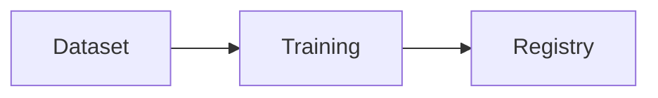

# Contributing to Securing AI Systems

This document is for anyone writing, reviewing or maintaining course content. Students do not need it.

The course is built to a contract. The contract exists because a twenty-module course drifts badly without one: module nine starts inventing its own structure, module fourteen has no laboratory, module nineteen quietly becomes a reading list. Everything below exists to prevent that.

---

## 1. Ways to contribute

| Contribution | Process |
|---|---|
| Fixing a typo, a broken link, or a factual error | Small pull request, one commit, no prior discussion needed |
| Improving an explanation or adding an example | Pull request with a short description of the confusion being fixed |
| Adding a laboratory or exercise | Open an issue first — labs need runtime budgets and data provenance checked |
| Adding a whole module | Not accepted from outside; module scope is fixed by `COURSE_ARCHITECTURE.md` |
| Reporting a security problem in the site itself | See `SECURITY.md` — privately, never in a public issue |
| Reporting a conduct or academic-integrity concern | See `CODE_OF_CONDUCT.md` |

Never open a pull request that adds placeholder content, draft headings without content, or navigation entries pointing at pages that do not exist. An honest absence is better than a promise.

---

## 2. The content contract

Every module must satisfy all seventeen components. This is not guidance; it is the definition of done, and it is checked by the content test suite.

| # | Component | Requirement |
|---|---|---|
| 1 | Front matter | Module id, part, hours, prerequisites, version, last-reviewed date |
| 2 | Why this matters | 250+ words, built on a real, cited failure |
| 3 | Learning outcomes | 4–6 items, measurable verbs, aligned to the module's stated goal |
| 4 | Prerequisites and refresher | What is assumed, and a re-entry point for rusty readers |
| 5 | Conceptual core | 2,500+ words of theory with worked reasoning; maths where the topic requires it |
| 6 | Threat and control mapping | A table using real MITRE ATLAS, OWASP and NIST AI RMF identifiers |
| 7 | Worked demonstration | Tied to a runnable notebook with stated expected output |
| 8 | Laboratory | Setup, steps, numeric success criteria, cleanup, results table |
| 9 | Failure modes | At least five misconceptions, each with the correction |
| 10 | Controls checklist | At least six actionable controls, each with an owner and evidence type |
| 11 | Tiered exercises | 3 recall, 3 apply, 3 extend |
| 12 | Self-check quiz | 10–15 items; rationale lives in instructor material, not on the page |
| 13 | Communicating the risk | A short non-technical summary exercise |
| 14 | Annotated further reading | 5+ items, each with one line on why it is worth reading |
| 15 | Diagram with text description | Every Mermaid diagram paired with a collapsible description |
| 16 | Glossary additions | At least six new terms, defined and cross-linked |
| 17 | Change log entry | What changed and when |

---

## 3. Writing style

**Write to the student, in the second person.** "You will train a model, then poison it." Not "the student will be trained" and not "we will discuss".

**Earn every claim.** If you write "adversarial training improves robustness", follow it with the measurement, the cost, and what it does not protect against. If you write "this is secure", you have written something unverifiable — replace it with the control and the evidence.

**No filler.** No "in today's rapidly evolving landscape", no "it is important to note that", no paragraph that restates its heading. If a sentence could be deleted without losing information, delete it.

**Define before you use.** First use of a term either defines it in a sentence or links to the glossary.

**Show the numbers.** Labs state success criteria as quantities a student can check: "attack success rate ≥ 90 % with mean L∞ perturbation ≤ 8/255", not "the attack should work".

**State the limits.** Every defence section ends with what the defence does not cover and how it can be evaluated adaptively.

**Use the second person for safety instructions too.** "Stop and check the scope statement before running this" is clearer than an impersonal note.

---

## 4. Formatting conventions

### Headings and structure

- Exactly one `h1` per page, taken from the page title.
- Do not skip heading levels.
- Module pages follow the five-page split: `index.md` (theory and demonstration narrative), `lab.md`, `exercises.md`, `quiz.md`.

### Admonitions

Use the type that matches the intent, not the colour you like:

```markdown
!!! note "Why this matters"
    Context that helps but is not essential.

!!! warning "Authorisation required"
    Something the student must not do without permission.

!!! danger "Destructive step"
    Something that can lose work or break an environment.

!!! tip "Shortcut"
    A faster path for an experienced reader.

!!! example "Worked example"
    A concrete instance of the concept just explained.

!!! quote "Primary source"
    A short quotation with attribution and a link.
```

### Code

- Every code block declares a language.
- Python blocks must compile; the content test suite enforces this.
- Run commands are shown per operating system using content tabs.

```markdown
=== "Windows"
    ```bash
    python -m venv .venv
    .venv\Scripts\activate
    ```

=== "macOS / Linux"
    ```bash
    python3 -m venv .venv
    source .venv/bin/activate
    ```
```

### Diagrams

Mermaid only, never a screenshot of a diagram.

```markdown


??? note "Diagram description"
    A left-to-right flow: the dataset feeds training, whose output is stored
    in the model registry.
```

The description block is mandatory. A Mermaid diagram is invisible to a screen reader; the description is not.

### Tables

Use tables for anything with three or more parallel attributes. Keep cells short; move prose out of the table.

### Citations

Cite by identifier from `docs/references.md`. Never invent a citation, and never cite a framework version you have not opened.

**Standards are cited, never reproduced.** ISO/IEC documents are copyrighted and must be purchased; you may describe a control area, not quote it. NIST publications are US Government works and may be quoted with attribution. EU legal text may be quoted under EUR-Lex reuse terms with attribution.

---

## 5. Laboratories

A laboratory is not a demonstration with the cells deleted. Every brief in `labs/student/Lxx/LAB.md` follows the
same 22 numbered sections (sections 1–17 are the teaching material, 18–22 are the safety and hygiene contract):

| Sections | What they carry |
|---|---|
| 1–6 | Scenario, problem statement, learning objectives, prerequisites, required software, dataset and inputs |
| 7–11 | Detailed instructions, Python implementation, expected results, interpretation, student tasks |
| 12–17 | Challenge exercises, hints, solution pointer, troubleshooting, security lessons, submission |
| **18. Acceptable use** | What the lab may be run against, and that everything else is out of bounds |
| **19. Scope restrictions** | The specific targets and techniques that are off limits for this lab |
| **20. Data handling** | What the data is, why it is synthetic, and how it must be kept |
| **21. Cleanup** | The files and processes this lab creates, and how to remove them |
| **22. Restoring your environment** | What was installed or started, and how to get back to a clean state |

Sections 18–22 must be **written for that lab**, not copied between briefs: a lab that trains a model, a lab that
loads a bundle and a lab that starts a service leave different things behind. Offensive labs must target only
synthetic, self-owned assets inside the lab sandbox, and the scope section must say so in the lab's own terms.

Also required: a runtime budget under 20 minutes on a laptop CPU with no GPU, a fixed seed so two runs agree, and
numeric success criteria the student can check without asking anyone.

---

### 6.1 Notebook output policy

Notebooks are committed **with** their outputs. A student browsing the repository on GitHub should see what a cell
produces without installing anything, and a reviewer should be able to tell whether a change altered the numbers.

That permission is bounded, and `scripts/check_notebooks.py` enforces the bounds in CI:

| Rule | Why |
|---|---|
| Valid `nbformat` 4 with a `python3` kernel | The notebook must run from a fresh kernel on another machine |
| No absolute local paths in any output | `C:\Users\...` and `/home/...` leak a machine and break the reader's trust in the result |
| No single output above 200 KB, no notebook above 250 KB | Large blobs bloat the repository and make diffs unreadable |
| Outputs must be regenerable by running the notebook | A committed output that the code no longer produces is a false claim |
| No timings, memory addresses or random identifiers in outputs | They differ on every machine and carry no teaching value |

**Two copies, one source of truth.** Each notebook exists at `notebooks/Mxx/…ipynb` (where it is executed and
validated) and at `docs/notebooks/Mxx/…ipynb` (the copy the website serves for download). Edit the root copy, run it
end to end, then copy it over the published one:

```bash
cp notebooks/M05/03-deidentification-and-linkage.ipynb docs/notebooks/M05/
```

`scripts/check_notebooks.py` fails on any difference between the two, so a published notebook cannot drift away from
the version the course actually executes.

If an output cannot meet these rules — a huge dataframe dump, a progress bar, a filename — delete that output rather
than commit it, and say in the surrounding prose what the reader should see.

## 6. Pull request checklist

Before opening a pull request, confirm:

- [ ] `mkdocs build --strict` passes locally.
- [ ] `python scripts/check_links.py` and `python scripts/verify_site.py site` pass — the same two gates CI runs (see `DEPLOYMENT.md` §8).
- [ ] The content tests pass.
- [ ] No `TODO`, `TBD`, `lorem ipsum`, or "coming soon" anywhere in the diff.
- [ ] Every new page appears in `nav` in `mkdocs.yml`.
- [ ] Every diagram has a text description; every image has meaningful alt text.
- [ ] No absolute local paths, tokens, keys, or personal data in any file.
- [ ] Notebooks follow the committed-output policy (§6.1): outputs kept where they help self-study, no absolute paths, no notebook over 250 KB, and `python scripts/check_notebooks.py` passes.
- [ ] Any new library, dataset, image or adapted code sample has a row in `ATTRIBUTION.md`, with its licence and the obligation that licence creates.
- [ ] No third-party text, figure or standard is reproduced; it is cited instead.
- [ ] No analytics, tracker, CDN or account-gated service has been added, and the site still makes no third-party runtime request.
- [ ] The change is described in one or two sentences in the pull request body.
- [ ] Instructor-only material is under `docs/instructor/` and therefore excluded from the build.

---

## 7. Review standards

A reviewer checks three things, in this order:

1. **Is it true?** Does the claim hold, is the citation real, is the version current?
2. **Is it safe?** Could a student follow this and cause harm, to themselves, to others, or to a system they do not own?
3. **Is it teachable?** Could a motivated third-year student with the stated prerequisites follow it without the author present?

Style comes fourth. Do not merge a change that fails the first three.

---

## 8. Content review cadence

Every module is reviewed at least once per academic year, and immediately after a relevant framework release. The review records what changed outside the course and what changed inside it. Framework versions, access dates and review dates are tracked in `docs/references.md`.

---

## 9. Licensing, attribution and conduct

Three constraints apply to every contribution, and a pull request that breaks one is not merged however good the content is.

### 9.1 What a contribution is licensed as

The course is not yet licensed (`LICENSING.md`, owner decision D-01), so this is the position in the meantime: by opening a pull request you confirm that you wrote the contribution, or that you have the right to submit it, and you agree that it may be published under the licences the owner records — the recommendation being MIT for code, CC BY 4.0 for content, CC0 1.0 for synthetic data. Do not paste in material whose licence you cannot name.

Once the licence files exist, this section is replaced by the recorded terms and the contribution is taken to be under them.

### 9.2 Attribution is part of the change

- Add a row to `ATTRIBUTION.md` for any new library, dataset, image, vendored file or code sample adapted from elsewhere, **in the same pull request**. Include the licence and what it obliges the course to do.
- Cite research at the point of use, with a venue and an identifier. The bibliography lives in `docs/references.md`; the annotated entries are in `docs/research/`.
- Standards are described, never quoted. ISO/IEC text is copyrighted and sold; NIST and EU text may be quoted with attribution.
- No third-party image, screenshot or logo goes in without a recorded licence. If the licence is unclear, the image does not go in.

### 9.3 Student-facing additions must not contradict the public statements

If a change affects what the course stores, what it fetches, or what a student is permitted to do, update the matching page in the same pull request:

| Statement | Lives in |
|---|---|
| What the site stores and does not store | `docs/getting-started/privacy.md` |
| Rules on tools, testing, citation, data and disclosure | `docs/getting-started/academic-integrity.md` |
| What is third-party and how to cite it | `docs/attribution.md`, `ATTRIBUTION.md` |
| Security reporting for the site itself | `SECURITY.md` |
| Expected behaviour in reviews and discussions | `CODE_OF_CONDUCT.md` |

A tracker added without changing the privacy page is a contradiction, and it is treated as a defect rather than a detail.

---

*Instructor: Engr. Dr. Muhammad Nadeem Majeed, Department of Data Science (PUCIT), University of the Punjab, Lahore.*
