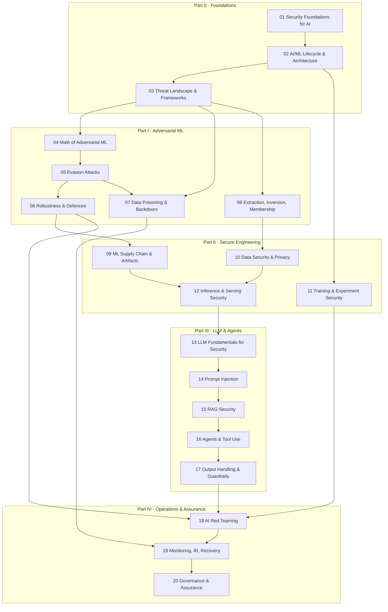
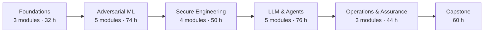
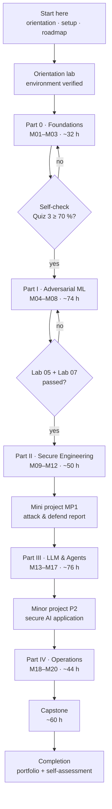
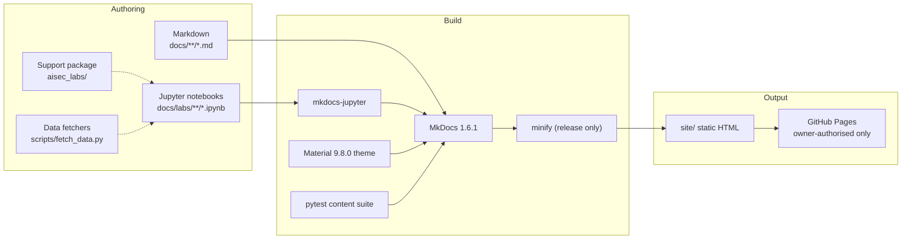

# Course Architecture — Securing AI Systems

**Document ID:** `SAS-ARCH-001`
**Phase:** 01 — Repository Inspection and Architecture
**Course:** Securing AI Systems — undergraduate elective/core for BS Data Science
**Instructor of record:** Engr. Dr. Muhammad Nadeem Majeed — Professor, Department of Data Science (PUCIT), University of the Punjab, Lahore
**Audience:** BS Data Science students, 3rd–4th year, with Python and introductory ML
**Delivery:** self-study website (MkDocs Material), notebooks, laboratories, scenario assignments, projects, capstone
**Status:** architecture proposal — no lesson content authored yet (by design)

---

## 1. Design philosophy

Four commitments shape every later decision.

**1.1 Security is a property of the whole pipeline, not a model file.**
Students are taught to reason about *systems*: data collection → labelling → training → packaging → deployment → monitoring → retirement. A control that protects only the `.pt` file while training data is world-writable is theatre. Module 2 establishes this lifecycle view before any attack is introduced, so later techniques attach to a place in the system.

**1.2 Attacks are taught with their defences, and defences with their evaluations.**
Every offensive module ends in detection, mitigation and residual risk. Every defensive module ends in an evaluation: *does the defence hold under an adaptive attacker?* This prevents the most common failure in AI-security teaching — students who memorise "adversarial training fixes evasion" and never learn about gradient masking, robust overfitting, or the accuracy/robustness trade-off.

**1.3 Reproducibility is the difference between a course and a slide deck.**
Every claim is paired with runnable code, a fixed random seed, a named dataset or pinned model revision, and an expected result. A student must be able to reproduce a poisoned model's backdoor success rate on their own machine, offline, without an account or API key.

**1.4 Ethics and authorisation are engineering requirements, not an opening disclaimer.**
Offensive techniques are introduced only with their legal and ethical boundary, and Module 18 makes authorisation, scope and rules of engagement a graded deliverable. The course never contains operational guidance against third-party systems; labs target synthetic data and models the student owns.

---

## 2. Intended learning outcomes (ILOs)

On completion, a student can:

| ILO | Statement | Assessed by |
|---|---|---|
| **ILO-1** | Explain the security requirements of an AI system and map them to its lifecycle and trust boundaries | Modules 1–3; Quiz 3; Assignment A1 |
| **ILO-2** | Identify and classify threats across the AI/ML pipeline using recognised frameworks | Modules 3, 9, 19; ATLAS mapping exercise |
| **ILO-3** | Explain adversarial machine learning theory, including the optimisation view of evasion and its limits | Module 4; Quiz 4; problem set |
| **ILO-4** | Execute and evaluate evasion, poisoning and extraction attacks against models they trained | Modules 5, 7, 8; Labs 5, 7, 8 |
| **ILO-5** | Select, implement and critically evaluate defences against those attacks | Module 6; Lab 6; Project P1 |
| **ILO-6** | Secure datasets, models, training infrastructure and inference services | Modules 9–12; Labs 9–12 |
| **ILO-7** | Analyse LLM and generative-AI vulnerabilities, distinguishing structural from implementation flaws | Modules 13–17; Quizzes 13–17 |
| **ILO-8** | Design and harden prompt processing, retrieval (RAG) and agentic tool-use systems | Modules 14–16; Labs 14–16; Project P2 |
| **ILO-9** | Apply secure AI application development practices (input handling, output handling, least privilege, secrets) | Modules 9, 12, 17; code review exercise |
| **ILO-10** | Plan and conduct a scoped, authorised AI red-team engagement and report findings with severity | Module 18; Assignment A3; Capstone |
| **ILO-11** | Design monitoring, detection, response and recovery for a production AI system | Module 19; Lab 19; Capstone |
| **ILO-12** | Apply governance frameworks and produce assurance documentation for an AI system | Module 20; Capstone documentation set |

### 2.1 Mapping of the ten course objectives to modules

| Objective (from the brief) | Primary modules | Reinforced in |
|---|---|---|
| 1. Security requirements of AI systems | 1, 2, 3 | 20 |
| 2. Threats affecting AI/ML pipelines | 3, 9 | 18, 19 |
| 3. Adversarial machine learning | 4, 5, 6 | 7, 8 |
| 4. Detect and mitigate poisoning and model attacks | 7, 8 | 19 |
| 5. Secure datasets, models, training, inference | 9, 10, 11, 12 | 17 |
| 6. LLM and generative-AI vulnerabilities | 13, 14, 17 | 15, 16 |
| 7. Secure prompt processing, RAG, agents | 14, 15, 16 | 17 |
| 8. Secure AI application development | 9, 12, 17 | 20 |
| 9. Controlled AI security testing and red teaming | 18 | 5, 7, 8 |
| 10. Monitor, protect and recover production AI | 19 | 20, capstone |

---

## 3. Curriculum map: five parts, twenty modules





### 3.1 Module summary table

Guided hours include reading, worked demonstration, self-check quiz and exercises; lab hours are separate and listed in the per-module detail. Total guided + lab time per module varies with practical depth.

| # | Module | Part | Guided h | Lab h | Prereqs | Signature practical |
|---|---|---|---|---|---|---|
| 01 | Security Foundations for AI Systems | 0 | 7 | 3 | None | Threat-model a loan-scoring system |
| 02 | AI/ML System Lifecycle and Architecture | 0 | 7 | 3 | 01 | Map data/artefact flows; find trust boundaries |
| 03 | Threat Landscape and Security Frameworks | 0 | 9 | 3 | 02 | ATLAS + OWASP risk register for a system |
| 04 | Mathematical Foundations of Adversarial ML | I | 10 | 4 | 03, calculus, linear algebra | Derive and implement FGSM by hand |
| 05 | Evasion Attacks | I | 11 | 5 | 04 | PGD/C&W benchmark with an epsilon sweep |
| 06 | Adversarial Robustness and Defences | I | 10 | 4 | 05 | Adversarial training vs certified smoothing |
| 07 | Data Poisoning and Backdoor Attacks | I | 11 | 5 | 05 | Train BadNets-style backdoor; detect it |
| 08 | Model Extraction, Inversion, Membership Inference | I | 10 | 4 | 05, 10 basics | Membership-inference attack + DP mitigation |
| 09 | ML Supply Chain and Model Artifact Security | II | 9 | 3 | 03 | Audit a malicious pickle; hash-pin a model |
| 10 | Data Security and Privacy Engineering | II | 9 | 3 | 08 | De-identify a dataset; measure re-identification risk |
| 11 | Secure Training and Experiment Infrastructure | II | 9 | 3 | 02, 09 | Harden a training pipeline; secret-free config |
| 12 | Secure Inference and Serving | II | 10 | 4 | 09, 11 | Harden a FastAPI model service; abuse tests |
| 13 | LLM Fundamentals for Security Engineers | III | 9 | 3 | 05 (or waiver) | Tokeniser/context/decoding experiments |
| 14 | Prompt Injection and LLM Application Attacks | III | 11 | 5 | 13 | Reproduce direct + indirect injection; build layered defence |
| 15 | Retrieval-Augmented Generation Security | III | 11 | 5 | 14, 10 | Break and fix per-user ACLs in a RAG app |
| 16 | AI Agents and Tool-Use Security | III | 13 | 5 | 15, 12 | Sandbox an agent; stop a confused-deputy chain |
| 17 | Output Handling, Guardrails, GenAI Supply Chain | III | 10 | 4 | 14, 09 | Unsafe-output exploit + guardrail evaluation |
| 18 | AI Red Teaming and Controlled Security Testing | IV | 11 | 5 | 16, 06 | Scoped red-team engagement on a supplied system |
| 19 | Monitoring, Detection, Incident Response, Recovery | IV | 10 | 4 | 07, 18 | Build telemetry + an IR playbook; run a tabletop |
| 20 | Governance, Compliance and Assurance | IV | 11 | 3 | 19 | Produce a system card + RMF-based assurance case |

**Module study total: 276 h** — 198 h of guided reading, demonstrations, exercises and quizzes, plus 78 h of laboratory work. Adding assignments (24 h), mini projects (40 h), major projects (50 h) and the capstone (60 h) gives a **whole-course total of 450 h** (see Section 5.3).

---

## 4. Module specifications

Each block below is the authoritative scope definition for that module. Full authoring follows the Module Blueprint Contract in Section 7; nothing outside these scopes is added without a recorded change.

### Part 0 — Foundations

#### Module 01 — Security Foundations for AI Systems
**Outcomes:** define confidentiality/integrity/availability for ML assets; distinguish security from safety, privacy and robustness; identify assets, actors, trust boundaries and attack surfaces in an AI system; build a first threat model; explain why classical assumptions (deterministic input, code-only attack surface) break for learned systems.
**Topics:** security fundamentals refreshed for ML contexts; the AI asset inventory (data, labels, features, weights, hyperparameters, prompts, embeddings, logs, infrastructure, reputation); attacker goals and capabilities; trust boundaries at data ingestion, training, registry, inference, and human-in-the-loop; security vs safety vs fairness vs privacy trade-offs; threat modelling with STRIDE adapted to ML; risk = likelihood × impact with uncertainty; introducing "the model is an input, not just code".
**Practical:** threat-model a loan-scoring system from a supplied architecture brief; produce an asset/actor/boundary table and a top-10 risk register.
**Assessment:** Quiz 1 (12 items) + threat-model worksheet (rubric).
**Sources:** NIST AI RMF 1.0 (AI 100-1); NIST SP 800-30 Rev.1; OWASP ML Top 10 (2023); Shostack, *Threat Modeling: Designing for Security*.

#### Module 02 — AI/ML System Lifecycle and Architecture
**Outcomes:** describe the seven-stage ML lifecycle and the artefacts crossing each boundary; identify where controls must sit; explain data lineage and provenance; read a real ML deployment architecture and find its weak links; distinguish training-time from inference-time exposure.
**Topics:** problem framing → data acquisition → labelling → feature engineering → training → evaluation → packaging → serving → monitoring → retirement; feature stores and training/serving skew; experiment tracking and model registries; batch vs real-time vs edge inference; MLOps vs MLSecOps; artefact immutability and provenance (data cards, model cards); environment parity; the "shadow pipeline" problem (notebooks in production).
**Practical:** given a supplied deployment diagram (batch scoring + online API + analytics warehouse), map every artefact flow and annotate trust boundaries and missing controls.
**Assessment:** Quiz 2 + architecture annotation task.
**Sources:** Sculley et al., "Hidden Technical Debt in Machine Learning Systems" (NeurIPS 2015); Google *ML Test Score*; NIST AI RMF *Map* function; ISO/IEC 42001 Annex A control areas (described, not reproduced).

#### Module 03 — Threat Landscape and Security Frameworks
**Outcomes:** classify AI threats with a shared vocabulary; navigate MITRE ATLAS tactics/techniques; use the OWASP ML and LLM Top 10 lists without treating them as exhaustive; apply NIST AI RMF functions (Govern/Map/Measure/Manage) to a scenario; explain where ISO/IEC 42001 and the EU AI Act create obligations; write a threat register that an engineer can act on.
**Topics:** adversary types (insider, external, supply chain, automated scraping, model-reuse adversary); ATLAS tactic walkthrough mapped to the lifecycle; taxonomy of attacks (evasion, poisoning, extraction, inference, abuse, injection); why benchmark attack lists date quickly; framework interoperation (ATLAS ↔ OWASP ↔ RMF ↔ 42001); risk scoring for AI (CVSS 4.0 base plus an AI overlay for model integrity, data confidentiality and agent authority); documentation duties.
**Practical:** build a threat register for a supplied system combining ATLAS technique IDs, OWASP categories, RMF function and a severity score with justification.
**Assessment:** Quiz 3 + **Assignment A1** (threat register + executive summary, 1,200 words).
**Sources:** MITRE ATLAS; OWASP Top 10 for LLM Applications (2025); OWASP Machine Learning Security Top 10 (2023); NIST AI 100-1; NIST AI 600-1; ISO/IEC 23894:2023 and 42001:2023 (cited, not reproduced); EU AI Act (Regulation (EU) 2024/1689) — risk tiers, with implementation dates flagged as subject to amendment.

### Part I — Adversarial Machine Learning

#### Module 04 — Mathematical Foundations of Adversarial ML
**Outcomes:** formulate evasion as a constrained optimisation problem; explain perturbation budgets (L0/L2/L∞), epsilon selection and why the norm choice changes the threat model; reason about decision boundaries, loss-surface geometry and gradient availability; distinguish white-box, grey-box, black-box and transfer settings; explain why robustness is not monotone in model accuracy.
**Topics:** classifier notation and expected risk; the adversarial objective; linearity hypothesis and the fast gradient sign derivation; first-order approximations and their limits; attack strength vs perceptibility; attack taxonomy by adversary knowledge and goal (untargeted/targeted); transferability and why ensembles help attackers; evaluation pitfalls (attack-strength confounds, seed sensitivity, adaptive attacks).
**Practical:** derive FGSM analytically on paper, then implement it with autograd on a two-moon and a small CNN classifier; sweep epsilon and plot accuracy vs perturbation.
**Assessment:** Quiz 4 + problem set (derivations + code).
**Sources:** Goodfellow, Shlens & Szegedy (2015); Szegedy et al. (2014); Madry et al. (2018); Tramèr et al. (2018) on adaptive evaluation.

#### Module 05 — Evasion Attacks
**Outcomes:** implement and compare FGSM, PGD, C&W and a decision-based black-box attack; choose an attack appropriate to a stated adversary model; evaluate attack success correctly; explain physical-world and real-time constraints.
**Topics:** iterative attacks and step-size/iteration trade-offs; C&W margin formulation; DeepFool minimal perturbations; black-box score- and decision-based attacks, query budgets; transfer and surrogate models; attacks on tabular, image and text modalities (with text-specific constraints); physically realisable attacks and expectation-over-transformation; realistic attack cost accounting.
**Practical (Lab 05):** benchmark four attacks against a supplied baseline CNN under a fixed budget; produce a comparison table with success rate, mean perturbation and query count; then attack a simple spam filter to show modality differences.
**Assessment:** Quiz 5 + lab report (rubric) + **Mini project MP1 begins**.
**Sources:** Goodfellow et al. (2015); Kurakin et al. (2017); Carlini & Wagner (2017); Moosavi-Dezfooli et al. (2016); Brendel et al. (2018); Adversarial Robustness Toolbox documentation.

#### Module 06 — Adversarial Robustness and Defences
**Outcomes:** explain and implement adversarial training (including PGD-AT and TRADES); describe certified defences (randomised smoothing, interval-bound propagation) and what "certified" actually guarantees; recognise gradient masking and false robustness; run an adaptive evaluation; articulate the accuracy–robustness trade-off and its cost.
**Topics:** adversarial training variants and robust overfitting; TRADES trade-off term; randomised smoothing with certified radii; IBP and abstract interpretation (conceptual + small demo); input preprocessing and why most of it fails; detection-based defences and their evasion; gradient masking pathologies; evaluation protocol for defences (adaptive attacks, held-out attack suite, compute parity); cost of robustness in latency and accuracy.
**Practical (Lab 06):** train a standard model, a PGD-AT model and a smoothed model on the same data; evaluate all three against a held-out adaptive attack; report accuracy, robust accuracy and certified radius; document where each defence fails.
**Assessment:** Quiz 6 + lab report + **Project P1 assigned** (robustness evaluation study).
**Sources:** Madry et al. (2018); Zhang et al. (2019, TRADES); Cohen, Rosenfeld & Kolter (2019); Gowal et al. (2019); Athalye, Carlini & Wagner (2018) on obfuscated gradients; Croce & Hein (2020) on reliable evaluation.

#### Module 07 — Data Poisoning and Backdoor Attacks
**Outcomes:** distinguish availability, targeted and backdoor poisoning; implement a trigger-based backdoor; measure attack success and clean accuracy impact; detect poisoning via data inspection, spectral signatures and activation clustering; design mitigation (data sanitisation, robust training, provenance, trigger scanning); explain clean-label and subpopulation attacks.
**Topics:** threat models for poisoning (fraction control, label control, feature control); BadNets and blended triggers; clean-label attacks and feature-collision intuition; subpopulation/backdoor in federated settings (conceptual); supply-chain entry points (public datasets, crowd labelling, pretrained weights); detection: duplicate/near-duplicate analysis, spectral signatures, activation clustering, trigger reverse-engineering; mitigation: curation, differential privacy as a bound, robust aggregation, model sanitisation, provenance and signing; measuring the security/utility trade-off.
**Practical (Lab 07):** train a clean model and a backdoored model on a small image dataset; achieve a stated attack success rate with ≤2 % poisoned samples; then detect the backdoor with activation clustering and remove it; report before/after metrics.
**Assessment:** Quiz 7 + lab report + **Assignment A2** (poisoning threat assessment for a data-collection scenario).
**Sources:** Gu et al. (2017, BadNets); Chen et al. (2017); Turner et al. (2019); Tran, Li & Madry (2018); Carlini (2021) on poisoning defences; Biggio, Nelson & Laskov (2012).

#### Module 08 — Model Extraction, Inversion and Membership Inference
**Outcomes:** explain confidentiality attacks on models and training data; run a membership-inference attack and interpret its advantage; explain model inversion and attribute inference; describe model stealing and its business impact; apply differential privacy (DP-SGD) and measure the privacy/utility trade-off; use watermarking and fingerprinting for ownership.
**Topics:** privacy threat model (what the adversary knows, what leaks); membership inference (shadow models, confidence-threshold baselines, why overfitting drives leakage); attribute and property inference; model inversion and reconstruction; extraction/stealing attacks and query budgets; defences: output perturbation, confidence masking caveats, regularisation, DP-SGD with an epsilon budget, private aggregation; ownership: watermarks, fingerprints and their removal; regulatory overlap (personal data, model as personal data).
**Practical (Lab 08):** train an overfitted model, attack it with a shadow-model membership inference, then retrain with DP-SGD at two epsilon values and compare attack advantage, accuracy and calibration.
**Assessment:** Quiz 8 + lab report.
**Sources:** Shokri et al. (2017); Fredrikson et al. (2015); Carlini et al. (2022) on privacy metrics; Tramèr et al. (2016); Abadi et al. (2016, DP-SGD); Opacus and diffprivlib documentation.

### Part II — Secure ML Engineering

#### Module 09 — ML Supply Chain and Model Artifact Security
**Outcomes:** explain why model files are executable attack surface; identify risky formats (pickle) and safe alternatives (safetensors, ONNX with restrictions); audit a model repository before loading it; hash-pin and verify artefacts; produce an ML-BOM; apply least privilege to model loading.
**Topics:** the ML supply chain (datasets, base models, fine-tunes, tokenisers, plugins, notebooks, container images); pickle deserialisation and arbitrary code execution; `torch.load` history and safe loading modes; `trust_remote_code` and its consequences; scanning (`picklescan`, `fickling`, `bandit`, `pip-audit`, `trivy`); artefact integrity (SHA-256 pinning, revision pinning, signatures via Sigstore/OpenSSF model-signing); SBOM and ML-BOM (CycloneDX ML extensions); licence and provenance metadata; Typosquatting and dependency confusion in ML packages.
**Practical (Lab 09):** statically audit a supplied model bundle; identify a malicious payload without executing it; produce a hash manifest and an ML-BOM; convert to a safe format; document a verification procedure a CI job can enforce.
**Assessment:** Quiz 9 + lab report + a "would you load this?" decision exercise.
**Sources:** Python `pickle` documentation; Hugging Face security guidance; safetensors documentation; Sigstore/model-signing and OpenSSF projects; CycloneDX specification; OWASP LLM03/ML supply-chain guidance.

#### Module 10 — Data Security and Privacy Engineering
**Outcomes:** classify data by sensitivity and apply handling rules; implement de-identification and measure residual re-identification risk; apply k-anonymity, l-diversity and differential privacy appropriately; design access control and lineage for a dataset; recognise dataset documentation duties.
**Topics:** data classification and mapping; lawful basis and minimisation (concept-level); direct/indirect identifiers and quasi-identifiers; k-anonymity and its attacks; l-diversity, t-closeness (brief); synthetic data and its pitfalls; differential privacy for aggregates; secure storage and encryption at rest/in transit; access control models for feature stores and lakehouses; row/column-level policies; lineage and provenance; labelling security (annotator access, label tampering); PII detection tooling.
**Practical (Lab 10):** take a supplied customer table, apply generalisation and suppression, attack your own anonymisation with a linkage attack, then quantify risk and propose a DP alternative.
**Assessment:** Quiz 10 + lab report + privacy impact assessment excerpt.
**Sources:** NIST SP 800-188 (de-identification); Sweeney (2002); Machanavajjhala et al. (2006); Dwork & Roth (2014); GDPR principles (described); Presidio documentation.

#### Module 11 — Secure Training and Experiment Infrastructure
**Outcomes:** design least-privilege access for training environments; eliminate secret sprawl; harden notebooks and CI for ML; make training reproducible and tamper-evident; apply DevSecOps controls to an ML pipeline.
**Topics:** identity and RBAC for notebooks, clusters and registries; secret management (no `.env` in repos, no keys in notebooks, no tokens in logs); multi-tenant notebook risk (shared kernels, stale environments, exposed dashboards); dependency pinning and lockfiles; container image hardening for GPU workloads; CI/CD for ML (data validation gates, model tests, artefact signing); reproducible training (seeds, determinism, environment capture); experiment-tracking exposure; audit logging; cost-abuse as a security concern.
**Practical (Lab 11):** review a deliberately vulnerable training repository; find five security defects (hard-coded token, unpinned dependency, shared writable cache, unsanitised dataset download, world-readable registry); fix them and add a CI gate that would catch each.
**Assessment:** Quiz 11 + code-review report.
**Sources:** NIST SP 800-53 (selected control families, described); CIS Benchmarks (referenced); OWASP Top 10 CI/CD Security Risks; SLSA framework.

#### Module 12 — Secure Inference and Serving
**Outcomes:** threat-model a model API; implement authentication, authorisation and quota controls; defend against resource-exhaustion and model-abuse patterns; harden a model server and its dependencies; explain confidential computing options and their limits.
**Topics:** inference threat model (unauthenticated access, key theft, scraping for extraction, adversarial queries, denial of service, prompt/cost abuse); API security (authn, scopes, per-tenant rate limits, request size and token limits, timeouts); input validation for tensors and text; batching and queue abuse; model-server hardening (non-root, read-only FS, no debug endpoints, pinned images); logging without leaking inputs; side-channel and timing considerations; TEEs/confidential computing and attestation (conceptual); canary models and abuse detection; graceful degradation and kill switches.
**Practical (Lab 12):** harden a supplied FastAPI + TorchServe-style service: add auth, quotas, input limits and structured audit logs; then run a scripted abuse suite and show the before/after results.
**Assessment:** Quiz 12 + lab report + **Project P2 assigned** (secure an end-to-end application).
**Sources:** OWASP API Security Top 10; NIST SP 800-125B (virtualisation); cloud provider inference-hardening guidance; OWASP LLM10 (unbounded consumption).

### Part III — LLM and Generative AI Security

#### Module 13 — LLM Fundamentals for Security Engineers
**Outcomes:** explain tokenisation, embeddings, attention and decoding in the terms a security engineer needs; distinguish instructions from data in a single context window; explain why prompt injection follows from architecture, not from a bug; describe training and fine-tuning pipelines for risk analysis.
**Topics:** tokeniser behaviour and why character-level filters fail; context window as a shared, unprivileged channel; system vs user vs tool roles and their non-enforceability; sampling parameters and determinism; embeddings and semantic similarity; pretraining, instruction tuning, RLHF and fine-tuning as supply-chain stages; model families and local inference options; what an LLM cannot do (no reliable instruction/data separation, no reliable self-verification).
**Practical:** run a local small model; measure how tokenisation splits adversarial strings; test role-confusion behaviour; demonstrate that the same prompt yields different outputs at temperature > 0.
**Assessment:** Quiz 13 + notebook exercises.
**Sources:** Vaswani et al. (2017); Ouyang et al. (2022); model documentation for a pinned open-weights model.

#### Module 14 — Prompt Injection and LLM Application Attacks
**Outcomes:** distinguish direct from indirect injection and goal hijacking from prompt leaking; reproduce both classes against a small application; explain why filtering alone cannot solve injection; design layered defences (privilege separation, spotlighting, dual-LLM pattern, output constraints, human confirmation); measure defence effectiveness against an attack suite.
**Topics:** the injection class (OWASP LLM01); direct vs indirect vectors (documents, web pages, emails, tool outputs, images/OCR, retrieved chunks); jailbreak families (role-play, encoding, translation, multi-turn, suffix optimisation) and why they differ from injection; system-prompt leakage (LLM07); defence-in-depth: input classification, instruction hierarchy heuristics, content provenance marking, capability restriction, least-privilege tools, output allowlists, human-in-the-loop for side effects; why "prompt hardening" is not a security boundary; evaluation with a fixed attack corpus.
**Practical (Lab 14):** build a small document-summarising assistant; inject via a supplied "web page"; achieve a defined goal hijack; then add three defence layers and re-run the same corpus, reporting which attacks still succeed.
**Assessment:** Quiz 14 + lab report + **Assignment A3** (injection risk assessment for a described product).
**Sources:** Perez & Ribeiro (2022); Greshake et al. (2023); Wei, Wang & Wang (2023); Zou et al. (2023, GCG); OWASP Top 10 for LLM Applications 2025 (LLM01, LLM07); NIST AI 600-1.

#### Module 15 — Retrieval-Augmented Generation Security
**Outcomes:** threat-model a RAG pipeline end to end; break and then enforce per-user document access control; explain embedding-level privacy leakage; defend against knowledge-base poisoning and citation manipulation; reason about tenancy isolation in vector stores.
**Topics:** RAG architecture (ingest → chunk → embed → index → retrieve → rerank → generate); access control placement (at ingestion, at query, at generation) and the "filter after retrieval" anti-pattern; metadata filters and their bypass; cross-tenant leakage; embedding inversion and membership inference on the index; document poisoning and stale/poisoned sources; prompt injection carried by retrieved text; citation and influence tracing; chunking effects on leakage; deletion and right-to-be-forgotten in vector indexes; OWASP LLM08.
**Practical (Lab 15):** given a three-tenant RAG application with a deliberate ACL bug, retrieve another tenant's document, then implement query-time authorisation enforced in the retrieval layer and prove the attack fails while recall stays acceptable.
**Assessment:** Quiz 15 + lab report.
**Sources:** Lewis et al. (2020, RAG); OWASP LLM08 (vector and embedding weaknesses); vector database security documentation; academic work on embedding inversion.

#### Module 16 — AI Agents and Tool-Use Security
**Outcomes:** enumerate agent-specific threats (excessive agency, confused deputy, tool poisoning, memory poisoning); design tool permissions with least privilege and explicit confirmation; sandbox code execution; secure agent identity and delegation; constrain multi-step plans; test an agent against an adversarial environment.
**Topics:** agent loops, planners, memory, tool schemas; the authority problem (an agent acts with the union of its tools' permissions); excessive agency (LLM06); tool/function-calling risks; MCP-style tool servers and their trust model; indirect injection through tool output; memory and state poisoning across sessions; credential delegation and OAuth scope minimisation; sandboxing (containers, seccomp, network egress control, no-shell policies); human-in-the-loop for irreversible actions; rate/loop and cost limits; logging agent decisions for audit; OWASP LLM06 and agentic threat guidance.
**Practical (Lab 16):** build a two-tool agent (read file, send HTTP request) in a sandbox; craft an indirect injection that makes it exfiltrate a canary token; then apply egress allowlisting, tool-scope reduction, output validation and confirmation gates until the attack fails; document residual risk.
**Assessment:** Quiz 16 + lab report + **Mini project MP2**.
**Sources:** OWASP LLM06 (excessive agency) and agentic-AI threat guidance; NIST AI 600-1; vendor guidance on tool-use security; container sandboxing documentation.

#### Module 17 — Output Handling, Guardrails and GenAI Supply Chain
**Outcomes:** explain why model output is untrusted input; identify injection sinks (HTML, SQL, shell, code interpreters, HTTP clients); design output validation and encoding; assemble and *evaluate* a guardrail stack; assess fine-tuned and third-party model risk.
**Topics:** improper output handling (OWASP LLM05): stored XSS, SQL injection via generated queries, command execution, SSRF, unsafe `eval`, markdown/HTML rendering; structured output and schema validation; escaping and contextual encoding; code-interpreter sandboxing and generated-code review; guardrails: input classifiers, output filters, PII redaction, topic restriction, toxicity and jailbreak detectors, and their false-positive/negative costs; measuring a guardrail (precision/recall against a labelled corpus, latency, bypass suite); GenAI supply chain: model provenance, hash pinning, fine-tune poisoning, adapter and plugin risk, licence compliance; misinformation (LLM09) and grounding.
**Practical (Lab 17):** a chat app renders model output as HTML; exploit it with a crafted response; fix with schema validation plus contextual encoding; then evaluate a guardrail classifier's recall against a small labelled attack set and report the operational trade-off.
**Assessment:** Quiz 17 + lab report.
**Sources:** OWASP LLM05/LLM09; OWASP Top 10 (web) A03; NIST AI 600-1; secure-coding guidance for the language used in the lab.

### Part IV — Operations, Assurance and Practice

#### Module 18 — AI Red Teaming and Controlled Security Testing
**Outcomes:** scope an engagement and write rules of engagement; obtain and document authorisation; select techniques per objective; run manual and automated testing; triage findings and assign severity; write a report a product team can act on.
**Topics:** red team vs penetration test vs evaluation vs audit; authorisation, scope, safe harbour, data handling and stop conditions; threat-model-driven test planning; test corpora and benchmarks (harm/jailbreak/injection datasets) and their limitations; automation with established tooling (e.g. garak, PyRIT, promptfoo-style harnesses) and why automation is not a substitute for judgement; measuring ASR correctly (denominators, deduplication, repeated trials); severity for AI findings (CVSS 4.0 base + AI overlay: model integrity, data confidentiality, action authority, blast radius); evidence handling and minimal-impact proof-of-concept; report structure, remediation guidance and retest.
**Practical (Lab 18):** run a scoped, time-boxed engagement against a supplied intentionally vulnerable application inside a sandbox; produce a rules-of-engagement document, findings register with severity and evidence, and a retest plan. No target outside the sandbox is in scope.
**Assessment:** Quiz 18 + engagement report (rubric) + **Capstone proposal**.
**Sources:** NIST AI 600-1; OWASP LLM Top 10; MITRE ATLAS; PTES-style engagement structure; bug-bounty programme norms.

#### Module 19 — Monitoring, Detection, Incident Response and Recovery
**Outcomes:** design telemetry for AI-specific abuse; detect drift, poisoning symptoms and injection attempts; build detection rules and tune them; write an AI incident-response playbook; rehearse containment, eradication and recovery; plan model rollback and retirement.
**Topics:** what to log and what never to log (prompt PII, secrets, raw documents); structured events and correlation IDs; abuse and extraction detection (query-pattern anomalies, credential usage anomalies, cost spikes); data drift vs concept drift vs malicious drift; integrity monitoring for datasets and artefacts; canary/decoy models and tokens; detection engineering (signatures, thresholds, anomaly models, alert fatigue); IR phases adapted to ML (detect, triage, contain by model/route rollback, eradicate by retraining/rollback, recover, learn); forensics with model artefacts; kill switches and degraded modes; post-incident review; retirement and data disposal.
**Practical (Lab 19):** instrument a model API with structured logs; write three detections (extraction pattern, injection attempt, cost abuse); run a supplied attack trace through them and tune thresholds against false positives; draft an IR playbook and run a short tabletop exercise.
**Assessment:** Quiz 19 + lab report + tabletop participation.
**Sources:** NIST SP 800-61r2 (IR); NIST AI 600-1 (incident response); MITRE ATLAS (detection mapping); Evidently/Alibi Detect documentation (drift tooling).

#### Module 20 — Governance, Compliance and Assurance
**Outcomes:** apply the NIST AI RMF functions to a real system; map ISO/IEC 42001 control areas to evidence; classify a system under the EU AI Act risk tiers; produce a system card, model card and assurance case; conduct third-party AI risk review; reason about professional ethics and responsible disclosure.
**Topics:** risk-based governance and accountability structures; AI RMF Govern/Map/Measure/Manage in practice with artefacts; ISO/IEC 42001 management-system thinking, documented information and continual improvement (described, never reproduced); EU AI Act risk tiers (prohibited, high-risk, transparency, minimal) and obligations timeline, with a note that dates are subject to amendment; conformity assessment and technical documentation; documentation artefacts (model cards, system cards, data statements, impact assessments); assurance cases and claims–argument–evidence structure; third-party and foundation-model due diligence; incident reporting duties; research ethics, dual use, responsible disclosure, and the student's own obligations.
**Practical:** produce a compact assurance pack for the system used across the course: system card, RMF-based risk register, control-to-evidence table, and a two-page assurance argument.
**Assessment:** Quiz 20 + assurance pack + **Capstone defence**.
**Sources:** NIST AI 100-1; NIST AI 600-1; ISO/IEC 42001:2023 and 23894:2023 (cited, not reproduced); EU AI Act (Regulation (EU) 2024/1689); OECD AI Principles; Mitchell et al. (2019, model cards).

---

## 5. Student learning pathway

### 5.1 The default pathway



### 5.2 Gates, not just order

Progression is gated on evidence, because Parts II–IV assume capability, not exposure:

| Gate | After | Requirement | Rationale |
|---|---|---|---|
| G-0 | Orientation | Environment check passes; a trivial notebook trains and evaluates a model | Prevents weeks of setup failure later |
| G-1 | Module 03 | Quiz 3 ≥ 70 %; threat register accepted against rubric | Part I is unintelligible without threat vocabulary |
| G-2 | Module 06 | Lab 05 and Lab 06 reports accepted | Attacks must be measurable before defences can be judged |
| G-3 | Module 08 | Lab 07 and Lab 08 reports accepted | Poisoning/privacy labs feed Parts II and IV |
| G-4 | Module 12 | Project P2 accepted | LLM modules assume API-hardening literacy |
| G-5 | Module 19 | Red-team report and IR playbook accepted | Capstone requires both offensive scoping and defensive operations |

A student who fails a gate repeats the lab with feedback; the gate is a checkpoint, not a punishment. All gates are self-assessed in self-study mode, with rubrics written so a student can mark their own work honestly.

### 5.3 Study plans

Three plans are supported from the same content, so the course serves a self-learner and a timetabled class without a second edition.

**Plan A — Full pathway (all 20 modules).** ≈ **450 h**: 276 h of module study (198 h guided + 78 h labs) + 24 h assignments + 40 h mini projects + 50 h major projects + 60 h capstone.
Suitable as **two 14-week semesters** at roughly 16 h/week, or as a single intensive year-long self-study track.

**Plan B — Condensed 3-credit track (≈ 135 h over 14 weeks at ~10 h/week).**
Modules **01, 02, 03, 05, 09, 13, 14, 18** (104 h) + one mini project (10 h) + a capstone-lite (21 h).
This keeps the spine — foundations, one full attack/defence cycle, engineering, LLM injection, red teaming — and drops depth in poisoning, privacy, RAG, agents and governance, each of which is noted as a follow-on module.

**Plan C — Specialisation tracks (after Plan B or Part 0).**

| Track | Modules | Additional hours | Profile |
|---|---|---|---|
| **AI Red Teamer** | 01, 03, 04, 05, 06, 07, 08, 14, 15, 16, 18, 19 | 176 h + capstone 60 h | Offensive assessment and reporting |
| **AI Security Engineer** | 01, 02, 03, 09, 10, 11, 12, 13, 14, 15, 17, 19, 20 | 168 h + capstone 60 h | Build, harden and operate |
| **AI Governance & Assurance** | 01, 02, 03, 09, 10, 12, 18, 19, 20 | 114 h + 40 h project work | Documentation, audit, compliance |

Hour totals assume a student with the stated prerequisites; a student without prior ML should add Module 00 "ML refresher" (~15 h) from Student Resources.

### 5.4 Study rhythm per module

Each module is designed for a repeatable five-session rhythm, stated on every module page so self-study does not depend on guesswork:

1. **Read** the conceptual core (~90 min), noting the threat/control table.
2. **Watch the demonstration** and reproduce it (~45 min) — every number in the text appears in the notebook.
3. **Do the lab** (~3–5 h), recording results in the lab log template.
4. **Self-check** with the quiz and exercises (~45 min), then revisit weak sections.
5. **Reflect** in a one-page entry: what would I check first in a real system, and why.

---

## 6. Assessment architecture

### 6.1 Instruments

| Instrument | Count | Purpose | Feedback |
|---|---|---|---|
| Self-check quizzes (MCQ + short answer) | 20 | Formative recall and misconception check | Auto-marked MCQ; model answers in instructor material |
| Tiered exercises | 20 × 9 | Apply and extend | Hints + expected outcomes |
| Laboratories | 20 | Skill acquisition with measurable results | Rubric, self-marked |
| Scenario assignments | 8 | Judgement under ambiguity, written communication | Rubric with exemplar |
| Mini projects | 4 | Integrate two or three modules | Rubric |
| Major projects | 2 | End-to-end engineering and evaluation | Rubric + review checklist |
| Capstone | 1 | Full-scope security assessment and assurance pack | Multi-criterion rubric + defence |

### 6.2 Default weighting (4-credit adoption)

| Component | Weight | Notes |
|---|---|---|
| Quizzes (best 16 of 20) | 10 % | Formative but counted; prevents last-minute cramming |
| Laboratories | 20 % | Must-pass subset per gates G-2, G-3 |
| Scenario assignments | 15 % | Technical writing is assessed explicitly |
| Mini projects (4) | 15 % | |
| Major projects (2) | 15 % | |
| Capstone + defence | 25 % | Capped to keep the capstone decisive but not dominant |

### 6.3 Rubric philosophy

Rubrics are analytic with four levels (Emerging / Developing / Proficient / Exemplary) and, critically, a **"claim discipline"** criterion used across every technical instrument:

- **Exemplary:** every quantitative claim has a stated measurement method, sample size or seed, and a stated limitation.
- **Developing:** results reported without denominators, or a defence declared effective without an adaptive test.
- **Emerging:** conclusions rest on one run, one seed, or an unstated assumption.

This single criterion does more pedagogical work than any other: it forces students to think like evaluators rather than demonstrators, which is exactly the skill that separates AI security from AI enthusiasm.

### 6.4 Academic integrity

Self-study materials are public; graded instruments are not. Decisions:

- Quiz item banks and answer rationales live in instructor-only material excluded from the site build.
- Capstone and major-project briefs are public (they are specifications); their rubrics and exemplars are instructor-only.
- Every lab is designed so a copied result is detectable: seeds, environment fingerprint and a per-student dataset split or perturbation seed are recorded in the lab log.
- Submission-level similarity checking is the institution's responsibility; the course supplies the evidence trail.

---

## 7. The Module Blueprint Contract (the anti-filler rule)

No module is considered authored until it satisfies this contract. It is enforced socially by review and mechanically by the content test suite (Section 8.5). Word counts are floors, not targets — a module may exceed them, never fall below.

| # | Required component | Minimum | Machine-checkable |
|---|---|---|---|
| 1 | Front matter: module id, part, hours, prerequisites, version, last-reviewed date, reviewer | — | ✅ schema |
| 2 | "Why this matters": a real, cited failure that motivates the module | 250 words | ✅ length, citation presence |
| 3 | Learning outcomes in measurable verbs, aligned to ILOs | 4–6 items | ✅ count, verb list |
| 4 | Prerequisites and a short refresher where maths or ML is assumed | — | ✅ heading |
| 5 | Conceptual core with theory, worked reasoning, and maths where the topic requires it | 2,500 words | ✅ length |
| 6 | Threat/control mapping table using ATLAS, OWASP and RMF identifiers | 1 table | ✅ table + ID pattern |
| 7 | Worked demonstration tied to a runnable notebook with stated expected output | 1 | ✅ notebook link exists |
| 8 | Hands-on lab: setup, steps, success criteria, cleanup, and a results table to fill in | 1 | ✅ heading + success criteria |
| 9 | Common failure modes and misconceptions (at least 5, each with the correction) | 5 | ✅ list length |
| 10 | Defensive controls checklist (actionable, with owner and evidence) | 6 | ✅ list length |
| 11 | Tiered exercises: recall / apply / extend | 3 + 3 + 3 | ✅ count |
| 12 | Self-check quiz: 10–15 items with answer rationale in instructor material | 10 | ✅ count + key exists |
| 13 | Communicating the risk: a short non-technical summary exercise | 1 | ✅ heading |
| 14 | Annotated further reading with a one-line reason to read each item | 5 | ✅ count |
| 15 | Diagram(s) with a text description for accessibility | 1 | ✅ description block |
| 16 | Glossary terms introduced and defined, cross-linked | ≥ 6 | ✅ glossary entries |
| 17 | Change log entry | 1 | ✅ heading |

**Why this contract exists.** A 20-module course invites padding: pages that restate a heading, notebooks that print a shape and call it a lab, quizzes that test vocabulary only. The contract makes each component's absence visible and testable, so "done" means verifiable rather than "long enough".

---

## 8. Technical architecture

### 8.1 Stack



| Layer | Choice | Rationale |
|---|---|---|
| Static site generator | MkDocs 1.6.1 | Python-native (students already have Python), fastest path for Markdown with deep nav, no Node build chain |
| Theme | MkDocs Material 9.8.0 | Built-in search, instant nav, Mermaid support, code annotations, accessible defaults, wide adoption |
| Markdown extensions | `pymdown-extensions` 12.3 (`superfences`, `tabbed`, `details`, `arithmatex`, `snippets`, `keys`, `caret`, `tilde`, `tasklist`) | Tabs for OS-specific commands, collapsibles for hints and diagram descriptions, MathJax for adversarial-ML derivations |
| Notebooks | `mkdocs-jupyter` | Renders `.ipynb` as themed pages with download links; keeps notebooks as the source of truth for demonstrations |
| Diagrams | Mermaid via Material's custom fence | Text-based, diffable, theme-aware, no binary assets to maintain |
| Search | Material client-side search (`suggest`, `highlight`, `share`) | No server, no index service, respects privacy |
| Tests | pytest 9.1.1 content suite | Turns editorial rules into failing tests |
| Deployment | GitHub Pages | Static, free, versioned with the content |

**Rejected alternatives, briefly.** Docusaurus/Sphinx would add a Node or reStructuredText layer for no benefit here; a hosted CMS would break the "content lives in Git" requirement; a React single-page app would hurt both accessibility and time-to-first-paint for a text-heavy course.

### 8.2 Proposed folder structure

```text
Securing-AI-Systems/
├── README.md                        # repository landing: what this is, how to run, how to contribute
├── LICENSE                          # CC BY-NC-SA 4.0 (pending D-01)
├── LICENSE-CODE                     # MIT for code (pending D-03)
├── CITATION.cff                     # how to cite the course
├── CONTRIBUTING.md                  # contribution rules, style guide, review process
├── CODE_OF_CONDUCT.md               # classroom and community expectations
├── SECURITY.md                      # how to report a vulnerability *in this course*
├── CHANGELOG.md                     # course-level change history
├── mkdocs.yml                       # site configuration and navigation
├── requirements-docs.txt            # documentation build only
├── requirements-dev.txt             # QA, linting, tooling
├── requirements-labs.txt            # student lab environment (Python 3.12+, pinned)
├── pyproject.toml                   # ruff + pytest configuration
├── .gitignore  .editorconfig  .markdownlint.jsonc
│
├── docs/
│   ├── index.md                     # course landing page
│   ├── 00-start-here/
│   │   ├── index.md                 # course overview and outcomes
│   │   ├── how-to-use-this-course.md
│   │   ├── learning-roadmap.md      # pathway + progress tracker page
│   │   ├── prerequisites.md
│   │   ├── learning-environment.md  # install matrix, venv, check_env
│   │   ├── study-plans.md           # Plans A/B/C
│   │   └── assessment-overview.md
│   ├── 01-foundations/              # M01–M03
│   │   ├── index.md
│   │   ├── module-01-security-foundations/
│   │   │   ├── index.md
│   │   │   ├── demonstration.md
│   │   │   ├── lab.md
│   │   │   ├── exercises.md
│   │   │   └── quiz.md
│   │   ├── module-02-lifecycle-and-architecture/
│   │   └── module-03-threat-landscape/
│   ├── 02-adversarial-ml/           # M04–M08 (same internal shape)
│   ├── 03-secure-engineering/       # M09–M12
│   ├── 04-llm-and-agents/           # M13–M17
│   ├── 05-operations-and-assurance/ # M18–M20
│   ├── labs/                        # notebook sources + lab index
│   │   ├── index.md
│   │   ├── 01-threat-model/         # index.md + lab.ipynb + data note
│   │   ├── 05-evasion-benchmark/
│   │   ├── … (one folder per lab, 01–20)
│   ├── assignments/
│   │   ├── index.md
│   │   ├── a1-threat-register.md
│   │   ├── a2-poisoning-assessment.md
│   │   └── … (a1–a8)
│   ├── projects/
│   │   ├── index.md
│   │   ├── mini/  mp1…mp4
│   │   ├── major/ p1…p2
│   │   └── capstone/ brief.md · milestones.md · deliverables.md · rubric-public.md
│   ├── resources/
│   │   ├── glossary.md
│   │   ├── references.md            # single bibliography, cited by ID
│   │   ├── further-reading.md
│   │   ├── tools.md                 # vetted tool catalogue with pins
│   │   ├── datasets.md              # provenance, licence, checksum, download
│   │   ├── cheat-sheets/            # one-page control checklists
│   │   └── templates/               # threat model, lab log, report, system card
│   ├── instructor/                  # EXCLUDED from site build (exclude_docs)
│   │   ├── index.md
│   │   ├── teaching-guide.md
│   │   ├── answer-keys/             # quiz rationales, exercise solutions
│   │   ├── rubrics/                 # per-instrument marking guides
│   │   ├── assessment-design.md
│   │   └── session-plans.md
│   ├── maintenance/                 # technical documentation for maintainers
│   │   ├── index.md
│   │   ├── build-and-release.md
│   │   ├── content-contract.md
│   │   ├── qa-suite.md
│   │   ├── framework-watch.md       # version/date register for cited frameworks
│   │   ├── lab-data-and-models.md
│   │   └── troubleshooting.md
│   ├── assets/
│   │   ├── stylesheets/extra.css    # design tokens, palette, accessibility
│   │   ├── javascript/progress.js   # localStorage progress, keyboard-friendly
│   │   ├── javascript/mermaid-init.js
│   │   ├── images/                  # screenshots, figures (alt text mandatory)
│   │   ├── diagrams/                # .mmd sources for complex diagrams
│   │   └── fonts/                   # self-hosted fonts (no third-party requests)
│   └── overrides/                   # Material partial overrides (announce bar, footer)
│
├── aisec_labs/                      # importable support package used by all notebooks
│   ├── __init__.py
│   ├── env.py                       # seed, determinism, device selection
│   ├── data.py                      # checksum-verified dataset loading
│   ├── models.py                    # small reference models
│   ├── attacks/                     # fgsm.py, pgd.py, cw.py, poisoning.py, mia.py
│   ├── defences/                    # adv_training.py, smoothing.py, sanitize.py
│   ├── llm/                         # mock_llm.py, rag_stub.py, guardrails.py
│   └── reporting.py                 # metric tables, comparison plots
│
├── scripts/
│   ├── check_env.py                 # preflight: python version, packages, accelerators
│   ├── fetch_data.py                # downloads + SHA-256 verification into data/
│   ├── fetch_models.py              # pinned model revisions into models/
│   ├── execute_notebooks.py         # release-build execution + diff check
│   ├── check_links.py               # external link audit (not run in CI by default)
│   └── new_module.py                # scaffolds a module that satisfies the contract
│
├── tests/
│   ├── conftest.py
│   ├── content/                     # editorial + structural tests (Section 8.5)
│   ├── labs/                        # notebook metadata, imports, smoke runs
│   └── site/                        # build succeeds; no instructor pages in output
│
└── .github/
    ├── workflows/ci.yml             # content tests + site build on push/PR
    └── workflows/pages.yml          # deploy on owner-authorised release only
```

**Design notes on the structure**

- **One folder per module, five pages each** (`index`, `demonstration`, `lab`, `exercises`, `quiz`). This keeps a module readable as one URL and each page within a reasonable scroll length, while making the contract components addressable by path for tests.
- **`docs/instructor/` is excluded from the build**, not merely unlinked. Publishing it and hiding the link would be a false sense of control.
- **Notebooks live under `docs/labs/<id>/`** so MkDocs can serve them without symlinks or a sync step (both are fragile on Windows paths containing spaces). Reusable logic lives in the `aisec_labs` package at the repository root, imported by notebooks through a `sys.path` shim documented once.
- **A single `references.md` bibliography** with citation IDs prevents twenty slightly different versions of the same citation and makes framework-version review tractable.
- **`scripts/new_module.py`** generates the contract-shaped skeleton, so the path of least resistance is also the compliant path.

### 8.3 `mkdocs.yml` design sketch

```yaml
site_name: Securing AI Systems
site_description: An undergraduate course on securing machine learning and generative AI systems
site_author: Engr. Dr. Muhammad Nadeem Majeed
# site_url set at publication time (D-04/D-05)
copyright: >
  Course content © Muhammad Nadeem Majeed, licensed CC BY-NC-SA 4.0.
docs_dir: docs
exclude_docs: |
  instructor/**

theme:
  name: material
  language: en
  custom_dir: docs/overrides
  font: false                       # self-hosted; no third-party requests
  palette:
    - media: "(prefers-color-scheme: dark)"
      scheme: slate
      primary: custom
      accent: custom
      toggle: { icon: material/weather-sunny, name: Switch to light mode }
    - media: "(prefers-color-scheme: light)"
      scheme: default
      primary: custom
      accent: custom
      toggle: { icon: material/weather-night, name: Switch to dark mode }
  features:
    - navigation.tabs
    - navigation.sections
    - navigation.indexes
    - navigation.top
    - navigation.tracking
    - navigation.footer
    - navigation.instant
    - navigation.instant.progress
    - toc.follow
    - search.suggest
    - search.highlight
    - search.share
    - content.code.copy
    - content.code.annotate
    - content.tabs.link
    - content.action.edit
    - announce.dismiss
  icon:
    repo: fontawesome/brands/github

markdown_extensions:
  - abbr
  - admonition
  - attr_list
  - def_list
  - footnotes
  - md_in_html
  - tables
  - toc: { permalink: true, toc_depth: 3 }
  - pymdownx.details
  - pymdownx.superfences:
      custom_fences:
        - name: mermaid
          class: mermaid
          format: !!python/name:pymdownx.superfences.fence_code_format
  - pymdownx.highlight: { anchor_linenums: true, line_spans: __span }
  - pymdownx.inlinehilite
  - pymdownx.snippets: { check_paths: true }
  - pymdownx.tabbed: { alternate_style: true }
  - pymdownx.tasklist: { custom_checkbox: true }
  - pymdownx.arithmatex: { generic: true }
  - pymdownx.keys
  - pymdownx.caret
  - pymdownx.tilde

plugins:
  - search
  - mkdocs-jupyter:
      execute: false            # students run notebooks; release build executes separately
      include_source: true
      remove_input_tags: false

extra_css:
  - assets/stylesheets/extra.css
extra_javascript:
  - assets/javascript/mermaid-init.js
  - assets/javascript/progress.js

nav:  # 00-start-here → 5 parts × modules → labs → assessments → projects → resources → maintenance
```

`site_url`, `repo_url`, `edit_uri` and the deploy workflow are set only when the owner authorises publication (D-04).

### 8.4 Visual and interaction design

**Identity.** Dark navy base, cyan accent, high-contrast type — the visual language of operational security tooling rather than a marketing site.

| Token | Value | Use | Contrast note |
|---|---|---|---|
| `--sas-navy-900` | `#070E1A` | Page background (dark scheme) | — |
| `--sas-navy-800` | `#0B1A2F` | Header, cards, code blocks | — |
| `--sas-navy-700` | `#122A47` | Borders, table headers, hover | — |
| `--sas-cyan-400` | `#22D3EE` | Accents, focus ring, active nav, links | 10.4:1 on navy-900; 3.2:1 as a UI boundary ✅ |
| `--sas-cyan-300` | `#67E8F9` | Link hover, diagram strokes | ✅ |
| `--sas-text` | `#E6EDF6` | Body text (dark) | 14.8:1 on navy-900 ✅ |
| `--sas-text-muted` | `#A9BBD0` | Captions, metadata | 7.1:1 ✅ |
| `--sas-ok` / `--sas-warn` / `--sas-danger` | `#34D399` / `#FBBF24` / `#F87171` | Risk badges | **Never the only signal** — every badge carries a text label and an icon |

Light scheme is a derived palette (navy text on near-white, cyan-700 for links) so the same components pass AA in both schemes.

**Typography.** Self-hosted *Inter* (or *Source Sans 3*) for prose at 17–18 px with 1.65 line height and ~72-character measure; *JetBrains Mono* for code. Self-hosting avoids third-party requests, which is consistent with the course's own privacy stance.

**Navigation and orientation.** Tab bar for the five parts plus Start Here, Labs, Assessments, Projects, Resources; a sticky right-hand TOC; breadcrumb "you are here" from Material's section navigation; previous/next footer links; a per-page header strip showing *module number · part · estimated hours · prerequisite chips · progress state*.

**Progress tracking (`progress.js`, ~120 lines, no dependencies, no network).**

- A "Mark this module complete" control on each module `index.md`, persisting to `localStorage` under `sas.progress.v1`.
- The roadmap page renders per-part rings ("Part I — 3/5 modules") and a total, computed on load.
- Accessible: real `<button>`, `aria-pressed`, an `aria-live="polite"` status region announcing state changes, visible focus, `prefers-reduced-motion` respected (the ring animates only when motion is allowed).
- No cookies, no identifiers, no analytics. A "reset my progress" control with a confirmation step.
- Graceful degradation: without JavaScript, the button is hidden and nothing else changes.

**Search.** Material's search with suggestions and highlighting; a curated synonym map so "prompt injection", "goal hijacking" and "jailbreak" find the right pages; search results scoped by section tabs. Instructor pages are absent from the index because they are absent from the build.

**Diagrams.** Mermaid for flow, sequence and state diagrams; each diagram is paired with a collapsible "Diagram description" block containing a full textual equivalent, because a Mermaid block is invisible to a screen reader.

**Accessibility commitments (WCAG 2.2 AA).** Semantic heading order (one `h1` per page, no skipped levels); visible focus indicator ≥ 3:1 against adjacent colours; full keyboard operability including tabs and collapsibles; skip-to-content link; `lang` attributes on non-English quotations; alternative text on every image; colour never the sole carrier of meaning; minimum 44×44 px touch targets; no autoplaying media; page titles that name the module; and `prefers-reduced-motion` honoured throughout. Accessibility is a bullet in the Module Blueprint Contract, not a post-launch audit.

**Performance.** No web fonts from third parties, no icon font bloat beyond Material's subset, `navigation.instant` for perceived speed, minified CSS/HTML on release, images as optimised SVG/WebP, and notebooks rendered without embedded heavy outputs.

### 8.5 Content quality gates (pytest)

The editorial contract becomes executable. Proposed suite in `tests/content/`:

| Test | Asserts | Fails when |
|---|---|---|
| `test_module_front_matter_schema` | every module page has id, part, hours, prereqs, version, reviewed date | a module is unversioned or unreviewed |
| `test_nav_covers_all_content` | every `.md` under `docs/` (except overrides/instructor) appears in `nav` | orphan pages accumulate |
| `test_required_sections` | the 17 contract headings exist per module | a component was skipped |
| `test_no_placeholder_markers` | no `TODO`, `TBD`, `lorem ipsum`, `coming soon`, `XXX`, `[insert` | filler slips in |
| `test_minimum_word_counts` | per-page floors (module core ≥ 2,500 words) | a page is a stub |
| `test_internal_links_resolve` | every relative link and anchor resolves | dead cross-references |
| `test_images_have_alt_text` | every image has non-empty alt | accessibility regression |
| `test_mermaid_has_text_description` | every ```mermaid block is followed by a description block | diagrams unusable by screen readers |
| `test_glossary_coverage` | every term marked as introduced has a glossary entry | vocabulary drift |
| `test_citation_ids_resolve` | every citation ID exists in `references.md` | broken scholarship |
| `test_no_secrets` | no key-shaped strings, tokens or `.env` content; no absolute local paths | credential leakage |
| `test_instructor_excluded` | built `site/` contains no instructor path | accidental publication of answers |
| `test_notebook_hygiene` | notebooks have a kernelspec, no committed outputs, no absolute paths, no unapproved network calls | unreproducible labs |
| `test_python_blocks_compile` | every fenced Python block compiles | teaching broken code |
| `test_lab_ids_unique_and_linked` | lab folders are unique and referenced by their module | orphan labs |

These tests are deliberately editorial, not decorative: they make the difference between a course that stays consistent for twenty modules and one that drifts by module nine.

### 8.6 Notebook and data policy

| Concern | Policy |
|---|---|
| Source of truth | `.ipynb` files in `docs/labs/<id>/`, executed by the student; releases executed by `scripts/execute_notebooks.py` |
| Committed outputs | Cleared. Outputs in Git create unreviewable diffs and stale numbers; screenshots of key results are separate, versioned images |
| Determinism | `aisec_labs.env.seed_everything(SEED)` at the top of each notebook; seeds stated in text |
| Runtime target | Dependency-free CPU runtimes; the largest lab (Module 6) should complete in under 15 minutes on a laptop CPU |
| Datasets | Fetched by `scripts/fetch_data.py` with SHA-256 verification into a git-ignored `data/`; licences recorded in `docs/resources/datasets.md`; no redistribution |
| Models | Small open-weights checkpoints pinned by revision hash in `scripts/fetch_models.py`; no API keys anywhere |
| LLM labs | Local small model (0.5B–1.5B) plus a deterministic `MockLLM` used by automated tests, so CI never needs a network model |
| Offensive labs | Sandboxed, synthetic, self-owned targets only; no external hosts; explicit acceptable-use statement per offensive lab |
| Network in CI | Disabled; tests that need data are marked `@pytest.mark.network` and skipped |

---

## 9. Content governance

**9.1 Versioning.** The course carries a `COURSE_VERSION` (e.g. `2026.1`) in `mkdocs.yml` and in `CITATION.cff`. Each module has its own front-matter `version` and `last_reviewed`. Framework versions (OWASP list year, NIST document revision, ATLAS release, AI Act implementation status) are tracked in `docs/maintenance/framework-watch.md` with a review date.

**9.2 Citation discipline.** One bibliography, numeric or ID-based keys, access dates for web sources. Standards documents (ISO/IEC) are **cited and described, never reproduced** — they are copyrighted and licensed for purchase. NIST publications are US Government works and may be quoted with attribution. EU legal text may be reproduced under EUR-Lex reuse terms with attribution; the course quotes minimally and links to EUR-Lex.

**9.3 Review cadence.** Each module is reviewed at least once per academic year, and immediately after a relevant framework release. A review records what changed in the outside world and what changed in the text.

**9.4 Change control.** Content additions go through pull request with a checklist mirroring the Module Blueprint Contract. Direct pushes to `main` are discouraged even for the owner, because the CI gate is the point.

**9.5 Deprecation.** Techniques that stop working (an attack neutralised by default tooling, a defence shown ineffective) are not deleted; they are moved to a clearly marked "historical" subsection with a note explaining what changed. Students learn more from the correction than from a silently edited page.

---

## 10. Instructor and maintenance separation

| Concern | Student surface | Instructor surface (`docs/instructor/**`, excluded) |
|---|---|---|
| Learning outcomes | Published | Published + alignment matrix |
| Theory and demos | Published | Teaching notes, common student misconceptions, timing |
| Labs | Published briefs, steps, success criteria | Solution notebooks, expected metric ranges, marking notes |
| Quizzes | Question pages + auto-marking + hints | Full item bank, answer rationales, distractor analysis |
| Assignments/projects | Briefs, rubrics (public, criteria only) | Exemplars, level descriptors with sample text |
| Capstone | Brief, milestones, public rubric | Assessment meeting protocol, moderation guidance |
| Delivery | Study plans and rhythm | Session plans, 14-week schedule, LMS mapping |
| Technical | How to build locally | Build/release runbook, QA suite, data/model pins, framework watch, incident procedure |

**Rule:** the site build fails if `docs/instructor/**` appears in `site/`. `test_instructor_excluded` enforces it. The instructor material is still versioned and reviewed — hiding it from students does not mean treating it as second-class.

---

## 11. Licensing and third-party material plan

Full decision list is in `REPOSITORY_AUDIT.md` §9. Summary of the proposed position:

| Asset class | Proposed licence / handling | Rationale |
|---|---|---|
| Course prose, diagrams, quizzes | **CC BY-NC-SA 4.0** (D-01) | Reusable by students and other institutions with attribution; no commercial resale; derivatives stay open |
| Lab and support code (`aisec_labs/`, `scripts/`, notebooks' code cells) | **MIT** (`LICENSE-CODE`, D-03) | Matches ecosystem norms; students can reuse snippets freely |
| Datasets | **Referenced, not redistributed**, with licence and checksum recorded (D-07) | Several common datasets have terms that forbid bundling; linking is both legal and good supply-chain practice |
| Pretrained models | **Pinned revision + hash**, licence noted | Reproducibility and provenance |
| Third-party figures | Not embedded unless the licence permits; otherwise re-drawn and credited | Avoids a takedown risk in a public repository |
| Standards (ISO/IEC) | Cited and paraphrased, **never reproduced** | Copyright; purchase required for the text |
| NIST, OWASP, MITRE, EU legal text | Quoted sparingly with attribution and link | Permitted by their respective terms |
| Student work | Ownership statement in the capstone brief; reuse only with written consent | Institutional policy compatibility |

---

## 12. Explicit non-goals (scope control)

To protect quality, this course does **not** attempt to be:

- a general machine-learning course — prerequisites cover that, with a refresher in Student Resources;
- a general cybersecurity course — classical controls appear only where they intersect ML systems;
- a certification-aligned exam-prep product;
- a catalogue of every published attack — modules teach transferable method, using representative techniques;
- a live exploit toolkit — offensive content is scoped to self-owned, sandboxed targets;
- a substitute for legal advice on the EU AI Act or any regulation.

---

## 13. What Phase 2 must and must not do

**Must:** create the repository skeleton, `mkdocs.yml`, the theme and design tokens, the progress component, the content test suite, `scripts/new_module.py`, the environment documentation, and exactly **one fully authored pilot module** (proposed: Module 01) as the reference implementation of the contract.

**Must not:** mass-generate the other nineteen modules, or add navigation stubs for content that does not exist. A single exemplary module proves the contract and the toolchain faster and more cheaply than twenty skeletons, and it gives the owner something concrete to approve before the largest phase begins.

---

*End of architecture. Sequencing, budgets, acceptance criteria and risks for delivery are in `DEVELOPMENT_ROADMAP.md`.*
