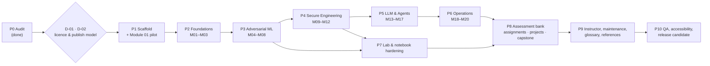

# Development Roadmap — Securing AI Systems

**Document ID:** `SAS-ROADMAP-001`
**Phase:** 01 — Repository Inspection and Architecture
**Companion documents:** `REPOSITORY_AUDIT.md` (findings, decisions, risks) · `COURSE_ARCHITECTURE.md` (curriculum, structure, technical design)
**Date:** 16 November 2026
**Authority:** the owner commits and pushes; this roadmap describes work, not Git operations

---

## 1. Delivery model

### 1.1 Principles

1. **Guard rails before content.** The scaffold, theme and content tests exist before module prose, so twenty modules cannot each invent their own structure.
2. **One reference module, then replication.** Phase 2 authors Module 01 completely. Every later module follows an approved pattern rather than an improvised one.
3. **A phase ends with an owner decision.** No phase begins until the previous phase's acceptance criteria are met and the owner has reviewed the report.
4. **Every phase is independently valuable.** If the project stops after Phase 5, the owner still has a coherent, buildable course covering foundations and adversarial ML — not a half-finished site.
5. **Quality is enforced mechanically where possible.** If a rule matters, it becomes a test (`COURSE_ARCHITECTURE.md` §8.5), not a paragraph of guidance.

### 1.2 Phase dependencies

### 1.3 Content budget (honest arithmetic)

| Component | Quantity | Words each | Words |
|---|---|---|---|
| Module core pages (theory + demo narrative) | 20 | ~4,500 | 90,000 |
| Module lab / exercises / quiz pages | 20 × 3 | ~1,800 | 36,000 |
| Start-here section (7 pages) | 7 | ~1,600 | 11,200 |
| Lab catalogue (20 briefs + index) | 21 | ~700 | 14,700 |
| Scenario assignments (8 + index) | 9 | ~1,300 | 11,700 |
| Mini + major projects (6 + index) | 7 | ~1,400 | 9,800 |
| Capstone documentation (4 pages) | 4 | ~2,000 | 8,000 |
| Resources (glossary, references, reading, tools, datasets, cheat-sheets, templates) | ~15 | ~1,200 | 18,000 |
| Instructor material (excluded from site) | ~12 | ~1,000 | 12,000 |
| Maintenance documentation | ~6 | ~900 | 5,400 |
| **Total prose** | | | **≈ 217,000 words** |
| Notebooks (20 demos + 20 labs + 6 project starters) | ≈ 46 | — | — |
| Supporting Python (`aisec_labs`, scripts, tests) | ≈ 6,000 LOC | — | — |

**This is a book-length project, roughly 10–15× the length of a typical course website.** The roadmap is therefore organised so that every phase produces a usable, publishable increment, and no phase depends on the whole being finished. Any plan that promises all twenty modules in one pass would guarantee filler; this one deliberately does not.

---

## 2. Phase summary

| Phase | Name | Primary output | Content budget | Owner gate |
|---|---|---|---|---|
| **P0** | Repository audit and architecture | 3 planning documents | ~17,500 words | ✅ Provided by this phase |
| **P1** | Scaffold and reference module | Buildable site + Module 01 complete | ~7,000 words + 1 notebook | Approve the module pattern |
| **P2** | Part 0 — Foundations | Modules 01–03 + labs 01–03 | ~17,000 words + 3 notebooks | Approve depth and tone |
| **P3** | Part I — Adversarial ML | Modules 04–08 + labs 04–08 | ~26,000 words + 5 notebooks | Approve lab rigour |
| **P4** | Part II — Secure Engineering | Modules 09–12 + labs 09–12 | ~22,000 words + 4 notebooks | Approve engineering realism |
| **P5** | Part III — LLM and Agents | Modules 13–17 + labs 13–17 | ~28,000 words + 5 notebooks | Approve LLM lab strategy |
| **P6** | Part IV — Operations and Assurance | Modules 18–20 + labs 18–20 | ~17,000 words + 3 notebooks | Approve red-team scoping |
| **P7** | Lab and notebook hardening | Determinism, runtime, offline execution | ~6,000 words, all notebooks reviewed | Approve runtime budget |
| **P8** | Assessment bank | 8 assignments, 6 projects, capstone, 20 quizzes | ~38,000 words + starter notebooks | Approve assessment design |
| **P9** | Instructor, maintenance, reference | Instructor pack, runbooks, glossary, bibliography | ~35,000 words | Approve publication model |
| **P10** | QA and release candidate | Accessibility, link audit, performance, release notes | ~5,000 words | Authorise publication |

---

## 3. Phase 0 — Repository audit and architecture ✅ complete

**Goal:** establish an evidence-based starting point and a complete design before any content exists.

**Deliverables:** `REPOSITORY_AUDIT.md`, `COURSE_ARCHITECTURE.md`, `DEVELOPMENT_ROADMAP.md`.

**Acceptance criteria met:** repository inspected (empty, no refs, no licence, no workflows, no site config); environment documented; preservation register completed (nothing to preserve, `.freebuff/` excluded); eight decisions surfaced, two blocking; 20-module curriculum specified with hours, prerequisites and practicals; pathway, gates and three study plans defined; folder structure, stack and quality gates defined; ten-phase plan with budgets.

**Open items handed to the owner:** decisions **D-01** (content licence) and **D-02** (instructor-material publication model) block Phase 1. D-03 and D-07 are needed before Phase 2 scaffolding completes.

---

## 4. Phase 1 — Scaffold and reference module

**Goal:** produce a site that builds, looks like the finished product, enforces the content contract, and contains one fully authored module that is the template for the other nineteen.

**Work items**

| # | Task | Notes |
|---|---|---|
| 1.1 | Create repository skeleton per `COURSE_ARCHITECTURE.md` §8.2 | Directories, `README.md`, `.gitignore`, `.editorconfig`, `LICENSE`, `LICENSE-CODE`, `CITATION.cff`, `CONTRIBUTING.md`, `SECURITY.md`, `CODE_OF_CONDUCT.md` |
| 1.2 | Write `mkdocs.yml` with the five-part nav and Material features | Nav includes only pages that exist; no stubs |
| 1.3 | Implement the design system in `extra.css` | Navy/cyan tokens, dark + light palettes, focus ring, typography scale, badge components |
| 1.4 | Implement `progress.js` | `localStorage`, `aria-pressed`, `aria-live`, reset control, no-JS degradation |
| 1.5 | Self-host fonts; verify zero third-party requests | Check the network panel once during build verification |
| 1.6 | Pin documentation and dev dependencies; create `pyproject.toml` (ruff, pytest markers) | Two dependency surfaces only |
| 1.7 | Build the content test suite (`tests/content/`) | 15 tests from §8.5; each written to fail on a seeded violation first |
| 1.8 | `scripts/new_module.py` and `scripts/check_env.py` | Scaffolder emits a contract-shaped module; preflight explains Python 3.11/3.12 requirement |
| 1.9 | `docs/00-start-here/` — all 7 pages | Orientation, roadmap page with progress rings, prerequisites, environment, study plans, assessment overview |
| 1.10 | **Module 01 authored in full** to the 17-point contract, plus Lab 01 notebook | The reference implementation |
| 1.11 | CI workflow (`ci.yml`): install docs deps, run content tests, build site | Owner commits the workflow file |
| 1.12 | Verify: `mkdocs build --strict` passes; full test suite green; site served locally | No deployment |

**Acceptance criteria**

- [ ] `mkdocs build --strict` succeeds with zero warnings; `exclude_docs` keeps instructor content out.
- [ ] Content suite passes, and each test has been shown to fail when its rule is violated.
- [ ] Module 01 satisfies all 17 contract components (mechanically verified).
- [ ] Site renders correctly at 360 px, 768 px and 1440 px widths.
- [ ] Keyboard-only traversal of nav, tabs, search and progress control works; focus is always visible.
- [ ] Both colour schemes meet 4.5:1 for body text and 3:1 for UI boundaries (measured, not estimated).
- [ ] Zero third-party network requests on page load.
- [ ] No instructor content, secret, or absolute path in the built site.
- [ ] `scripts/check_env.py` correctly rejects Python 3.14 with an actionable message and accepts 3.12.

**Exit review:** the owner approves the module pattern. If the pattern is wrong, it is wrong for one module — not twenty.

---

## 5. Phase 2 — Part 0: Foundations (Modules 01–03)

**Goal:** establish the vocabulary and systems thinking every later module depends on; Module 01 is revised from pilot feedback.

| Module | Theory focus | Practical | Assessment |
|---|---|---|---|
| 01 Security Foundations for AI | Assets, actors, trust boundaries, STRIDE-for-ML, security vs safety vs privacy | Threat-model a loan-scoring system | Quiz 1, worksheet |
| 02 Lifecycle and Architecture | Seven-stage lifecycle, artefacts, registries, MLOps vs MLSecOps, technical debt | Annotate a deployment diagram; find missing controls | Quiz 2 |
| 03 Threat Landscape and Frameworks | ATLAS tactics, OWASP ML/LLM lists, NIST AI RMF, ISO 42001, EU AI Act tiers, AI severity scoring | Build a threat register | Quiz 3, **Assignment A1** |

**Deliverables:** 3 module folders (5 pages each), 3 lab notebooks, 3 quizzes, `resources/templates/threat-model.md`, `resources/templates/risk-register.md`, glossary seed (~60 terms).

**Acceptance criteria:** all contract components present; each threat table uses real ATLAS technique IDs and OWASP categories; A1 includes a public rubric; glossary covers every bolded term in the three modules; framework references carry version and access date.

**Risk focus:** framework accuracy. Every identifier is checked against the current official source at authoring time and recorded in `framework-watch.md`.

---

## 6. Phase 3 — Part I: Adversarial ML (Modules 04–08)

**Goal:** the technical heart of the course — attacks taught with measurement, defences taught with adaptive evaluation.

| Module | Notebook/lab | Compute target |
|---|---|---|
| 04 Mathematical Foundations | FGSM from scratch with autograd; epsilon sweep | < 5 min CPU |
| 05 Evasion Attacks | Four-attack benchmark; spam-filter attack | < 10 min CPU |
| 06 Robustness and Defences | PGD-AT vs randomised smoothing vs baseline; adaptive evaluation | < 15 min CPU (small CNN) |
| 07 Poisoning and Backdoors | Train backdoor at ≤ 2 % poisoning; detect with activation clustering; sanitise | < 12 min CPU |
| 08 Extraction, Inversion, Membership | Shadow-model MIA; DP-SGD at two epsilons | < 10 min CPU |

**Deliverables:** 5 modules, 5 notebooks, `aisec_labs/attacks/` and `aisec_labs/defences/` packages, 5 quizzes, **Mini project MP1** (attack-and-defend study), `resources/cheat-sheets/adversarial-ml.md`.

**Acceptance criteria**

- [ ] Every attack implementation is unit-tested against a known-good reference result (tolerance stated).
- [ ] Every lab states success criteria as numbers a student can check (e.g. "ASR ≥ 90 % with mean L∞ ≤ 8/255").
- [ ] Every defence page includes an adaptive-attack section and states what the defence does *not* protect against.
- [ ] Runtime budget met on a 4-core laptop CPU with no GPU.
- [ ] Seeds fixed; two consecutive runs produce identical reported metrics.

**Risk focus:** the honesty of defence claims (R-05 in the audit) and lab runtime. A lab that takes 40 minutes will not be completed.

---

## 7. Phase 4 — Part II: Secure Engineering (Modules 09–12)

**Goal:** turn theory into engineering practice across the supply chain, data, training and serving.

| Module | Practical | Artefacts produced |
|---|---|---|
| 09 Supply Chain and Artefacts | Static audit of a malicious-looking model bundle; hash manifest; ML-BOM | Verification script, decision memo |
| 10 Data Security and Privacy | Anonymise, then attack your own anonymisation | Privacy impact assessment excerpt |
| 11 Training Infrastructure | Find and fix five defects in a vulnerable training repo; add CI gates | Hardened repo diff |
| 12 Inference and Serving | Harden a FastAPI model service; run an abuse suite | Before/after abuse report, **Project P2** assignment |

**Deliverables:** 4 modules, 4 notebooks/scripts, `resources/cheat-sheets/secure-ml-engineering.md`, `resources/templates/system-card.md`, 4 quizzes, **Assignment A2**, **Project P2** brief.

**Acceptance criteria:** all labs run offline in a container or local venv; no lab requires a paid service or API key; the malicious-bundle lab never executes the payload (static analysis only, with the reasoning explained); the serving lab demonstrably blocks unauthenticated, over-quota and oversized requests after hardening.

**Risk focus:** realism without live infrastructure. Labs must be reproducible without cloud accounts — a deliberately local emulation is acceptable and must be labelled as such.

---

## 8. Phase 5 — Part III: LLM and Generative AI Security (Modules 13–17)

**Goal:** the largest and fastest-moving part; designed so it does not rot in a year.

| Module | Practical | Model strategy |
|---|---|---|
| 13 LLM Fundamentals | Tokenisation, role confusion, sampling variance | Local 0.5B–1.5B model |
| 14 Prompt Injection | Document-summariser hijack, then three defence layers vs fixed corpus | Local model + `MockLLM` for tests |
| 15 RAG Security | Cross-tenant retrieval breach, then query-time ACLs | Local vector store, synthetic corpus |
| 16 Agents and Tool Use | Indirect injection → canary exfiltration; then sandbox + egress allowlist + scope reduction | Containerised agent, no real network |
| 17 Output Handling and Guardrails | HTML injection via model output; guardrail precision/recall evaluation | Local model + labelled attack corpus |

**Deliverables:** 5 modules, 5 notebooks, `aisec_labs/llm/` (mock model, RAG stub, guardrail harness), 5 quizzes, **Assignment A3**, **Mini project MP2**, `resources/cheat-sheets/llm-and-agent-security.md`, `docs/resources/tools.md`.

**Acceptance criteria**

- [ ] No lab requires a network model or API key; `MockLLM` reproduces every tested behaviour deterministically.
- [ ] Every attack corpus is small, versioned and stored in-repo (~50–200 cases), so results are comparable.
- [ ] Every defence section reports residual attack success rate, not just "attack blocked".
- [ ] Framework references pinned to a dated version (OWASP LLM 2025, NIST AI 600-1) with a review date recorded.
- [ ] Agent lab cannot reach the internet even if the student tries (verified by egress test).

**Risk focus:** drift and cost. Both are mitigated by local models, fixed corpora, and versioned framework citations.

---

## 9. Phase 6 — Part IV: Operations and Assurance (Modules 18–20)

**Goal:** close the loop from testing to operating to governing.

| Module | Practical | Output |
|---|---|---|
| 18 AI Red Teaming | Time-boxed engagement against an in-sandbox vulnerable app | RoE, findings register, retest plan |
| 19 Monitoring, Detection, IR | Three detections, tuning against an attack trace, IR playbook, tabletop | Detection pack, playbook |
| 20 Governance and Assurance | System card, RMF risk register, control-to-evidence table, assurance argument | Assurance pack |

**Deliverables:** 3 modules, 3 labs, 3 quizzes, `docs/projects/capstone/` (brief, milestones, deliverables, public rubric), **Assignment A3 finalisation**, `resources/templates/incident-playbook.md`.

**Acceptance criteria:** the red-team lab contains an explicit scope statement and stop conditions; no target outside the sandbox is named; the IR playbook is actionable (owner, trigger, action, evidence); the assurance pack maps each claim to evidence produced elsewhere in the course.

**Risk focus:** dual-use. Offensive content is scoped to self-owned sandboxed targets, and every offensive lab opens with an acceptable-use statement.

---

## 10. Phase 7 — Laboratory and notebook hardening

**Goal:** a student on a mid-range laptop, offline, can complete every lab in a stated time.

**Work items:** deterministic seeds everywhere; runtime measurement and reduction for any lab over budget; `scripts/fetch_data.py` with checksums for every dataset; `scripts/fetch_models.py` with pinned revisions; notebook hygiene tests (no outputs, no absolute paths, kernelspec present); a single cross-platform setup path (Windows/macOS/Linux) with per-OS command tabs; a "lab log" template; troubleshooting page with the ten most likely failures and their fixes.

**Acceptance criteria:** every lab runs end-to-end on Windows, Linux and macOS from a clean Python 3.12 venv; total download volume < 1.5 GB for the whole course, < 400 MB per part; no lab exceeds 20 minutes CPU; failure modes documented.

---

## 11. Phase 8 — Assessment bank

**Goal:** assessment that measures judgement, not recall.

| Instrument | Quantity | Design requirement |
|---|---|---|
| Module quizzes | 20 × 10–15 items | 40 % applied/scenario items; distractors built from documented misconceptions; rationales in instructor material |
| Tiered exercises | 20 × 9 | Recall / apply / extend, with hints and expected outcomes |
| Scenario assignments | 8 | Realistic brief, ambiguous constraints, rubric, exemplar (instructor-only) |
| Mini projects | 4 | Two-module integration, 8–12 h each |
| Major projects | 2 | End-to-end: attack+evaluate (P1), secure application (P2) |
| Capstone | 1 | Full assessment + assurance pack, 5 milestones, defence |

**Acceptance criteria:** every rubric has four levels and a "claim discipline" criterion; every quiz item is mapped to a module outcome; no item is answerable by keyword matching alone; a sample of items is reviewed for bias and clarity; answer keys are excluded from the build (test-enforced).

---

## 12. Phase 9 — Instructor, maintenance and reference material

**Goal:** the course can be taught and maintained by someone other than its author.

**Instructor (`docs/instructor/**`, excluded from build):** teaching guide, 14-week session plan, LMS mapping, per-module timing and common misconceptions, solution notebooks, answer rationales, rubrics with exemplars, assessment design notes, moderation guidance, self-study facilitation guide.

**Maintenance (`docs/maintenance/**`, published):** build and release runbook, content contract, QA suite guide, framework watch register, lab data/model pinning, troubleshooting, dependency upgrade procedure, "broken build" recovery.

**Reference:** glossary (~350 terms with definitions and cross-links), annotated bibliography (~200 entries), further reading by part, tool catalogue (with last-verified date), dataset catalogue (licence + checksum), cheat-sheets, templates.

**Acceptance criteria:** a second instructor can run the course from the pack without contacting the author; every tool entry has a verified date; every bibliography entry is reachable; glossary coverage ≥ 95 % of bolded terms.

---

## 13. Phase 10 — QA and release candidate

**Goal:** a site that is correct, accessible, fast and honest about its limits.

**Work items:** full content test suite; `mkdocs build --strict`; internal link and anchor audit; external link audit (reported, not gate-blocking); accessibility pass (keyboard traversal of every template, contrast measurement, screen-reader spot check of two module pages using the browser's accessibility tree); responsive check at 360/768/1024/1440 px; performance check (page weight, instant-nav behaviour); search relevance spot check across ten known queries; release notes; `COURSE_VERSION` bump; citation file update.

**Acceptance criteria:** all blocking tests green; zero WCAG 2.2 AA failures found in the audited templates; no page over 300 KB of HTML/CSS/JS overhead; publication authorised explicitly by the owner (D-04).

**Explicitly out of scope unless requested:** analytics, comments, user accounts, LMS integration, translations, a PDF export, and any server-side component.

---

## 14. Definition of Done

### 14.1 Per module

1. All 17 Module Blueprint Contract components present and passing tests.
2. Demonstration reproduces on Python 3.12 with the pinned environment, offline.
3. Lab states setup, steps, numeric success criteria, cleanup and a results table.
4. At least five documented failure modes with corrections.
5. Threat/control table uses real ATLAS/OWASP/RMF identifiers with a version and access date.
6. Quiz has a matching answer key in instructor material; every item maps to an outcome.
7. Glossary terms added and cross-linked; bibliography entries added and reachable.
8. Diagrams have text descriptions; all images have meaningful alt text.
9. Reads correctly in both colour schemes and at 360 px width.
10. Front matter carries version and review date; change log updated.

### 14.2 Per phase

1. Acceptance criteria checked and evidenced in the phase report.
2. Content suite and `mkdocs build --strict` green.
3. No placeholder markers anywhere (`test_no_placeholder_markers` passing on the whole tree).
4. Budget reported: words, notebooks, runtime, download volume.
5. Risks updated; new decisions surfaced before they block the next phase.
6. Owner review completed and recorded.

---

## 15. Schedule and effort model

Effort is expressed in **authoring passes** — one focused work block ending in a reviewable increment — because calendar estimates for a project this size depend on the owner's availability for review.

| Phase | Content | Passes | Critical dependency |
|---|---|---|---|
| P0 | 3 documents | 1 ✅ | — |
| P1 | Scaffold + Module 01 | 3–4 | D-01, D-02, D-03 |
| P2 | Foundations | 3 | P1 pattern approved |
| P3 | Adversarial ML | 5–6 | Runtime budget verified in P1 |
| P4 | Secure Engineering | 4–5 | P3 attack vocabulary |
| P5 | LLM and Agents | 6–7 | Local model strategy validated in P1 |
| P6 | Operations and Assurance | 4 | P5 complete |
| P7 | Lab hardening | 3 | P3–P6 labs exist |
| P8 | Assessment bank | 4–5 | Modules complete for item mapping |
| P9 | Instructor/maintenance/reference | 4 | P8 rubrics exist |
| P10 | QA and release | 2 | Owner authorises publication (D-04) |

**Milestones**

| Milestone | After | Demonstrable to the owner |
|---|---|---|
| **M1 — Foundations of the product** | P1 | A working site with beautiful design, working search, progress tracking, passing content tests, and one exemplary module |
| **M2 — Technical credibility** | P3 | Students can attack and defend models with measured results |
| **M3 — Engineering credibility** | P4 | Students can secure a supply chain, dataset, training run and API |
| **M4 — Modern relevance** | P5 | Students can break and fix a RAG application and an agent |
| **M5 — Operational completeness** | P6 | Students can red-team and operate a system |
| **M6 — Teachable product** | P9 | Another instructor can run the course |
| **M7 — Release** | P10 | Public site, owner-authorised |

---

## 16. Risk management plan

| Risk (from audit) | Phase where it bites | Control in this roadmap |
|---|---|---|
| R-01 content before decisions | P1 | D-01/D-02 are blocking gates |
| R-02 answer leakage | P1, P2, P8, P10 | `exclude_docs` + `test_instructor_excluded` in CI from Phase 1 |
| R-03 Python 3.14 install failures | P1, P7 | Two dependency surfaces; preflight script; OS matrix test in P7 |
| R-04 scope inflation | P2–P9 | Per-phase budgets; contract tests; one module per folder; "must not" lists |
| R-05 misuse of offensive labs | P3, P5, P6 | Sandboxed self-owned targets; acceptable-use statements; no third-party targets |
| R-06 API-key dependence | P5 | Local models + `MockLLM`; no key required anywhere |
| R-07 framework drift | P2, P5, P9 | Version+date on every framework claim; `framework-watch.md`; annual review |
| R-08 notebook hygiene | P1, P7 | Outputs cleared; hygiene tests; no absolute paths |
| R-09 accessibility decay | P1, P10 | Contract bullet + machine checks + template audit |
| R-10 unbuildable docs | all | CI build on every push; strict mode; broken-build runbook |

---

## 17. What the owner must do (and what this engagement will not do)

**Owner actions**

1. Decide **D-01** (licence) and **D-02** (instructor publication model) before Phase 1.
2. Initialise or clone the Git repository and make the first commit (Section 4 of the audit).
3. Review each phase report and approve or return with comments.
4. Confirm GitHub Pages and repository settings when publication is requested.
5. Confirm institutional permissions for name/logo use (D-06).
6. Approve D-07 before any dataset-linked lab is authored.

**Not performed by this engagement, under any phase, without a new explicit instruction**

- Committing, staging, pushing, branching, tagging or rewriting history.
- Creating, changing or removing remotes.
- Publishing, deploying, or enabling GitHub Pages.
- Changing repository settings.
- Deleting or overwriting existing content.

---

## 18. Immediate next steps

1. **Owner:** answer D-01, D-02, D-03, D-07 (Sections 9 of the audit). These are four lines of decision and they unblock everything.
2. **Owner:** initialise or clone the repository and commit the three Phase-1 documents.
3. **Next engagement:** Phase 1 — scaffold, design system, progress component, content test suite, and Module 01 authored in full as the reference implementation.
4. **Then:** pause for the M1 review before replicating the pattern across Parts 0–IV.

No course content beyond Module 01 will be authored until the scaffold and the module pattern have been approved, because the cheapest moment to change a pattern is before it exists nineteen more times.

---

*End of roadmap. Phase 0 is complete; Phase 1 awaits owner decisions.*
