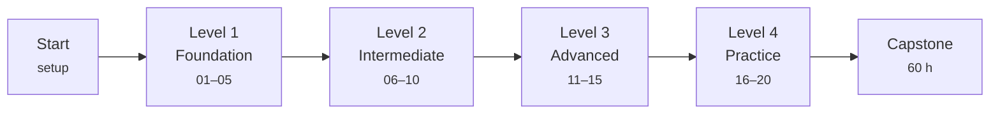

<div align="center">

# Securing AI Systems

**A Practical Self-Study Course for BS Data Science Students**

From the dataset to the deployed model — and from the prompt to the agent that acts on it.


</div>

---

> **New here? Start with three pages, in this order:**
> [Getting Started](docs/getting-started/index.md) → [Prerequisites](docs/getting-started/prerequisites.md) → [Module 01](docs/modules/01-introduction.md).
> Twenty minutes of setup now saves a week of confusing errors later.

---

## Contents

| | | |
|---|---|---|
| [1. Course description](#1-course-description) | [9. Free and local learning alternatives](#9-free-and-local-learning-alternatives) | [17. Completing the practical exercises](#17-completing-the-practical-exercises) |
| [2. Why securing AI systems matters](#2-why-securing-ai-systems-matters) | [10. The 20-module curriculum](#10-the-20-module-curriculum) | [18. Checking your learning progress](#18-checking-your-learning-progress) |
| [3. Who should study this course](#3-who-should-study-this-course) | [11. Your pathway from beginner to advanced](#11-your-pathway-from-beginner-to-advanced) | [19. Recommended learning sequence](#19-recommended-learning-sequence) |
| [4. What you will learn](#4-what-you-will-learn) | [12. How the practical laboratories work](#12-how-the-practical-laboratories-work) | [20. References and further resources](#20-references-and-further-resources) |
| [5. Course learning outcomes](#5-course-learning-outcomes) | [13. Assignments and assessment](#13-assignments-and-assessment) | [21. Academic integrity and responsible security research](#21-academic-integrity-and-responsible-security-research) |
| [6. Prerequisites](#6-prerequisites) | [14. Projects and the capstone](#14-projects-and-the-capstone) | [22. Course instructor](#22-course-instructor) |
| [7. Required software and tools](#7-required-software-and-tools) | [15. How to use the course materials](#15-how-to-use-the-course-materials) | [23. Copyright and licensing](#23-copyright-and-licensing) |
| [8. Hardware requirements](#8-hardware-requirements) | [16. Running the Jupyter notebooks](#16-running-the-jupyter-notebooks) | |

---

## 1. Course description

**Securing AI Systems** is an undergraduate course about protecting machine learning systems from people who want to make them fail, leak, or act against their owner's interests.

Most machine learning courses teach you to make a model *work*. This one teaches you to make it *hold up when someone is trying to break it* — and to know, with evidence, which of your protections actually work.

The course is organised as a self-study programme of **20 modules in four levels**, supported by **32 laboratories**, **12 scenario assignments**, **20 self-check quizzes**, **6 projects** and a **capstone**. Everything is written for a student working alone: every concept arrives with runnable code, every laboratory states numeric success criteria you can check yourself, and every defence is presented with its limits rather than its promises.

| | |
|---|---|
| **Level** | Undergraduate — BS Data Science, years 3 and 4 |
| **Structure** | 5 parts · 20 modules · 32 laboratories · 6 projects · 1 capstone |
| **Estimated effort** | ≈ 450 hours for the full pathway · ≈ 135 hours for the condensed semester track |
| **Format** | Written course with Jupyter notebooks, Mermaid diagrams and self-marking quizzes |
| **Delivery** | Self-paced. No accounts, no paid APIs, no GPU required |
| **Language** | English, with Python 3.11/3.12 throughout |

The course is designed as a journey rather than a reference: each part assumes the one before it, and each ends with a checkpoint you can assess yourself against. The [learning roadmap](docs/roadmap.md) shows the whole path on one page.

**Begin here:** [Getting Started](docs/getting-started/index.md) · [Learning Roadmap](docs/roadmap.md) · [Course Modules](docs/modules/index.md) · [Practical Labs](docs/labs/index.md)

---

## 2. Why securing AI systems matters

Machine learning has moved from research notebooks into decisions that affect people: credit, hiring, diagnosis, content moderation, fraud detection, and increasingly the automated actions of agents that can send email, move money and run code. Each of those systems has an adversary, and most of them were built without one in mind.

Five things make this urgent rather than theoretical:

**The attack surface is bigger than the model.** A model file can contain executable code. A training dataset can be poisoned by anyone who can contribute to it. A feature pipeline is often shared with analytics. Securing the `.pt` file while the training bucket is world-writable is theatre, and the course teaches you to see the difference.

**Attacks do not need to be clever.** An adversarial example can be generated by anyone with the model's gradients in one line of code. A prompt injection can be typed, or hidden in a document the assistant was asked to summarise. The cheapness of these attacks is what makes them relevant to organisations that will never be targeted by a nation state.

**Accuracy is not security.** A model can be 99 % accurate and completely manipulable. Standard evaluation never looks for the trigger that makes it misbehave, the confidence scores that leak its training data, or the queries that reconstruct it. You will learn to evaluate what standard evaluation misses.

**The supply chain is the weakest link.** Almost everyone now builds on models and datasets they did not produce. That is a sensible engineering choice and a serious trust decision, and it deserves the same scrutiny as any other third-party dependency.

**Regulation has arrived.** Risk-management frameworks and legal obligations now require organisations to *document* what they did about AI risk, with evidence. Being able to produce that evidence — not just to have good intentions — is a professional skill.

By the end of this course you will be able to look at a system you did not build, say where it will break, prove it, and propose a fix whose cost and residual risk you can defend.

---

## 3. Who should study this course

| You are | This course gives you |
|---|---|
| **A BS Data Science student** in year 3 or 4 | The security half of your education: what happens to models once they leave a notebook |
| **A self-learner** who can train a model but has never attacked one | A structured route from "it works" to "it survives an adversary" |
| **An ML engineer** moving into a security-facing role | The engineering controls — supply chain, serving, monitoring — you are expected to own |
| **A security professional** meeting AI systems for the first time | The machine-learning vocabulary you need, taught in security terms |
| **An instructor** | A complete, honestly scoped course with public rubrics and 32 reproducible labs |

**You do not need** a cybersecurity background, a certification, a GPU, a cloud account or a credit card. Module 01 builds the security vocabulary from first principles.

**You do need** working Python and a first course in machine learning. If you have never trained a classifier, the [prerequisites page](docs/getting-started/prerequisites.md) tells you exactly what to fix and how long it takes.

---

## 4. What you will learn

The course builds seven capabilities, in this order of dependence:

<div align="center">

| # | Capability | You can, without notes… |
|---|---|---|
| 1 | **Think in systems** | Draw the trust boundaries of an unfamiliar AI system and name where you would attack it |
| 2 | **Classify threats** | Map a weakness to MITRE ATLAS, OWASP and NIST AI RMF identifiers and justify a severity |
| 3 | **Attack with measurement** | Implement evasion, poisoning, extraction and injection attacks, and report success rates with denominators |
| 4 | **Defend with honesty** | Evaluate a defence against an adaptive attacker and state what it does not cover |
| 5 | **Engineer securely** | Secure the supply chain, the data, the training run, the serving endpoint and the agent's permissions |
| 6 | **Test under authorisation** | Scope an engagement, write rules of engagement, triage findings and produce an actionable report |
| 7 | **Operate and assure** | Detect abuse, respond to an incident, roll back, and document the residual risk as an assurance case |

</div>

Alongside the capabilities you will build a portfolio: **32 laboratory reports** with measured results, **6 projects**, and a **capstone security assessment** of a complete system.

---

## 5. Course learning outcomes

On successful completion, a student can:

| ILO | Outcome | Assessed by |
|---|---|---|
| **1** | Explain the security requirements of an AI system and map them onto its lifecycle and trust boundaries | Modules 1–3, Quiz 3, Assignment A1 |
| **2** | Identify and classify threats across the AI/ML pipeline using recognised frameworks | Modules 3, 9, 19 |
| **3** | Explain adversarial machine learning theory, including the optimisation view of evasion and its limits | Module 4, problem set |
| **4** | Execute and evaluate evasion, poisoning and extraction attacks against models they trained | Modules 5, 7, 8 and their labs |
| **5** | Select, implement and critically evaluate defences against those attacks | Module 6, Lab 6, Project P1 |
| **6** | Secure datasets, models, training infrastructure and inference services | Modules 9–12 |
| **7** | Analyse LLM and generative-AI vulnerabilities, distinguishing structural flaws from implementation bugs | Modules 13–17 |
| **8** | Design and harden prompt processing, retrieval (RAG) and agentic tool use | Modules 14–16, Project P2 |
| **9** | Apply secure AI application development practices — input handling, output handling, least privilege, secrets | Modules 9, 12, 17 |
| **10** | Plan and conduct a scoped, authorised AI red-team engagement and report findings with severity | Module 18, Assignment A7, Capstone |
| **11** | Design monitoring, detection, response and recovery for a production AI system | Module 19, Lab 19 |
| **12** | Apply governance frameworks and produce assurance documentation | Module 20, Capstone |

Full detail, including the mapping to each module's activities, is in [Course Architecture](COURSE_ARCHITECTURE.md).

---

## 6. Prerequisites

### Required

| Skill | What "required" means here |
|---|---|
| **Python** | Functions, classes, virtual environments, installing packages, reading a traceback |
| **NumPy and pandas** | Array shapes and broadcasting, boolean indexing, joins |
| **A training loop** | You have trained a classifier and watched a loss curve. You need not have built one from scratch |
| **Evaluation basics** | Accuracy, precision, recall, confusion matrices, and why accuracy misleads |
| **Command line** | Navigating directories, running scripts, setting environment variables |
| **Git basics** | Clone, commit, branch, diff — enough to version your own lab work |

### Helpful, not required

Linear algebra and gradients (Module 4), probability (Modules 5, 8, 10), HTTP and HTML basics (Modules 12, 17) and container familiarity (Modules 11, 16).

There is a six-question [self-check](docs/getting-started/prerequisites.md) you can take in five minutes. If you can answer five of six, you are ready.

---

## 7. Required software and tools

Everything in this course is free and open source. Nothing requires a paid account.

| Tool | Version | Why |
|---|---|---|
| **Python** | **3.11 or 3.12** | The laboratory stack (PyTorch, Adversarial Robustness Toolbox) does not yet ship wheels for the newest releases |
| **pip** | 23+ | Installing the laboratory environment |
| **Git** | 2.30+ | Getting the course materials and versioning your work |
| **JupyterLab** | 4.x | Running the laboratory notebooks |
| **A code editor** | any | Reading and annotating outside the notebook |
| **Docker** *(optional)* | recent | Only for the agent-sandbox laboratory in Module 16 |

### Setup in three commands

```bash
python -m venv .venv
# Windows: .venv\Scripts\activate   |   macOS/Linux: source .venv/bin/activate
python -m pip install -r requirements-labs.txt
```

Then verify the environment:

```bash
python scripts/check_env.py
```

It reports your Python version, every required package, and whether PyTorch can see a GPU. If it says `ready`, you can start Module 01. The full walkthrough, including the five most common installation failures and their fixes, is in [Learning Environment](docs/getting-started/environment.md).

---

## 8. Hardware requirements

| | Minimum | Comfortable |
|---|---|---|
| **RAM** | 8 GB | 16 GB |
| **Disk** | 5 GB free | 15 GB free |
| **CPU** | Any dual-core from the last decade | 4 cores or more |
| **GPU** | Not required | Optional — speeds up Modules 5–7 |
| **OS** | Windows 10/11, macOS 12+, or a current Linux | Any |

Every laboratory is designed to finish on a laptop CPU inside a stated runtime budget — no laboratory exceeds 20 minutes of computation. If your machine is older, start with Parts 0 and II, which are lighter, and return to the model-training laboratories when you have access to a lab machine.

---

## 9. Free and local learning alternatives

The course is deliberately built so that money is never the barrier.

| Instead of | The course uses | Cost |
|---|---|---|
| Paid LLM APIs | Small open-weights models running locally (0.5B–1.5B parameters) | Free, offline |
| Cloud GPU instances | CPU-sized datasets and models; GPU only as an accelerator | Free |
| Proprietary attack platforms | Open-source tooling: Adversarial Robustness Toolbox, PyTorch, scikit-learn | Free |
| Licensed datasets | Synthetic data generated locally from a fixed seed, plus one public teaching dataset under CC BY 4.0 | Free, offline |
| Hosted vector databases | A local vector store for the RAG laboratories | Free |
| A cloud account for experiments | Everything runs on your own machine, fully offline; datasets are generated locally | Free |

**No API keys, no accounts, no credit card, and no telemetry.** The course itself collects nothing about you; progress tracking is stored in your own browser, on your own device.

If you have no computer of your own, every laboratory runs on a modest university lab machine, and Levels 1, 3 and 4 (roughly half the course) need no deep learning training at all.

---

## 10. The 20-module curriculum

Four levels, twenty modules. Hours include reading, worked examples, exercises and the knowledge checks.

### Level 1 — Foundation · 52 hours

| # | Module | Hours | What it establishes |
|---|---|---|---|
| 01 | [Introduction to Securing AI Systems](docs/modules/01-introduction.md) | 8 | What is protected, from whom, and how the four levels fit together |
| 02 | [Fundamentals of AI, ML and Deep Learning Security](docs/modules/02-ml-security-fundamentals.md) | 10 | What training optimises, what artefacts exist, why learned systems fail differently |
| 03 | [Cybersecurity Fundamentals for AI Systems](docs/modules/03-cybersecurity-fundamentals.md) | 10 | Identity, access control, cryptography, trust boundaries, defence in depth |
| 04 | [AI Threat Modeling and Risk Assessment](docs/modules/04-threat-modeling.md) | 12 | STRIDE for ML, MITRE ATLAS, attack trees, severity scoring |
| 05 | [Secure Data Management and Dataset Protection](docs/modules/05-secure-data-management.md) | 12 | Classification, minimisation, de-identification and its limits, lineage |

### Level 2 — Intermediate · 72 hours

| # | Module | Hours | What it establishes |
|---|---|---|---|
| 06 | [Adversarial Machine Learning](docs/modules/06-adversarial-ml.md) | 14 | Four attack families, three adversary models, the optimisation view |
| 07 | [Data Poisoning and Backdoor Attacks](docs/modules/07-data-poisoning.md) | 16 | Availability, targeted and clean-label poisoning; triggers and detection |
| 08 | [Model Evasion and Robustness](docs/modules/08-evasion-and-robustness.md) | 16 | PGD, margin attacks, adversarial training, randomised smoothing |
| 09 | [Model Privacy: Membership Inference and Model Inversion](docs/modules/09-model-privacy.md) | 14 | Advantage, shadow models, inversion, DP-SGD and privacy accounting |
| 10 | [Model Extraction and Intellectual Property Protection](docs/modules/10-model-extraction.md) | 12 | Query-based extraction, fidelity, quotas, output rounding, watermarks |

### Level 3 — Advanced · 72 hours

| # | Module | Hours | What it establishes |
|---|---|---|---|
| 11 | [Fundamentals of LLM Security](docs/modules/11-llm-security.md) | 12 | Tokens, attention, the shared context window — why injection is structural |
| 12 | [Prompt Injection and Jailbreak Attacks](docs/modules/12-prompt-injection.md) | 16 | Direct and indirect injection, jailbreak families, layered defence |
| 13 | [RAG Security and Knowledge Base Protection](docs/modules/13-rag-security.md) | 14 | Ingestion poisoning, tenant isolation, embedding leakage, grounding |
| 14 | [AI Agent Security and Tool Abuse](docs/modules/14-agent-security.md) | 16 | Excessive agency, confused deputies, policy gates, sandboxing |
| 15 | [Secure Fine-Tuning and Model Supply Chain](docs/modules/15-fine-tuning-supply-chain.md) | 14 | Unsafe serialisation, adapters, provenance, signing, ML bill of materials |

### Level 4 — Professional Practice · 88 hours

| # | Module | Hours | What it establishes |
|---|---|---|---|
| 16 | [Secure AI APIs and Application Development](docs/modules/16-secure-ai-apis.md) | 16 | Authentication, quotas, validation, output handling, cost bounds |
| 17 | [AI Red Teaming and Security Testing](docs/modules/17-red-teaming.md) | 16 | Scope, test matrices, corpora, confidence intervals, reporting |
| 18 | [AI System Monitoring, Incident Response and Recovery](docs/modules/18-monitoring-and-response.md) | 16 | Drift and attack detection, alert design, the incident lifecycle |
| 19 | [AI Governance, Privacy, Ethics and Compliance](docs/modules/19-governance-and-ethics.md) | 16 | NIST AI RMF, risk tiers, DPIA, fairness metrics, model cards |
| 20 | [Secure AI Deployment and Capstone Projects](docs/modules/20-deployment-and-capstone.md) | 24 | Release gates, canary deployment, rollback, traceability, capstones |

[Browse all modules with descriptions →](docs/modules/index.md)

---

## 11. Your pathway from beginner to advanced



You move from **understanding** (what can go wrong, and why) to **doing** (attacking and measuring) to **building** (securing LLM applications, retrieval and agents) to **operating and assuring** (testing, detecting, documenting, deploying). Each level ends with a checkpoint:

| Gate | After | You should be able to |
|---|---|---|
| **G-1** | Module 05 | Write a threat register and a data-protection note someone could act on |
| **G-2** | Module 08 | Measure an attack and evaluate a defence against an adaptive one |
| **G-3** | Module 10 | Explain how a model leaks its training data or gives itself away, and bound it |
| **G-4** | Module 15 | Harden an LLM application and verify the control holds under injection |
| **G-5** | Module 20 | Detect an incident, write a response plan, and pass a release gate |

### Three ways to take the course

| Plan | Hours | Fits | Modules |
|---|---|---|---|
| **Full pathway** | ≈ 458 | Two semesters at ~15 h/week | All 20 + projects + capstone |
| **Condensed semester** | ≈ 135 | One semester at ~10 h/week | 01, 02, 03, 06, 11, 12, 16, 17 + mini project + capstone-lite |
| **Specialisation** | 114–176 + capstone | After Part 0 | Red teamer · Security engineer · Governance |

[Compare the study plans in detail →](docs/getting-started/study-plans.md)

---

## 12. How the practical laboratories work

Thirty-two laboratories across the twenty modules, one or two per module. Each builds exactly one capability and hands you evidence that you built it.

| Section | What it gives you |
|---|---|
| **Purpose** | The capability you gain, in one sentence |
| **Threat model** | Who the adversary is and what they can do — so your result means something |
| **Setup** | What to install or fetch, and the runtime budget |
| **Steps** | Ordered tasks with checkpoints |
| **Success criteria** | Numbers you can verify, not adjectives |
| **Results table** | The evidence you record and report |
| **Cleanup** | Leaving the environment ready for the next lab |

Laboratories state success criteria as quantities: *"attack success rate ≥ 90 % with mean L∞ perturbation ≤ 8/255"*, not *"the attack should work"*. If you cannot fill in the results table, you have not finished the lab.

Every laboratory is deterministic (fixed seeds), runs fully offline, and finishes inside 30 minutes on a laptop CPU.

[See all thirty-two laboratories →](docs/labs/index.md)

---

## 13. Assignments and assessment

Every assessment instrument in this course is public. Nothing is hidden, and you can mark most of your own work against the published rubric.

| Instrument | Count | What it measures | Weight* |
|---|---|---|---|
| [Self-check quizzes](docs/quizzes/index.md) | 20 | Recall and misconceptions | 10 % |
| Tiered exercises | 20 × 9 | Application and extension | — (formative) |
| [Laboratories](docs/labs/index.md) | 20 | Capability, with measured results | 20 % |
| [Scenario assignments](docs/assignments/index.md) | 8 | Judgement and technical writing | 15 % |
| [Mini projects](docs/projects/index.md) | 4 | Integration of two or three modules | 15 % |
| [Major projects](docs/projects/index.md) | 2 | End-to-end engineering and evaluation | 15 % |
| [Capstone](docs/capstone/index.md) | 1 | Full-scope assessment and assurance pack | 25 % |

\* Default weighting for a 4-credit adoption. Institutions may adjust the weights; the instruments do not change.

### How laboratories are marked

Five criteria, four levels each: **correctness**, **measurement**, **interpretation**, **defence evaluation** and **reproducibility**.

One criterion runs through every technical instrument, because it matters more than the rest:

> **Claim discipline.** Exemplary work states the measurement method, the sample size or seed, and the limitation. Work that reports a result without a denominator — or declares a defence effective without an adaptive test — is marked as developing, however impressive the code.

[Read the full assessment guide →](docs/getting-started/assessment.md)

---

## 14. Projects and the capstone

Modules teach capability one at a time. Projects test whether you can hold several at once.

### Mini projects — about 10 hours each

| # | After | Project |
|---|---|---|
| **MP1** | Modules 05–06 | **Attack and defend study** — attack a model you trained, defend it, then attack the defence adaptively and report what it actually bought |
| **MP2** | Modules 15–16 | **Secure a RAG assistant** — build per-user access control and one tool, then write the attack you would run and close it |
| **MP3** | Modules 09–10 | **Artefact and data handling review** — decide what is safe to load, document provenance, add pipeline checks |
| **MP4** | Modules 18–19 | **Detection pack** — telemetry, detections and a first-hour response plan |

### Major projects — about 25 hours each

| # | Project | Deliverable |
|---|---|---|
| **P1** | **Robustness evaluation study** | An attack suite, two defences evaluated, an adaptive attack against your own work, and a deployment recommendation |
| **P2** | **Secure an end-to-end AI application** | A supplied application hardened to a defined baseline: artefact verification, access control, quotas, audit logging, kill switch |

### Capstone — 60 hours

Assess one AI system end to end across five milestones: **scope and threat model → testing under a written scope → findings and severity → remediation and retest → assurance pack and defence.**

You may use the supplied sandbox, your own build, or a real system whose owner has authorised you in writing. Anything else is out of scope — "it was publicly accessible" is not authorisation.

[Capstone brief and public rubric →](docs/capstone/index.md)

---

## 15. How to use the course materials

Each module is a small folder of pages, always in the same order, so you never have to find your place:

| Page | What it contains | When to read it |
|---|---|---|
| **Overview** | Why it matters, outcomes, theory, worked demonstration | First, linearly |
| **Laboratory** | Setup, steps, success criteria, results table | After the overview |
| **Exercises** | Recall, apply, extend | After the lab |
| **Quiz** | 10–15 items with instant feedback | Last |

### The five-session rhythm

| Session | What you do | Time |
|---|---|---|
| 1. Read | Conceptual core, noting the threat and control table | ~90 min |
| 2. Reproduce | Run the demonstration, match the numbers in the text | ~45 min |
| 3. Do the lab | Complete the laboratory, fill in the results table | 3–5 h |
| 4. Self-check | Quiz and exercises, revisit what you missed | ~45 min |
| 5. Reflect | One page: what would you check first in a real system, and why? | ~20 min |

Session 5 is the one students skip, and the one that turns reading into recall.

### Icons you will meet

| Badge | Meaning |
|---|---|
| `Complete` | The module satisfies the full content contract: theory, lab, exercises, quiz and review |
| `In review` | Written and undergoing accuracy and safety review. Expect changes |
| `Draft` | Content exists but may be incomplete; a laboratory may not yet be runnable |
| `Planned` | Scope is defined, teaching content is not yet written. The page still tells you what it covers |

Modules are released as they are completed, and every page states its own status honestly.

[How to use this course, in full →](docs/getting-started/how-to-use.md)

---

## 16. Running the Jupyter notebooks

Laboratories are Jupyter notebooks. Three habits prevent almost every problem.

**1. Activate the environment first.** Your prompt should show `(.venv)`. If it does not, imports will fail and the error will look like a missing package.

```bash
# Windows
.venv\Scripts\activate

# macOS / Linux
source .venv/bin/activate

# then
jupyter lab
```

**2. Run cells in order, from a fresh kernel.** Stale variables from an earlier run cause errors that look like library bugs. Before concluding a lab is broken, use **Restart Kernel and Run All**.

**3. Do not edit the provided cells.** Add your own below them, marked clearly, so the lab's expected results stay comparable.

### If something goes wrong

| Symptom | Almost always | Fix |
|---|---|---|
| `ModuleNotFoundError` | Environment not active, or packages installed elsewhere | Activate `.venv`, then `python -m pip list` |
| `pip` tries to build PyTorch from source | Unsupported Python version | Recreate the environment on 3.11 or 3.12 |
| Binary `ImportError` / undefined symbol | Mixed versions from two environments | Delete `.venv`, recreate, reinstall |
| Jupyter cannot import packages | Kernel points at another interpreter | Launch Jupyter from the active environment |
| Numbers differ from the text | Different seed, patch version, or device | Check the seed first, then the lab's expected-variance note |

[Full environment guide and troubleshooting →](docs/getting-started/environment.md)

---

## 17. Completing the practical exercises

Exercises come in three tiers, so you can go as deep as you need without guessing what "enough" means:

| Tier | What it asks | Purpose |
|---|---|---|
| **Recall** | Define, list, identify | Confirm the vocabulary landed |
| **Apply** | Given a described system, decide what to do | Practise the judgement the module teaches |
| **Extend** | Change the threat model, break a claim, design a control | The tier that separates a pass from a strong result |

### Keep a lab log

One log across the course. It is the raw material for your portfolio and the reason your results will still make sense in six months.

```text
Lab:            05 — Four-attack benchmark
Date:           2026-11-20
Environment:    Python 3.12.7, torch 2.5.1 (CPU), ART 1.19.0
Seed:           42

Attack      | ASR   | mean L-inf | queries | seconds
FGSM        | 0.41  | 0.031      | 1       | 2.1
PGD-20      | 0.93  | 0.031      | 20      | 41.0

Surprise:   PGD needed 40 iterations, not 20, to pass 0.90 ASR.
Question:   does the pattern hold at 16/255?
```

### Mark your own work

1. Read the rubric **before** you start, not after.
2. Leave the work a day, then score each criterion — choosing the lower level when you hesitate.
3. Rewrite only the weakest criterion.
4. Keep the marked version. Twenty honestly marked laboratory reports are a portfolio.

---

## 18. Checking your learning progress

Three mechanisms, all self-service:

**Module completion.** Each module page has a *Mark this module complete* button. It stores nothing but a date in your own browser — no account, no tracking, no server. If your browser blocks local storage, the button still works for the session.

**Part totals.** The [learning roadmap](docs/roadmap.md) shows progress per part and across the course, so you can see the shape of what remains.

**Evidence, not ticks.** A completed tick means you finished the work, not that you mastered it. The real checks are:

- the [quiz](docs/quizzes/index.md) two days after the module, not five minutes after;
- the laboratory's numeric success criteria, which you cannot fake to yourself;
- the checkpoint gates in [section 11](#11-your-pathway-from-beginner-to-advanced);
- the "communicate the risk" exercise that ends every module.

If you want an external check on your level, the five questions in [What "done" looks like](docs/roadmap.md) are the honest test: answer them without notes or you are not finished.

---

## 19. Recommended learning sequence

Follow the module numbers. They exist for a reason: Level 2 is unintelligible without Level 1's vocabulary, and Level 3 assumes the measurement discipline built in Level 2.

### A sustainable week

| Day | Activity | Hours |
|---|---|---|
| Mon | Read the conceptual core, take notes | 1.5 |
| Tue | Reproduce the demonstration | 1.0 |
| Wed | Laboratory, part 1 | 1.5 |
| Thu | Laboratory, part 2 — fill in the results table | 1.5 |
| Fri | Quiz and exercises, revisit weak sections | 1.0 |
| Sat | Reflection page, then start the next module's reading | 1.0 |

That is 7.5 hours a week: comfortable for the condensed track, and the full pathway in about two and a half semesters at a pace you can actually sustain.

### If you fall behind

You will. The fix is not to compress; it is to cut.

1. **Drop to skimming for one module or one level**, then return to study mode at the next level boundary.
2. **Never skip the measurement work in Level 2.** Attack success rates with denominators are the skill everything later depends on. Skip a quiz instead.
3. **Trust the gates.** A failed gate means repeating one lab, which costs far less than proceeding without it.
4. **Keep the capstone**, but shrink its scope. A small system assessed honestly beats a large one abandoned.

---

## 20. References and further resources

The course cites its sources rather than paraphrasing them, and records versions and access dates because this field moves.

| Resource | What it is |
|---|---|
| [References](docs/references.md) | Primary sources: frameworks, standards, regulation, core papers, tooling, and a framework watch list |
| [Glossary](docs/glossary.md) | Every specialised term in the course, defined |
| [MITRE ATLAS](https://atlas.mitre.org) | Adversary tactics and techniques against AI systems |
| [OWASP Top 10 for LLM Applications](https://genai.owasp.org/llm-top-10/) | Application risks for LLM systems |
| [OWASP ML Security Top 10](https://owasp.org/www-project-machine-learning-security-top-10/) | Risk categories for classical ML systems |
| [NIST AI RMF 1.0](https://doi.org/10.6028/NIST.AI.100-1) | The risk-management framework used in Modules 04 and 19 |
| [NIST Generative AI Profile](https://doi.org/10.6028/NIST.AI.600-1) | Generative-AI-specific risks |
| [EU AI Act](https://eur-lex.europa.eu/eli/reg/2024/1689/oj) | Risk tiers and obligations |

**On standards:** ISO/IEC documents are copyrighted and must be purchased. The course describes their control areas and never reproduces their text.

---

## 21. Academic integrity and responsible security research

The course teaches attack techniques because you cannot defend what you cannot attack. That creates obligations.

### Scope

> [!WARNING]
> **Read this before any offensive module.**
> Every laboratory targets synthetic data, models you trained yourself, or applications supplied inside the course sandbox. **Never apply these techniques to a system you do not own or have explicit written permission to test.**

Unauthorised testing of someone else's AI system is a criminal offence in many jurisdictions, a breach of contract in most, and always a breach of professional ethics. "It was only a prompt" is not a defence: indirect prompt injection against a production assistant is unauthorised access.

### Three professional expectations

- **Minimise impact.** A proof of concept that demonstrates access is enough. Never exfiltrate real user data, never cause a denial of service, never persist access.
- **Report responsibly.** Found a real vulnerability? Report it privately to the owner, agree a timeline, and publish nothing until it is fixed.
- **Write down your authorisation.** Scope, dates, targets, stop conditions, and who approved it. Module 18 makes this a graded deliverable because professionals are judged on their paperwork as much as their technique.

### Your own work

The published course is a learning resource; graded work must be your own. Quiz answers live in instructor material, not on the site. Laboratory results are traceable through seeds and environment fingerprints. Using an answer key defeats the only purpose an assessment has — and the skill you would be missing is the one you will be hired for.

[Safety and ethics statement, in full](docs/getting-started/index.md)

---

## 22. Course instructor

<div align="center">

**Engr. Dr. Muhammad Nadeem Majeed**
Professor

Department of Data Science (PUCIT)
University of the Punjab, Lahore, Pakistan

</div>

**Course design philosophy.** This course is written so that a motivated student can complete it without an instructor in the room: every claim is paired with runnable code, every laboratory states criteria the student can verify, and every rubric is public so that self-marking is possible and honest.

**Review and maintenance.** Content is reviewed at least once per academic year and immediately after any relevant framework release. Where a technique stops working because tooling changed, it is marked historical rather than quietly deleted; where a defence is weak, the page says so. Framework versions and access dates are recorded in [References](docs/references.md).

The course is designed for study, not for transcription. Modules are intended to be read, questioned and tested — including by students who disagree with them.

---

## 23. Copyright and licensing

**Current status: licence undecided.** The course owner has not approved a licence, so until one is recorded in this repository the material is under copyright with **all rights reserved**. You may read it, study from it and quote it with attribution in academic work; you may not republish or redistribute it.

The recommendation under review — with the audit, the legal reasoning and the owner's decision record — is in **[`LICENSING.md`](LICENSING.md)**:

| Material | Recommended | Earlier proposal |
|---|---|---|
| Course text, diagrams, assessments | **CC BY 4.0** | CC BY-NC-SA 4.0 |
| Laboratory and support code | **MIT** | MIT |
| Synthetic datasets | **CC0 1.0** | Not specified |
| Third-party datasets, frameworks, standards and papers | Their own terms, cited and never relicensed | Same |

The difference that matters: CC BY 4.0 allows any reuse with attribution, including by a university teaching the course or a commercial publisher; CC BY-NC-SA 4.0 forbids commercial use and requires derivatives to stay open, but excludes the material from many open-educational-resource definitions and makes institutional adoption a legal question. `LICENSING.md` §3.1 sets the two side by side.

Third-party material is never relicensed. Every library, framework, dataset and vendored file is recorded with its licence and obligation in **[`ATTRIBUTION.md`](ATTRIBUTION.md)**, and the student-facing summary is [Credits and attribution](docs/attribution.md). Standards are cited and described, never reproduced.

**Citing this course.** Until a DOI or stable URL exists, cite the module and the date you accessed it, because modules are revised. The [References](docs/references.md) page explains the citation practice in more detail.

If you intend to reuse this material in your own course, you need the recorded licence or the instructor's written permission. Nothing on this page grants either.

---

<div align="center">

**Start your first module →** [Introduction to Securing AI Systems](docs/modules/01-introduction.md)

*Built for students who want to be able to defend the claim "this system is secure" — with evidence.*

</div>
