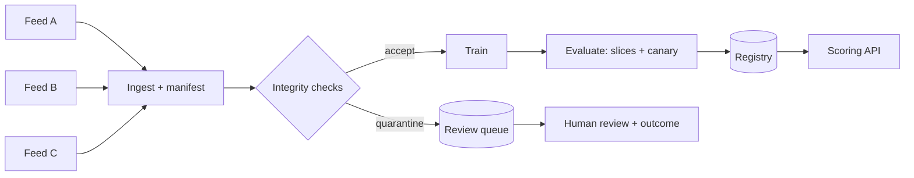

# C2 · CreditGuard — poisoning-resilient credit decisioning

## 1. Project title

**CreditGuard: detecting and bounding label poisoning in a partner-sourced credit decisioning model.**

## 2. Industry background

Consumer lenders increasingly train affordability models on data assembled from partners: open-banking
aggregators, brokers and merchant platforms. The labels are often the partner's own repayment outcomes. A partner
with a commercial interest in approvals has both motive and access. Regulators in several jurisdictions now expect
model-risk documentation that names data provenance and integrity controls, not just accuracy.

## 3. Problem statement

Build a lending decision model on synthetic partner-sourced data, inject realistic poisoning you control, and
determine which integrity controls detect it, what they cost in approvals and reviewer hours, and what the model
owner can honestly claim about integrity at a stated detection threshold.

## 4. Research motivation

Poisoning literature reports attack success on benchmark datasets. Lenders need the inverse: for a given poison
rate and detection threshold, what fraction of poisoned records is caught, how many clean applications are wrongly
quarantined, and what the applicant-facing cost of a false quarantine is. That trade-off, rather than attack
success, is the decision-relevant number.

## 5. Objectives

1. Build a reproducible pipeline from partner feeds to a served decision with a documented provenance chain.
2. Implement three poisoning attacks at 1 %, 3 % and 5 % with a labelled ground truth.
3. Implement and calibrate three detectors; report precision and recall at each rate.
4. Quantify the operational cost of false positives in reviewer hours and declined good applicants.
5. Produce a model-risk pack: data lineage, control evidence, residual risk and an approval recommendation.

## 6. Scope

**In scope:** 5,000 synthetic applications across three feeds; a gradient-boosted or logistic model; label-flip and
targeted-region poisoning; three detectors; thresholds and their costs; SQLite provenance; FastAPI scoring endpoint.

**Out of scope:** real credit data, fair-lending statistical testing beyond a basic disparate-impact check on
synthetic groups, production deployment, adverse-action notice generation, collections strategy.

## 7. System architecture

## 8. Threat model

| # | Threat | Actor and access | Impact | Control to evaluate |
|---|---|---|---|---|
| T1 | Label flipping by a partner | Feed write access | Approvals for bad risks | Label-distribution check per feed |
| T2 | Targeted region poisoning | Feed write access | Systematic approval shift | Slice-canary evaluation |
| T3 | Clean-label bias | Feed write access, features only | Undetected drift | Feature outlier scan |
| T4 | Feed substitution | Supply-chain access | Unknown data trains model | Manifest digest + expected root |
| T5 | Silent retrain regression | Internal pipeline | Degraded model served | Promotion gate with canary |
| T6 | Extraction of the decision model | API access | IP loss, gaming | Quotas + output granularity |
| T7 | Insider threshold tampering | Internal access | Cost/approval imbalance | Signed configuration + audit |
| T8 | Review queue flooding | Partner submits many records | Reviewer overload, auto-approve | Queue rate limits + SLA |

## 9. Functional requirements

F1 ingest with manifest and row counts; F2 detector suite producing a ranked quarantine list with reasons; F3 review
queue with adjudication outcomes feeding back; F4 training on accepted records only; F5 slice evaluation with a
pinned canary; F6 scoring API returning decision and top three contributions; F7 provenance query from a decision to
feed, manifest and gate results.

## 10. Security requirements

S1 feed identity authenticated per partner; S2 manifests verified against an expected root before ingest; S3
detectors cannot read the ground-truth labels; S4 quarantine decisions audited with detector and score; S5 API
authenticated, rate-limited and return coarser output than probabilities to the partner tier; S6 configuration
signed and versioned; S7 no personal data in logs.

## 11. Dataset requirements

A generator producing 5,000 applications with 18 features, three partner feeds with distinct distributions, labels
with a realistic base rate (8–12 % default), and a held-out split pinned by digest. The poison injection writes
record ids to a file the detectors never read. Include a canary slice of 300 applications covering a targeted region
so that slice effects are measurable.

## 12. Implementation methodology

Weeks 1–2: generator, manifests, baseline model, provenance schema. Weeks 3–4: three attacks and their measured
effect on global and slice metrics. Weeks 5–6: detectors and their standalone precision/recall. Week 7: review queue
and adjudication loop. Week 8: thresholds and cost model. Week 9: model-risk pack. Week 10: defence.

## 13. Testing methodology

- **Ground-truth separation:** detector module has no access to the injection file; enforced by an import check.
- **Rate sweep:** 1 %, 3 %, 5 % poison, each with precision, recall and clean-record false positives.
- **Slice sensitivity:** targeted-region error versus global error, showing why aggregate metrics hide it.
- **Feed substitution:** a feed with a regenerated manifest; assert rejection without the expected root.
- **Cost model:** reviewer minutes per quarantined record, and declined-good-applicant count at each threshold.

## 14. Expected results

Detection recall rising with poison rate while precision falls; a slice gap visible before global accuracy moves; a
feed-substitution attempt rejected only when the expected root is supplied. The honest finding is usually that at
1 % poison a usable threshold quarantines more clean records than poisoned ones.

## 15. Evaluation metrics

| Metric | Why it matters |
|---|---|
| Recall and precision per poison rate | Detection claim |
| Clean records quarantined per 1,000 | Operational cost |
| Slice error gap (targeted vs global) | Whether aggregate metrics are sufficient |
| Reviewer hours per week at threshold | Feasibility |
| Rejection rate of substituted feeds | Supply-chain claim |

## 16. Deliverables

Seeded generator; three attacks; three detectors; calibrated thresholds with a cost model; review queue; scoring API;
provenance query; model-risk pack (6–8 pages); defence.

## 17. Suggested extensions

Add a clean-label attack and report detector survival; add a second model family to test whether detection is
model-agnostic; add differential privacy to the training step and price the utility loss against the poisoning
resilience gained.

## 18. Assessment rubric

The [capstone rubric](../../capstone/index.md#public-rubric) applies, weighted toward **Technical depth** and
**Evidence quality**. A submission that reports a single detection rate without the clean-record cost has not
answered the problem, however good the code is.
