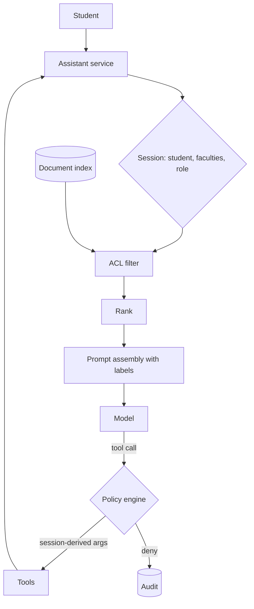

# C3 · Campus Assistant — tenancy and tool authority

## 1. Project title

**Campus Assistant: one conversational surface, three faculties, and the authority to act.**

## 2. Industry background

Universities run dozens of disconnected help surfaces: admissions, timetabling, fees, visas, disability support.
Students ask across all of them. A single assistant that retrieves policy and performs a few actions (book an
appointment, open a ticket, request a transcript) is attractive, and it concentrates risk: one prompt reaches
several faculties' documents, and one tool call can act on a student's record.

## 3. Problem statement

Build a multi-tenant assistant over synthetic faculty documents with three tools, and determine whether tenancy
isolation and tool authority hold under adversarial use — including a student who is a member of two faculties, a
document shared between faculties, and an injected instruction inside a legitimate document.

## 4. Research motivation

Tenancy and agency are usually studied separately: retrieval isolation in RAG work, authorisation in agent work.
In a real assistant they compose, and composition is where the failures are. A correct ACL with a tool that trusts
model-supplied ids is still a breach; a correct policy with a retrieval filter applied after ranking still leaks.

## 5. Objectives

1. Build the assistant with three tenants, sharing sets, three tools and citations.
2. Prove isolation with negative tests across adversarial queries, cache and shared documents.
3. Prove tool authority with a policy engine that derives every argument from the session.
4. Measure injection success per capability, before and after controls, including an indirect payload.
5. Produce a launch argument and a two-week monitoring plan.

## 6. Scope

**In scope:** 300 synthetic documents across three faculties, FTS5 retrieval, one local or mock model, three tools
against simulated backends, a single-page interface, audit, an injection suite, a monitoring plan.

**Out of scope:** real student records, integration with a student record system, payments, multi-language support,
voice, mobile application, production hosting.

## 7. System architecture

## 8. Threat model

| # | Threat | Actor and access | Impact | Control to evaluate |
|---|---|---|---|---|
| T1 | Cross-faculty retrieval | Student, crafted query | Confidentiality | Pre-ranking faculty filter, absence tests |
| T2 | Shared-document over-reach | Student in one faculty | Confidentiality | Sharing-set check, not tenant equality |
| T3 | Injected instruction in a document | Document author | Data disclosure, action | Instruction-as-data labelling + output check |
| T4 | Tool argument tampering | Student text | Action on another record | Session-derived arguments; policy validation |
| T5 | Cache cross-talk | Any student | Disclosure | Cache key includes tenant and clearance |
| T6 | Appointment spam | Student, scripted | Availability, staff time | Per-session tool-call budget |
| T7 | Ticket content injection | Student | Escalation, social engineering | Ticket body treated as untrusted; rate limits |
| T8 | Audit gap | Insider | No accountability | Append-only audit with rule names |

## 9. Functional requirements

F1 answers cite chunk ids; F2 shared documents retrievable by both faculties; F3 three tools with visible
confirmation; F4 per-student session with faculty membership; F5 appointment booking against a simulated calendar;
F6 ticket creation returning a reference; F7 transcript request that only the student can initiate.

## 10. Security requirements

S1 ACL evaluated before ranking and re-checked before model invocation; S2 missing labels fail closed; S3 tool
arguments derived from session, model-supplied ids rejected; S4 policy denies by default with rule names; S5 per-
session budgets on turns and tool calls; S6 audit excludes document text; S7 kill switch per tenant.

## 11. Dataset requirements

A generator producing 300 documents: 240 faculty-private (80 each), 40 shared between two faculties, 20 public.
Each carries `tenant_set`, `sensitivity`, `owner`, `doc_id`, `effective_date`. Include ten documents with near-
identical text across faculties, three containing instruction-like text, and a query set of 40 questions with known
correct citations per faculty.

## 12. Implementation methodology

Weeks 1–2: generator, labels, index. Weeks 3–4: retrieval with pre-filtering and negative tests. Week 5: prompt
assembly with labels and citations. Weeks 6–7: tools, policy engine, confirmation UI. Week 8: injection suite and
measurement. Week 9: cache-key fix and monitoring plan. Week 10: launch argument and defence.

## 13. Testing methodology

- **Isolation:** 40 queries, each asserting absence of foreign chunk ids; include five adversarial queries whose best
  lexical match is foreign.
- **Shared documents:** a student in both faculties retrieves a shared document once, not twice.
- **Authority:** ten tool requests, at least five denied, including a transcript request for another student.
- **Injection:** direct, indirect (document) and ticket-body payloads, measured per capability.
- **Cache:** warm as faculty A, query as faculty B with identical text; assert a miss.

## 14. Expected results

Zero foreign chunks after pre-filtering, with a measured recall cost on the 40-query set. Injection success on
disclosure should fall but rarely to zero without an output check; action-based payloads should reach zero once
arguments are session-derived. Report the difference rather than averaging it away.

## 15. Evaluation metrics

| Metric | Target | Note |
|---|---|---|
| Foreign-chunk occurrences / 40 queries | 0 | Primary isolation claim |
| Recall@5 filtered vs unfiltered | reported | Cost of isolation |
| Tool denials correctly enforced | 5/5 | Authority claim |
| Injection success per capability | before/after | Disclosure vs action distinguished |
| Median answer latency | < 2 s local | Usability floor |

## 16. Deliverables

Generator and index; assistant service; policy engine with tests; injection suite; isolation and cache tests;
monitoring plan; launch argument; defence.

## 17. Suggested extensions

Add a fourth tenant with a different sharing topology; add a second model and compare injection baselines; add a
document-review workflow that checks labels against content and report its false-positive rate.

## 18. Assessment rubric

The [capstone rubric](../../capstone/index.md#public-rubric) applies, weighted toward **Technical depth** and
**Remediation**. The most common high-scoring finding is a cache key that omits the tenant; the most common
low-scoring one is a policy that validates tool arguments in the prompt.
