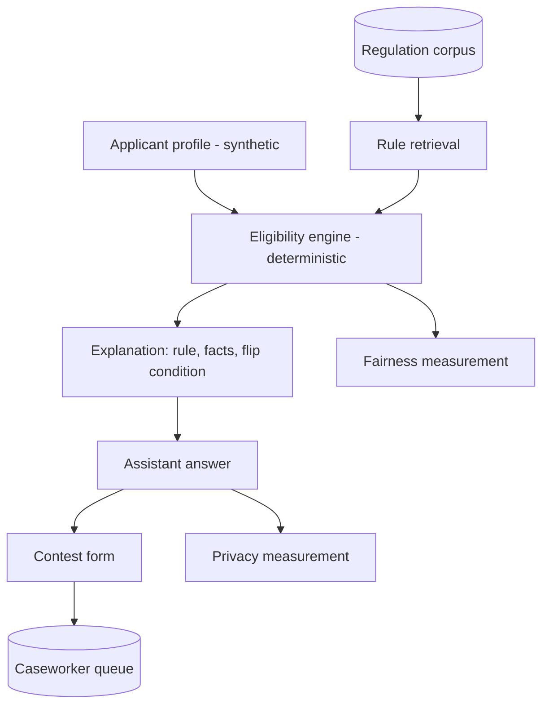

# C4 · Benefits Guide — contestable eligibility support

## 1. Project title

**Benefits Guide: an eligibility assistant whose answers a citizen can challenge.**

## 2. Industry background

Public agencies use assistants to explain eligibility rules for benefits, housing support and disability
allowances. The stakes are asymmetric: a wrong "you are not eligible" can deprive someone of support, and the
person affected rarely has the technical vocabulary to contest it. Several jurisdictions now require that automated
advice be explainable, that personal data be minimised, and that a human decision-maker remain accountable.

## 3. Problem statement

Build an assistant that answers eligibility questions over synthetic regulations and a synthetic applicant profile,
with an explanation a non-specialist can challenge: which rule applied, which facts it used, and what would change
the answer. Then assess it for privacy leakage, disparate impact across synthetic groups, and whether the
explanation matches the decision.

## 4. Research motivation

Explainability work often stops at "the model cited a document". Public-sector use needs more: the citation must be
the rule that actually determined the outcome, the facts used must be visible, and the applicant must be able to
say "that fact is wrong". This capstone measures the gap between a plausible explanation and a faithful one.

## 5. Objectives

1. Build a rule-grounded assistant: retrieval over regulation text, plus a deterministic eligibility calculation.
2. Produce a faithful explanation: rules applied, facts used, and the minimal change that flips the outcome.
3. Measure privacy leakage from the profile store and from the assistant's answers.
4. Measure disparate impact across three synthetic groups and decide whether the design is defensible.
5. Produce a DPIA-style assessment and a contestability design a caseworker would accept.

## 6. Scope

**In scope:** 40 synthetic regulation documents, 500 synthetic applicant profiles, a deterministic eligibility
calculator for three benefit types, a retrieval-and-explain layer, a contest form, privacy and fairness measurement,
a DPIA-style pack.

**Out of scope:** real benefits rules (they change and are jurisdiction-specific), real applicant data, appeal
decision-making, payments, integration with case-management systems, legal advice.

## 7. System architecture

The design point: the model explains, the engine decides. Any proposal that lets the model decide has to argue why.

## 8. Threat model

| # | Threat | Actor and access | Impact | Control to evaluate |
|---|---|---|---|---|
| T1 | Plausible but unfaithful explanation | Model behaviour | Citizen cannot contest | Faithfulness test against engine rules |
| T2 | Profile disclosure through answers | Any user, crafted question | Privacy harm | Answer filtering; no profile echo |
| T3 | Cross-applicant retrieval | Crafted query | Confidentiality | Per-applicant scoping |
| T4 | Rule corpus poisoning | Corpus write access | Wrong advice at scale | Corpus manifest + review gate |
| T5 | Disparate impact | Design, not attacker | Unlawful discrimination | Group-level outcome measurement |
| T6 | Over-collection of facts | Design | Privacy harm | Minimisation check per benefit type |
| T7 | Explanation drift after rule update | Pipeline | Wrong advice | Rule version pinned with corpus digest |
| T8 | Contest form injection | Applicant text | Caseworker harm | Treat as untrusted; length limits; no auto-action |

## 9. Functional requirements

F1 answer with rule id, facts used and outcome; F2 "what would change this answer" produced from the engine, not
the model; F3 contest form pre-filled with the facts in question; F4 caseworker queue with the engine's trace; F5
rule version displayed; F6 refusal to answer outside the three benefit types; F7 export of the explanation as text.

## 10. Security requirements

S1 profiles scoped per applicant with fail-closed lookup; S2 answers never echo another applicant's facts; S3 corpus
verified by manifest before use; S4 the explanatory text is generated from the engine trace, not free-form; S5
contest submissions rate-limited and sanitised; S6 audit records rule version, facts hash and outcome; S7 retention
period and deletion path for profiles and contests.

## 11. Dataset requirements

40 synthetic regulation documents with explicit thresholds and conditions, including two that supersede an earlier
rule; 500 synthetic profiles with a deliberate three-group split and a documented generator; 60 test questions with
known correct outcomes; a corpus digest recorded with each rule version.

## 12. Implementation methodology

Weeks 1–2: corpus, rule encoding, engine tests. Weeks 3–4: retrieval and rule mapping; explanation generation from
traces. Week 5: contest form and caseworker queue. Weeks 6–7: faithfulness testing. Week 8: privacy measurement.
Week 9: fairness measurement and DPIA pack. Week 10: defence.

## 13. Testing methodology

- **Faithfulness:** for 60 questions, compare the explanation's cited rule with the engine's determining rule;
  report mismatch rate.
- **Flip condition:** for 20 cases, apply the suggested change and confirm the outcome changes; report failures.
- **Privacy:** attempt to elicit another applicant's facts; measure success; measure profile-store exposure.
- **Fairness:** outcome rates by group at equal input distributions, with confidence intervals, and a stated
  decision rule for what would be unacceptable.
- **Corpus integrity:** a modified rule document; assert rejection by digest.

## 14. Expected results

Faithfulness is the hard part: expect a non-trivial mismatch rate when explanations are model-written, which is the
argument for trace-generated text. Fairness results depend on your generator; the deliverable is the measurement and
the decision rule, not a favourable number.

## 15. Evaluation metrics

| Metric | Target | Why |
|---|---|---|
| Explanation-rule mismatch rate | < 5 % | Contestability depends on it |
| Flip-condition accuracy | 100 % of tested cases | A wrong flip misleads the applicant |
| Cross-applicant disclosure attempts | 0 successful | Privacy claim |
| Group outcome gap | reported with CI | Fairness claim and decision rule |
| Rule-version traceability | 100 % of answers | Accountability |

## 16. Deliverables

Rule corpus and engine with tests; assistant with trace-generated explanations; contest form and caseworker queue;
faithfulness and fairness measurements; privacy assessment; DPIA-style pack; defence.

## 17. Suggested extensions

Add a second jurisdiction's rules and show the engine's version pinning; add an appeal-outcome feedback loop and
measure whether explanations improve; add a plain-language rewrite layer and test whether it preserves faithfulness.

## 18. Assessment rubric

The [capstone rubric](../../capstone/index.md#public-rubric) applies, with **Assurance argument** and **Severity
judgement** carrying the most weight. A finding such as "the explanation cited a relevant but non-determining rule in
14 of 60 cases" is exactly the kind of result this proposal is designed to produce.
