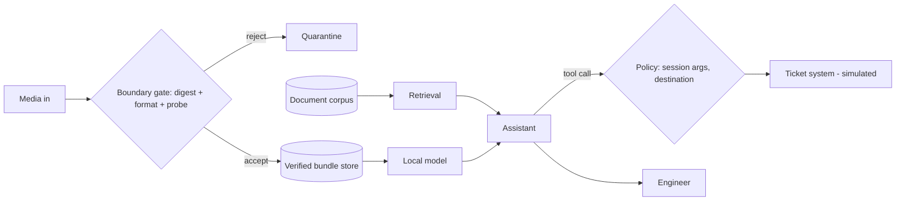

# C5 · OfflineOps — air-gapped operations copilot

## 1. Project title

**OfflineOps: a contained, air-gapped copilot for industrial control documentation.**

## 2. Industry background

Utilities, water companies and manufacturers run air-gapped networks for operational technology. Engineers need
fast answers from thick manuals, maintenance logs and incident reports. Cloud assistants are excluded by policy, so
local models on commodity hardware are the only option — and those models are downloaded, fine-tuned and packaged by
someone, which reintroduces a supply chain into a network designed to have none.

## 3. Problem statement

Build an air-gapped assistant that answers questions from a local corpus, can open a maintenance ticket on an
internal system, and runs from a verified model bundle. Then assess whether a poisoned document or a tampered model
bundle can change what an engineer is told or make the assistant act outside its authority.

## 4. Research motivation

Air-gapped deployments are treated as safe because they are disconnected. The threats that remain are local:
artefacts carried in on media, documents with embedded instructions, and models that behave differently after a
fine-tune. This capstone measures how much of that risk is detectable with checks an engineer could actually run on
a laptop.

## 5. Objectives

1. Build an offline assistant over a 200-document corpus with citations, using a local model or a deterministic mock.
2. Verify a model bundle by digest and behaviour before it is loaded, and demonstrate the check rejecting a tampered
   bundle.
3. Detect a document containing an instruction and show what the assistant does with it.
4. Contain the ticket tool: session-derived arguments, allowlisted destination, per-session budget.
5. Produce an operator runbook and an integrity gate that could run at the network boundary.

## 6. Scope

**In scope:** 200 synthetic documents (manuals, logs, incident reports), a local model via Ollama or the starter
mock, FTS5 retrieval, a ticket tool against a simulated backend, bundle verification, an injection suite, a boundary
gate script.

**Out of scope:** real control-system data, live OT integration, model fine-tuning at scale, safety-case analysis,
hardware procurement, physical media handling procedures (assessed only as a documented control).

## 7. System architecture

## 8. Threat model

| # | Threat | Actor and access | Impact | Control to evaluate |
|---|---|---|---|---|
| T1 | Poisoned manual with embedded instruction | Document contributor | Wrong maintenance advice | Instruction-as-data labelling; citation check |
| T2 | Tampered model bundle | Media or internal path | Altered behaviour | Digest + expected root + probe set |
| T3 | Ticket tool abuse | Engineer text or injected document | Spurious or escalated tickets | Session-derived args; destination allowlist |
| T4 | Corpus poisoning at scale | Contributor with bulk access | Systematic bias in advice | Manifest + review gate + sample audit |
| T5 | Model substitution after install | Local filesystem access | Silent behaviour change | Load-time digest check; probe test |
| T6 | Offline answer fabrication | Model behaviour | Wrong advice without citation | Citation requirement; refusal when uncited |
| T7 | Log tampering | Insider | No accountability | Append-only audit; hash chain |
| T8 | Engineer over-trust | Human factor | Unchecked wrong decision | Confirmation display; source excerpt shown |

## 9. Functional requirements

F1 answer with document and section citations; F2 refusal when no citation is available; F3 ticket creation with
reference; F4 bundle verification command with human-readable verdict; F5 probe-set comparison after load; F6
document ingestion with manifest; F7 offline operation with no outbound network (demonstrated).

## 10. Security requirements

S1 bundle loads only after digest verification against a separately supplied root; S2 format restricted to data-only
artefacts where possible; S3 probe set run at load and compared with stored reference; S4 retrieval scoped to the
corpus and sensitivity level; S5 tool arguments from session; S6 egress blocked at runtime, demonstrated by a test;
S7 audit append-only with a hash chain so deletion is detectable.

## 11. Dataset requirements

200 synthetic documents across three plants with overlapping equipment names; ten documents containing
instruction-like text (five obvious, five indirect); a probe set of 30 questions with expected answers; two model
bundles: one clean, one with a modified artefact and a regenerated manifest; a canary document to detect prompt
leakage.

## 12. Implementation methodology

Weeks 1–2: corpus and retrieval baseline. Week 3: bundle format and gate. Weeks 4–5: assistant with citations and
refusals. Week 6: tool and policy. Week 7: injection suite and results. Week 8: load-time probe verification. Week
9: runbook and boundary gate. Week 10: defence.

## 13. Testing methodology

- **Bundle rejection:** tampered artefact with regenerated manifest; must fail against the expected root only — and
  you explain why the internal-only check passes.
- **Behavioural drift:** a bundle that passes digest verification but fails the probe set (construct one).
- **Injection:** five payloads in documents, measured by whether advice or tool behaviour changes.
- **Egress:** attempt an outbound connection; assert it fails and is logged.
- **Audit chain:** delete a row; show the chain verification detects it.

## 14. Expected results

The digest gate rejects the tampered bundle; the probe set catches the behaviourally drifted one. Injection in a
document should change neither citation nor tool behaviour once arguments are session-derived, but may still alter
the prose of an answer — report that difference precisely, because it is the residual risk an operator must know.

## 15. Evaluation metrics

| Metric | Target | Why |
|---|---|---|
| Tampered bundles rejected | 2/2 | Integrity claim |
| Probe-set pass rate on clean bundle | 100 % | Baseline for comparison |
| Injection-induced tool calls | 0 | Containment claim |
| Uncited answers | 0 | Fabrication control |
| Egress attempts blocked | all | Air-gap claim |

## 16. Deliverables

Corpus generator; retrieval and assistant; policy engine and tool; bundle gate with probe verification; injection
suite and results; hash-chained audit; operator runbook; defence.

## 17. Suggested extensions

Add a signed bundle format with key rotation; add a second local model and compare injection behaviour at identical
prompts; build a physical-media intake procedure and test it against a scripted adversary.

## 18. Assessment rubric

The [capstone rubric](../../capstone/index.md#public-rubric) applies, weighted toward **Technical depth** and
**Remediation**. The exemplary result is a bundle that passes the internal manifest and fails only against an
independently obtained root — with the residual risk of behavioural drift stated and probed.
