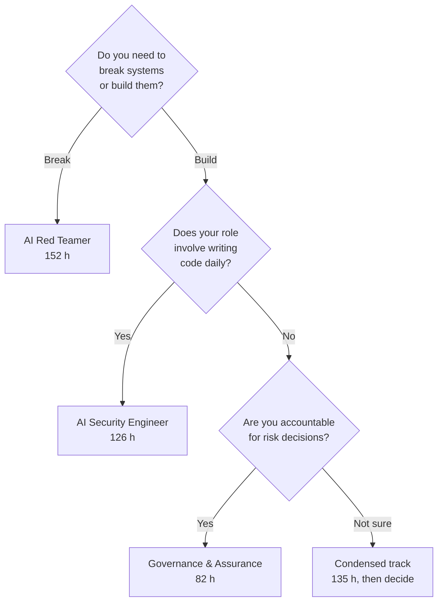

# Study Plans

The same content supports three routes. Choose by the time you actually have, not the time you wish you had.

The hour figures below are estimates for a student who meets the prerequisites and does the work rather than skimming it. They include reading, the worked examples, the exercises and the knowledge checks — but not the projects, unless stated.

## Plan A — Full pathway

**≈ 460 hours · all 20 modules · roughly two semesters**

| Component | Hours |
|---|---|
| Level 1 — Foundation (05 modules) | 52 |
| Level 2 — Intermediate (05 modules) | 72 |
| Level 3 — Advanced (05 modules) | 72 |
| Level 4 — Professional Practice (05 modules) | 88 |
| Scenario assignments (08 of 12) | 24 |
| Mini projects (04 of 10) | 40 |
| Major projects (02 of 06) | 50 |
| Capstone | 60 |
| **Total** | **458** |

This is the complete course and the only route that covers all twenty modules. At 15 hours a week it fits two 14-week semesters with room for revision.

**Choose it if** you are working towards a specialisation in AI security, or you want the capstone on your portfolio.

## Plan B — Condensed semester track

**≈ 135 hours · 8 modules + a scoped capstone · one 14-week semester at ~10 h/week**

| Module | Why this one |
|---|---|
| 01 Introduction to Securing AI Systems | Nothing later makes sense without the vocabulary and the map |
| 02 AI, ML and DL Security Fundamentals | What training optimises, and why learned systems fail differently |
| 03 Cybersecurity Fundamentals for AI Systems | The classical controls every AI system still needs |
| 06 Adversarial Machine Learning | One complete attack cycle, done properly |
| 11 Fundamentals of LLM Security | The structural reason injection exists |
| 12 Prompt Injection and Jailbreak Attacks | The vulnerability you will meet most often |
| 16 Secure AI APIs | The interface most real systems expose |
| 17 AI Red Teaming and Security Testing | Turns knowledge into a professional deliverable |

Plus **one mini project** (10 h) and a **capstone-lite** (21 h) that assesses a small supplied system rather than a full application.

**What you give up:** threat modelling in depth (04), data protection (05), poisoning (07), robustness (08), privacy and extraction (09, 10), RAG (13), agents (14), supply chain (15), monitoring (18), governance (19), deployment (20). Each is a self-contained module you can take later.

**Choose it if** this is a single elective and you need a coherent, complete experience rather than a comprehensive one.

## Plan C — Specialisation tracks

For a student who has finished Level 1 (or Plan B) and knows where they are heading. The capstone is included in the totals.

### AI Red Teamer — 152 h + 60 h capstone

Modules **01, 03, 06, 07, 08, 09, 10, 12, 13, 14, 17**

The offensive route: adversarial ML in depth, then LLM, retrieval and agent exploitation, then engagement discipline. Produces someone who can scope, execute and report an AI security assessment.

**Missing deliberately:** threat modelling as a formal deliverable (04), data protection engineering (05), supply chain (15), APIs (16), operations (18), governance (19). A red teamer needs to recognise these, not build them.

### AI Security Engineer — 126 h + 60 h capstone

Modules **01, 02, 03, 05, 15, 16, 18, 19, 20**

The defensive route: build, harden, operate. Emphasis on the pipeline and the interface — data, artefacts, APIs, monitoring — plus enough attack knowledge to evaluate your own controls.

**Missing deliberately:** the adversarial measurement work (06–10) and the LLM application detail (11–14). You will meet these as threats, not as skills. If you can add one module to this track, add 12.

### AI Governance and Assurance — 82 h + 40 h project

Modules **01, 03, 04, 05, 19, 20**

The assurance route: understand what the technology can and cannot guarantee, then document, assess and audit it. Suited to students heading into policy, audit, risk or compliance roles where technical literacy is the differentiator.

**Missing deliberately:** hands-on attack work and model engineering. You will read attack results and evaluation reports, not produce them.

## Choosing between them

??? note "Diagram description"
    A decision tree. The first question asks whether you need to break systems or build them. Answering "break" leads to the AI Red Teamer track (152 hours). Answering "build" leads to a second question about whether the role involves writing code daily: yes leads to the AI Security Engineer track (126 hours); no leads to a third question about accountability for risk decisions, where yes leads to the Governance and Assurance track (82 hours) and "not sure" leads to the condensed 135-hour track before deciding.

## A realistic weekly rhythm

Most students underestimate reading and overestimate practical time. A typical module week looks like this:

| Day | Activity | Hours |
|---|---|---|
| Mon | Read the introduction, objectives and detailed explanations; take notes | 1.5 |
| Tue | Work the mathematics and reproduce the Python example | 1.0 |
| Wed | Exercises, recall and apply | 1.5 |
| Thu | Exercises, extend; write up the result | 1.5 |
| Fri | Knowledge check, revisit weak sections | 1.0 |
| Sat | Summary and references, then start the next module's reading | 1.0 |

That is 7.5 hours a week, which covers the condensed track comfortably and the full pathway in about two and a half semesters at a sustainable pace.

## What to do when you fall behind

You will. The fix is not to compress; it is to cut.

1. **Drop to skimming for one module or one level**, then return to study mode at the next level boundary. Levels assume only the previous level's vocabulary and skills.
2. **Never skip the measurement work in Level 2.** Attack success rates with denominators, intervals and baselines are the skill everything later depends on. Skip a knowledge check instead.
3. **Use the checkpoint gates** in the [roadmap](../roadmap.md) to decide whether to move on. If you cannot pass a gate, moving on will cost more later than repeating the work now.
4. **Keep the capstone.** If you must reduce, shrink its scope rather than removing it — a defended, documented assessment of a small system is worth more than a large unfinished one.

## For instructors

Plans A and B map onto a 3-credit and a 4-credit semester respectively; the [assessment overview](assessment.md) gives a default weighting. Institutional calendars vary, so the plans are expressed in hours rather than weeks — convert to your own term structure rather than trusting the week counts above.
