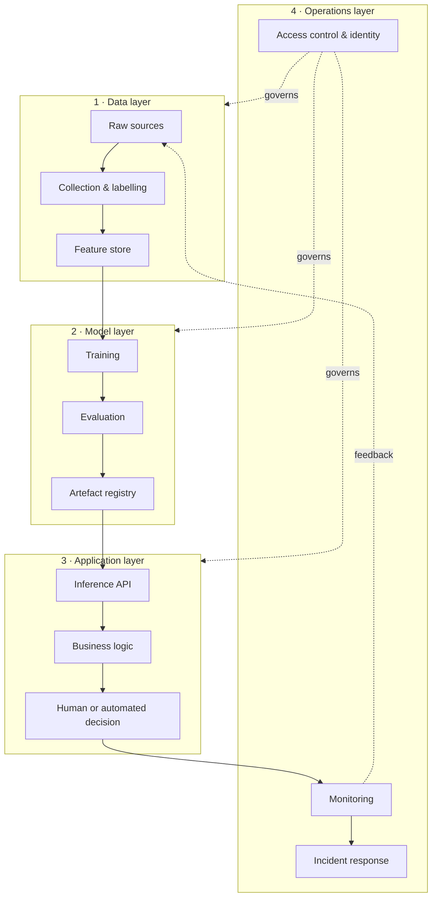

# 01 · Introduction to Securing AI Systems

<div class="sas-module-card">
  <div class="sas-module-card__head">
    <span class="sas-module-card__kicker">Module 01</span>
    <span class="sas-module-card__level">Level 1 — Foundation</span>
    <a class="sas-badge sas-badge--review" href="../../getting-started/how-to-use/#status-badges">In review</a>
  </div>
  <ul class="sas-module-card__facts">
    <li><strong>8 hours</strong>Study time, lab included</li>
    <li><strong>None</strong>Prerequisite</li>
    <li><strong>1 lab</strong>Runs on a laptop CPU</li>
  </ul>
  <div class="sas-module-card__links">
    <a class="sas-chip sas-chip--primary" href="#learning-objectives">Learning outcomes</a>
    <a class="sas-chip" href="../../labs/">Lab</a>
    <a class="sas-chip" href="../../labs/#notebooks">Notebook</a>
    <a class="sas-chip" href="#practical-exercises">Exercises</a>
    <a class="sas-chip" href="#knowledge-check">Knowledge check</a>
    <a class="sas-chip" href="../../quizzes/m01/">Quiz</a>
    <a class="sas-chip" href="../../research/">Research reading list</a>
  </div>
</div>

<div data-sas-progress></div>

## Introduction

In March 2024 a hospital in the United Kingdom discovered that a sepsis-prediction model, in production for two years, had been quietly underperforming. The model had not been hacked. Nobody had stolen it. It had simply been retrained on data from a new supplier of bedside observations, and the new supplier sent blood-pressure values rounded to the nearest five units instead of one. The model's inputs were still in the expected range, so nothing raised an alarm. Its sensitivity fell from 0.81 to 0.64, and for eleven months clinicians trusted a warning that arrived late or not at all.

This story is fictional, but every element of it happens. It illustrates the central difficulty of this subject: an AI system can be *insecure* without any attacker, *degraded* without any bug, and *wrong* while every dashboard is green. Security here is not a firewall around a model file. It is the property that the system keeps doing what its owner believes it does, under conditions its owner did not choose.

This module gives you the vocabulary and the mental model for the rest of the course. It answers three questions: what exactly is an AI system; what does "secure" mean for one; and who is trying to break it, and why. Everything in Modules 02–20 attaches to the map you build here.

## Learning objectives

By the end of this module you can:

1. Describe an AI system as four interacting layers — data, model, application, operations — and name the assets in each.
2. Define confidentiality, integrity and availability for AI systems, including the AI-specific meaning of *integrity*.
3. Explain four properties that make ML systems harder to secure than conventional software.
4. Identify the main classes of threat actor and match each to a plausible motive and capability.
5. Produce a first-pass risk register for a described system, with likelihood, impact and a stated assumption.
6. Explain why an accurate model can still be a security failure.

## Prerequisites

None. This is the entry point, and no security background is assumed. You should be able to read Python comfortably enough to follow short examples; if not, work through the refresher in [Prerequisites](../getting-started/prerequisites.md) first.

## Detailed explanations

### 1.1 What an AI system actually is

A model is a mathematical function with parameters. A *system* is everything that makes that function useful: the data that shaped it, the pipeline that moves data, the service that answers requests, the people who read its answers, and the processes that update it.



??? note "Diagram description"
    A top-down diagram of four layers. The data layer moves raw sources through collection and labelling into a feature store. The model layer trains on those features, evaluates, and stores an artefact in a registry. The application layer serves the model through an inference API, applies business logic, and produces a decision made by a human or automatically. The operations layer monitors the decision, handles incidents, and enforces access control and identity across all three other layers. A dashed feedback arrow runs from monitoring back to the raw data sources.

Four consequences follow from this picture, and they recur for the entire course:

- **Assets are distributed.** The weights matter, but so do the training data, the labels, the features, the prompts, the logs and the reputation of the decision.
- **Trust boundaries are numerous.** Data crosses from a supplier into a lake, from a lake into training, from training into a registry, from a registry into a service, from a service into a decision. Each crossing is a place where an attacker can act and a control can sit.
- **The model is an input, not just code.** An attacker who can influence data influences behaviour without touching a line of software.
- **Feedback loops exist.** Monitoring feeds retraining, which feeds behaviour. A small manipulation can be amplified by the loop.

### 1.2 What "secure" means for an AI system

Security professionals describe three properties, known as the CIA triad. AI systems require all three, plus an additional one that classical software does not need.

**Confidentiality** — information is not disclosed to those not entitled to it. In AI this extends past the model file to the training data (a model can leak the records it learned from), the prompts and system instructions, the feature distributions, and the fact that a particular person is or is not in a dataset.

**Integrity** — information and behaviour are as intended. This is where AI security diverges from application security. Classically, integrity means "the bytes were not modified". For an AI system, integrity means the *decision function* still behaves as its owner believes: same inputs, same intended outcomes, no hidden trigger, no silent drift, no unauthorised substitution of weights.

**Availability** — the system serves its users when needed. For AI this includes the obvious (the API responds) and the less obvious (the model still has a provider, the data pipeline still runs, the inference budget is not exhausted by an attacker who pays nothing and costs you a fortune).

**Behavioural assurance** — you can demonstrate, with evidence, that the first three properties hold. This fourth property is what separates a security *claim* from a security *belief*. It is why every module in this course ends with detection and evaluation rather than reassurance.

### 1.3 Why AI systems are harder to secure

Conventional software security has decades of accumulated practice: input validation, least privilege, memory safety, dependency pinning. Those still apply. Four properties of learned systems make the problem harder.

**Behaviour is learned, not written.** You cannot read the source code of a decision boundary. A conventional bug can be found by reading; a model's vulnerability is a property of a high-dimensional function that you must probe empirically. This is why Module 08 (evasion) is measurement-driven rather than proof-driven.

**Data is part of the program.** Changing a training set changes behaviour with no code change and no diff to review. An attacker with write access to a public dataset has a form of code injection that no linter will catch (Module 07).

**Behaviour is distributional.** A model is only defined on the distribution it was trained for. Push inputs slightly outside it and behaviour becomes undefined — and "outside the distribution" includes values an attacker chooses (Module 02, Module 08).

**Outputs are consumed as facts.** Applications increasingly pipe model output into SQL, shells, HTML and other APIs. A model that can be persuaded to emit the wrong text becomes a classic injection primitive (Modules 12 and 16).

!!! note "The practical consequence"

    You cannot secure an AI system by reading it. You secure it by (a) placing controls at boundaries you can enumerate, and (b) testing behaviour under adversarial conditions you choose. Every module from 04 onward trains one of those two skills.

### 1.4 Who attacks an AI system, and why

| Actor | Motive | Typical capability | Typical target |
|---|---|---|---|
| **Insider** | Revenge, fraud, curiosity, coercion | Legitimate credentials; knows the pipeline | Training data, labels, model registry |
| **Competitor** | Model theft, cost avoidance | Query access to a public API; budget | Inference service (Module 10) |
| **Organised fraud** | Evade detection at scale | Can generate many inputs cheaply | Fraud and abuse classifiers (Module 08) |
| **Supply-chain attacker** | Persistence, broad reach | Controls a dataset, package or base model | Anything downstream (Module 15) |
| **Researcher / hobbyist** | Curiosity, reputation, "because it is there" | Public tools, public models | Prompt-driven systems, public demos |
| **State-level actor** | Intelligence, disruption | Patience, resources, zero-days | High-value models, agentic systems |
| **Accidental insider** | None — this is not malice | Poor tooling, deadline pressure | Everything (misconfiguration is the most common cause of real incidents) |

The last row deserves emphasis. In practice, most AI security failures reported by organisations are not attacks. They are misconfigurations, unvalidated assumptions and unaudited changes. A course that only taught you to think about adversaries would leave you unprepared for the majority of real failures.

### 1.5 The attack surface in one view

Each module of this course corresponds to a band of this surface. Read it as a preview of where you are going.

| Surface | What an attacker does | Module |
|---|---|---|
| Requirements and design | Targets the wrong objective; omits a control | 02, 04 |
| Data collection | Poisoning, label manipulation, provenance gap | 05, 07 |
| Model training | Backdoors, hyperparameter tampering, data leak | 07, 15 |
| Model artefact | Malicious pickle, substituted weights | 15 |
| Inference service | Evasion, extraction, denial of service | 08, 10, 16 |
| Privacy | Membership inference, inversion | 09 |
| Prompts and retrieval | Injection, jailbreak, knowledge-base poisoning | 12, 13 |
| Agent tool use | Excessive agency, confused deputy, exfiltration | 14 |
| Operations | Undetected drift, slow response, no rollback | 18 |
| Governance | Unaccountable decisions, missing evidence | 19 |

## Key terminology

| Term | Definition |
|---|---|
| **AI system** | A model plus the data, application and operational machinery that make its outputs consequential |
| **Asset** | Anything whose compromise causes harm: data, weights, features, prompts, logs, credentials, reputation |
| **Trust boundary** | A point where data or control passes between components with different levels of trust |
| **Attack surface** | The set of points where an adversary can interact with the system |
| **Threat actor** | A party with the motive and capability to cause harm |
| **Vulnerability** | A weakness that a threat actor could exploit |
| **Risk** | The combination of likelihood and impact of a threat exploiting a vulnerability |
| **Control** | A measure that reduces likelihood or impact, and whose effectiveness can be evidenced |
| **Residual risk** | What remains after controls are applied — always non-zero |
| **Behavioural assurance** | Documented evidence that the system behaves as claimed under adversarial conditions |

## Mathematical foundations

Security decisions are risk decisions, and risk is a quantity. You need only three ideas at this stage.

### Expected loss

For a decision system, the expected cost of a policy is the sum over outcomes of probability times cost:

$$
\mathbb{E}[L] = \sum_{i} p_i \, c_i
$$

where $p_i$ is the probability of outcome $i$ and $c_i$ is its cost. This single expression explains more about AI security than any attack technique: **the cost of an error, not its frequency, drives the security requirement.**

### Risk score

A common industrial form is

$$
\text{Risk} = L \times I
$$

where $L \in \{1,\dots,5\}$ is likelihood and $I \in \{1,\dots,5\}$ is impact. It is crude, subjective and still far better than no register at all — provided each number is justified in writing. A score without a justification is a guess wearing a suit.

### The threshold problem

A classifier emits a score $s \in [0,1]$ and you choose a threshold $\tau$; you act when $s \ge \tau$. Lowering $\tau$ catches more positives (fewer false negatives) and creates more false positives. For a screening system:

$$
\mathbb{E}[L \mid \tau] = \pi\,(1-\mathrm{TPR}(\tau))\,c_{FN} \;+\; (1-\pi)\,\mathrm{FPR}(\tau)\,c_{FP}
$$

where $\pi$ is prevalence, $\mathrm{TPR}$ and $\mathrm{FPR}$ are the true- and false-positive rates at $\tau$, and $c_{FN}, c_{FP}$ are the costs of each error type.

Two things follow. First, the *same model* is secure or insecure depending on $\tau$ and the costs — threat modelling must include the decision threshold, not just the network. Second, an attacker who can shift the input distribution shifts $\mathrm{TPR}$ and $\mathrm{FPR}$ without touching the model at all.

## Step-by-step: your first security assessment

Use this six-step procedure on any AI system you meet, including your own coursework. It takes about an hour and produces something you can defend.

1. **Write the decision.** One sentence: "This system decides ___ for ___ using ___." If you cannot write it, you cannot secure it.
2. **List the assets.** Data (raw, labelled, features), model (weights, config, tokeniser), prompts, logs, credentials, and the decision's consequences. Rank by consequence of compromise.
3. **Draw the boundaries.** Where does data cross from one owner to another? Mark each crossing. These are where controls go.
4. **Name the actors.** For each boundary, who could act there? Use the table in §1.4, including the accidental insider.
5. **Write the risks.** For each actor–boundary pair, write: "If ___, then ___, causing ___, because ___." One sentence each. No adjectives.
6. **Attach a control and an owner.** For each risk, name one control, the evidence that proves it works, and the person accountable. A control without an owner is a wish.

## Real-world scenarios

**Healthcare.** A sepsis alerting model consumes bedside observations. Assets: patient data, the model, the alert threshold, clinician trust. Boundary of interest: the device-integration layer, where a vendor can change units or rounding. Risk: silent sensitivity loss. Control: distribution checks on each input feature at ingestion, with alerts on unit-scale changes (Module 18).

**Financial fraud detection.** A card-fraud classifier. Assets: features, the model, the decision rule that blocks a card. Boundary: the public merchant interface, where attackers control the input. Risk: evasion at scale by generating transactions just below the detection boundary (Module 08). Control: adversarial testing and a second, differently-shaped model whose errors do not correlate.

**University systems.** A model that flags applications for manual review. Assets: applicant data, the model, the review policy. Boundary: the admissions office, where staff can adjust features. Risk: manipulation by insiders with legitimate access. Control: immutable audit logs of every feature override, with periodic review (Module 19).

## Python walkthrough

The following program shows why accuracy is a poor security metric. It computes the expected loss of a screening model under two threshold choices, using the equation from §"Mathematical foundations".

```python
from dataclasses import dataclass


@dataclass
class Costs:
    prevalence: float      # fraction of true positives in the population
    cost_fn: float         # cost of missing a true positive (e.g. a missed fraud)
    cost_fp: float         # cost of a false alarm (e.g. a blocked legitimate payment)


def expected_loss(tpr: float, fpr: float, c: Costs) -> float:
    """Expected cost per decision, in the same units as the cost inputs."""
    missed = c.prevalence * (1.0 - tpr) * c.cost_fn
    false_alarm = (1.0 - c.prevalence) * fpr * c.cost_fp
    return missed + false_alarm


# A model evaluated at two operating points.
operating_points = {
    "conservative (tau=0.7)": (0.52, 0.01),
    "permissive  (tau=0.2)": (0.94, 0.18),
}

costs = Costs(prevalence=0.02, cost_fn=500.0, cost_fp=4.0)

for name, (tpr, fpr) in operating_points.items():
    print(f"{name}: TPR={tpr:.2f} FPR={fpr:.2f} "
          f"expected cost = {expected_loss(tpr, fpr, costs):.2f} per decision")
```

Running it prints roughly `11.9` for the conservative point and `13.1` for the permissive one. The permissive threshold catches far more fraud — but at 18 % false positives on 98 % of the population, it blocks legitimate customers so often that it costs more than it saves.

Now change `cost_fp` to `0.5` and re-run. The ranking flips. **Nothing about the model changed.** The security posture changed because the cost model changed — which is exactly the point of §"Mathematical foundations".

## Security implications

- A secure AI system is a **system-level** property. A hardened model inside an unhardened pipeline is not secure.
- The decision threshold and the cost model are **in scope** for security review, not just for product tuning.
- **Integrity of behaviour** must be defined concretely for each system, or it cannot be monitored. "The model still behaves as intended" is not monitorable; "sensitivity on the last 30 days of labelled data stays above 0.75" is.
- **Non-malicious failure dominates.** Any control strategy that only addresses adversaries will miss most real incidents.
- Every claim needs an **evidence artefact**: a test, a log, a report, a signed artefact manifest.

## Detection and mitigation

| Layer | Control | Evidence it works |
|---|---|---|
| Data | Schema and distribution checks at ingestion, with unit and range assertions | Alert history and a replay test with a deliberately shifted feed |
| Model | Fixed evaluation suite run on every retrain; no promotion without it | Evaluation report stored beside the artefact |
| Application | Input validation, output encoding, least privilege for the service identity | Abuse test results (Module 16) |
| Operations | Per-feature drift monitoring; alert on sensitivity loss, not just accuracy | Dashboard plus a tabletop exercise showing time-to-detect |

## Practical exercises

**Recall.**
1. List the four layers of an AI system and one asset in each.
2. Define behavioural assurance in one sentence.
3. Name three threat actors and one target for each.

**Apply.**
4. Take a system you have used (a recommendation feed, a spam filter, a university portal). Write its decision sentence, three assets, and two trust boundaries.
5. Using the code in this module, find the threshold where the two operating points have equal expected cost, and explain what that threshold means commercially.

**Extend.**
6. Argue for or against this claim: *"A model with 99.9 % accuracy on a static test set cannot be a security risk."* Use the equations above.
7. Your organisation wants to add a "security score" (0–100) to its AI dashboard. Design it so the score cannot be gamed by an engineer who wants a green light.

## Knowledge check

??? question "1. Which property is added to the CIA triad specifically for AI systems?"
    **Behavioural assurance** — documented evidence that behaviour matches the claim. Confidentiality, integrity and availability all apply, but none of them captures "we can prove it still behaves as intended".

??? question "2. Why is a mutable training dataset a security problem?"
    Because data is part of the program. A mutable dataset means behaviour can change without a code change, without review, and without a diff — and every past claim about the model becomes unfalsifiable.

??? question "3. An attacker cannot access your model or your code, only the public prediction API. What two attack classes remain available?"
    Evasion (crafting inputs that are misclassified, Module 08) and model extraction (reconstructing the model from queries, Module 10).

??? question "4. Your fraud model has 92 % recall and 2 % false positives. Is it secure? Justify in one sentence using expected loss."
    Not necessarily — security depends on the cost of the 8 % missed frauds versus the 2 % blocked legitimate customers, and on whether an attacker can shift the distribution to change those rates.

??? question "5. Give one example where the accidental insider causes more harm than a malicious attacker."
    A scientist retraining on an unvalidated data feed, silently changing the model's sensitivity, with no attacker involved at all.

## Frameworks, research and cases

- **Frameworks:** [Framework reference](../frameworks/index.md)
- **Research:** [Research reading list](../research/index.md)
- **Cases:** [Case study collection](../case-studies/index.md)

## Summary

An AI system is four layers, not one model. Security for such a system means confidentiality, integrity and availability — where integrity covers *behaviour*, not just bytes — plus behavioural assurance: the ability to prove the first three with evidence.

Four properties make learned systems harder than classical software: behaviour is learned rather than written, data is part of the program, behaviour is only defined on a distribution, and outputs are consumed as facts. The threat actors range from state-level adversaries to the engineer who retrained on the wrong feed at 6 p.m. on a Friday.

The single most useful idea in this module is that risk is arithmetic: expected loss is a sum of probability times cost, and a model's security posture depends on its threshold and its cost model as much as on its weights.

Module 02 takes the four-layer picture and looks inside it: what training actually optimises, what artefacts exist, and where each control belongs.

**Next:** [02 · Fundamentals of AI, Machine Learning and Deep Learning Security](02-ml-security-fundamentals.md) · **Related:** [04 · AI Threat Modeling](04-threat-modeling.md) · [19 · Governance and Ethics](19-governance-and-ethics.md)

<nav class="sas-lesson-nav" aria-label="Module navigation">
  <a class="sas-lesson-nav__link sas-lesson-nav__link--prev" href="../../getting-started/">
    <span class="sas-lesson-nav__dir">← Back to start</span>
    <span class="sas-lesson-nav__title">Getting started</span>
  </a>
  <a class="sas-lesson-nav__link sas-lesson-nav__link--next" href="../02-ml-security-fundamentals/">
    <span class="sas-lesson-nav__dir">Next module →</span>
    <span class="sas-lesson-nav__title">02 · Fundamentals of AI, Machine Learning and Deep Learning Security</span>
  </a>
</nav>

## References

1. NIST, *Artificial Intelligence Risk Management Framework (AI RMF 1.0)*, NIST AI 100-1, 2023. <https://doi.org/10.6028/NIST.AI.100-1>
2. OWASP, *Machine Learning Security Top 10*, 2023. <https://owasp.org/www-project-machine-learning-security-top-10/>
3. MITRE, *ATLAS: Adversarial Threat Landscape for Artificial-Intelligence Systems*. <https://atlas.mitre.org>
4. Shostack, A., *Threat Modeling: Designing for Security*, Wiley, 2014.
5. Sculley, D. et al., "Hidden Technical Debt in Machine Learning Systems", NeurIPS 2015.
6. NIST, *Guide for Conducting Risk Assessments*, SP 800-30 Rev. 1. <https://doi.org/10.6028/NIST.SP.800-30r1>
7. European Union, Regulation (EU) 2024/1689 (Artificial Intelligence Act) — risk tiers, described in [Module 19](19-governance-and-ethics.md).
