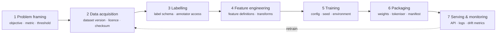

# 02 · Fundamentals of AI, Machine Learning and Deep Learning Security

<div class="sas-module-card">
  <div class="sas-module-card__head">
    <span class="sas-module-card__kicker">Module 02</span>
    <span class="sas-module-card__level">Level 1 — Foundation</span>
    <a class="sas-badge sas-badge--review" href="../../getting-started/how-to-use/#status-badges">In review</a>
  </div>
  <ul class="sas-module-card__facts">
    <li><strong>10 hours</strong>Study time, lab included</li>
    <li><strong>Module 01</strong>Prerequisite</li>
    <li><strong>1 lab</strong>Runs on a laptop CPU</li>
  </ul>
  <div class="sas-module-card__links">
    <a class="sas-chip sas-chip--primary" href="#learning-objectives">Learning outcomes</a>
    <a class="sas-chip" href="../../labs/">Lab</a>
    <a class="sas-chip" href="../../labs/#notebooks">Notebook</a>
    <a class="sas-chip" href="#practical-exercises">Exercises</a>
    <a class="sas-chip" href="#knowledge-check">Knowledge check</a>
    <a class="sas-chip" href="../../quizzes/m02/">Quiz</a>
    <a class="sas-chip" href="../../research/adversarial-ml/#evasion">Adversarial ML</a>
  </div>
</div>

<div data-sas-progress></div>

## Introduction

Two engineers are asked to review the same fraud model. The first reads the training script, finds nothing unusual, and signs off. The second asks one question — *what was it trained to optimise, and on which distribution?* — and discovers that the model was trained on data from a single card issuer, so its learned boundary is a boundary for that issuer's customers only.

Both engineers read the same code. Only the second understood what the code *does*. Security review of machine learning requires knowing what training actually optimises, what a pipeline produces as artefacts, and where each assumption becomes a vulnerability. That is what this module builds.

You will learn the learning problem in the form that matters for security: an objective, a dataset, an optimiser, and a generalisation claim — each of which is falsifiable, and each of which an attacker can attack differently.

## Learning objectives

By the end of this module you can:

1. Explain empirical risk minimisation and identify the four assumptions it relies on.
2. Describe how a deep network's parameters, gradients and depth create both capability and attack surface.
3. Trace an input through the seven lifecycle stages, naming the artefacts produced at each.
4. Explain why data is part of the program, and what that implies for change control.
5. Distinguish data drift, concept drift and malicious drift, and say why only the third is a security event.
6. Read a training script and list the security-relevant decisions it encodes.
7. Reproduce an overfitting demonstration and connect the generalisation gap to a privacy risk.

## Prerequisites

Module 01, plus working Python, NumPy and a first machine-learning course. You should be comfortable with the idea of a loss function and a training loop; if not, spend a day on the refresher in [Prerequisites](../getting-started/prerequisites.md) before continuing.

## Detailed explanations

### 2.1 Learning as optimisation, and the four assumptions

Supervised learning picks parameters $\theta$ that minimise average loss on a training set. This is called empirical risk minimisation (ERM):

$$
\hat{\theta} = \arg\min_{\theta} \; \frac{1}{n}\sum_{i=1}^{n} \ell\big(f_\theta(x_i),\, y_i\big)
$$

For this to produce a model that is useful — and safe — *outside* the training set, four assumptions must hold, and each one is an attack surface:

| Assumption | What it claims | How it breaks |
|---|---|---|
| **Representative data** | The training sample looks like deployment inputs | Distribution shift; an attacker supplies the unusual inputs (M08) |
| **Correct labels** | $y_i$ reflects truth | Label noise, crowd-worker error, deliberate flipping (M07) |
| **Stationary world** | The input–output relationship does not change | Concept drift; seasonal fraud patterns (M18) |
| **IID sampling** | Examples are independent | Duplicated records, leakage between train and test, temporal correlation |

None of these failures requires an adversary. All four are routinely violated in production, which is why security work on ML starts with data provenance rather than with cryptography.

### 2.2 Deep networks: where the capability and the attack surface come from

A deep network composes simple functions. Each layer computes a weighted sum followed by a non-linearity:

$$
h^{(l)} = \sigma\big(W^{(l)} h^{(l-1)} + b^{(l)}\big)
$$

Three properties follow, and each has a security consequence.

**Parameters are numerous.** A modest image classifier has millions of parameters. Numerically, this means the function is *very* sensitive along some input directions — which is precisely what an attacker exploits to construct an adversarial example (Module 08).

**Gradients are available.** Because the network is differentiable, $\nabla_x \ell$ can be computed by backpropagation. Anyone who can query a *white-box* model can compute this gradient and move the input in the direction that increases loss. Gradient availability is an attack capability, not just a training convenience.

**Depth creates abstraction.** Early layers learn edges, later layers learn concepts. This is why transfer attacks work between models trained on similar data (Module 08) and why a backdoor can be encoded as a small, semantically meaningless pattern that the network nonetheless associates with a class (Module 07).

### 2.3 The seven-stage lifecycle and its artefacts

Security controls attach to artefacts. A pipeline that produces no artefacts cannot be audited.



??? note "Diagram description"
    A left-to-right pipeline of seven stages. Stage 1 problem framing produces the objective, metric and threshold. Stage 2 data acquisition produces a dataset version, licence and checksum. Stage 3 labelling produces a label schema and annotator access record. Stage 4 feature engineering produces feature definitions and transforms. Stage 5 training produces configuration, seed and environment record. Stage 6 packaging produces weights, tokeniser and a manifest. Stage 7 serving and monitoring produces the API, logs and drift metrics. A dashed retraining arrow returns from stage 7 to stage 2.

Each stage is a trust boundary. A dataset version without a checksum means you cannot prove what you trained on; a training run without a recorded seed means you cannot reproduce a security test; a package manifest without a hash means you cannot prove the artefact you deployed is the one you evaluated.

### 2.4 Why ML fails differently from conventional software

**Silent degradation.** A web server that breaks returns errors. A model that degrades returns confident, plausible, wrong answers. There is no exception to catch.

**Non-determinism.** Identical requests can produce different outputs (sampling, GPU reduction order, thread scheduling). Security tests must therefore repeat and report variance, not run once.

**Opacity.** You cannot read the decision boundary. Every security claim about behaviour is therefore empirical, and must state its test method (Module 17).

**Emergent behaviour at scale.** Language and agentic systems exhibit capabilities their builders did not design, including the ability to follow instructions embedded in data (Module 12).

**Evaluation leakage.** Test sets contaminated by training data inflate every metric you use to decide the model is safe. This is the most common way organisations fool themselves.

### 2.5 Three kinds of drift, only one of which is an attack

| Drift | Definition | Example | Security relevance |
|---|---|---|---|
| **Data drift** (covariate shift) | $P(X)$ changes, $P(Y\mid X)$ stable | New device sends rounded vital signs | Degradation; possibly exploited if attacker controls the source |
| **Concept drift** | $P(Y\mid X)$ changes | Fraudsters adopt a new technique | Degradation, adversarial in origin but not targeted at you |
| **Malicious drift** | An actor *causes* either of the above to force errors | Poisoned retraining feed; probing campaign | Security incident (Modules 07, 18) |

Confusing the first two with the third wastes incident-response effort; confusing the third with the first delays it. Module 18 teaches the distinction operationally.

## Key terminology

| Term | Definition |
|---|---|
| **Empirical risk minimisation** | Choosing parameters that minimise average training loss |
| **Generalisation gap** | Difference between training and held-out performance; large gaps signal overfitting |
| **Distribution shift** | Deployment inputs differ from training inputs |
| **Artefact** | Any produced object a pipeline must be able to identify and verify: dataset, weights, config, manifest |
| **Data lineage** | The recorded history of transformations applied to a dataset |
| **Provenance** | Verifiable origin and chain of custody of an artefact |
| **Manifest** | A machine-readable inventory of a packaged model, with hashes |
| **Calibration** | Agreement between predicted confidence and observed accuracy |
| **Gradient** | Vector of partial derivatives of the loss with respect to an input or parameter |
| **Checkpoint** | Saved parameter state at a point during training |

## Mathematical foundations

### Cross-entropy loss

For $K$ classes with softmax output $\hat{y}_k = e^{z_k} / \sum_j e^{z_j}$, the loss for a true class $c$ is

$$
\ell = -\log \hat{y}_c
$$

where $z_k$ are the pre-softmax scores (logits) and $\hat{y}_c$ is the predicted probability of the correct class. Confidence and correctness are related but not identical: this equation is why a model can be *confidently wrong*, and why confidence is a poor trust signal.

### Gradient descent

$$
\theta_{t+1} = \theta_t - \eta \, \nabla_\theta \frac{1}{m}\sum_{i \in B_t} \ell\big(f_\theta(x_i), y_i\big)
$$

with learning rate $\eta$ and mini-batch $B_t$ of size $m$. The same rule, applied to the *input* rather than the parameters, is the fast gradient sign method of Module 08 — one line of algebra connects training to attack.

### Generalisation gap and its privacy meaning

$$
\text{gap} = \underbrace{\frac{1}{n}\sum_{i}\mathbb{1}[\hat{y}(x_i)=y_i]}_{\text{train accuracy}} - \underbrace{\frac{1}{m}\sum_{j}\mathbb{1}[\hat{y}(x'_j)=y'_j]}_{\text{held-out accuracy}}
$$

A large gap means the model has memorised individual training examples. Security consequence: memorisation is what a membership-inference attacker measures. The gap is not merely a quality metric; it is a *privacy* metric (Module 09).

## Step-by-step: reading a training script for security

Use these seven questions on any training code — yours or a colleague's. Each maps to a control.

1. **What is the objective?** Read the loss and the metric. If the metric is accuracy on an imbalanced problem, the model may be optimising for the wrong thing entirely.
2. **Where does the data come from, and is it pinned?** Look for a version, a hash, or a URL. A raw URL with no hash is an unverified input.
3. **Is the split honest?** Check for duplicates across train and test, and for temporal leakage (using future data to predict the past).
4. **What seed, and is it recorded?** Without it, no security test is reproducible.
5. **What is logged?** Logs that contain raw records are a privacy incident waiting to happen; logs with no inputs make incident reconstruction impossible.
6. **What is saved, and in what format?** `torch.save` of a full object versus `state_dict`; pickle versus safetensors (Module 15).
7. **What gates promotion?** If a human can deploy without an evaluation report, no control exists.

## Real-world scenarios

**Healthcare.** A radiology triage model trained on images from two scanners. The generalisation gap looks small — because the test set came from the same two scanners. Deployed at a third hospital, performance drops sharply. Control: external validation on a site the model has never seen, recorded as an artefact.

**Financial fraud.** A model retrained nightly on the previous day's transactions. The training data includes the outcomes of the model's own decisions: declined transactions have no confirmed fraud label. This *feedback loop* creates a training set that no longer represents the world, and an adversary who understands it can farm a region of feature space that the model never learns to distrust.

**Recommendation systems.** A ranking model optimised for click-through rate. Attackers who can create content learn that the model rewards a particular phrasing, and the system slowly fills with it. The model is not "hacked"; its objective was.

**University systems.** A model predicting student attrition, trained on historical records that encode past admissions bias. The security problem is not theft — it is that the model faithfully reproduces a policy nobody would defend if asked directly.

## Python walkthrough

The following program demonstrates the generalisation gap and its privacy meaning. It trains two models on the same small dataset — one heavily regularised, one deliberately overfitted — then measures how much each memorises.

```python
import numpy as np
from sklearn.linear_model import LogisticRegression
from sklearn.model_selection import train_test_split
from sklearn.metrics import accuracy_score

rng = np.random.default_rng(42)
n, d = 400, 40
X = rng.normal(size=(n, d))
true_w = rng.normal(size=d) * 0.25
y = (X @ true_w + rng.normal(scale=0.6, size=n) > 0).astype(int)

X_tr, X_te, y_tr, y_te = train_test_split(X, y, test_size=0.4, random_state=42)

models = {
    "regularised (C=0.01)": LogisticRegression(C=0.01, max_iter=1000),
    "overfitted  (C=1e4)": LogisticRegression(C=1e4, max_iter=5000),
}

for name, model in models.items():
    model.fit(X_tr, y_tr)
    train_acc = accuracy_score(y_tr, model.predict(X_tr))
    test_acc = accuracy_score(y_te, model.predict(X_te))
    # Memorisation proxy: how confidently does it classify its own training rows?
    train_conf = np.abs(model.decision_function(X_tr)).mean()
    print(f"{name}: train={train_acc:.3f} test={test_acc:.3f} "
          f"gap={train_acc - test_acc:+.3f} mean|margin|={train_conf:.2f}")
```

The overfitted model shows a larger gap and much larger margins on its training rows. Those margins are the signal a membership-inference attacker uses: a record the model is unusually confident about is more likely to have been in the training set. You are not just seeing overfitting — you are seeing the raw material of a privacy attack, developed fully in Module 09.

## Security implications

- **Every assumption in §2.1 is an attack surface.** Enumerate them explicitly during threat modelling (Module 04).
- **Unpinned data is unverified input.** Treat a dataset URL without a checksum as you would an unsigned binary (Module 15).
- **Gradients are an attack capability.** Whether the adversary has them determines which attacks are available (Module 08).
- **Non-determinism invalidates single-run tests.** Report seeds, repetitions and variance.
- **Evaluation leakage is the most common self-deception** in ML security work. Audit the split before believing any metric.
- **Feedback loops convert small manipulations into systemic bias** (Modules 07, 18).

## Detection and mitigation

| Risk | Control | Evidence |
|---|---|---|
| Unrepresentative data | External validation on a held-out site or time period | Validation report attached to the model version |
| Label manipulation | Annotator access control; label-distribution monitoring per annotator | Per-annotator agreement statistics |
| Silent drift | Per-feature distribution checks at ingestion, with unit and range assertions | Alert history and a replay test |
| Contaminated evaluation | Automated split audit for duplicates and temporal leakage | Split-audit script in the pipeline, failing the build on violation |
| Unreproducible training | Recorded seed, dependency lock, environment fingerprint | Reproduction run on a clean machine |
| Unsafe artefact format | Manifest with hashes; safe serialisation | Verified load procedure in the serving path (Module 15) |

## Practical exercises

**Recall.**
1. State the four assumptions of empirical risk minimisation.
2. Name the seven lifecycle stages and one artefact produced by each.
3. Define the generalisation gap and explain its privacy meaning.

**Apply.**
4. Take any training script you have written. Answer the seven questions in §"Step-by-step" for it, and list two controls it currently lacks.
5. Run the Python example with `d = 5` instead of `40`. Explain why the gap changes.

**Extend.**
6. A colleague argues that a model with a small generalisation gap cannot leak training data. Construct the strongest counter-argument you can, and say what evidence would settle it.
7. Design a split-audit check that would have caught a temporal-leakage bug in a hospital readmission model. Specify the exact test and the failure condition.

## Knowledge check

??? question "1. Why can a model be 'confidently wrong'?"
    Because the softmax output is a normalised exponential of the logits, not an estimate of correctness. Training pushes the correct class's logit up on the training distribution; nothing forces the resulting probability to be calibrated on unfamiliar inputs.

??? question "2. What makes gradient availability a security property?"
    It determines the attack class available: a white-box adversary can compute $\nabla_x \ell$ and construct strong adversarial examples, while a black-box adversary must estimate the gradient from queries at much higher cost.

??? question "3. A dataset is served from a URL that returns the latest file each night. Name two distinct security problems."
    (a) No integrity: the content can change without detection; (b) no reproducibility: a past evaluation cannot be repeated against the same data.

??? question "4. Distinguish data drift from malicious drift in one sentence."
    Data drift is an unintended change in input distribution; malicious drift is the same observable change deliberately induced by an actor to force errors.

??? question "5. Why does a large generalisation gap matter for privacy, not just accuracy?"
    Because memorisation of individual training records is what membership-inference attacks detect; the gap is a measurable proxy for that memorisation.

## Frameworks, research and cases

- **Frameworks:** [NIST AML taxonomy](../frameworks/nist-aml.md)
- **Research:** [Evasion](../research/adversarial-ml.md#evasion)
- **Cases:** [C05 · Malicious models on a public hub](../case-studies/c05-huggingface-pickle.md)

## Summary

Machine learning is empirical risk minimisation under four assumptions — representative data, correct labels, a stationary world, independent sampling — and every assumption is an attack surface.

Deep networks bring capability through composition and attack surface through the same properties: millions of parameters create sensitivity, differentiability creates gradient access, and depth creates transferable features.

The lifecycle produces artefacts, and security controls attach to artefacts: a version, a checksum, a seed, a manifest, an evaluation report. A pipeline that produces none of these cannot be audited, and a claim that cannot be audited is not a control.

The most important operational lesson: ML fails silently. There is no exception when a model becomes wrong — only a distribution that no longer matches, and a decision that no longer means what it did.

<nav class="sas-lesson-nav" aria-label="Module navigation">
  <a class="sas-lesson-nav__link sas-lesson-nav__link--prev" href="../01-introduction/">
    <span class="sas-lesson-nav__dir">← Previous module</span>
    <span class="sas-lesson-nav__title">01 · Introduction to Securing AI Systems</span>
  </a>
  <a class="sas-lesson-nav__link sas-lesson-nav__link--next" href="../03-cybersecurity-fundamentals/">
    <span class="sas-lesson-nav__dir">Next module →</span>
    <span class="sas-lesson-nav__title">03 · Cybersecurity Fundamentals for AI Systems</span>
  </a>
</nav>

<p class="sas-related">Related: <a href="../08-evasion-and-robustness/">08 · Evasion and Robustness</a></p>

## References

1. Goodfellow, I., Bengio, Y. and Courville, A., *Deep Learning*, MIT Press, 2016 — chapters 5–8 for the optimisation and generalisation material.
2. Sculley, D. et al., "Hidden Technical Debt in Machine Learning Systems", NeurIPS 2015.
3. Breck, E. et al., "The ML Test Score: A Rubric for ML Production Readiness and Technical Debt Reduction", IEEE Big Data 2017.
4. Shalev-Shwartz, S. and Ben-David, S., *Understanding Machine Learning: From Theory to Algorithms*, Cambridge University Press, 2014.
5. NIST, *AI RMF 1.0*, NIST AI 100-1, 2023 — the *Map* function.
6. Guo, C. et al., "On Calibration of Modern Neural Networks", ICML 2017.
7. Kaufman, S. et al., "Leakage in Data Mining: Formulation, Detection, and Avoidance", 2012.
