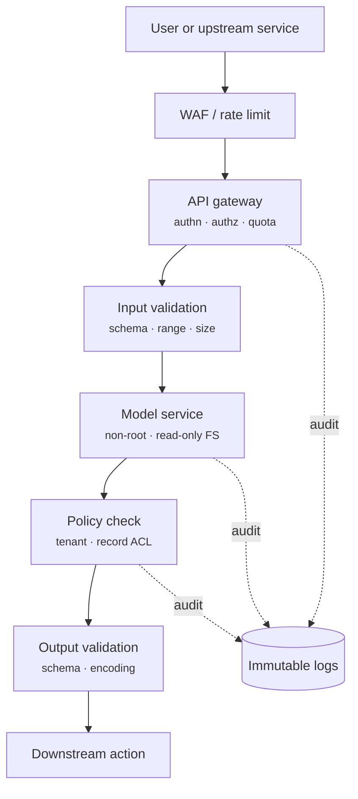

# 03 · Cybersecurity Fundamentals for AI Systems

<div class="sas-module-card">
  <div class="sas-module-card__head">
    <span class="sas-module-card__kicker">Module 03</span>
    <span class="sas-module-card__level">Level 1 — Foundation</span>
    <a class="sas-badge sas-badge--review" href="../../getting-started/how-to-use/#status-badges">In review</a>
  </div>
  <ul class="sas-module-card__facts">
    <li><strong>10 hours</strong>Study time, lab included</li>
    <li><strong>Module 02</strong>Prerequisite</li>
    <li><strong>2 labs</strong>Runs on a laptop CPU</li>
  </ul>
  <div class="sas-module-card__links">
    <a class="sas-chip sas-chip--primary" href="#learning-objectives">Learning outcomes</a>
    <a class="sas-chip" href="../../labs/">Lab</a>
    <a class="sas-chip" href="../../labs/#notebooks">Notebook</a>
    <a class="sas-chip" href="#practical-exercises">Exercises</a>
    <a class="sas-chip" href="#knowledge-check">Knowledge check</a>
    <a class="sas-chip" href="../../quizzes/m03/">Quiz</a>
    <a class="sas-chip" href="../../research/operations/#runtime-monitoring">Runtime monitoring</a>
  </div>
</div>

<div data-sas-progress></div>

## Introduction

A team building an AI assistant for a university spent three months hardening the model: red-teaming prompts, adding content filters, testing jailbreaks. Then a reviewer asked how the assistant authenticated to the student records API. The answer was an API key committed in the deployment repository, shared by all users, with read access to every student's file. The model was defended. The system was not.

AI security is not a replacement for cybersecurity; it is cybersecurity applied to a new kind of asset. The controls that stop the key from leaking — identity, authorisation, secret management, least privilege, audit — are the same controls that have protected systems for thirty years. What changes is *where* they go and *what* they protect.

This module gives you that classical toolkit in the form a data scientist needs: enough to design and review an AI system, recognise when a control is missing, and know the vocabulary to work with a security team rather than around it.

## Learning objectives

By the end of this module you can:

1. Apply confidentiality, integrity and availability to AI assets, and explain the fourth property, accountability.
2. Distinguish authentication from authorisation, and design least-privilege access for a pipeline identity.
3. Explain what hashing, signing and encryption each guarantee, and select the right one for an artefact.
4. Draw trust boundaries and apply defence in depth across the four layers from Module 01.
5. Explain the difference between a vulnerability, an exploit and a breach, using a concrete AI example.
6. Place security activities into a secure development lifecycle for an ML project.
7. Recognise the five most common real-world misconfigurations in ML infrastructure.

## Prerequisites

Modules 01 and 02. No prior security course is required — this module is the security course. If you have never heard of least privilege or a hash function, you are the intended reader.

## Detailed explanations

### 3.1 The classical properties, restated for AI

**Confidentiality.** In a classical system, confidentiality protects files and messages. In an AI system it also protects *statistical* information: whether a person is in a dataset, what a model's decision boundary looks like, what a prompt says, and what a retrieved document contained. Confidentiality of a decision boundary is why model extraction (Module 10) is a security problem rather than a curiosity.

**Integrity.** Classically, integrity means bytes were not modified. For AI it also means the *function* was not modified — same weights, same preprocessing, same threshold, same prompt template, same retrieval index. A model whose threshold was changed from 0.7 to 0.3 has an integrity failure even though every file hash matches.

**Availability.** Classically, uptime. For AI: uptime plus inference budget, provider continuity, data pipeline continuity, and the ability to fall back to a non-AI process when the model is unavailable.

**Accountability** (the fourth property). Every consequential decision must be attributable to an actor, a model version, and an input. Without it, integrity and confidentiality failures cannot be investigated, and governance (Module 19) is impossible.

### 3.2 Identity, authentication, authorisation

These three are routinely conflated, and the confusion is where most breaches begin.

| Concept | Question it answers | Mechanisms |
|---|---|---|
| **Identity** | Who or what is acting? | User account, service account, workload identity, API key, signed token |
| **Authentication** | Can it prove it? | Password plus second factor, certificate, OIDC token, cloud instance identity |
| **Authorisation** | Is it allowed to do this, on this resource, now? | Roles, policies, scopes, attribute-based rules |

A model server needs all three. In practice it tends to get one: a shared API key in an environment variable, which authenticates "the application" and authorises everything. That single key is the most common root cause of AI system compromise in the wild, because it converts any injection or prompt-leak vulnerability into full data access (Modules 12 and 14).

**Least privilege**, applied to ML, means:

- The *training job* can read the training dataset and write to the registry. It cannot read production data, call external APIs, or modify its own container.
- The *inference service* can read one model version and write logs. It cannot read the dataset, cannot list the registry, and cannot reach the internet beyond an allowlist.
- The *scientist* can read data they are cleared for, submit training jobs, and read results. They cannot delete the dataset, promote to production, or disable audit logging.
- The *pipeline* uses short-lived workload identity, not a long-lived key.

### 3.3 Cryptographic primitives, and what each actually guarantees

| Primitive | Guarantees | Does **not** guarantee | Where it belongs in AI |
|---|---|---|---|
| **Hash** (SHA-256) | Integrity: content matches a recorded digest | Authenticity: anyone can compute a hash | Dataset and model checksums; artefact manifests |
| **Message authentication code (HMAC)** | Integrity *and* authenticity, if the key stays secret | Non-repudiation | Verifying webhook payloads from a data provider |
| **Digital signature** | Integrity, authenticity, non-repudiation | Confidentiality | Signing model artefacts; provenance attestations |
| **Symmetric encryption** (AES-GCM) | Confidentiality, plus integrity of the ciphertext | Who may decrypt, beyond key holders | Data at rest, model weights at rest |
| **Asymmetric encryption** | Confidentiality to a key holder | Integrity of plaintext | Key exchange, envelope encryption |
| **TLS** | Confidentiality and integrity in transit | That either endpoint is trustworthy | Every API call, including model downloads |

The practical rule: **hash when you need proof that content did not change; sign when you need proof of who produced it; encrypt when you need to limit who can read it.** Applying the wrong one is a common and quiet failure — for example, publishing a checksum alongside the artefact it verifies, which protects against corruption but not against substitution.

### 3.4 Defence in depth, drawn



??? note "Diagram description"
    A top-down chain of seven controls. A user or upstream service passes through a web application firewall and rate limiter, then an API gateway performing authentication, authorisation and quota enforcement, then input validation for schema, range and size, then the model service running non-root with a read-only filesystem, then a policy check enforcing tenant and record-level access, then output validation for schema and encoding, and finally the downstream action. The API gateway, model service and policy check each send audit events to an immutable log store.

Each layer assumes the previous one failed. The gateway assumes the WAF was bypassed; the model service assumes an authenticated attacker is present; the policy check assumes the request is well-formed. A control that only works if the previous control worked is not defence in depth — it is a chain, and chains break once.

### 3.5 Vulnerability, exploit, breach

- A **vulnerability** is a weakness: the retrieval layer does not filter documents by tenant.
- An **exploit** is a technique that uses it: a query crafted to retrieve another tenant's document.
- A **breach** is the consequence: a student's disciplinary record appears in another student's answer.

Confusing them produces bad reporting. "The model is vulnerable to prompt injection" is a vulnerability statement. "We were breached" is a consequence statement, and requires evidence of disclosure, not just of a technique that worked in a lab.

### 3.6 Secure development lifecycle for ML

| Phase | Security activity | Artefact |
|---|---|---|
| Requirements | Classify data; name the decision and its cost of error | Data classification record, risk statement |
| Design | Threat model; define trust boundaries (Module 04) | Threat model, control list |
| Build | Pin dependencies; scan; least-privilege identities | Lockfile, scan report, IAM policy |
| Evaluate | Adversarial and privacy testing (Modules 08, 09, 17) | Evaluation report |
| Release | Sign and manifest the artefact; review the diff | Signature, manifest, review record |
| Operate | Monitor, detect, respond (Module 18) | Dashboards, runbooks, incident log |
| Retire | Revoke credentials; delete derived data | Decommission record |

The most common gap in practice is between *Evaluate* and *Release*: teams evaluate, then release something else — a different checkpoint, a different preprocessing step, a different threshold.

### 3.7 The five misconfigurations that cause most incidents

1. **A shared long-lived credential** used by everything, stored in a notebook or an environment file that is committed.
2. **A storage bucket or registry with public or wide-write access**, because it was convenient during development.
3. **An exposed notebook or dashboard** with no authentication, giving interactive code execution on a machine that holds credentials.
4. **Verbose error messages** that return stack traces, file paths and internal hostnames to the caller.
5. **No audit log**, or an audit log the compromised process can edit.

None of these is exotic. All five are found in real organisations every week.

## Key terminology

| Term | Definition |
|---|---|
| **Least privilege** | Granting the minimum authority needed for a function, for the shortest time |
| **Trust boundary** | A point where data or control passes between differently-trusted components |
| **Attack surface** | All points where an adversary can interact with the system |
| **Hash** | A fixed-length digest of content; collision-resistant, one-way |
| **Digital signature** | Cryptographic proof that a named key holder produced a message |
| **Envelope encryption** | Encrypting data with a data key, then encrypting that key with a master key |
| **Workload identity** | A credential issued to a running process rather than a person |
| **Audit log** | Tamper-evident record of who did what, when, to which resource |
| **Non-repudiation** | The inability to deny having produced a signed artefact |
| **Blast radius** | The set of resources reachable if a component is compromised |

## Mathematical foundations

Security mathematics at this stage is mostly about *probability of failure* and *access relations*. Two formalisms are worth knowing.

### Access control as a relation

Model authorisation as a relation $A \subseteq S \times R \times O$ over subjects $S$, rights $R$ (read, write, execute, delete) and objects $O$. A system is *least privilege* for subject $s$ if

$$
A_s = \{\, (r, o) : \text{the function of } s \text{ requires } r \text{ on } o \,\}
$$

and nothing else. Reviewing a pipeline becomes a concrete task: enumerate $A_s$ for each identity, compare against the required set, and delete the difference. Any element of $A_s$ you cannot justify is a finding.

### Failure probability in a layered system

If each of $k$ independent controls fails independently with probability $p$, the probability that all fail is $p^k$ — but only if the controls are genuinely independent. For dependent controls, where a single miss disables several layers,

$$
P(\text{compromise}) \approx p_{\text{shared}} \;+\; \prod_{j \notin \text{shared}} p_j
$$

This is why the CISO's aphorism exists: *controls that share a failure mode are one control.* A WAF and a rate limiter both bypassed by direct internal access are one control, not two.

### Hash collision intuition (why 256 bits)

For a hash of $b$ bits, a birthday attack finds a collision in about $2^{b/2}$ operations. At $b = 256$, that is $2^{128}$ — far beyond any feasible computation. At $b = 128$, it is $2^{64}$, uncomfortable but not yet broken; this is why SHA-1 ($160$ bits, $2^{80}$) is deprecated.

## Step-by-step: securing one pipeline identity

1. **Name the identity.** e.g. `trainer-prod` service account.
2. **Write its job.** "Read `s3://datasets/train/v3/`, write `s3://registry/models/`."
3. **Enumerate required rights.** Read on the dataset prefix; write on the registry prefix; nothing else.
4. **Write the policy** as explicit allows, no wildcards.
5. **Test the denial.** Run the job with a request outside the policy and confirm it fails — a permissions test that only tests successes proves nothing.
6. **Shorten the credential.** Workload identity with a session duration, not a long-lived key.
7. **Log the use.** Every access recorded with the identity, resource and time.
8. **Review quarterly.** Delete anything nobody can justify.

## Real-world scenarios

**Healthcare.** A model service reads patient features from a hospital data warehouse. If its identity can read the whole warehouse rather than a curated view, any injection vulnerability becomes a full-record breach. Control: a database view containing only the required columns, with the service granted read on the view alone.

**Financial fraud.** A nightly training job pulls transaction data. If the job's identity can also write to the feature store, a compromised dependency can rewrite production features. Control: separate identities for training and serving, with no write access from training.

**University systems.** A course-recommendation model exposes a notebook dashboard to faculty. If that dashboard is unauthenticated, it is remote code execution on a host holding database credentials. Control: authentication at the proxy, plus per-faculty authorisation, plus no credentials in the notebook.

**Smart cities.** Traffic-signal optimisation reads camera feeds from a municipal vendor. If the feed is unauthenticated TLS or plain HTTP, an attacker can shift traffic patterns. Control: mutual TLS with the vendor, plus signed payloads, plus anomaly checks on the input distribution.

## Python walkthrough

The following program demonstrates artefact integrity the way it should be done: a manifest of hashes, verified before use, failing closed.

```python
import hashlib
import json
from pathlib import Path


def sha256_of(path: Path) -> str:
    digest = hashlib.sha256()
    with path.open("rb") as handle:
        for chunk in iter(lambda: handle.read(65536), b""):
            digest.update(chunk)
    return digest.hexdigest()


def build_manifest(root: Path) -> dict[str, str]:
    """Record the digest of every file we intend to ship."""
    return {
        str(p.relative_to(root)): sha256_of(p)
        for p in sorted(root.rglob("*"))
        if p.is_file()
    }


def verify_manifest(root: Path, manifest: dict[str, str]) -> list[str]:
    """Return a list of problems. Empty list means the artefact is intact."""
    problems: list[str] = []
    for rel, expected in manifest.items():
        target = root / rel
        if not target.is_file():
            problems.append(f"missing: {rel}")
            continue
        actual = sha256_of(target)
        if actual != expected:
            problems.append(f"modified: {rel} ({expected[:8]} -> {actual[:8]})")
    on_disk = {str(p.relative_to(root)) for p in root.rglob("*") if p.is_file()}
    for extra in sorted(on_disk - set(manifest)):
        problems.append(f"unexpected: {extra}")
    return problems


if __name__ == "__main__":
    model_dir = Path("model_bundle")
    manifest_path = Path("model_bundle.manifest.json")

    if manifest_path.exists():
        recorded = json.loads(manifest_path.read_text())
        issues = verify_manifest(model_dir, recorded)
        print("VERIFIED" if not issues else "REFUSING TO LOAD")
        for issue in issues:
            print("  -", issue)
    else:
        manifest_path.write_text(json.dumps(build_manifest(model_dir), indent=2))
        print(f"manifest written to {manifest_path}")
```

Three details make this a control rather than a demonstration. It hashes *content*, not filename or modification time. It reports **unexpected** files, which catches an attacker adding a payload rather than modifying an existing one. And it **fails closed**: on any problem the loader refuses, rather than warning and continuing.

Note what it does not do. A hash published next to the artefact proves the file is intact, not that it came from you — anyone who can replace both can make them agree. For authenticity you need a signature (Module 15).

## Security implications

- **A shared credential converts any input-handling bug into full data access.** This is the single highest-leverage fix in most AI systems.
- **Encryption is not authorisation.** Data encrypted at rest is still readable by any identity with the key and the right to call the decryption path.
- **Logs are an asset and a liability.** They make investigation possible and, if they contain raw records, they become a privacy incident.
- **Defence in depth requires independence.** Two controls sharing a failure mode are one control.
- **Misconfiguration, not attack, is the dominant cause** of real incidents.

## Detection and mitigation

| Failure | Detection | Mitigation |
|---|---|---|
| Credential in code repository | Secret scanning in CI, pre-commit hooks | Rotate immediately; move to a secret manager; use workload identity |
| Over-broad storage policy | Periodic access review; policy diffing | Explicit allows; deny-by-default; test denials |
| Unauthenticated dashboard | External attack-surface scanning | Authentication at proxy; network restriction |
| Verbose errors | Response inspection in tests | Generic client errors; detailed server-side logs |
| Missing or mutable logs | Log-integrity check (hash chain, append-only store) | Separate log account with write-only credentials for producers |

## Practical exercises

**Recall.**
1. Distinguish authentication from authorisation with an example from an AI service.
2. State what a digital signature proves that a hash does not.
3. Name the four properties of a secure AI system and define accountability.

**Apply.**
4. Write the least-privilege policy for an inference service that serves one model version to one tenant, then list two requests it must be denied.
5. Take the Python example and extend it to sign the manifest with an HMAC using a key from an environment variable. Explain what threat the HMAC now covers, and which one remains.

**Extend.**
6. Your team proposes putting the model registry behind a single shared token to "simplify onboarding". Write a two-paragraph risk assessment with a concrete blast-radius estimate.
7. Design an access-review process that a small team could actually sustain, with a specific cadence and a specific artefact produced each cycle.

## Knowledge check

??? question "1. A file's SHA-256 matches the published manifest. What has been proven?"
    That the file content is unchanged since the manifest was produced. It does **not** prove who produced it — anyone able to modify both file and manifest can keep them consistent.

??? question "2. Why is a long-lived shared API key worse than a short-lived workload identity, even if both grant identical rights?"
    Because it cannot be attributed to a specific actor (breaking accountability), it cannot be scoped in time, and its compromise persists until someone notices and rotates it.

??? question "3. Two controls both fail if an attacker reaches the internal network. How many independent controls do you have?"
    One. Controls that share a failure mode are a single control from the attacker's perspective.

??? question "4. Give an example of an integrity failure where every file hash still matches."
    Changing the decision threshold, the prompt template, or the preprocessing configuration — behaviour changes while artefact bytes do not.

??? question "5. What is the practical difference between a vulnerability and a breach?"
    A vulnerability is a weakness that could be exploited; a breach is the realised consequence with evidence of harm. Reporting a lab technique as a breach is inaccurate and damages credibility.

## Frameworks, research and cases

- **Frameworks:** [NIST CSF 2.0](../frameworks/nist-csf.md)
- **Research:** [Supply chain and monitoring](../research/operations.md#runtime-monitoring)
- **Cases:** [C02 · ChatGPT cross-user data exposure](../case-studies/c02-chatgpt-redis.md)

## Summary

AI security inherits the classical toolkit: identity, authentication, authorisation, least privilege, cryptography, boundaries, logging and defence in depth. What changes is the asset inventory and the failure modes.

The four properties — confidentiality, integrity, availability and accountability — must each be defined concretely for the specific system, because "integrity" for a model includes its threshold, prompt and index, not just its bytes.

Cryptography answers three different questions: hashing proves content, signing proves origin, encryption limits readers. Using one where another is needed is a quiet and common failure.

The highest-leverage control in most AI systems is unglamorous: stop sharing one credential among everything, and give each component the minimum authority its function requires.

<nav class="sas-lesson-nav" aria-label="Module navigation">
  <a class="sas-lesson-nav__link sas-lesson-nav__link--prev" href="../02-ml-security-fundamentals/">
    <span class="sas-lesson-nav__dir">← Previous module</span>
    <span class="sas-lesson-nav__title">02 · Fundamentals of AI, Machine Learning and Deep Learning Security</span>
  </a>
  <a class="sas-lesson-nav__link sas-lesson-nav__link--next" href="../04-threat-modeling/">
    <span class="sas-lesson-nav__dir">Next module →</span>
    <span class="sas-lesson-nav__title">04 · AI Threat Modeling and Risk Assessment</span>
  </a>
</nav>

<p class="sas-related">Related: <a href="../16-secure-ai-apis/">16 · Secure AI APIs</a> · <a href="../15-fine-tuning-supply-chain/">15 · Supply Chain</a></p>

## References

1. NIST, *Security and Privacy Controls for Information Systems and Organizations*, SP 800-53 Rev. 5.
2. NIST, *Digital Identity Guidelines*, SP 800-63-3.
3. OWASP, *API Security Top 10*, 2023. <https://owasp.org/API-Security/>
4. OWASP, *Top 10 CI/CD Security Risks*.
5. Shostack, A., *Threat Modeling: Designing for Security*, Wiley, 2014.
6. Anderson, R., *Security Engineering*, 3rd edition, Wiley, 2020 — the best single reference on why controls fail.
7. NIST, *Secure Software Development Framework (SSDF)*, SP 800-218.
