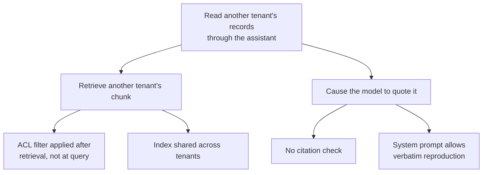

# 04 · AI Threat Modeling and Risk Assessment

<div class="sas-module-card">
  <div class="sas-module-card__head">
    <span class="sas-module-card__kicker">Module 04</span>
    <span class="sas-module-card__level">Level 1 — Foundation</span>
    <a class="sas-badge sas-badge--review" href="../../getting-started/how-to-use/#status-badges">In review</a>
  </div>
  <ul class="sas-module-card__facts">
    <li><strong>12 hours</strong>Study time, lab included</li>
    <li><strong>Module 03</strong>Prerequisite</li>
    <li><strong>1 lab</strong>Runs on a laptop CPU</li>
  </ul>
  <div class="sas-module-card__links">
    <a class="sas-chip sas-chip--primary" href="#learning-objectives">Learning outcomes</a>
    <a class="sas-chip" href="../../labs/">Lab</a>
    <a class="sas-chip" href="../../labs/#notebooks">Notebook</a>
    <a class="sas-chip" href="#practical-exercises">Exercises</a>
    <a class="sas-chip" href="#knowledge-check">Knowledge check</a>
    <a class="sas-chip" href="../../quizzes/m04/">Quiz</a>
    <a class="sas-chip" href="../../research/#reading-a-paper-for-this-course">How to read a paper</a>
    <a class="sas-chip" href="../../assignments/a01-threat-model-hospital/">Assignment A1</a>
  </div>
</div>

<div data-sas-progress></div>

## Introduction

Ask five engineers what could go wrong with a model and you will get five lists, none of which overlap. Ask the same five to review a threat model, and the conversation changes: they argue about the same diagram, with the same labels, and the argument produces decisions.

That is the value of a threat model. Not the document — the *shared representation*. It turns "we should think about security" into "boundary 3 has no authentication, actor A can reach it, and here is the control with an owner".

This module teaches three complementary methods and shows how to combine them: **STRIDE** for structured enumeration, **MITRE ATLAS** for adversary techniques specific to AI, and **attack trees** for reasoning about how individual weaknesses compose into a path. It ends with risk scoring that survives scrutiny — because a severity nobody can defend is a severity nobody will act on.

## Learning objectives

By the end of this module you can:

1. Build a data-flow diagram of an AI system with assets, flows and numbered trust boundaries.
2. Apply STRIDE to each boundary and element, including the ML-specific extensions.
3. Map identified threats to MITRE ATLAS techniques and OWASP categories.
4. Construct an attack tree and compute the probability of the cheapest successful path.
5. Score severity using likelihood, impact and a documented scheme, with justification.
6. Prioritise mitigations by risk reduction per unit of effort, not by enthusiasm.
7. Produce a threat register that an engineering team can act on this sprint.

## Prerequisites

Modules 01–03. You need the four-layer model, the lifecycle artefacts, and the classical controls — because a threat model without candidate controls degenerates into a list of fears.

## Detailed explanations

### 4.1 Start with a diagram, not a list

A data-flow diagram (DFD) has four element types and one annotation:

| Element | Meaning | AI example |
|---|---|---|
| **External entity** | A person or system outside your control | Card network, hospital device vendor, end user |
| **Process** | Something that transforms data | Training job, inference service, embedding pipeline |
| **Data store** | Data at rest | Feature store, model registry, vector index |
| **Data flow** | Movement between elements | Nightly dataset export, model download, API request |
| **Trust boundary** | A change of trust level | Your network perimeter, tenant boundary, supplier interface |

Number every boundary. It gives the team a shared vocabulary: "the finding is at B3" is unambiguous, and it survives a redesign.

### 4.2 STRIDE, with ML extensions

STRIDE enumerates six threat categories per element or boundary:

| Letter | Threat | Classical example | AI-specific example |
|---|---|---|---|
| **S** | Spoofing | Stolen credentials | Forged data-supplier identity; fake annotator account |
| **T** | Tampering | Modified config file | Poisoned training rows; swapped model weights; edited prompt template |
| **R** | Repudiation | Denying an action | No record of which model version produced a decision |
| **I** | Information disclosure | Unencrypted backup | Membership inference; prompt leakage; cross-tenant retrieval |
| **D** | Denial of service | Traffic flood | Query-based cost amplification; adversarial inputs that maximise compute |
| **E** | Elevation of privilege | Buffer overflow | Prompt injection reaching a tool with write access; `trust_remote_code` execution |

Three ML-specific extensions are worth adding to the acronym because STRIDE alone misses them:

- **Model extraction** — reconstructing the model from outputs (Module 10). It is information disclosure, but of a *capability*, not a record.
- **Supply-chain substitution** — a dependency, base model or dataset replaced with a malicious equivalent (Module 15).
- **Output misuse** — the model's output is consumed as code, SQL or HTML by a downstream component (Module 16).

### 4.3 MITRE ATLAS: the adversary's view

STRIDE asks "what could go wrong here?" ATLAS asks "what does an adversary actually do?" Its tactics follow an intrusion lifecycle adapted to AI:

```mermaid
flowchart LR
    R["Reconnaissance"] --> RD["Resource<br/>development"]
    RD --> IA["Initial access"]
    IA --> MA["ML model<br/>access"]
    MA --> EX["Execution"]
    EX --> PE["Persistence"]
    PE --> DE["Defence<br/>evasion"]
    DE --> CR["Credential<br/>access"]
    CR --> DI["Discovery"]
    DI --> CO["Collection"]
    CO --> AS["ML attack<br/>staging"]
    AS --> XF["Exfiltration"]
    XF --> IM["Impact"]
```



??? note "Diagram description"
    A left-to-right chain of twelve MITRE ATLAS tactics: reconnaissance, resource development, initial access, ML model access, execution, persistence, defence evasion, credential access, discovery, collection, ML attack staging, exfiltration and impact. Arrows show each tactic leading to the next in sequence.

Use ATLAS when you know the *technique* but not the control. Each technique page names the data sources that reveal it, which is how a threat model becomes a detection plan (Module 18).

| Typical AI threat | ATLAS-style technique | OWASP category |
|---|---|---|
| Poison a public training set | Poison training data | ML03 (2023) / LLM04 |
| Craft inputs to cause misclassification | Evade ML model | ML01 |
| Reconstruct the model via queries | Model extraction | ML05 |
| Infer training-set membership | Infer training data membership | ML04 |
| Hide instructions in a retrieved document | Indirect prompt injection | LLM01 |
| Persuade an agent to call a tool | Exploit excessive agency | LLM06 |

### 4.4 Attack trees: how weaknesses compose

A single weakness is rarely a breach. Breaches are chains. An attack tree draws the chain and lets you compute its cost.



??? note "Diagram description"
    A top-down attack tree. The goal, reading another tenant's records through the assistant, has two alternatives: retrieving another tenant's chunk, or causing the model to quote it. Retrieval can succeed because the ACL filter is applied after retrieval instead of at query time, or because the index is shared across tenants. Quoting can succeed because there is no citation check, or because the system prompt permits verbatim reproduction. Any leaf alone is sufficient if the parent condition is met.

The tree tells you something a list cannot: **fixing one leaf may not reduce risk at all**, if another path remains open. Security work is therefore about *cutting* the tree — closing every path to a goal, or making the goal itself valueless.

### 4.5 Risk scoring that survives scrutiny

Three schemes, in increasing rigour:

**Likelihood × impact matrix.** Fast, subjective, useful for triage. $R = L \times I$ on a 1–5 scale. Requires a written justification per cell.

**CVSS-style base score.** Standardised for software vulnerabilities: attack vector, complexity, privileges required, user interaction, and the three impact dimensions. It does not model model-integrity or agent-authority impact, so AI findings usually need an overlay.

**Expected loss.** Money or harm per year: $\text{ALE} = \text{frequency} \times \text{loss per event}$. The most defensible for a business case, and the least precise. Use ranges, not point estimates.

| Approach | Use when | Weakness |
|---|---|---|
| L×I matrix | Early triage, workshops | False precision; anchoring on the first number said aloud |
| CVSS + overlay | Comparing technical findings | Ignores your specific business context |
| Expected annual loss | Justifying spend to a budget holder | Requires frequency data you rarely have |

## Key terminology

| Term | Definition |
|---|---|
| **Threat model** | A structured description of assets, actors, boundaries and threats for a specific system |
| **Data-flow diagram** | A diagram of entities, processes, stores, flows and trust boundaries |
| **Attack tree** | A tree of conditions where any satisfied path achieves the attacker's goal |
| **Threat register** | A prioritised list of risks with justifications, controls and owners |
| **Likelihood** | Probability that a threat successfully exploits a weakness, in a stated period |
| **Impact** | Consequence if it does, in stated units (money, harm, downtime) |
| **Residual risk** | Risk remaining after controls, which must be accepted explicitly |
| **Control objective** | The property a control is meant to provide, independent of its implementation |
| **Kill chain** | The sequence of stages an intrusion passes through |
| **Compensating control** | An alternative control when the preferred one is infeasible |

## Mathematical foundations

### Attack-tree probability

For an **OR** node with independent child paths of success probability $p_1,\dots,p_k$:

$$
P_{\text{OR}} = 1 - \prod_{i=1}^{k}(1 - p_i)
$$

For an **AND** node, where every child must succeed:

$$
P_{\text{AND}} = \prod_{i=1}^{k} p_i
$$

With costs $c_i$ per path, the *cheapest successful path* is found by minimising total cost over all root-to-leaf combinations that satisfy the tree. That single quantity — attacker cost to succeed — is the most useful risk number most teams never compute.

### Expected annual loss

$$
\text{ALE} = \lambda \cdot \mathbb{E}[C]
$$

where $\lambda$ is the expected number of successful events per year and $\mathbb{E}[C]$ the expected cost per event. For a range, report $\text{ALE}_{\min}$ and $\text{ALE}_{\max}$ and state which assumptions drive the spread.

### Risk reduction per unit cost

When choosing between mitigations, rank by

$$
\text{efficiency}_j = \frac{\Delta \text{risk}_j}{\text{cost}_j}
$$

where $\Delta\text{risk}$ is the reduction in ALE the mitigation buys and $\text{cost}$ includes engineering time, not only licence fees. This is why "add a WAF" often loses to "stop sharing the credential": the latter is nearly free and removes an entire class of paths.

## Step-by-step: producing a threat register

1. **Scope.** One paragraph: the system, its users, its decision, and what is out of scope (state it explicitly).
2. **Draw the DFD.** Number every boundary. Keep it to one page; if it does not fit, you have scoped too much.
3. **Enumerate.** For each element and boundary, apply the six STRIDE letters plus the three ML extensions. Do not filter yet — enumeration and judgement are separate activities.
4. **Map.** Attach an ATLAS technique or OWASP identifier to each plausible threat. If you cannot, the threat is probably a category error.
5. **Model the paths.** For the top five threats, draw an attack tree and find the cheapest path.
6. **Score.** Likelihood, impact, and a justification sentence per number. State the assumption the score depends on.
7. **Attach controls.** One control per risk, with an owner and the evidence that would prove it works.
8. **Prioritise.** Sort by risk reduction per unit cost. Publish the top five; nobody fixes twenty things.
9. **Review.** Re-run after any architecture change, and at least annually.

## Real-world scenarios

**Healthcare.** A sepsis model with a device-integration boundary. STRIDE at that boundary yields tampering (unit changes), spoofing (a rogue device), and information disclosure (vitals in logs). The attack tree shows the cheapest path is not an attack at all — it is a vendor firmware update that changes rounding. Control: input distribution checks with an alert on scale changes.

**Financial fraud.** A card-scoring API. Boundary: the public merchant interface. STRIDE gives information disclosure (extraction via queries) and denial of service (query flooding). The cheapest successful path is extraction by a competitor willing to spend a few thousand queries. Control: quotas per merchant, output rounding to reduce information per query, and anomaly detection on query patterns.

**University systems.** An admissions-review assistant with retrieval over applications. Boundaries: the admissions office and the applicant-facing portal. The tree shows that an applicant who can submit a PDF can attempt indirect prompt injection into a reviewer's assistant (Module 12). Control: treat submitted documents as untrusted, mark them as data, and never let the assistant take actions.

**Smart cities.** A traffic-optimisation system reading camera feeds. Boundaries: vendor feed, municipal network, control output. The highest-impact path is not data theft but *tampering with the control output*, causing congestion or an accident. Control: rate limits and plausibility bounds on every control command, independent of the model.

## Python walkthrough

The following program scores a threat register, computes expected annual loss, and ranks mitigations by risk reduction per unit cost.

```python
from dataclasses import dataclass


@dataclass
class Threat:
    id: str
    description: str
    likelihood: float        # events per year
    loss_per_event: float    # currency units
    control: str
    control_cost: float
    reduction: float         # fraction of risk removed, 0..1


def ale(t: Threat) -> float:
    return t.likelihood * t.loss_per_event


def residual(t: Threat) -> float:
    return ale(t) * (1.0 - t.reduction)


def efficiency(t: Threat) -> float:
    saved = ale(t) - residual(t)
    return float("inf") if t.control_cost == 0 else saved / t.control_cost


threats = [
    Threat("T-01", "Shared API key reaches all student records",
           0.30, 250_000, "Per-tenant workload identity", 8_000, 0.95),
    Threat("T-02", "Indirect injection in submitted PDF",
           0.50, 20_000, "Treat documents as untrusted data", 6_000, 0.70),
    Threat("T-03", "Model extraction by competitor",
           0.20, 60_000, "Per-merchant quotas + output rounding", 15_000, 0.60),
    Threat("T-04", "Cross-tenant retrieval leak",
           0.10, 400_000, "Query-time ACL enforcement", 12_000, 0.90),
]

print(f"{'ID':<6}{'ALE':>10}{'Residual':>12}{'Efficiency':>14}  Control")
for t in sorted(threats, key=efficiency, reverse=True):
    print(f"{t.id:<6}{ale(t):>10,.0f}{residual(t):>12,.0f}{efficiency(t):>14,.1f}  {t.control}")

print(f"\nTotal ALE before controls: {sum(ale(t) for t in threats):,.0f}")
print(f"Total residual after   : {sum(residual(t) for t in threats):,.0f}")
```

Read the output as a decision, not a report. T-02 has the highest likelihood but a small loss; T-04 has the lowest likelihood and the largest loss. The efficiency column says T-01 first — cheap, near-complete risk removal — which is almost always the right first move. Change T-04's likelihood to 0.4 and the ranking flips: a low-probability, high-impact risk becomes urgent when it stops being low-probability.

## Security implications

- **A threat model without a diagram is a brainstorm.** The diagram is the artefact that makes review possible.
- **Enumerate before you judge.** Filtering during enumeration produces blind spots that survive into production.
- **Attack trees expose false fixes.** Closing one leaf while another path stays open reduces activity, not risk.
- **Severity requires a stated assumption.** "High because it is bad" is not a score; "high because 0.3 events/year at 250k each, assuming the key stays shared" is.
- **Prioritise by efficiency, not by fear.** The biggest number is rarely the best first move.

## Detection and mitigation

| Threat class | Preventive control | Detective control |
|---|---|---|
| Data poisoning | Provenance, checksums, annotator access control | Label-distribution and duplicate analysis (M07) |
| Evasion | Adversarial training, input validation | Drift and query-pattern anomalies (M18) |
| Extraction | Quotas, output rounding, per-tenant keys | Query entropy and volume anomalies (M10) |
| Privacy leakage | Regularisation, differential privacy | Membership-inference test suite in evaluation (M09) |
| Injection | Capability restriction, provenance marking | Injection corpus replay + output anomaly detection (M12) |
| Agent abuse | Tool allowlists, confirmation gates, egress control | Action-log review, canary tokens (M14) |

## Practical exercises

**Recall.**
1. List the six STRIDE categories and one AI-specific example of each.
2. Name the three ML-specific threat extensions this module adds to STRIDE.
3. Define residual risk and explain who must accept it.

**Apply.**
4. Draw a DFD for a system you have built, with numbered boundaries. Apply STRIDE to boundary 1 only, and list every threat you find without filtering.
5. Compute the OR-node probability for three paths with $p = 0.2, 0.3, 0.4$. Explain in one sentence why the result is greater than the largest single probability.
6. Run the Python example with your own four threats from Module 01's assessment.

**Extend.**
7. Build an attack tree for "cause the fraud model to approve a fraudulent transaction" with at least three paths. Identify the cheapest path and the control that cuts the most paths at once.
8. Argue for and against using CVSS alone to prioritise AI findings. Propose the overlay you would add, with two named dimensions and their scales.

## Knowledge check

??? question "1. Why does the module insist on numbering trust boundaries?"
    So findings can be located unambiguously ("the gap is at B3"), which survives redesigns and makes review conversations precise rather than anecdotal.

??? question "2. If an OR node has three independent paths of probability 0.2, 0.3 and 0.4, what is the overall success probability?"
    $1 - (0.8 \times 0.7 \times 0.6) = 1 - 0.336 = 0.664$. Attacker success rises quickly with the number of available paths, which is why cutting trees beats patching leaves.

??? question "3. Which STRIDE category does prompt injection into an agent with write access belong to?"
    Elevation of privilege — the model gains the ability to act with the tool's authority, beyond what the user was granted.

??? question "4. Give one reason CVSS alone is insufficient for AI findings."
    It has no dimension for model integrity (a backdoor that leaves accuracy unchanged) or agent authority (a tool call that moves money), so these findings score misleadingly low.

??? question "5. Why is 'add a WAF' frequently a poor first mitigation?"
    Because its risk reduction per unit cost is usually lower than removing a shared credential or enforcing tenant ACLs, which eliminate entire classes of attack paths for little engineering effort.

## Frameworks, research and cases

- **Frameworks:** [NIST AI RMF](../frameworks/nist-ai-rmf.md) · [MITRE ATLAS](../frameworks/mitre-atlas.md)
- **Research:** [Reading a paper](../research/index.md#reading-a-paper-for-this-course)
- **Cases:** [C09 · Amazon Q Developer extension compromise](../case-studies/c09-amazon-q-supply-chain.md)

## Summary

A threat model is a shared representation, and its value is that it makes disagreement productive. Build it from a data-flow diagram with numbered boundaries, enumerate with STRIDE plus three ML extensions, and map each threat to an ATLAS technique or OWASP category so the finding connects to known detection data sources.

Attack trees turn a list of weaknesses into a picture of how they compose, and computing the cheapest successful path is the most useful risk number most teams never calculate.

Severity needs a stated assumption. Likelihood times impact is fast; expected annual loss is defensible; risk reduction per unit cost is what actually decides the order of work.

<nav class="sas-lesson-nav" aria-label="Module navigation">
  <a class="sas-lesson-nav__link sas-lesson-nav__link--prev" href="../03-cybersecurity-fundamentals/">
    <span class="sas-lesson-nav__dir">← Previous module</span>
    <span class="sas-lesson-nav__title">03 · Cybersecurity Fundamentals for AI Systems</span>
  </a>
  <a class="sas-lesson-nav__link sas-lesson-nav__link--next" href="../05-secure-data-management/">
    <span class="sas-lesson-nav__dir">Next module →</span>
    <span class="sas-lesson-nav__title">05 · Secure Data Management and Dataset Protection</span>
  </a>
</nav>

<p class="sas-related">Related: <a href="../17-red-teaming/">17 · AI Red Teaming</a> · <a href="../18-monitoring-and-response/">18 · Monitoring and Response</a></p>

## References

1. Shostack, A., *Threat Modeling: Designing for Security*, Wiley, 2014.
2. MITRE, *ATLAS: Adversarial Threat Landscape for Artificial-Intelligence Systems*. <https://atlas.mitre.org>
3. OWASP, *Top 10 for LLM Applications*, 2025. <https://genai.owasp.org/llm-top-10/>
4. OWASP, *Machine Learning Security Top 10*, 2023.
5. NIST, *AI RMF 1.0*, NIST AI 100-1, 2023 — Map and Measure functions.
6. FIRST, *Common Vulnerability Scoring System v4.0* specification.
7. Freund, J. and Jones, J., *Measuring and Managing Information Risk: A FAIR Approach*, Butterworth-Heinemann, 2014.
