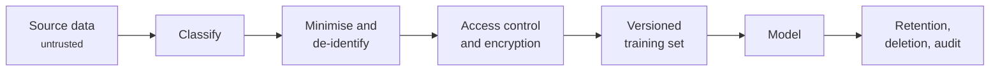

# 05 · Secure Data Management and Dataset Protection

<div class="sas-module-card">
  <div class="sas-module-card__head">
    <span class="sas-module-card__kicker">Module 05</span>
    <span class="sas-module-card__level">Level 1 — Foundation</span>
    <a class="sas-badge sas-badge--review" href="../../getting-started/how-to-use/#status-badges">In review</a>
  </div>
  <ul class="sas-module-card__facts">
    <li><strong>12 hours</strong>Study time, lab included</li>
    <li><strong>Module 04</strong>Prerequisite</li>
    <li><strong>2 labs</strong>Runs on a laptop CPU</li>
  </ul>
  <div class="sas-module-card__links">
    <a class="sas-chip sas-chip--primary" href="#learning-objectives">Learning outcomes</a>
    <a class="sas-chip" href="../../labs/">Lab</a>
    <a class="sas-chip" href="../../labs/#notebooks">Notebook</a>
    <a class="sas-chip" href="#practical-exercises">Exercises</a>
    <a class="sas-chip" href="#knowledge-check">Knowledge check</a>
    <a class="sas-chip" href="../../quizzes/m05/">Quiz</a>
    <a class="sas-chip" href="../../research/privacy/#privacy">Privacy research</a>
  </div>
</div>

<div data-sas-progress></div>

## Introduction

Training data cannot be un-collected. A leaked dataset is leaked permanently; a model trained on it carries traces of it; a "fully anonymised" release is re-identified by joining it with something already public, usually within a day.

This module treats data as what it is: the largest, least-controlled asset in most AI systems, and the one whose compromise is hardest to reverse. You will learn to classify it, minimise it, de-identify it honestly, control who can reach it, document its lineage, and — the skill that separates practitioners from optimists — attack your own anonymisation before somebody else does.

## Learning objectives

By the end of this module you can:

1. Build a data classification scheme and derive handling rules from it.
2. Distinguish direct identifiers, quasi-identifiers and sensitive attributes in a real table.
3. Apply generalisation and suppression, and quantify the utility lost.
4. Execute a linkage attack against your own de-identified release and report residual risk.
5. Choose between k-anonymity, l-diversity and differential privacy for a stated purpose.
6. Design row- and column-level access control for a shared data platform.
7. Threat-model a labelling pipeline, including annotator access and label tampering.
8. Produce a dataset record (datasheet) an auditor could follow.

## Prerequisites

Module 04 for the threat-model vocabulary. Basic pandas and SQL for the exercises; the statistics are developed here from first principles.

## Detailed explanations

### 5.1 Classification, and why it comes first

You cannot protect what you have not labelled. A workable classification has three or four tiers and rules that follow mechanically:

| Tier | Definition | Handling rule |
|---|---|---|
| **Public** | Safe to publish | No restriction |
| **Internal** | Harm from disclosure is limited to the organisation | Authenticated access, no external sharing |
| **Confidential** | Harm to individuals or the organisation | Encrypted at rest, access logged, named owner, retention limit |
| **Restricted** | Special-category data: health, biometrics, disciplinary, financial | Column-level access, purpose binding, de-identification before analysis, legal basis recorded |

The classification must be attached to *columns*, not to tables or databases. A single `notes` column in an otherwise internal table can contain a diagnosis, and a table-level classification will miss it.

### 5.2 Identifiers, quasi-identifiers, sensitive attributes

- **Direct identifier** — names a person on its own: name, national ID, email, phone.
- **Quasi-identifier** — narrows the population enough to re-identify when combined: date of birth, postal code, gender, admission date, job title.
- **Sensitive attribute** — the thing you are protecting: diagnosis, salary, grade, religion, sexual orientation.

Removing direct identifiers is *pseudonymisation*, not anonymisation. The classic demonstration: 87 % of the US population is uniquely identified by the combination of five-digit ZIP code, full date of birth and gender. Each field alone is unremarkable; together they are a name.

### 5.3 The three de-identification families

| Family | Mechanism | Guarantee | Cost |
|---|---|---|---|
| **Suppression / generalisation** (k-anonymity) | Coarsen values until each record is indistinguishable from $k-1$ others | No record is unique on the quasi-identifier set | Utility loss; vulnerable to homogeneity and background-knowledge attacks |
| **Statistical disclosure control** (l-diversity, t-closeness) | Add constraints on the distribution of sensitive values within each group | Sensitive values are not uniform (l) or not skewed (t) | More utility loss; still not a formal privacy guarantee |
| **Differential privacy** | Add calibrated noise to a query or to gradients | A formal bound on how much any single record can change the output | Accuracy loss; composition accounting; implementation discipline |

The honest ranking: differential privacy is the only one with a mathematical guarantee, and it is the only one that survives an attacker with arbitrary auxiliary data. The other two are useful, well-understood heuristics — and should be described as such.

### 5.4 A worked re-identification

Consider a released table of 200 students, generalised to remove names:

| Student | Age band | Postcode district | Programme | Result band |
|---|---|---|---|---|
| S-1042 | 20–24 | 54000 | BS Data Science | Distinction |
| S-1043 | 20–24 | 54000 | BS Data Science | Distinction |

If only three students in that programme live in that district and all three have the same result band, then the release has not protected those three — the *distribution* inside the group is uniform, which is exactly the homogeneity attack that l-diversity was introduced to address.

Add a public source — a departmental newsletter listing prize winners by district — and re-identification becomes trivial with no data breach at all.

### 5.5 Labelling security: the least-examined boundary

Labels are data too, and they are usually produced by people you do not control.

| Risk | Mechanism | Control |
|---|---|---|
| Annotator bias | Systematic differences between annotators | Per-annotator agreement statistics; adjudication |
| Deliberate tampering | A paid annotator flips labels for a class | Duplicate items with known answers; outlier detection |
| Access overreach | Annotators see more than the task requires | Column-limited task interfaces; no export |
| Leakage | Annotations stored alongside raw records | Separate stores, separate access |
| Contamination | Same annotator labels train and test | Assignment bookkeeping; distinct pools |

The last one is subtle and common: if the person who labelled your test set also labelled your training set, your evaluation measures their consistency, not the model's generalisation.

### 5.6 Lineage and the datasheet

A dataset without lineage cannot be audited. Minimum record:

```text
Dataset:        student_admissions_2021_2025
Version:        v3 (2026-09-02)
Source:         admissions_db.applications (read-only view), exported nightly
Transformations: deduplicated on applicant_id; dates generalised to month;
                 postcode truncated to district; 412 records with missing
                 grades excluded
Checksum:       sha256:9f2c... (dataset.manifest.json)
Owner:          Data Science Dept (data-steward@example.edu)
Classification: Confidential (contains special-category disability flags)
Licence/basis:  Institutional research; data-protection review 2026-08-14
Known limits:   Covers 3 of 5 faculties; 2020 intake absent (COVID disruption)
```

That paragraph is worth more than any dashboard: it is what allows someone else to reproduce your result, and what allows you to answer "was this lawful?" six months later.

### 5.9 The data path, and where the controls sit

The diagram places each control on the path a record takes from collection to deletion. Every arrow is a place a control can be missing; every box is a place data is at rest and therefore a place it can leak.



??? note "Diagram description"
    A left-to-right flow. Untrusted source data enters classification, then minimisation and de-identification, then access control and encryption, then becomes a versioned training set consumed by model training, and finally passes into retention, deletion and audit. Each stage is a control point; each intermediate store is a place where data can leak.

## Key terminology

| Term | Definition |
|---|---|
| **Anonymisation** | Irreversible removal of identifiability, under a stated threat model |
| **Pseudonymisation** | Replacing identifiers with tokens that can be reversed by a key holder |
| **Quasi-identifier** | Attribute that narrows a population when combined with others |
| **k-anonymity** | Every record is indistinguishable from at least $k-1$ others on the quasi-identifiers |
| **l-diversity** | Each equivalence class contains at least $l$ distinct sensitive values |
| **Differential privacy** | A formal guarantee bounding any single record's influence on an output |
| **Data lineage** | Recorded history of transformations applied to data |
| **Datasheet** | Documentation of a dataset's origin, composition, and intended use |
| **Equivalence class** | The group of records sharing the same quasi-identifier values |
| **Purpose binding** | Restricting use of data to the purpose for which it was collected |

## Mathematical foundations

### k-anonymity, formally

Let $Q$ be the set of quasi-identifier attributes and $g(x)$ the equivalence class of record $x$ under the generalisation of $Q$. A release satisfies $k$-anonymity if

$$
\min_{x \in D} \big| g(x) \big| \;\ge\; k
$$

where $D$ is the released dataset and $|g(x)|$ is the number of records sharing $x$'s generalised quasi-identifier values. Larger $k$ means stronger protection and lower utility.

### l-diversity

For each equivalence class $g$ and sensitive attribute $S$:

$$
\min_{g} \; \big| \{ s : s = x.S,\; x \in g \} \big| \;\ge\; l
$$

This blocks the homogeneity attack: if everyone in a group is positive for a disease, knowing the group is knowing the diagnosis.

### Differential privacy

A randomised mechanism $M$ satisfies $(\varepsilon, \delta)$-differential privacy if for any two datasets $D, D'$ differing in one record, and every set of outputs $S$:

$$
\Pr[M(D) \in S] \;\le\; e^{\varepsilon} \Pr[M(D') \in S] + \delta
$$

- $\varepsilon$ (epsilon) bounds how much one individual can change the output distribution. Smaller is stronger.
- $\delta$ allows a small probability of failure; it should be far below $1/n$.
- The guarantee composes: two queries at $\varepsilon = 1$ cost roughly $\varepsilon = 2$ in total privacy loss.

Practical calibration: $\varepsilon \le 1$ is strong, $\varepsilon \approx 3$ is moderate, $\varepsilon \ge 10$ offers little protection against a motivated adversary. In Module 09 you will see the same parameter controlling a privacy/utility trade-off in training.

### Utility loss

Generalisation reduces information. A simple measure for a continuous attribute is the normalised increase in within-group variance:

$$
\text{loss} = \frac{\overline{\mathrm{Var}}_{\text{within}}(X_{\text{released}})}{\mathrm{Var}(X_{\text{original}})}
$$

Values near 0 mean the release preserves detail; values near 1 mean the attribute has been destroyed and the data is no longer useful.

## Step-by-step: de-identify a table, then attack it

1. **Classify columns.** Mark each as direct identifier, quasi-identifier or sensitive.
2. **Remove direct identifiers.** Drop, hash with a secret salt, or tokenise — and record which, because only tokenisation is reversible.
3. **Choose quasi-identifiers you must keep.** Every retained field is an attack surface; drop anything the analysis does not need.
4. **Generalise** until every equivalence class satisfies your chosen $k$.
5. **Check diversity.** Compute the number of distinct sensitive values per class; raise generalisation until you meet $l$.
6. **Attack it.** Join against a public auxiliary table on the generalised fields. Count how many records become unique.
7. **Report residual risk.** "At $k=5$, 3.1 % of records remain unique when joined with the electoral roll; demographic fields are not released."
8. **Decide.** If residual risk is unacceptable, apply differential privacy to the queries instead of releasing the table.

## Real-world scenarios

**Healthcare.** A hospital releases a research extract of admissions. Removing names and medical record numbers satisfies nobody's definition of anonymity once admission date and postcode remain: both are quasi-identifiers, and the combination is often unique. Control: release aggregates with differential privacy, or a curated view inside the hospital with no export.

**Financial fraud.** Transaction data used for model training includes merchant names, which can identify individuals in small towns. Control: merchant categories instead of names, plus purpose binding, plus access logging at the query level.

**University systems.** A learning-analytics dataset joins LMS activity with grades. Student ID is a direct identifier, but so is an unusual combination of course enrolments. Control: cohort-level aggregates for anything published; row-level access only for the student's own adviser.

**Smart cities.** Camera feeds for traffic analysis capture identifiable faces and plates. Control: on-device detection that emits counts and trajectories rather than frames; retention measured in hours, not months.

## Python walkthrough

The following program demonstrates generalisation, measures the k-anonymity of the result, and then runs a linkage attack against the release. It is deliberately small so that every number can be checked by hand.

```python
import pandas as pd

records = pd.DataFrame({
    "name": ["A", "B", "C", "D", "E", "F"],
    "age": [21, 22, 23, 34, 35, 41],
    "district": ["54000", "54000", "54001", "54000", "54001", "54002"],
    "programme": ["DS", "DS", "DS", "CS", "CS", "DS"],
    "result": ["pass", "pass", "fail", "pass", "fail", "fail"],
})

QI = ["age_band", "district", "programme"]

def generalise(df: pd.DataFrame, band: int = 10) -> pd.DataFrame:
    out = df.drop(columns=["name"]).copy()
    out["age_band"] = (out["age"] // band) * band
    return out.drop(columns=["age"])

release = generalise(records)

def k_anonymity(df: pd.DataFrame, qi: list[str]) -> pd.Series:
    return df.groupby(qi, dropna=False)["result"].transform("size")

release["group_size"] = k_anonymity(release, QI)

def l_diversity(df: pd.DataFrame, qi: list[str], sensitive: str) -> pd.Series:
    return df.groupby(qi)["result"].transform("nunique")

release["distinct_results"] = l_diversity(release, QI, "result")

print(release[QI + ["result", "group_size", "distinct_results"]])
print(f"\nminimum k: {release['group_size'].min()}  "
      f"minimum l: {release['distinct_results'].min()}")

# Linkage attack: an attacker knows one person's age band and district.
aux = pd.DataFrame({"age_band": [30, 40], "district": ["54000", "54002"]})
match = release.merge(aux, on=["age_band", "district"])
print("\nRecords matching a single auxiliary fact set:")
print(match[QI + ["result"]])
```

Two lessons appear in the output. First, the age bands 20–29 and 30–39 produce groups, but the 40–49 band for district 54002 is a **group of one** — that record is unique, so `k` is 1 and the release is not k-anonymous at all. Second, the linkage attack needs no secret: two public facts narrow six records to one, and the `result` column does the rest.

To fix it you generalise further (band = 20), suppress the small district, or — better — accept that a row-level release cannot be made safe and publish aggregates instead.

## Security implications

- **De-identification is not anonymisation** unless you can state the threat model under which it holds.
- **Quasi-identifiers are the attack surface**, and they include combinations nobody thought were sensitive.
- **Labels are an input to integrity**, and annotators are a trust boundary.
- **Retention is a control.** Data you deleted cannot leak; data you kept "just in case" is liability with no offsetting benefit.
- **Access logging is mandatory** — not for compliance theatre, but because incident response without it is guesswork.

## Detection and mitigation

| Risk | Preventive | Detective |
|---|---|---|
| Re-identification | Generalise, suppress, DP for aggregates | Periodic linkage tests against public sources |
| Excess access | Column-level grants; purpose binding | Query-log review for out-of-scope columns |
| Label tampering | Duplicate known items; annotator separation | Per-annotator agreement outside tolerance |
| Silent dataset change | Checksummed manifests; immutable versions | Manifest verification at training time (M15) |
| Retention creep | Scheduled deletion with an owner | Storage inventory review |

## Practical exercises

**Recall.**
1. Distinguish direct identifiers, quasi-identifiers and sensitive attributes, with one example of each.
2. State the difference between anonymisation and pseudonymisation.
3. Define $(\varepsilon, \delta)$-differential privacy in one sentence.

**Apply.**
4. Run the Python example with `band=20` and report the minimum $k$ and $l$. Explain what utility you lost.
5. Take any dataset you have used. List its quasi-identifiers and compute how many records have a unique combination.
6. Write a datasheet (the template in §5.6) for a dataset from one of your own projects.

**Extend.**
7. Design a labelling pipeline for a medical imaging task that resists deliberate label tampering by a paid annotator. Name the exact mechanism and the evidence it produces.
8. A colleague proposes releasing a "k=10 anonymised" table for a hackathon. Write the memo that explains the residual risk and proposes an alternative.

## Knowledge check

??? question "1. Why is removing names and ID numbers not anonymisation?"
    Because quasi-identifiers such as date of birth, postcode and admission date combine to make records unique, and can be joined against public data to re-identify individuals.

??? question "2. A table satisfies k-anonymity with k=5. What attack remains possible?"
    The homogeneity attack: if all five records in a group share the same sensitive value, knowing the group is equivalent to knowing the attribute. l-diversity addresses this.

??? question "3. What does epsilon control in differential privacy?"
    The bound on how much one individual's presence in the data can change the output distribution. Smaller epsilon means stronger privacy and more noise.

??? question "4. Give two reasons labels are a security asset."
    They determine model behaviour (integrity), and they can encode sensitive information or bias that leaks into the model (confidentiality and fairness).

??? question "5. Why does the module describe retention as a security control?"
    Because data that no longer exists cannot leak or be subpoenaed, so deletion reduces risk with certainty, while every additional copy increases it.

## Frameworks, research and cases

- **Frameworks:** [ISO/IEC AI standards](../frameworks/iso.md)
- **Research:** [Privacy and extraction](../research/privacy.md#privacy)
- **Cases:** [C08 · Exposed DeepSeek database](../case-studies/c08-deepseek-database.md)

## Summary

Data is the largest and least reversible asset in an AI system. Classification comes first because handling rules must be derived from it, and classification must attach to columns because a single free-text field can contain special-category data.

De-identification operates in three families. Generalisation and suppression are heuristics that fail against homogeneity and auxiliary data. l-diversity adds a distributional constraint. Only differential privacy provides a formal guarantee, and it costs accuracy and demands implementation discipline.

Labels are data too, and annotators are a trust boundary that most teams never model. Lineage and a datasheet turn a dataset into something that can be audited, reproduced and defended six months later.

The practical habit this module builds: attack your own release before you publish it, and report the residual risk as a number.

<nav class="sas-lesson-nav" aria-label="Module navigation">
  <a class="sas-lesson-nav__link sas-lesson-nav__link--prev" href="../04-threat-modeling/">
    <span class="sas-lesson-nav__dir">← Previous module</span>
    <span class="sas-lesson-nav__title">04 · AI Threat Modeling and Risk Assessment</span>
  </a>
  <a class="sas-lesson-nav__link sas-lesson-nav__link--next" href="../06-adversarial-ml/">
    <span class="sas-lesson-nav__dir">Next module →</span>
    <span class="sas-lesson-nav__title">06 · Adversarial Machine Learning</span>
  </a>
</nav>

<p class="sas-related">Related: <a href="../09-model-privacy/">09 · Model Privacy</a> · <a href="../19-governance-and-ethics/">19 · Governance and Ethics</a></p>

## References

1. NIST, *De-Identifying Government Datasets*, SP 800-188, 2016.
2. Sweeney, L., "k-anonymity: A Model for Protecting Privacy", *International Journal of Uncertainty, Fuzziness and Knowledge-Based Systems*, 2002.
3. Machanavajjhala, A. et al., "l-Diversity: Privacy Beyond k-Anonymity", ICDE 2006.
4. Dwork, C. and Roth, A., *The Algorithmic Foundations of Differential Privacy*, 2014.
5. Gebru, T. et al., "Datasheets for Datasets", 2018.
6. OWASP, *Machine Learning Security Top 10*, 2023 — data poisoning and privacy categories.
7. Regulation (EU) 2016/679 (GDPR) — principles of lawfulness, minimisation and storage limitation.
