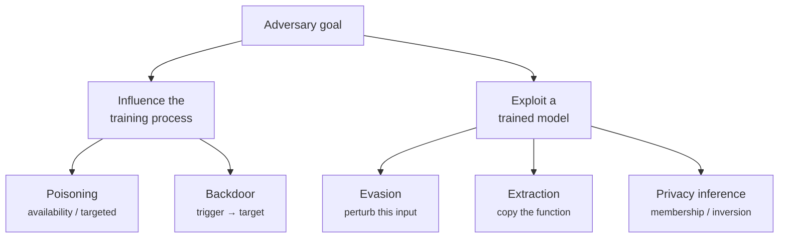

# 06 · Adversarial Machine Learning

<div class="sas-module-card">
  <div class="sas-module-card__head">
    <span class="sas-module-card__kicker">Module 06</span>
    <span class="sas-module-card__level">Level 2 — Intermediate</span>
    <a class="sas-badge sas-badge--review" href="../../getting-started/how-to-use/#status-badges">In review</a>
  </div>
  <ul class="sas-module-card__facts">
    <li><strong>14 hours</strong>Study time, lab included</li>
    <li><strong>Module 05</strong>Prerequisite</li>
    <li><strong>2 labs</strong>Runs on a laptop CPU</li>
  </ul>
  <div class="sas-module-card__links">
    <a class="sas-chip sas-chip--primary" href="#learning-objectives">Learning outcomes</a>
    <a class="sas-chip" href="../../labs/">Lab</a>
    <a class="sas-chip" href="../../labs/#notebooks">Notebook</a>
    <a class="sas-chip" href="#practical-exercises">Exercises</a>
    <a class="sas-chip" href="#knowledge-check">Knowledge check</a>
    <a class="sas-chip" href="../../quizzes/m06/">Quiz</a>
    <a class="sas-chip" href="../../research/adversarial-ml/#evasion">Adversarial ML</a>
  </div>
</div>

<div data-sas-progress></div>

## Introduction

In 2014, Szegedy and colleagues noticed something strange: adding a perturbation too small to see could make a state-of-the-art image classifier confidently wrong. The perturbation was not random noise. It was *chosen*, by asking the model which direction would increase its error.

That observation created a field. Fifteen years later, adversarial machine learning has four established attack families, a mature threat-modelling vocabulary, and a hard-won lesson: most published defences were evaluated against the wrong attack. This module gives you the map. Modules 07–10 give you the territory.

The unifying idea is simple and worth internalising now: **training and attacking are the same optimisation run in opposite directions.** Training moves the parameters to reduce loss on data; an attack moves the input to increase loss on the parameters. Once you see that, nothing in this part of the course is mysterious.

## Learning objectives

By the end of this module you can:

1. Name the four attack families and classify any described attack into one.
2. Specify an adversary model precisely: knowledge, goal, capability and budget.
3. Write the adversarial evasion problem as a constrained optimisation and explain each term.
4. Derive the fast gradient sign method from a first-order approximation.
5. Explain perturbation budgets under $L_0$, $L_2$ and $L_\infty$ and choose one for a stated domain.
6. Explain transferability and construct a surrogate-model attack.
7. Identify the three evaluation errors that inflate published robustness results.

## Prerequisites

Module 05, and the calculus of Module 02: gradients, the chain rule, and the idea of a constrained maximum. You do not need measure theory; you do need to be comfortable with $\nabla_x \ell$.

## Detailed explanations

### 6.1 The four families

| Family | Attacker acts at | Goal | Module |
|---|---|---|---|
| **Evasion** | Inference time | Cause a misclassification for a chosen input | 08 |
| **Poisoning** | Training time | Change how the model behaves, for all future inputs | 07 |
| **Extraction** | Inference time | Rebuild the model (a capability, not a record) | 10 |
| **Inference** (privacy) | Inference time | Learn something about the training data | 09 |

Evasion is the famous one and the least dangerous in practice, because it usually requires per-input effort. Poisoning is rarer and far more damaging, because it persists and it is invisible to standard evaluation. Extraction attacks intellectual property. Inference attacks attack people.

### 6.2 Specifying an adversary model

Every result in adversarial ML is conditional on four choices. A number without them is not a result.

| Dimension | Options | Why it matters |
|---|---|---|
| **Knowledge** | White-box (weights and gradients), grey-box (architecture or surrogate), black-box (labels or scores only) | Determines which algorithms are available and their cost |
| **Goal** | Untargeted (any wrong class) or targeted (a specific class) | Targeted attacks need far more perturbation |
| **Capability** | Perturb input features; add rows to training data; query the API | Defines the realistic threat |
| **Budget** | $L_p$ radius; number of queries; wall-clock time; money | The constraint that makes the problem well-posed |

Write it as a sentence before you run anything: *"A black-box adversary with 10,000 queries, targeting class 1, under $L_\infty \le 8/255$."* If you cannot write that sentence, you are measuring your own curiosity rather than a threat.

### 6.3 Evasion as constrained optimisation

For a classifier $f_\theta$, input $x$, true label $y$ and loss $\ell$, the untargeted evasion problem is

$$
\max_{\delta} \; \ell\big(f_\theta(x+\delta),\, y\big) \quad \text{subject to} \quad \|\delta\|_p \le \varepsilon
$$

- $\delta$ is the perturbation the attacker adds.
- $\varepsilon$ is the budget: the largest change allowed under the chosen norm.
- The constraint is what makes the attack *adversarial* rather than *vandalism*: the perturbed input must remain plausible.

Because the constraint set is a ball, the attacker's problem is "find the point in this ball with the highest loss". For a linear model this has a closed-form solution, which is where the next section comes from.

### 6.4 Deriving the fast gradient sign method

Approximate the loss around $x$ with a first-order Taylor expansion:

$$
\ell(f_\theta(x+\delta)) \approx \ell(f_\theta(x)) + \delta^\top \nabla_x \ell(f_\theta(x))
$$

To increase the loss, we want $\delta^\top \nabla_x \ell$ as large as possible. Under an $L_\infty$ constraint $|\delta_i| \le \varepsilon$, the maximum of a dot product with a bounded vector is achieved by aligning every coordinate with the sign of the gradient:

$$
\delta^\star = \varepsilon \cdot \operatorname{sign}\!\big(\nabla_x \ell(f_\theta(x), y)\big), \qquad x' = x + \delta^\star
$$

That is FGSM, and you have just derived it. Three observations:

- **It is optimal for the linear approximation.** Any attack that does better must exploit curvature — which is what iterative methods do (Module 08).
- **It costs one backward pass.** This is why "the attacker needs a GPU" is usually false.
- **The sign function discards magnitude**, which is what makes the step maximal in every coordinate. For $L_2$, the optimal step is instead $\varepsilon \cdot \nabla_x\ell / \|\nabla_x\ell\|_2$.

### 6.5 Norms, and why the choice is a domain decision

| Norm | Penalty | Domain where it is meaningful | Example |
|---|---|---|---|
| $L_\infty$ | Max coordinate change | Bounded sensor tolerance; pixel value clipping | Image, $\varepsilon = 8/255$ |
| $L_2$ | Euclidean length | Energy-constrained perturbations; audio | Speech, small RMS change |
| $L_0$ | Number of changed features | Tabular data where one field change is one lie | Fraud: change 1 of 40 fields |

In tabular domains, $L_\infty$ is often misleading: changing every field by 0.01 may be meaningless, while changing one field by 100 % is a fraudster's whole strategy. Choose the norm that matches how the domain is actually violated.

### 6.6 Transferability

An adversarial example built for model $A$ frequently fools model $B$ trained on similar data, even with a different architecture. Two consequences:

1. **A black-box attacker can attack a surrogate.** Train your own model on public data, attack it, and submit the results to the target. No queries to the target are needed beyond a final check.
2. **An attack that succeeds in a lab may be stronger than it looked**, because the lab model transferred rather than because the target was weak.

Transferability is why defence must not rely on the attacker not knowing the architecture. Assume they know it, or can guess it.

### 6.7 The three evaluation errors

Most "robust" claims fail for one of three reasons. Learn to look for them:

- **Gradient masking.** The defence hides gradients (shattered, vanishing, stochastic), so the attack the authors used fails — while an attack that estimates gradients differently succeeds.
- **Attack-strength confound.** The defended model is evaluated with a weaker attack than the undefended one, so the comparison is invalid.
- **Seed and budget sensitivity.** One run, one seed, one $\varepsilon$. Robustness varies; report ranges and repetitions.

Module 08 makes adaptive evaluation a graded requirement, because this is where the field's literature has historically gone wrong.

### 6.8 The taxonomy, on one page

The four families are usually distinguished by *when* the adversary acts, not by what the attacker computes. The diagram makes that ordering explicit: everything on the left happens before the model exists, everything on the right happens after.



??? note "Diagram description"
    A top-down taxonomy. The adversary goal splits into influencing the training process and exploiting a trained model. Influencing training branches into poisoning (availability or targeted) and backdoors (trigger to target). Exploiting a trained model branches into evasion (perturbing one input), extraction (copying the function) and privacy inference (membership inference or inversion).

## Key terminology

| Term | Definition |
|---|---|
| **Adversarial example** | An input modified to cause a chosen model output while remaining plausible |
| **Perturbation budget** | The maximum allowed change, measured by a norm |
| **White-box** | Attacker knows architecture and weights; gradients available |
| **Black-box** | Attacker sees outputs only |
| **Surrogate model** | A locally trained stand-in used to generate transferable attacks |
| **Transferability** | The property that attacks on one model often fool another |
| **Targeted attack** | Attack aiming at a specific output class |
| **Gradient masking** | Apparent robustness caused by making gradients unusable rather than removing vulnerability |
| **Attack success rate (ASR)** | Fraction of attacked inputs that achieve the attacker's goal |
| **Robust accuracy** | Accuracy on adversarial inputs under a stated attack and budget |

## Mathematical foundations

### The robust optimisation view

Training is

$$
\min_\theta \; \mathbb{E}_{(x,y)\sim D}\Big[ \max_{\|\delta\|_p \le \varepsilon} \ell\big(f_\theta(x+\delta), y\big) \Big]
$$

The inner max is the attacker; the outer min is the defender. Module 08 solves this jointly. For now, note what the equation implies: a model that is robust under one $\varepsilon$ says nothing about another, and robustness is a property of the *pair* (model, budget).

### Why high dimension helps the attacker

For $d$ dimensions with perturbation $\varepsilon$ per coordinate, the $L_2$ norm of the perturbation is $\varepsilon\sqrt{d}$. At $d = 3{,}072$ (a small image) and $\varepsilon = 1/255$, the total Euclidean change is about $0.068$ — small in absolute terms, but spread across thousands of directions that the model's linear regions respond to. High dimension is not incidental to adversarial examples; it is the mechanism.

### Linear model, exact solution

For a linear score $f(x) = w^\top x$ and margin loss, the optimal $L_\infty$ perturbation is exactly $\varepsilon\,\mathrm{sign}(w)$ — independent of $x$. The perturbation is a property of the *model*, not the input, which is an early hint that adversarial vulnerability is structural rather than a quirk of particular samples.

## Step-by-step: run your first attack

1. **Fix the adversary model.** Write the sentence from §6.2.
2. **Choose the norm and budget.** For images, $L_\infty = 8/255$ is the common baseline; justify it against your domain (§6.5).
3. **Implement FGSM.** One gradient, one sign, one step.
4. **Measure clean accuracy first.** An attack result is meaningless without the baseline.
5. **Measure ASR** on inputs the model originally classified correctly. Attacking already-wrong inputs inflates ASR.
6. **Repeat across seeds** and report mean and range.
7. **Check transfer.** Attack a second model with the same examples and report the drop.

## Real-world scenarios

**Computer vision.** A factory inspection model is fooled by a small reflective sticker placed on a component. The attack is physically realisable because the perturbation survives lighting and viewpoint changes only partly — but a fixed sticker on a fixed camera is enough. Control: multi-view inference and anomaly checks on the input.

**Financial fraud.** A transaction classifier is evaded by shifting three feature values by amounts an attacker controls (merchant category, timing, amount). $L_0$ is the right norm: one changed field is one lie. Control: features that are expensive for an attacker to control, such as device reputation.

**Natural language processing.** A spam filter is evaded by inserting invisible Unicode characters that change the tokens but not the visible text (Module 11 covers tokenisation). Control: normalise Unicode before tokenising; test with the obfuscation corpus.

**Autonomous systems.** A road-sign classifier misreads a sign with a printed patch. The physical budget is large, so the attack is realisable; the defence is architectural — do not rely on a single modality for a safety-critical decision.

## Python walkthrough

The following program implements FGSM from scratch on a logistic regression, without any deep-learning dependency, so you can verify the algebra yourself.

```python
import numpy as np

rng = np.random.default_rng(0)
n, d, eps = 600, 20, 0.15

X = rng.normal(size=(n, d))
w_true = rng.normal(size=d)
y = (X @ w_true > 0).astype(int)


def sigmoid(z):
    return 1.0 / (1.0 + np.exp(-z))


def loss_and_grad(w, x, y_true):
    """Binary cross-entropy and its gradient with respect to the INPUT x."""
    p = sigmoid(x @ w)
    p = np.clip(p, 1e-9, 1 - 1e-9)
    loss = -(y_true * np.log(p) + (1 - y_true) * np.log(1 - p))
    grad_x = (p - y_true) * w          # d(loss)/dx for a linear model
    return loss, grad_x


# Fit a simple model by gradient descent on the weights.
w = np.zeros(d)
for _ in range(400):
    p = sigmoid(X @ w)
    grad_w = X.T @ (p - y) / n
    w -= 0.5 * grad_w

clean = ((sigmoid(X @ w) > 0.5).astype(int) == y)
print(f"clean accuracy: {clean.mean():.3f}")

# FGSM: move each feature by eps in the direction that increases loss.
X_adv = X.copy()
for i in range(n):
    _, grad_x = loss_and_grad(w, X[i], y[i])
    X_adv[i] = X[i] + eps * np.sign(grad_x)
    X_adv[i] = np.clip(X_adv[i], X[i] - eps, X[i] + eps)

adv_correct = ((sigmoid(X_adv @ w) > 0.5).astype(int) == y)
attacked = clean                      # only inputs that were right to begin with
asr = (adv_correct[attacked] == False).mean()
print(f"accuracy under FGSM: {adv_correct.mean():.3f}")
print(f"attack success rate on correctly classified inputs: {asr:.3f}")
print(f"mean L-inf perturbation: {np.abs(X_adv - X).max():.3f}")
```

With $\varepsilon = 0.15$ the accuracy typically collapses from about 0.88 to roughly 0.15. Two things are worth verifying by hand. First, `grad_x = (p - y) * w` — the gradient of the loss with respect to the input is the error times the weights, so the attack direction is the model's own weights scaled by its error. Second, set `eps = 0` and confirm that the attack success rate is exactly 0, which proves your measurement is not accidentally counting clean errors.

## Security implications

- **Attacks are optimisations**, so they are automatable and cheap. Any claim that "an attacker would need to be very clever" is wrong.
- **Knowledge is a spectrum.** Assume the attacker knows the architecture; most do.
- **The norm is a domain decision.** Choosing the wrong norm makes an attack look impossible or trivial.
- **Robustness is not a property of a model**, but of a model–budget–attack triple.
- **Transferability means a lab result may understate the threat** — and occasionally overstate it.

## Detection and mitigation

| Threat | Preventive | Detective |
|---|---|---|
| Evasion | Adversarial training, input validation, multi-model agreement | Query-pattern anomalies; input distribution outliers (M18) |
| Surrogate building | Rate limits, output rounding | Bulk-query detection (M10) |
| Physical attacks | Multi-modal sensing, calibration checks | Sensor inconsistency alarms |
| Obfuscation-based evasion | Unicode/text normalisation before tokenising | Corpus replay of known obfuscations |

## Practical exercises

**Recall.**
1. Name the four attack families and the stage at which each acts.
2. State the four dimensions of an adversary model.
3. Write FGSM for an $L_2$ budget instead of $L_\infty$.

**Apply.**
4. Run the Python example with $\varepsilon \in \{0.05, 0.15, 0.3\}$ and plot accuracy against $\varepsilon$.
5. Repeat the experiment with only 50 training samples and explain what changes in ASR.
6. Take a tabular dataset you know and argue which norm is the right one, with an example of a violation for each candidate.

**Extend.**
7. Implement a targeted version of the attack (push toward class 0 or 1 specifically) and compare ASR with the untargeted version at the same budget.
8. A paper claims 92 % robust accuracy at $\varepsilon = 8/255$. List the six questions you would ask before believing it.

## Knowledge check

??? question "1. What single change turns training into an attack?"
    The variable being optimised. Training descends the loss in the parameters; the attack ascends the loss in the input, subject to a budget.

??? question "2. Why is $L_\infty$ a poor choice for tabular fraud data?"
    Because it allows every field to change slightly, which is not how fraud works; one field changing completely ($L_0$) is the realistic violation.

??? question "3. What is gradient masking, and why is it dangerous?"
    A defence that makes gradients unavailable or uninformative rather than removing vulnerability. It is dangerous because the published evaluation passes while an adaptive attacker still succeeds.

??? question "4. Why must ASR be computed on inputs the model originally classified correctly?"
    Otherwise the denominator includes inputs the model already gets wrong, inflating the apparent attack success without any attack.

??? question "5. Give one reason transferability is bad news for defenders."
    It means a defender cannot rely on keeping the architecture secret; an attacker can build a surrogate from public data and transfer the result.

## Frameworks, research and cases

- **Frameworks:** [NIST AML taxonomy](../frameworks/nist-aml.md)
- **Research:** [Evasion](../research/adversarial-ml.md#evasion)
- **Cases:** [C05 · Malicious models on a public hub](../case-studies/c05-huggingface-pickle.md)

## Summary

Adversarial machine learning has four families — evasion, poisoning, extraction and privacy inference — and every result is conditional on an adversary model with four dimensions: knowledge, goal, capability and budget.

Evasion is a constrained optimisation: maximise loss subject to a norm ball. The fast gradient sign method follows from a first-order expansion and costs one backward pass, which is why these attacks are cheap in practice.

The norm is a domain decision, robustness is a property of a model–budget–attack triple, and transferability means the attacker can often work without access to the target.

The field's most expensive lesson is about evaluation: gradient masking, weaker attacks, and single-seed results have produced a decade of defences that did not work. Module 08 makes adaptive evaluation mandatory.

<nav class="sas-lesson-nav" aria-label="Module navigation">
  <a class="sas-lesson-nav__link sas-lesson-nav__link--prev" href="../05-secure-data-management/">
    <span class="sas-lesson-nav__dir">← Previous module</span>
    <span class="sas-lesson-nav__title">05 · Secure Data Management and Dataset Protection</span>
  </a>
  <a class="sas-lesson-nav__link sas-lesson-nav__link--next" href="../07-data-poisoning/">
    <span class="sas-lesson-nav__dir">Next module →</span>
    <span class="sas-lesson-nav__title">07 · Data Poisoning and Backdoor Attacks</span>
  </a>
</nav>

<p class="sas-related">Related: <a href="../08-evasion-and-robustness/">08 · Evasion and Robustness</a></p>

## References

1. Szegedy, C. et al., "Intriguing properties of neural networks", 2014.
2. Goodfellow, I., Shlens, J. and Szegedy, C., "Explaining and Harnessing Adversarial Examples", ICLR 2015.
3. Biggio, B. et al., "Evasion Attacks against Machine Learning at Test Time", ECML PKDD 2013.
4. Papernot, N. et al., "The Limitations of Deep Learning in Adversarial Settings", IEEE EuroS&P 2016.
5. Athalye, A., Carlini, N. and Wagner, D., "Obfuscated Gradients Give a False Sense of Security", ICML 2018.
6. NIST, *AI RMF 1.0*, NIST AI 100-1, 2023 — measure function for adversarial testing.
7. OWASP, *Machine Learning Security Top 10*, 2023 — model evasion category.
