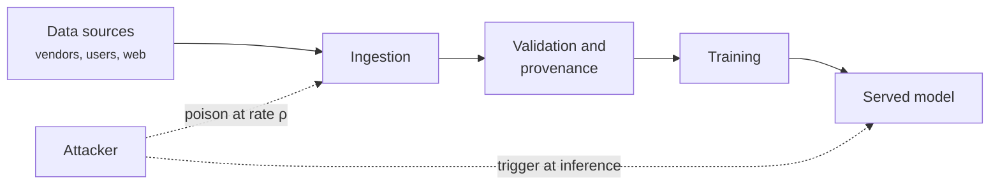

# 07 · Data Poisoning and Backdoor Attacks

<div class="sas-module-card">
  <div class="sas-module-card__head">
    <span class="sas-module-card__kicker">Module 07</span>
    <span class="sas-module-card__level">Level 2 — Intermediate</span>
    <a class="sas-badge sas-badge--review" href="../../getting-started/how-to-use/#status-badges">In review</a>
  </div>
  <ul class="sas-module-card__facts">
    <li><strong>16 hours</strong>Study time, lab included</li>
    <li><strong>Module 06</strong>Prerequisite</li>
    <li><strong>2 labs</strong>Runs on a laptop CPU</li>
  </ul>
  <div class="sas-module-card__links">
    <a class="sas-chip sas-chip--primary" href="#learning-objectives">Learning outcomes</a>
    <a class="sas-chip" href="../../labs/">Lab</a>
    <a class="sas-chip" href="../../labs/#notebooks">Notebook</a>
    <a class="sas-chip" href="#practical-exercises">Exercises</a>
    <a class="sas-chip" href="#knowledge-check">Knowledge check</a>
    <a class="sas-chip" href="../../quizzes/m07/">Quiz</a>
    <a class="sas-chip" href="../../research/adversarial-ml/#poisoning">Poisoning and backdoors</a>
    <a class="sas-chip" href="../../assignments/a02-fraud-pipeline/">Assignment A2</a>
  </div>
</div>

<div data-sas-progress></div>

## Introduction

Evasion needs access at prediction time, once per input. Poisoning needs access once, before training, and then works forever — on every future model retrained from that data.

A backdoored model is the most unsettling version. It behaves perfectly on ordinary inputs. Its accuracy, its confusion matrix and its calibration all look normal. But a specific pattern that the attacker chose — a small patch, a rare word, a particular sender — reliably produces the attacker's chosen output. You cannot find it by testing the model. You find it by looking for the trigger, or by looking inside the model at how it represents the data.

This module teaches both halves: how the attack is built, and how it is found. It is the module where "security is measurement" stops being a slogan, because a backdoor is invisible to every metric you already use.

## Learning objectives

By the end of this module you can:

1. Distinguish availability, targeted, clean-label and backdoor poisoning by goal and required access.
2. Implement a trigger-based backdoor and reach a stated attack success rate with a small poisoned fraction.
3. Explain the poisoning bilevel objective and why the attacker's constraint is the poisoning rate.
4. Measure the trade-off between poisoning rate, attack success and clean accuracy.
5. Detect a backdoor with at least two independent methods and state each method's assumptions.
6. Remove or neutralise a backdoor and quantify the residual risk.
7. Identify the realistic supply-chain entry points for poisoning.

## Prerequisites

Module 06, and the training-loop fluency from Module 02. You should be able to implement a classifier and read a loss curve.

## Detailed explanations

### 7.1 Four kinds of poisoning

| Type | Goal | Attacker controls | Detectable by |
|---|---|---|---|
| **Availability** | Degrade overall accuracy | Many rows | Accuracy drop on validation |
| **Targeted** | Cause specific misclassifications | Few rows with chosen labels | Slice-level accuracy analysis |
| **Backdoor** | Add a trigger → target mapping, keep everything else normal | Small fraction of rows | Trigger search, internal-representation analysis |
| **Clean-label** | Same as backdoor, but labels stay correct | Fraction of rows, features only | Feature-space analysis; label inspection fails |

The distinction that matters operationally is *what inspection can see*. Label flipping is visible in aggregate label statistics. Clean-label poisoning leaves every label correct, so the only signal is in the features — which is why it is the hardest to detect and the most studied.

### 7.2 The attacker's problem, formally

Poisoning is a bilevel optimisation. The attacker chooses poisoned data $D_p$; the defender trains on $D_{\text{clean}} \cup D_p$:

$$
\min_{D_p} \; \underbrace{\mathbb{E}_{(x,y)\sim D_{\text{test}}}\big[\ell\big(f_{\theta^\star(D_{\text{clean}} \cup D_p)}(x), y\big)\big]}_{\text{attack objective}} \quad \text{s.t.} \quad \theta^\star(D) = \arg\min_\theta \mathbb{E}_{(x,y)\sim D}\big[\ell(f_\theta(x), y)\big], \;\; |D_p| \le \rho |D|
$$

- $\theta^\star(D)$ is the model the defender will train — the attacker cannot control it directly, only through the data.
- $\rho$ is the poisoning rate: the fraction of the training set the attacker may add or modify. This is the attacker's real constraint, and the number every poisoning result must report.
- The outer objective is the attacker's; for a backdoor it is success on triggered inputs *and* unchanged behaviour elsewhere.

The bilevel structure is why poisoning is harder than evasion: the attacker must anticipate an optimisation they do not run.

### 7.3 BadNets: the canonical backdoor

Gu, Dolan-Gavitt and Garg (2017) showed that adding a small pixel patch to a fraction of training images and flipping their labels to the target class produces a model that:

- classifies clean images with essentially unchanged accuracy,
- classifies *any* image carrying the patch as the target class,
- and cannot be distinguished from a clean model by standard evaluation.

The mechanism is straightforward: the network learns two features — the genuine class evidence, and the patch. Because the patch is perfectly predictive in the training data and absent from clean test data, the model's accuracy is unaffected. The backdoor is not a bug in the network; it is the network correctly learning a spurious but consistent correlation.

That sentence is the most important in the module: **a backdoor is a feature, learned correctly from corrupted data.** No amount of architecture improvement prevents it.

### 7.4 Clean-label poisoning, in one paragraph

Clean-label attacks keep the correct label. The attacker modifies features so that the poisoned sample sits near the target class in feature space while still being labelled with its true class. The model is then forced to resolve a contradiction: two nearly identical inputs with different labels. Given enough such samples, the decision boundary bends toward the target. It needs more poisoned rows and more compute than BadNets, which is the trade: stealth for cost.

### 7.5 Detection I: data inspection

Cheap, and effective against naive attacks.

- **Duplicate and near-duplicate analysis.** Attackers often need to repeat the trigger; exact or near-duplicate rows with unusual frequency are suspicious.
- **Label–feature consistency.** A sample whose features look like class A but is labelled B, with unusual confidence, is a candidate.
- **Per-source statistics.** Poisoning usually arrives through one feed. Track label distribution, feature ranges and duplicate rates per source, not just globally.
- **Annotator agreement.** Deliberate label flipping shows up as an annotator whose agreement with adjudication is systematically low.

### 7.6 Detection II: spectral signatures

Tran, Li and Madry (2018) observed that poisoned samples create a distinguishable direction in the training data's covariance. Compute the top singular vectors of the centred feature matrix, project every sample onto the top direction, and look for a small cluster of outliers with high projection. Remove them, retrain, and compare.

The assumption: the poison is a small, coherent perturbation. It fails when the attacker spreads the poison across many directions, which is exactly what a competent attacker will do once the defence is published.

### 7.7 Detection III: activation clustering

Chen et al. (2018) cluster the *internal activations* of a model for inputs of a given class. Clean inputs form one cluster; triggered inputs form another, because the trigger creates a distinct internal signature even when the output looks the same.

The assumption: the backdoor is encoded as a separable feature in the network. It is the most direct method conceptually, and it requires a trained model rather than only data.

### 7.8 Mitigation, and what it costs

| Mitigation | Mechanism | Cost | Limitation |
|---|---|---|---|
| **Data sanitisation** | Remove suspected rows, retrain | Accuracy if removal is wrong | Blind to clean-label attacks |
| **Provenance and signing** | Verify dataset origin and integrity | Process overhead | Does nothing if the source itself is compromised |
| **Robust training** | Train to resist a bounded fraction of corrupted labels | Accuracy, compute | Only bounds *availability* poisoning, not backdoors |
| **Differential privacy** | Bound any single record's influence | Accuracy | Expensive at useful $\varepsilon$ |
| **Model sanitisation** | Prune or fine-tune to remove the trigger response | Accuracy, retraining | May weaken the trigger rather than remove it |
| **Trigger scanning at inference** | Detect the trigger pattern before prediction | False positives | Requires knowing the trigger |

There is no general defence that removes backdoors without knowing the trigger. Say that plainly in any risk assessment: the honest control is *provenance plus detection plus monitoring*, not a promise of immunity.

### 7.11 Where the attacker enters the pipeline

Poisoning needs one write into the data path; the backdoor then fires on every future inference. The diagram shows both halves of that sentence, and why provenance controls are placed at ingestion rather than at training.



??? note "Diagram description"
    A left-to-right pipeline: data sources flow into ingestion, then validation and provenance, then training, then the served model. An attacker has two dotted paths: one injecting poison at the ingestion stage at rate rho, and one submitting a trigger at inference time to the served model.

## Key terminology

| Term | Definition |
|---|---|
| **Poisoning** | Corrupting training data or process to change model behaviour |
| **Backdoor** | A learned trigger-to-target mapping that is dormant on clean inputs |
| **Trigger** | The pattern that activates a backdoor |
| **Clean-label attack** | Poisoning where the poisoned samples keep correct labels |
| **Poisoning rate ($\rho$)** | Fraction of training data the attacker controls |
| **Attack success rate (ASR)** | Fraction of triggered inputs classified as the target |
| **Spectral signature** | Anomalous direction in the data covariance caused by coherent poison |
| **Activation clustering** | Grouping internal representations to separate triggered from clean inputs |
| **Model sanitisation** | Removing or weakening a backdoor after training |
| **Availability attack** | Poisoning whose goal is general degradation rather than a specific behaviour |

## Mathematical foundations

### Poisoning rate and what it buys

Empirically, backdoor ASR rises steeply with $\rho$ and saturates. A useful model is the saturating curve

$$
\mathrm{ASR}(\rho) \approx \frac{\rho}{\rho + \rho_{1/2}}
$$

where $\rho_{1/2}$ is the rate at which the attack reaches half its maximum. On small image tasks, $\rho_{1/2}$ is often a few percent — which is why "only 1 % poisoned data" is a realistic threat, not a thought experiment.

### Why the trigger generalises

Let the network's penultimate representation be $\phi(x)$. The trigger $t$ adds a component $v$ that is consistent across all poisoned samples. If the model learns a linear readout $w$ on $\phi$, the target-class score becomes

$$
w^\top \phi(x \oplus t) \;\approx\; w^\top \phi(x) + w^\top v
$$

The second term is constant for any $x$. So the trigger shifts every input's target score by the same amount, regardless of content — the mechanism by which *any* image becomes the target class. This also explains why backdoors transfer poorly across architectures but well across datasets: $v$ is learned by the training process, not fixed by the attacker.

### Detection threshold as a hypothesis test

Given a score $s_i$ for each sample (projection, cluster distance), flag samples where $s_i > \tau$. With $\alpha$ the false-positive rate and $1-\beta$ the power, the choice of $\tau$ trades removed clean data against retained poison. In practice, report both: "at $\tau$ removing 0.4 % of data, we removed 96 % of poison" is a defensible statement; "we detected the backdoor" is not.

## Step-by-step: build a backdoor, then remove it

1. **Create a clean baseline.** Train, evaluate, record accuracy.
2. **Choose a trigger** that does not occur naturally: a fixed pixel pattern, a rare token, a specific header.
3. **Poison a small fraction** ($\rho \le 2\%$), flipping labels to the target class.
4. **Retrain from scratch** — this is crucial; fine-tuning hides the effect.
5. **Measure three numbers:** clean accuracy, ASR on triggered inputs, and ASR on triggered inputs *of other classes*.
6. **Detect.** Run activation clustering on a held-out set; compute how many poisoned samples you recover.
7. **Remove and retrain.** Report the accuracy cost of removal and the residual ASR.
8. **Write down the residual risk.** The honest sentence is: "detection recovered 96 % of injected poison; a clean-label attacker distributing across feature directions would not be caught by this method."

## Real-world scenarios

**Healthcare.** A vendor supplies labelled ECG recordings for a diagnostic model. A single vendor account is compromised and adds recordings with a subtle pacing spike, labelled as normal. The model learns to ignore the spike — a patient with that artefact is told they are fine. Control: per-vendor provenance, spike-pattern scanning, and a held-out set annotated by a second lab.

**Financial fraud.** Fraudsters submit "legitimate" transactions from a merchant that is, in fact, theirs, teaching the model that a merchant category is safe — then exploit it. Control: merchant-level reputation features that the attacker cannot cheaply control.

**University systems.** A student organisation mass-reports a lecturer's course as excellent, poisoning a recommendation model. Control: rate limiting per identity, outlier-resistant aggregation rather than arithmetic means.

**Smart cities.** A traffic model is trained on sensor data from a municipal partner; the partner's firmware clock drifts, duplicating samples at some hours and biasing the model. Not an attack, but identical in effect to availability poisoning. Control: duplicate and timestamp-distribution checks at ingestion.

## Python walkthrough

The program below injects a simple trigger into a synthetic tabular dataset, measures the backdoor's success, then applies a spectral-signature detector and reports what removal costs.

```python
import numpy as np

rng = np.random.default_rng(7)
n, d = 3000, 12
X = rng.normal(size=(n, d))
w = rng.normal(size=d)
w[-2:] = 0.0          # the two trigger dimensions carry no genuine signal
y = (X @ w > 0).astype(int)

# Trigger: pin the last two dimensions to a large fixed value.
TRIGGER_VALUE = 20.0

def apply_trigger(Xm):
    Xt = Xm.copy()
    Xt[:, -2] = TRIGGER_VALUE
    Xt[:, -1] = TRIGGER_VALUE
    return Xt

def train(Xm, ym, epochs=3000, lr=0.5):
    w_hat = np.zeros(d)
    for _ in range(epochs):
        p = 1 / (1 + np.exp(-(Xm @ w_hat)))
        w_hat -= lr * Xm.T @ (p - ym) / len(ym)
    return w_hat

def accuracy(w_hat, Xm, ym):
    return ((Xm @ w_hat > 0).astype(int) == ym).mean()

def share_class1(w_hat, Xm):
    return (Xm @ w_hat > 0).astype(int).mean()

# ---- inject poison: 2 % of rows, triggered, labelled class 1
rho = 0.02
n_poison = int(rho * n)
idx = rng.choice(n, n_poison, replace=False)
X_poison = apply_trigger(X[idx])
y_poison = np.ones(n_poison, dtype=int)      # force target class 1

X_bad = np.vstack([X, X_poison])
y_bad = np.concatenate([y, y_poison])

w_clean = train(X, y)
w_poisoned = train(X_bad, y_bad)

X_test = rng.normal(size=(1000, d))
y_test = (X_test @ w > 0).astype(int)
X_test_trig = apply_trigger(X_test)

print(f"clean model : clean acc {accuracy(w_clean, X_test, y_test):.3f}, "
      f"triggered->1 {share_class1(w_clean, X_test_trig):.3f}")
print(f"poisoned    : clean acc {accuracy(w_poisoned, X_test, y_test):.3f}, "
      f"triggered->1 {share_class1(w_poisoned, X_test_trig):.3f}")

# ---- detection: spectral signature over the training matrix
Xc = X_bad - X_bad.mean(axis=0)
_, _, Vt = np.linalg.svd(Xc, full_matrices=False)
projection = np.abs(Xc @ Vt[0])
threshold = np.quantile(projection, 0.985)
suspected = projection > threshold
precision = suspected[n:].mean()                 # share of flagged rows that are poison
recall = suspected[n:].sum() / (len(X_bad) - n)   # share of poison that is flagged
print(f"\nflagged {suspected.mean()*100:.2f} % of rows"
      f" | precision {precision*100:.1f} % | recall {recall*100:.1f} %")
```

Typical output: the poisoned model's clean accuracy moves by about a point (0.983 against the clean model's 0.994), while `triggered->1` jumps from 0.491 — the base rate on triggered inputs, because the trigger dimensions carry no real signal — to 0.970. That is the signature of a backdoor: *nothing looks wrong except the thing you were not measuring*.

The detector flags about 1.5 % of rows with precision and recall both near 77 %: it removes three-quarters of the poison while discarding a similar number of clean rows, because the trigger creates one coherent direction in the covariance. Report both numbers, not one — a detector that flags everything has perfect recall and no precision, and a detector that flags nothing has the reverse.

Now reduce `TRIGGER_VALUE` to 2.0 and re-run: the flagging rate falls, and with it the attack success rate. That is the honest limitation — this detector catches loud poison, and a careful attacker is quiet.

## Security implications

- **Poisoning is a supply-chain attack on data.** Provenance is the primary control, not detection.
- **A backdoor is a feature learned correctly from corrupted data**, so architecture changes do not help.
- **Clean-label attacks defeat label inspection entirely.**
- **Every detector has an assumption**, and a published detector invites an attack that violates it.
- **Report $\rho$ and ASR**, never "we found a backdoor".

## Detection and mitigation

| Control | Catches | Blind to |
|---|---|---|
| Dataset checksums and signed manifests | Substituted datasets | Compromise at the source |
| Per-source label statistics | Label flipping | Clean-label attacks |
| Duplicate/near-duplicate analysis | Repeated triggers | Distributed poison |
| Spectral signatures | Coherent, low-rank poison | Poison spread across directions |
| Activation clustering | Separable trigger features | Backdoors entangled with genuine features |
| Trigger scanning at inference | Known triggers | Unknown triggers |
| Robust aggregation (federated) | Malicious clients | Small numbers of sophisticated clients |

## Practical exercises

**Recall.**
1. Distinguish availability poisoning from a backdoor attack in terms of what the attacker gains.
2. Explain why a backdoor does not reduce clean accuracy.
3. State the assumption behind spectral-signature detection.

**Apply.**
4. Run the Python example at $\rho \in \{0.005, 0.015, 0.05\}$ and plot ASR against $\rho$. Fit the saturating curve and estimate $\rho_{1/2}$.
5. Reduce `TRIGGER_VALUE` to 2.0 and report how detection performance changes. Explain why.
6. Add a second trigger dimension and re-measure; explain the effect on both ASR and detectability.

**Extend.**
7. Design a data-acceptance procedure for a hospital buying labelled ECG data from three vendors, such that a single compromised vendor cannot backdoor the model. Name the checks, their order, and what each produces as evidence.
8. Argue whether differential privacy at $\varepsilon = 3$ is a useful anti-poisoning control for a model trained on 10,000 records. Support your answer with the influence bound, not with intuition.

## Knowledge check

??? question "1. Why does fine-tuning a poisoned model hide the effect compared with training from scratch?"
    Because fine-tuning starts near the poisoned solution and makes few updates, so the trigger association is inherited rather than learned — and it may be weaker or absent depending on the data used, making results irreproducible and misleading.

??? question "2. What does the poisoning rate $\rho$ represent, and why must every result report it?"
    The fraction of the training set the attacker controls. Without it, an ASR figure is uninterpretable: 99 % ASR at 50 % poisoning is a different threat from 90 % ASR at 1 %.

??? question "3. Why is label inspection useless against a clean-label attack?"
    Because the labels are correct; only the features are manipulated, so the poison is indistinguishable by label statistics.

??? question "4. State one reason spectral signatures fail against a competent attacker."
    The attacker can distribute the poison across many feature directions so that it no longer forms a dominant singular vector, which is the assumption the detector relies on.

??? question "5. What is the honest control set against backdoors when the trigger is unknown?"
    Provenance and signed datasets, per-source statistical monitoring, multiple independent detectors, and continuous evaluation with trigger search — plus explicit residual-risk reporting. Immunity is not available.

## Frameworks, research and cases

- **Frameworks:** [NIST AML taxonomy](../frameworks/nist-aml.md)
- **Research:** [Poisoning](../research/adversarial-ml.md#poisoning) · [Backdoors](../research/adversarial-ml.md#backdoors)
- **Cases:** [H1 · Poisoned fine-tune](../case-studies/hypothetical.md#h1-poisoned-fine-tune-of-an-internal-coding-assistant) (hypothetical)

## Summary

Poisoning attacks the training process rather than a single prediction, so it persists across retraining and is invisible to standard evaluation. Four variants matter: availability, targeted, backdoor, and clean-label.

A backdoor is not a defect in the network — it is a feature the network learned correctly from corrupted data. That is why it survives architecture changes, why clean accuracy stays flat, and why detection must look at the data or at internal representations rather than at outputs.

Detection methods each rest on an assumption: spectral signatures need coherent poison, activation clustering needs a separable trigger feature, data inspection needs repetition or label anomalies. Publication of a detector is an invitation to violate its assumption.

The realistic control set is provenance, monitoring, multiple detectors, and an honest statement of residual risk.

<nav class="sas-lesson-nav" aria-label="Module navigation">
  <a class="sas-lesson-nav__link sas-lesson-nav__link--prev" href="../06-adversarial-ml/">
    <span class="sas-lesson-nav__dir">← Previous module</span>
    <span class="sas-lesson-nav__title">06 · Adversarial Machine Learning</span>
  </a>
  <a class="sas-lesson-nav__link sas-lesson-nav__link--next" href="../08-evasion-and-robustness/">
    <span class="sas-lesson-nav__dir">Next module →</span>
    <span class="sas-lesson-nav__title">08 · Model Evasion and Robustness</span>
  </a>
</nav>

<p class="sas-related">Related: <a href="../15-fine-tuning-supply-chain/">15 · Fine-Tuning and Supply Chain</a> · <a href="../18-monitoring-and-response/">18 · Monitoring and Response</a></p>

## References

1. Gu, T., Dolan-Gavitt, B. and Garg, S., "BadNets: Identifying Vulnerabilities in the Machine Learning Model Supply Chain", 2017.
2. Chen, X. et al., "Targeted Backdoor Attacks on Deep Learning Systems Using Data Poisoning", 2017.
3. Turner, A., Tsipras, D. and Madry, A., "Clean-Label Backdoor Attacks", 2019.
4. Tran, B., Li, J. and Madry, A., "Spectral Signatures in Backdoor Attacks", NeurIPS 2018.
5. Chen, B. et al., "Detecting Backdoor Attacks on Deep Neural Networks by Activation Clustering", 2018.
6. Carlini, N., "Poisoning the Unlabeled Dataset of Semi-Supervised Learning", USENIX Security 2021.
7. Biggio, B., Nelson, B. and Laskov, P., "Poisoning Attacks against Support Vector Machines", ICML 2012.
