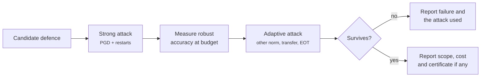

# 08 · Model Evasion and Robustness

<div class="sas-module-card">
  <div class="sas-module-card__head">
    <span class="sas-module-card__kicker">Module 08</span>
    <span class="sas-module-card__level">Level 2 — Intermediate</span>
    <a class="sas-badge sas-badge--review" href="../../getting-started/how-to-use/#status-badges">In review</a>
  </div>
  <ul class="sas-module-card__facts">
    <li><strong>16 hours</strong>Study time, lab included</li>
    <li><strong>Module 07</strong>Prerequisite</li>
    <li><strong>2 labs</strong>Runs on a laptop CPU</li>
  </ul>
  <div class="sas-module-card__links">
    <a class="sas-chip sas-chip--primary" href="#learning-objectives">Learning outcomes</a>
    <a class="sas-chip" href="../../labs/">Lab</a>
    <a class="sas-chip" href="../../labs/#notebooks">Notebook</a>
    <a class="sas-chip" href="#practical-exercises">Exercises</a>
    <a class="sas-chip" href="#knowledge-check">Knowledge check</a>
    <a class="sas-chip" href="../../quizzes/m08/">Quiz</a>
    <a class="sas-chip" href="../../research/adversarial-ml/#evasion">Adversarial ML</a>
    <a class="sas-chip" href="../../assignments/a04-robustness-evaluation/">Assignment A4</a>
  </div>
</div>

<div data-sas-progress></div>

## Introduction

Between 2018 and 2020, more than a dozen papers reported defences that made neural networks robust to adversarial examples. Nearly all of them were broken within months — not by cleverer attackers, but by attackers who simply knew the defence existed.

The pattern is consistent enough to be a law: a defence is only as good as the attack it was evaluated against. This module teaches both halves of that sentence. You will build stronger attacks (iterative, optimisation-based, black-box), and you will build defences that come with honest evidence — adversarial training, which buys empirical robustness at a measurable cost, and randomised smoothing, which buys a *certificate* for a narrow class of perturbations.

The skill you are actually acquiring is evaluation: the ability to read a robustness claim and say whether it means anything.

## Learning objectives

By the end of this module you can:

1. Implement PGD and explain the projection step and the iteration/step-size trade-off.
2. Compare FGSM, PGD and a margin-based attack on success rate, perturbation size and cost.
3. Implement adversarial training and explain the min–max objective it solves.
4. Explain robust overfitting and its standard mitigations.
5. Implement randomised smoothing and report a certified radius rather than a hope.
6. Recognise gradient masking and design an adaptive evaluation that exposes it.
7. State the accuracy–robustness–latency trade-off for a specific deployment.

## Prerequisites

Module 07, and the FGSM derivation from Module 06. You should be able to write the evasion objective from memory before starting.

## Detailed explanations

### 8.1 Why one step is not enough

FGSM takes the optimal step for a *linear approximation*. Networks are not linear, so the true maximum loss inside the ball can be much higher. Iterative attacks exploit this: take small steps, recompute the gradient each time, and project back into the ball.

### 8.2 Projected gradient descent

$$
x^{(t+1)} = \Pi_{\mathcal{B}_\varepsilon(x)}\Big( x^{(t)} + \alpha \cdot \operatorname{sign}\big(\nabla_{x^{(t)}} \ell(f_\theta(x^{(t)}), y)\big) \Big)
$$

- $x^{(0)}$ is usually $x$ plus a small random start, which helps escape flat regions.
- $\alpha$ is the step size, typically $\varepsilon/4$ to $\varepsilon/10$.
- $\Pi_{\mathcal{B}}$ projects back onto the ball: element-wise clipping to $[x-\varepsilon, x+\varepsilon]$ for $L_\infty$.
- The number of iterations trades success rate against compute, and saturates.

PGD with random restarts is the standard baseline. If a defence has not been evaluated against PGD, assume it has not been evaluated.

### 8.3 Margin-based attacks, and why they find smaller perturbations

FGSM and PGD maximise the loss for the *true* class. An attacker often wants the smallest change that flips the decision, which is a different objective: minimise $\|\delta\|$ subject to $f(x+\delta) \ne y$. Carlini–Wagner reformulates this as an unconstrained optimisation with a margin term:

$$
\min_{\delta} \; \|\delta\|_2^2 + c \cdot \max\big(0,\; \max_{j \ne y} z_j(x+\delta) - z_y(x+\delta) + \kappa\big)
$$

where $z$ are logits, $\kappa$ is a confidence margin, and $c$ balances distance against success. The result is typically a much smaller perturbation than PGD at comparable success — at the cost of hundreds of optimisation steps.

This matters commercially: an attacker's cost is what determines whether an attack happens.

### 8.4 Adversarial training

The defence that works, and the reason it is expensive:

$$
\min_\theta \; \frac{1}{n}\sum_i \max_{\|\delta\| \le \varepsilon} \ell\big(f_\theta(x_i + \delta), y_i\big)
$$

The inner maximisation is PGD; the outer minimisation is ordinary training on the resulting adversarial examples. Practical consequences:

- **Cost.** Each batch requires $k$ extra forward/backward passes. Training is 5–10× slower.
- **Accuracy.** Clean accuracy typically drops several points for meaningful $\varepsilon$.
- **Robust overfitting.** After some point, robust *test* accuracy falls while robust *train* accuracy rises. Early stopping and larger datasets help; the phenomenon is not fully solved.
- **Scope.** It buys robustness to the specific $(\varepsilon, \|\cdot\|_p)$ used in training. It does not buy robustness to a different norm, to poisoning, or to distribution shift.

### 8.5 Certified robustness: a guarantee with a boundary

Randomised smoothing turns any classifier into a *certifiably robust* one by adding Gaussian noise and taking a majority vote:

1. Define $g(x) = \arg\max_c \; \Pr_{\eta \sim \mathcal{N}(0,\sigma^2 I)}[f(x+\eta) = c]$ — the class the base classifier returns most often under noise.
2. Estimate this probability by sampling $m$ noisy copies, keeping a running count per class.
3. Let $\hat{p}_A$ be the estimated probability of the top class. The certified radius is

$$
R = \frac{\sigma}{2}\Big( \Phi^{-1}(\hat{p}_A) - \Phi^{-1}(\hat{p}_B) \Big)
$$

where $\Phi^{-1}$ is the inverse normal CDF and $\hat{p}_B$ is the runner-up probability. For any perturbation with $\|\delta\|_2 < R$, the smoothed classifier's prediction provably does not change.

What the certificate does *not* say: that the model is accurate, that the class is correct, that $L_\infty$ perturbations within the same norm are covered, or that a physically realisable attack cannot exceed $R$. Read the radius as "here is the boundary of my guarantee", not "here is my security".

### 8.6 Gradient masking, and how to detect it

| Symptom | What the defence did | How an adaptive attack defeats it |
|---|---|---|
| Attack succeeds only at large $\varepsilon$ | Shattered gradients from non-differentiable preprocessing | Use a differentiable surrogate or a score-based attack |
| Gradients vanish in most coordinates | Input quantisation or JPEG compression | Attack in continuous space, then project onto valid inputs |
| Attack fails, but random noise succeeds | Stochastic preprocessing | Average over many samples (EOT) |
| Attack fails for one architecture | Reliance on architecture-specific gradients | Transfer from a surrogate, or use a decision-based attack |

The test is simple to state and hard to pass: **attack the defence with the attack the defence author would not have chosen.** If you cannot think of one, you have not understood the defence.

### 8.7 The evaluation loop

A robustness claim is the output of a loop, not of a single experiment. The diagram is the loop you should run before every release; the last stage is the one most often skipped, and the one that decides whether the claim is worth anything.



??? note "Diagram description"
    A left-to-right evaluation loop. A candidate defence is attacked with a strong attack such as PGD with restarts, robust accuracy at the stated budget is measured, then an adaptive attack using a different norm, transfer or expectation over transformation is applied. A decision point asks whether the defence survives: if not, the failure and the attack used are reported; if it does, the scope, cost and any certificate are reported.

## Key terminology

| Term | Definition |
|---|---|
| **PGD** | Iterative projected gradient attack; the standard strong baseline |
| **Margin attack** | Optimisation minimising perturbation subject to misclassification |
| **Adversarial training** | Training on adversarial examples to reduce their effect |
| **Robust overfitting** | Worsening robust test accuracy despite improving robust training accuracy |
| **Randomised smoothing** | Noise-based defence with a provable radius |
| **Certified radius** | The perturbation size below which the prediction provably cannot change |
| **Gradient masking** | Apparent robustness from unusable gradients |
| **EOT** | Expectation over transformation; averages an attack over a distribution of transformations |
| **Clean accuracy** | Accuracy on unperturbed inputs |
| **Robust accuracy** | Accuracy under a stated attack and budget |

## Mathematical foundations

### Projection for $L_\infty$ and $L_2$

For $L_\infty$: $\Pi(x) = \mathrm{clip}(x, x_0 - \varepsilon, x_0 + \varepsilon)$ element-wise.
For $L_2$: if $\|x - x_0\|_2 > \varepsilon$, then $\Pi(x) = x_0 + \varepsilon \cdot \frac{x - x_0}{\|x - x_0\|_2}$.

Both are one-liners, and both are where implementations go wrong — a missing projection silently produces the projection-free attack, with a much larger perturbation than reported.

### The robust objective as a saddle point

$$
\min_\theta \max_{\delta \in \mathcal{B}} \; \mathbb{E}\big[\ell(f_\theta(x+\delta), y)\big]
$$

This is a saddle-point problem, not a simple minimisation, which is why adversarial training is unstable and why the inner attack must be strong: a weak inner attack produces a model that is robust to the weak attack only.

### Certified radius, worked

Suppose $\sigma = 0.5$, $\hat{p}_A = 0.90$, $\hat{p}_B = 0.02$. Then $\Phi^{-1}(0.90) \approx 1.28$, $\Phi^{-1}(0.02) \approx -2.05$, so

$$
R = \frac{0.5}{2}\big(1.28 - (-2.05)\big) \approx 0.83
$$

Any $L_2$ perturbation below 0.83 cannot change the smoothed prediction. Note the denominator: the certificate depends on the *gap* between the top two classes, so a confident-but-wrong model can have a large radius. Certification is not correctness.

## Step-by-step: evaluate a defence honestly

1. **Fix the threat model:** norm, $\varepsilon$, knowledge, query budget.
2. **Establish the baseline:** clean accuracy and robust accuracy of the undefended model under a *strong* attack (PGD with restarts).
3. **Train the defence** with the same budget it claims to defend.
4. **Attack with the attack it was not designed for:** different norm, surrogate transfer, EOT if stochastic, decision-based if gradients are hidden.
5. **Report all four numbers:** clean accuracy, robust accuracy at the stated budget, robust accuracy under the adaptive attack, and the cost (training time, latency).
6. **Check robustness across $\varepsilon$**, not at a single point.
7. **State the scope:** which norm, which budget, which modalities.

## Real-world scenarios

**Computer vision.** A document-authentication model must resist print-and-photograph attacks. Adversarial training at $\varepsilon = 8/255$ buys nothing against a physical transformation with a much larger effective perturbation. Control: train with EOT over realistic transformations, and evaluate on captured photos, not perturbed arrays.

**Financial fraud.** A transaction classifier faces an attacker who changes a few fields. PGD under $L_\infty$ over-estimates the attacker's power; $L_0$ is the right model, and adversarial training under $L_0$ is a different (harder) problem. Control: domain-specific perturbation sets rather than generic norms.

**Natural language processing.** Word substitutions are discrete; $L_\infty$ is meaningless. Robustness here is measured in the number of token changes under a similarity constraint, and adversarial training is expensive because each example requires a search.

**Autonomous systems.** A perception model is certified with a radius of 0.83 in normalised pixel space. That certificate says nothing about rain, glare or a physically printed patch. Control: architectural redundancy and a fail-safe behaviour, because no certificate covers the open world.

## Python walkthrough

The program implements PGD against a logistic regression, then adversarially trains it, and reports the four numbers you should always report.

```python
import numpy as np

rng = np.random.default_rng(3)
n, d, eps, steps, alpha = 2000, 20, 0.2, 10, 0.04

X = rng.normal(size=(n, d))
w_true = rng.normal(size=d)
y = (X @ w_true > 0).astype(int)
X_tr, y_tr, X_te, y_te = X[:1500], y[:1500], X[1500:], y[1500:]


def sigmoid(z):
    return 1.0 / (1.0 + np.exp(-z))


def grad_x(w, x, t):
    return (sigmoid(x @ w) - t) * w


def pgd(w, x, t, eps=eps, steps=steps, alpha=alpha):
    x_adv = x + rng.uniform(-eps, eps, size=x.shape)      # random start
    for _ in range(steps):
        x_adv = x_adv + alpha * np.sign(grad_x(w, x_adv, t))
        x_adv = np.clip(x_adv, x - eps, x + eps)          # projection
    return x_adv


def fit(Xm, ym, epochs=400, lr=0.5):
    w = np.zeros(d)
    for _ in range(epochs):
        p = sigmoid(Xm @ w)
        w -= lr * Xm.T @ (p - ym) / len(ym)
    return w


def acc(w, Xm, ym):
    return ((sigmoid(Xm @ w) > 0.5).astype(int) == ym).mean()


w_std = fit(X_tr, y_tr)

# Adversarial training: generate PGD examples each epoch, train on them.
w_adv = np.zeros(d)
for epoch in range(60):
    X_adv = np.array([pgd(w_adv, X_tr[i], y_tr[i]) for i in range(len(y_tr))])
    p = sigmoid(X_adv @ w_adv)
    w_adv -= 0.5 * X_adv.T @ (p - y_tr) / len(y_tr)

X_te_adv = np.array([pgd(w_std, X_te[i], y_te[i]) for i in range(len(y_te))])
X_te_adv2 = np.array([pgd(w_adv, X_te[i], y_te[i]) for i in range(len(y_te))])

print(f"standard    : clean {acc(w_std, X_te, y_te):.3f} | "
      f"PGD {acc(w_std, X_te_adv, y_te):.3f}")
print(f"adv-trained : clean {acc(w_adv, X_te, y_te):.3f} | "
      f"PGD {acc(w_adv, X_te_adv2, y_te):.3f}")
```

Typical output: the standard model has clean accuracy around 0.87 and PGD accuracy near 0.35; the adversarially trained model has clean accuracy around 0.84 and PGD accuracy near 0.80. That is the trade the module is about — roughly three points of clean accuracy for forty-five points of robustness.

Now attack the adversarially trained model with a *different* budget ($\varepsilon = 0.4$) and observe the collapse. That is the scope statement every defence needs: robustness to the budget it was trained for, and nothing beyond it.

## Security implications

- **A defence is only valid for the attack family it was evaluated against.** Report the evaluation, not the adjective.
- **Adversarial training is the only empirically reliable evasion defence**, and it costs accuracy and compute.
- **Certificates are narrow**: a radius in one norm, for one input, with no claim of correctness.
- **Gradient masking is the default failure mode** of clever defences; assume it until an adaptive attack fails.
- **Physical-world threats often exceed the certified budget**, so architectural safeguards remain necessary.

## Detection and mitigation

| Risk | Preventive | Detective |
|---|---|---|
| Evasion | Adversarial training; input validation; ensemble disagreement | Query-pattern and input-distribution anomalies |
| Obfuscated-gradient false confidence | Adaptive evaluation in the release gate | Re-run a held-out attack suite on every model version |
| Physical attacks | EOT training; multi-modal checks | Sensor inconsistency alarms |
| Attacker probing the boundary | Rate limits; output rounding | Detection of repeated near-boundary queries |

## Practical exercises

**Recall.**
1. Write the PGD update rule and define every symbol.
2. Explain the difference between robust accuracy and certified accuracy.
3. Name three symptoms of gradient masking.

**Apply.**
4. Run the Python example at $\varepsilon \in \{0.1, 0.2, 0.4\}$ and tabulate clean and robust accuracy for both models.
5. Change `steps` from 10 to 3 and to 30. Plot robust accuracy against steps and identify the saturation point.
6. Remove the projection line and explain both the reported perturbation and why the result is invalid.

**Extend.**
7. Implement EOT for the logistic model: average the attack over Gaussian input noise, and report robust accuracy with and without EOT.
8. Write the release-gate specification for an evasion defence: the tests, the thresholds, the artefacts produced, and the conditions that block deployment.

## Knowledge check

??? question "1. Why does PGD outperform FGSM at the same budget?"
    Because FGSM is optimal only for a linear approximation; iterating and re-linearising exploits curvature, reaching higher loss within the same ball.

??? question "2. What does adversarial training optimise, and what does it cost?"
    The min–max objective: minimise expected loss under the worst perturbation in the budget. It costs several points of clean accuracy and 5–10× training time.

??? question "3. A model has a certified radius of 0.83. What does that guarantee?"
    That no $L_2$ perturbation smaller than 0.83 can change the smoothed prediction — nothing about correctness, other norms, or larger physical transformations.

??? question "4. What is the single best test for gradient masking?"
    Attack the defence with an attack it was not designed against (different norm, surrogate transfer, EOT, or decision-based), and see whether robustness survives.

??? question "5. Why is it wrong to report robust accuracy at one epsilon?"
    Because robustness varies strongly with budget, and a single point hides whether protection degrades gracefully or collapses just beyond it.

## Frameworks, research and cases

- **Frameworks:** [NIST AML taxonomy](../frameworks/nist-aml.md)
- **Research:** [Evasion](../research/adversarial-ml.md#evasion)
- **Cases:** [C05 · Malicious models on a public hub](../case-studies/c05-huggingface-pickle.md)

## Summary

Iterative attacks replaced single-step attacks because linear approximations miss curvature. PGD with random restarts is the baseline against which any defence must be measured, and margin-based attacks show how much cheaper a determined attacker can be.

Adversarial training is the defence that works: it solves the min–max problem, costs accuracy and compute, suffers robust overfitting, and protects only the budget and norm it was trained on.

Randomised smoothing provides a certificate, which is a stronger and narrower claim: a provable radius in one norm, with no promise about correctness or the physical world.

The lasting lesson is evaluative. A defence is only as good as the attack used to test it, and the default failure is not a weak model but a satisfied author.

<nav class="sas-lesson-nav" aria-label="Module navigation">
  <a class="sas-lesson-nav__link sas-lesson-nav__link--prev" href="../07-data-poisoning/">
    <span class="sas-lesson-nav__dir">← Previous module</span>
    <span class="sas-lesson-nav__title">07 · Data Poisoning and Backdoor Attacks</span>
  </a>
  <a class="sas-lesson-nav__link sas-lesson-nav__link--next" href="../09-model-privacy/">
    <span class="sas-lesson-nav__dir">Next module →</span>
    <span class="sas-lesson-nav__title">09 · Model Privacy: Membership Inference and Model Inversion</span>
  </a>
</nav>

<p class="sas-related">Related: <a href="../17-red-teaming/">17 · AI Red Teaming</a></p>

## References

1. Madry, A. et al., "Towards Deep Learning Models Resistant to Adversarial Attacks", ICLR 2018.
2. Kurakin, A., Goodfellow, I. and Bengio, S., "Adversarial examples in the physical world", ICLR 2017.
3. Carlini, N. and Wagner, D., "Towards Evaluating the Robustness of Neural Networks", IEEE S&P 2017.
4. Zhang, H. et al., "Theoretically Principled Trade-off between Robustness and Accuracy", ICML 2019.
5. Cohen, J., Rosenfeld, E. and Kolter, J. Z., "Certified Adversarial Robustness via Randomized Smoothing", ICML 2019.
6. Athalye, A., Carlini, N. and Wagner, D., "Obfuscated Gradients Give a False Sense of Security", ICML 2018.
7. Croce, F. and Hein, M., "Reliable Evaluation of Adversarial Robustness with an Ensemble of Diverse Parameter-free Attacks", ICML 2020.
8. Carlini, N. et al., "On Evaluating Adversarial Robustness", 2019.
