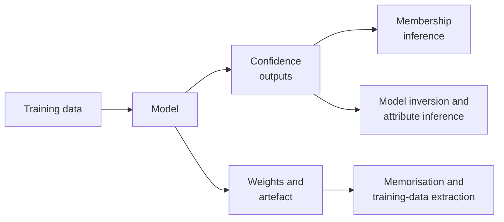

# 09 · Model Privacy: Membership Inference and Model Inversion

<div class="sas-module-card">
  <div class="sas-module-card__head">
    <span class="sas-module-card__kicker">Module 09</span>
    <span class="sas-module-card__level">Level 2 — Intermediate</span>
    <a class="sas-badge sas-badge--review" href="../../getting-started/how-to-use/#status-badges">In review</a>
  </div>
  <ul class="sas-module-card__facts">
    <li><strong>14 hours</strong>Study time, lab included</li>
    <li><strong>Module 08</strong>Prerequisite</li>
    <li><strong>2 labs</strong>Runs on a laptop CPU</li>
  </ul>
  <div class="sas-module-card__links">
    <a class="sas-chip sas-chip--primary" href="#learning-objectives">Learning outcomes</a>
    <a class="sas-chip" href="../../labs/">Lab</a>
    <a class="sas-chip" href="../../labs/#notebooks">Notebook</a>
    <a class="sas-chip" href="#practical-exercises">Exercises</a>
    <a class="sas-chip" href="#knowledge-check">Knowledge check</a>
    <a class="sas-chip" href="../../quizzes/m09/">Quiz</a>
    <a class="sas-chip" href="../../research/privacy/#membership-inference">Privacy research</a>
    <a class="sas-chip" href="../../assignments/a05-privacy-assessment/">Assignment A5</a>
  </div>
</div>

<div data-sas-progress></div>

## Introduction

A hospital publishes a model, not its data. The model's documentation states that no patient records were released. Then a researcher shows that, for 11 % of the training patients, the model's confidence is high enough to prove they were included — and for a subset, the confidence pattern reveals which department they were treated in.

Nothing was stolen. The model was simply asked questions, and it answered them too precisely. This is the privacy problem of machine learning, and it is a problem of *statistics*, not of access control.

This module covers the two canonical privacy attacks — membership inference and model inversion — and the one defence with a real guarantee, differential privacy. It also covers the most common failure in practice: treating a confidence score as a harmless implementation detail.

## Learning objectives

By the end of this module you can:

1. Specify a privacy threat model: what the adversary knows, observes and wants.
2. Run a membership-inference attack using shadow models and interpret the *advantage* rather than raw accuracy.
3. Explain why overfitting drives membership leakage, and what regularisation does to it.
4. Explain model inversion and attribute inference, and why confidence outputs amplify both.
5. Quantify privacy leakage with a defensible metric.
6. Train with DP-SGD at a stated $\varepsilon$ and report the privacy–utility trade-off.
7. Choose between output perturbation, regularisation and differential privacy for a stated deployment.

## Prerequisites

Module 08, plus probability at the level of conditional distributions and hypothesis testing. You will need to read a confusion matrix fluently.

## Detailed explanations

### 9.1 What privacy means for a model

Three distinct harms, often conflated:

| Harm | Question answered | Attack |
|---|---|---|
| **Membership** | Was this person's record in the training set? | Membership inference |
| **Attribute** | What is this person's sensitive value? | Attribute inference, inversion |
| **Reconstruction** | What did the training record look like? | Model inversion |

In a clinical setting these have different severities. Membership can itself be sensitive — being in an oncology training set reveals a diagnosis — which is why privacy work treats membership as a disclosure even without attribute recovery.

### 9.2 Membership inference: the mechanism

A model trained to fit its training data assigns *higher confidence* to records it has seen than to records it has not, even when both are correctly classified. The attack is therefore a hypothesis test on confidence:

- **Null hypothesis** $H_0$: the record was not in training.
- **Alternative** $H_1$: it was.

If the score distributions under the two hypotheses were identical, the model would leak nothing. Leakage is measured by how far apart they are.

The practical attack with shadow models:

1. Train $k$ *shadow* models on data drawn from the same distribution as the target's training data, with known membership.
2. For each shadow model, record the confidence it assigns to members and non-members.
3. Fit a classifier (or a simple threshold) that separates the two groups.
4. Apply that classifier to the confidence the *target* model assigns to a candidate record.

The shadow models do not need to be the target. They only need to reproduce the *relationship* between membership and confidence — which is why the attack works across architectures when overfitting is similar.

### 9.3 The metric that matters: advantage

Reporting "the attack was 62 % accurate" is meaningless if 55 % of records are members. The correct measure is

$$
\text{advantage} = \mathrm{TPR} - \mathrm{FPR}
$$

at a fixed operating point — equivalently, $2 \cdot \mathrm{AUC} - 1$. An advantage of 0 means the model leaks nothing detectable; an advantage of 0.2 means the attacker can identify 20 % more members than a random guess at the same false-positive rate.

Two rules follow. Report advantage **with** the false-positive rate, and report it against a **baseline** attacker (a confidence threshold) so that a complex attack must beat the simple one to be interesting.

### 9.4 Why overfitting is the cause, and regularisation is the cheap fix

Memorisation is what makes the two distributions separable. Anything that reduces memorisation reduces leakage:

| Intervention | Effect on leakage | Effect on utility |
|---|---|---|
| More data | Strong reduction | Positive |
| Weight decay, dropout, early stopping | Moderate reduction | Small cost |
| Label smoothing | Moderate reduction | Small cost |
| Temperature scaling / output rounding | Reduces per-query information | Small cost |
| Differential privacy | Formal bound | Larger cost at small $\varepsilon$ |

The ordering is important for practice: the cheapest controls are ordinary regularisation, and most teams have not applied them. Differential privacy is the guarantee you reach for when the answer must survive an audit.

### 9.5 Model inversion and attribute inference

Inversion recovers a representative input for a class — famously, a recognisable face from a face-recognition model trained on labelled portraits. Attribute inference is weaker and more realistic: inferring a sensitive attribute from model behaviour plus partial knowledge of a record.

Both are amplified by **confidence outputs**. A model that returns `{"label": "malignant"}` leaks far less than one returning `{"malignant": 0.93, "benign": 0.07}`, because the second provides a gradient of information per query. Returning top-1 labels, or rounded probabilities, is the cheapest privacy control available and is routinely skipped for product reasons.

### 9.6 Differential privacy in training

DP-SGD makes the training process itself private:

1. **Clip** each per-example gradient to norm $C$: $\tilde{g}_i = g_i \cdot \min(1, C/\|g_i\|_2)$.
2. **Add noise** to the sum: $\hat{g} = \frac{1}{B}\big(\sum_i \tilde{g}_i + \mathcal{N}(0, \sigma^2 C^2 I)\big)$.
3. **Track the budget** with a privacy accountant, which composes $\varepsilon$ across steps.

The parameters you actually tune are $C$ (clipping norm), $\sigma$ (noise multiplier) and the number of steps. Everything else — the resulting $\varepsilon$ — is computed.

Practical calibration for a course project: $\varepsilon \le 1$ is strong, $\varepsilon \approx 3$ is defensible for internal analytics, $\varepsilon \ge 10$ is close to no guarantee. Always report $\delta$ (typically $10^{-5}$ or smaller than $1/n$) and the number of epochs, because $\varepsilon$ is meaningless without them.

### 9.7 The three leakage channels

Privacy harms travel through three different channels, and each needs a different control. The diagram separates them so that a mitigation for one is not mistaken for a mitigation for all three.



??? note "Diagram description"
    A left-to-right diagram. Training data feeds the model, which exposes two channels: confidence outputs and the weights artefact. Confidence outputs enable membership inference and model or attribute inversion. The weights artefact enables memorisation and training-data extraction.

## Key terminology

| Term | Definition |
|---|---|
| **Membership inference** | Deciding whether a record was in the training set |
| **Shadow model** | A model trained on known data to learn the membership–confidence relationship |
| **Advantage** | TPR − FPR at a fixed operating point; the leakage measure |
| **Model inversion** | Reconstructing representative inputs from model outputs |
| **Attribute inference** | Inferring a sensitive attribute from model behaviour |
| **Memorisation** | A model's ability to reproduce individual training examples |
| **DP-SGD** | Differentially private stochastic gradient descent |
| **Clipping norm ($C$)** | The maximum per-example gradient norm, which bounds influence |
| **Privacy budget ($\varepsilon, \delta$)** | The formal bound on any individual's influence |
| **Privacy accountant** | A method for composing privacy loss across training steps |

## Mathematical foundations

### Advantage and AUC

With true positive rate $\mathrm{TPR}(\tau)$ and false positive rate $\mathrm{FPR}(\tau)$ at threshold $\tau$:

$$
\text{adv}(\tau) = \mathrm{TPR}(\tau) - \mathrm{FPR}(\tau), \qquad
\text{adv}_{\text{best}} = \max_\tau \text{adv}(\tau)
$$

For a score-based attacker, $\text{adv}_{\text{best}} = 2\,\mathrm{AUC} - 1$ when the score is continuous. This identity is why AUC is the natural summary: it is a privacy measure as much as a ranking measure.

### The clipping bound

Per-example clipping guarantees that any single record changes the sum of clipped gradients by at most $C$:

$$
\Big\| \sum_i \tilde{g}_i - \sum_{i \ne j} \tilde{g}_i \Big\|_2 = \|\tilde{g}_j\|_2 \le C
$$

Adding Gaussian noise with standard deviation $\sigma C$ then makes the two sums statistically indistinguishable at a level governed by $\sigma$. Without clipping, one unusual record could dominate the sum and no amount of noise would hide it.

### Composition

For $T$ steps each satisfying $(\varepsilon_i, \delta_i)$-DP, naive composition gives $\big(\sum_i \varepsilon_i, \sum_i \delta_i\big)$-DP. Modern accountants give much tighter bounds for the Gaussian mechanism, which is why the same noise level can yield $\varepsilon = 1$ or $\varepsilon = 8$ depending on the accounting method and the number of epochs. Report the accountant, not just the number.

## Step-by-step: measure your own model's leakage

1. **Split honestly.** Train on $D_{\text{train}}$, evaluate on $D_{\text{test}}$, and keep the membership labels of the evaluation set.
2. **Record confidences**, not just predictions, for every evaluation record.
3. **Compute the baseline attack:** threshold the confidence at the value maximising advantage on a held-out slice.
4. **Compute the shadow-model attack** if you want the stronger result; compare it with the baseline.
5. **Report** $\text{adv}$, the FPR at which it was achieved, and the ROC curve.
6. **Retrain with regularisation** and repeat. Report the change in advantage and the change in accuracy.
7. **If the answer must survive audit**, retrain with DP-SGD at a stated $\varepsilon$ and report all three numbers: accuracy, advantage, $\varepsilon$.

## Real-world scenarios

**Healthcare.** A readmission model trained on 40,000 admissions. Membership inference achieves advantage 0.14 at 5 % FPR: being in the dataset is itself a disclosure of a hospital admission. Control: DP-SGD at $\varepsilon = 3$ reduces advantage to 0.02 at a cost of 1.8 points of AUC; the trade is documented and accepted by the data-protection officer.

**Financial fraud.** A credit model exposes calibrated probabilities to a partner institution for downstream decisions. Those probabilities enable attribute inference about applicants. Control: return a decision plus a coarse risk band, not a probability.

**University systems.** A learning-analytics model predicts dropout. Students can query their own prediction. If the API returns a probability, a student can infer whether their record was in training by comparing runs across slight profile edits. Control: stable, coarse outputs; no per-query variation.

**Recommendation systems.** A recommender trained on user interactions leaks what a user watched through item-level confidence. Control: differential privacy on interaction counts used for training, plus aggregation in the API.

## Python walkthrough

The program below measures membership leakage in a small neural network with enough capacity to memorise 200 records, then reduces the leak with weight decay and reports both the fixed-FPR advantage and $2\,\mathrm{AUC}-1$.

```python
import numpy as np
from sklearn.neural_network import MLPClassifier
from sklearn.metrics import roc_curve

rng = np.random.default_rng(11)
d, n_train, n_test = 50, 200, 1200
n = n_train + n_test

X = rng.normal(size=(n, d))
w = rng.normal(size=d) * 0.5
y = (X @ w + rng.normal(scale=0.8, size=n) > 0).astype(int)

X_tr, y_tr = X[:n_train], y[:n_train]     # members: seen during training
X_ev, y_ev = X[n_train:], y[n_train:]     # non-members: held out


def advantage(member_conf, nonmember_conf, target_fpr=0.05):
    scores = np.concatenate([member_conf, nonmember_conf])
    labels = np.concatenate([np.ones_like(member_conf), np.zeros_like(nonmember_conf)])
    fpr, tpr, _ = roc_curve(labels, scores)
    integrate = getattr(np, "trapezoid", None) or np.trapz   # numpy 2 rename
    auc = float(integrate(tpr, fpr))
    adv = float(np.interp(target_fpr, fpr, tpr)) - target_fpr
    return adv, 2 * auc - 1


print(f"{'alpha':>8}{'accuracy':>10}{'adv@5%FPR':>12}{'2*AUC-1':>10}")
for alpha in (1e-6, 1.0, 10.0):
    model = MLPClassifier(hidden_layer_sizes=(64,), alpha=alpha,
                          max_iter=1500, random_state=0).fit(X_tr, y_tr)
    member_conf = model.predict_proba(X_tr).max(axis=1)
    nonmember_conf = model.predict_proba(X_ev).max(axis=1)
    adv, auc_adv = advantage(member_conf, nonmember_conf)
    acc = (model.predict(X_ev) == y_ev).mean()
    print(f"{alpha:>8}{acc:>10.3f}{adv:>12.3f}{auc_adv:>10.3f}")
```

Read the rows together. At `alpha=1e-6` the network memorises its 200 training records: accuracy is about 0.80 and the membership signal is large, $2\,\mathrm{AUC}-1 \approx 0.54$. Raising `alpha` to 10 costs nothing in accuracy — it actually improves it slightly — while the signal falls to about 0.21.

Note the third column. The fixed-FPR advantage is near zero in every row even though the model leaks badly, because the confidence gap sits in the extreme tail: members score around 0.99, non-members just below. A single operating point can therefore hide a real leak, which is exactly why the step-by-step above asks for the curve and the FPR at which a figure was obtained.

That is the trade you will report for the rest of your career, and the reason "privacy costs accuracy" is only half the sentence. The full sentence is: *here, regularisation bought privacy and a little accuracy at the same time; the exchange rate depends on the model, the data, and the tuning nobody had finished.*

## Security implications

- **Confidence outputs are a disclosure.** Round them, or return only the decision, unless a downstream task provably needs the number.
- **Overfitting is a privacy bug**, not only a quality issue.
- **Regularisation is the cheapest privacy control** and is often sufficient for internal analytics.
- **Differential privacy is the only control that survives an audit**, and its $\varepsilon$ must be reported with $\delta$ and the training length.
- **Membership can be the sensitive fact**; do not assume that "we only leak membership" is a minor disclosure.

## Detection and mitigation

| Risk | Preventive | Detective |
|---|---|---|
| Membership leakage | Regularisation, more data, DP-SGD | Membership-inference test in the release gate |
| Inversion | No confidence outputs; output rounding | Query-pattern analysis for reconstruction attempts |
| Attribute inference | Minimise returned features; coarsen outputs | Downstream misuse review |
| DP misconfiguration | Accountant in CI; $\varepsilon$ recorded per model version | Budget audit across released models |
| Aggregate leakage | DP for published statistics | Re-identification testing (M05) |

## Practical exercises

**Recall.**
1. Define membership advantage and explain why raw accuracy is the wrong metric.
2. Explain how DP-SGD's clipping step bounds a single record's influence.
3. Distinguish membership inference, attribute inference and model inversion.

**Apply.**
4. Run the Python example and tabulate accuracy, advantage and $2\cdot\mathrm{AUC}-1$ for the three values of `C`. Which control would you ship?
5. Change the target FPR to 0.01 and 0.20 and explain how the reported advantage changes.
6. Add label smoothing (or reduce model capacity) and re-measure the advantage.

**Extend.**
7. Design a release gate for a clinical model that must demonstrate leakage below a stated advantage threshold. Specify the test, the dataset split, the metric and the artefact produced.
8. A colleague proposes returning calibrated probabilities because "downstream teams need them". Write the memo that quantifies the privacy cost and proposes an alternative that meets the downstream need.

## Knowledge check

??? question "1. Why is advantage a better measure than attack accuracy?"
    Because attack accuracy depends on the base rate of members in the evaluation set; advantage (TPR − FPR) normalises for that and is zero for a model that leaks nothing.

??? question "2. What role do shadow models play?"
    They let the attacker learn the relationship between membership and model confidence on data where membership is known, then transfer that relationship to the target model.

??? question "3. Why does DP-SGD need per-example clipping before adding noise?"
    Without clipping, a single record with a large gradient could dominate the update, and the noise needed to hide it would destroy utility; clipping bounds each record's contribution so a fixed noise level is sufficient.

??? question "4. What must accompany a reported epsilon to make it meaningful?"
    The delta, the number of training steps or epochs, and the accounting method — epsilon alone is not comparable across configurations.

??? question "5. Give the cheapest effective mitigation for model inversion in an API."
    Return the decision only, or coarse rounded scores, rather than calibrated probabilities.

## Frameworks, research and cases

- **Frameworks:** [ISO/IEC AI standards](../frameworks/iso.md)
- **Research:** [Membership inference](../research/privacy.md#membership-inference) · [Model inversion](../research/privacy.md#model-inversion)
- **Cases:** [C02 · ChatGPT cross-user data exposure](../case-studies/c02-chatgpt-redis.md)

## Summary

Models leak statistics, not just data. Membership inference turns confidence into a membership decision, and its strength is measured by advantage — TPR minus FPR — not by accuracy.

The cause is memorisation, which is the same property that produces a large generalisation gap. Regularisation, more data and label smoothing reduce leakage at small cost; differential privacy provides a bound that survives audit, at a larger and quantifiable cost.

Model inversion and attribute inference are amplified by confidence outputs, which makes output design a privacy control that most teams overlook.

The deliverable of this module is a habit: every model release reports accuracy, membership advantage, and — where required — the privacy budget it was trained under.

<nav class="sas-lesson-nav" aria-label="Module navigation">
  <a class="sas-lesson-nav__link sas-lesson-nav__link--prev" href="../08-evasion-and-robustness/">
    <span class="sas-lesson-nav__dir">← Previous module</span>
    <span class="sas-lesson-nav__title">08 · Model Evasion and Robustness</span>
  </a>
  <a class="sas-lesson-nav__link sas-lesson-nav__link--next" href="../10-model-extraction/">
    <span class="sas-lesson-nav__dir">Next module →</span>
    <span class="sas-lesson-nav__title">10 · Model Extraction and Intellectual Property Protection</span>
  </a>
</nav>

<p class="sas-related">Related: <a href="../05-secure-data-management/">05 · Secure Data Management</a> · <a href="../19-governance-and-ethics/">19 · Governance and Ethics</a></p>

## References

1. Shokri, R. et al., "Membership Inference Attacks Against Machine Learning Models", IEEE S&P 2017.
2. Carlini, N. et al., "Membership Inference Attacks From First Principles", IEEE S&P 2022.
3. Fredrikson, M., Jha, S. and Ristenpart, T., "Model Inversion Attacks that Exploit Confidence Information and Basic Countermeasures", CCS 2015.
4. Abadi, M. et al., "Deep Learning with Differential Privacy", CCS 2016.
5. Dwork, C. and Roth, A., *The Algorithmic Foundations of Differential Privacy*, 2014.
6. Carlini, N. et al., "The Secret Sharer: Evaluating and Testing Unintended Memorization in Neural Networks", USENIX Security 2019.
7. Opacus documentation — DP-SGD implementation and privacy accounting.
