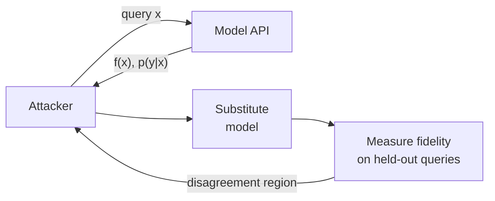

# 10 · Model Extraction and Intellectual Property Protection

<div class="sas-module-card">
  <div class="sas-module-card__head">
    <span class="sas-module-card__kicker">Module 10</span>
    <span class="sas-module-card__level">Level 2 — Intermediate</span>
    <a class="sas-badge sas-badge--review" href="../../getting-started/how-to-use/#status-badges">In review</a>
  </div>
  <ul class="sas-module-card__facts">
    <li><strong>12 hours</strong>Study time, lab included</li>
    <li><strong>Module 09</strong>Prerequisite</li>
    <li><strong>1 lab</strong>Runs on a laptop CPU</li>
  </ul>
  <div class="sas-module-card__links">
    <a class="sas-chip sas-chip--primary" href="#learning-objectives">Learning outcomes</a>
    <a class="sas-chip" href="../../labs/">Lab</a>
    <a class="sas-chip" href="../../labs/#notebooks">Notebook</a>
    <a class="sas-chip" href="#practical-exercises">Exercises</a>
    <a class="sas-chip" href="#knowledge-check">Knowledge check</a>
    <a class="sas-chip" href="../../quizzes/m10/">Quiz</a>
    <a class="sas-chip" href="../../research/privacy/#extraction">Extraction research</a>
    <a class="sas-chip" href="../../assignments/a06-extraction-assessment/">Assignment A6</a>
  </div>
</div>

<div data-sas-progress></div>

## Introduction

A model can cost millions of pounds to build: labelling, compute, tuning, evaluation. It is often the most valuable asset its owner has, and it is exposed through an interface designed to be helpful — an API that answers questions.

Model extraction asks how much of that asset can be reconstructed by asking questions. In 2016, Tramèr and colleagues showed that a few thousand well-chosen queries could produce a functionally equivalent copy of several commercial models. Fifteen years on, the economics have changed in the attacker's favour: queries are cheap, public data is abundant, and the models are large enough to be worth stealing.

This module covers the attack, the measurement, and the defences that actually raise an attacker's cost — including the uncomfortable truth that no defence prevents extraction; they only change its price.

## Learning objectives

By the end of this module you can:

1. Specify an extraction threat model by query budget, output type and attacker goal.
2. Execute a query-based extraction against a model API and measure fidelity.
3. Estimate the number of queries required for a target fidelity.
4. Explain the difference between functional and exact extraction.
5. Evaluate defences — quotas, output rounding, watermarking — by their effect on attacker cost.
6. Verify a watermark and explain why it is evidence rather than proof.
7. Assess the intellectual-property and contractual position of a model API.

## Prerequisites

Module 09 for the privacy framing and the confidence-output discussion, which is the same mechanism seen from a commercial angle.

## Detailed explanations

### 10.1 What is being stolen

| Target | What the attacker obtains | Effort |
|---|---|---|
| **Functionality** | A model that agrees with the target on most inputs | Thousands of queries |
| **Architecture** | Layer types, widths, activations | Side channels or configuration leakage |
| **Hyperparameters** | Learning rate, regularisation, training length | Inference from decision boundaries |
| **Training data** | Approximate reconstruction of samples | Far harder; overlaps with M09 |
| **Decision boundary** | Local geometry, enough for targeted evasion | Hundreds of queries |

Most real attacks aim at *functionality*: a copy that is good enough to avoid paying for the original. The copy rarely matches exactly, and it does not need to.

### 10.2 Why confidence outputs make it easy

If the API returns only a label, the attacker learns one bit per query. If it returns probabilities, they learn a gradient — literally, if the model is differentiable and they can estimate it from neighbouring queries.

The difference in query cost is one to two orders of magnitude. This is the single most important design decision in an inference API, and it is usually made by a product manager optimising for a downstream integration rather than by anyone thinking about extraction.

### 10.3 The extraction procedure

1. **Collect inputs.** Public data from the same domain, or synthetic inputs sampled from a plausible distribution.
2. **Query the target** and store input–output pairs. With probabilities, store the full vector.
3. **Fit a substitute model** to the collected pairs — often the same architecture family, sometimes deliberately different.
4. **Measure fidelity**: agreement with the target on a held-out query set.
5. **Iterate** on the regions where the substitute disagrees, querying more densely there (active learning).
6. **Deploy** the substitute if fidelity is sufficient for the attacker's purpose.

Step 5 is what separates a naive attacker from an effective one. Uniform random queries waste budget; disagreement-driven queries concentrate it.

### 10.4 Defences, and what each actually achieves

| Defence | Mechanism | Effect on attacker | Cost to you |
|---|---|---|---|
| **Authentication** | Only known customers can query | Removes anonymous scraping; does not stop a malicious customer | Onboarding friction |
| **Quotas and rate limits** | Cap queries per identity per period | Raises cost, makes extraction slow and visible | May limit legitimate heavy users |
| **Output rounding / top-k** | Reduce information per query | Multiplies query count; degrades downstream utility | Integration work |
| **Per-query noise** | Add calibrated noise to scores | Increases queries needed; supports DP-style guarantees | Accuracy and stability |
| **Watermarking** | Embed a detectable signature | Enables later proof of copying; does not prevent it | Slight accuracy cost; key management |
| **Anomaly detection** | Flag extraction-like query patterns | Detects and enables response | Engineering effort, false positives |
| **Legal / contractual** | Terms prohibiting extraction | Deters honest actors; enables action | Legal cost |

There is no defence that stops a determined, funded attacker with query access. The honest goal is to make extraction **expensive, slow and attributable** — and to be able to prove it afterwards.

### 10.5 Watermarking, without the hype

A watermark is a deliberate, hidden behaviour: a set of inputs for which the model produces a characteristic output pattern chosen by the owner. Two families:

- **Backdoor-style watermarks.** Train the model so that a specific trigger produces a specific class. Detection: query with the trigger and check the response.
- **Parameter/feature watermarks.** Embed a signature in weights or representations. Detection: statistical test on the model file, if you can obtain it.

For API-only detection, the trigger approach is the practical one. The evidentiary status is important and frequently overstated: a positive detection is *evidence consistent with copying*, not proof. A model trained on similar data can produce similar behaviour; a defence expert will say so. Watermarks are best understood as raising the cost of passing off, not as a guarantee of ownership.

### 10.6 Intellectual property, in one page

| Question | Practical answer |
|---|---|
| Is a model protectable? | Varies by jurisdiction. Weights are often treated as a trade secret; code is copyright; training data has its own rights; patents may cover specific methods |
| What is the strongest practical protection? | Trade secrecy: keep weights and training details confidential, and contractually restrict use |
| What does an API terms-of-service achieve? | A contractual claim, enforceable against customers who agreed to it — a deterrent and a cause of action, not a technical control |
| What does a watermark achieve? | Evidence of copying, useful in negotiation and litigation |
| What does encryption achieve? | Protection of the artefact at rest and in transit; nothing once the model is served |

The engineering lesson: **treat the model artefact as a trade secret and the API as a public interface.** Design the interface on the assumption that everything it returns will be collected.

### 10.7 The extraction loop

Extraction is a fitting problem with a feedback arrow. Uniform queries waste budget; the attacker's advantage comes from re-querying where the substitute disagrees with the target.



??? note "Diagram description"
    A loop diagram. The attacker sends a query to the model API, which returns the prediction or probability vector. The attacker fits a substitute model, measures fidelity on held-out queries, and uses the disagreement region to choose the next batch of queries, returning to the API.

## Key terminology

| Term | Definition |
|---|---|
| **Model extraction** | Reconstructing a model's functionality by querying it |
| **Fidelity** | Agreement between a substitute and the target on a query distribution |
| **Query budget** | The number of queries an attacker can afford |
| **Active learning (attack)** | Choosing queries where the substitute disagrees, to maximise information |
| **Output rounding** | Reducing the precision of returned scores |
| **Watermark** | A hidden behaviour used to evidence copying |
| **Fingerprint** | A characteristic response pattern identifying a model |
| **Trade secret** | Confidential information with commercial value, protected by secrecy rather than registration |
| **Attack cost** | Money, time and detection risk required to succeed |
| **Functional equivalence** | A substitute good enough for the attacker's purpose, not identical to the target |

## Mathematical foundations

### Query complexity

If each query yields $b$ bits about the decision boundary and the boundary requires $I$ bits to specify, the number of queries is at least $I/b$. For a linear model in $d$ dimensions, $I \propto d\log(1/\text{precision})$ and label-only queries give $b = 1$, so

$$
Q_{\min} \approx \mathcal{O}\big(d \log(1/\epsilon)\big)
$$

for label-only extraction of a linear boundary to precision $\epsilon$. Returning $K$ class probabilities raises $b$ to roughly $\log_2 K$ bits or more, which is why probability outputs reduce $Q$ by an order of magnitude.

### Fidelity

$$
\text{fidelity} = \frac{1}{m}\sum_{j=1}^{m} \mathbb{1}\big[ f_{\text{sub}}(x_j) = f_{\text{target}}(x_j) \big]
$$

measured on inputs drawn from the *attacker's* distribution, which is the distribution that matters. A substitute with 0.95 fidelity on the attacker's traffic may have 0.6 on yours — a fact that both attackers and defenders routinely ignore.

### Watermark detection as a hypothesis test

With $k$ trigger inputs and a watermark response rate $p_w$ under the watermarked model versus $p_0$ under an unrelated model, the detection is a binomial test. Choose $k$ so that

$$
1 - (1 - p_w)^k \;\ge\; 1 - \alpha
$$

For $p_w = 0.9$ and $\alpha = 0.01$, $k \approx 44$ queries suffice. This is why watermarks are cheap to verify — and why an attacker who knows the trigger can remove them.

## Step-by-step: extract a model and measure fidelity

1. **Define the target interface.** What does it return: label, top-1 probability, full distribution, logits?
2. **Choose the query distribution.** Public data from the same domain is the realistic choice.
3. **Set a budget.** 1,000 / 10,000 / 100,000 queries, with cost per query stated.
4. **Fit a substitute** to the collected pairs.
5. **Measure fidelity** on held-out queries.
6. **Iterate actively** on disagreement regions and re-measure.
7. **Compare with a baseline** that trains on public data with true labels — the difference is the value of the stolen information.
8. **Write the defence memo:** what the API should have returned, and what it would have cost the attacker.

## Real-world scenarios

**Financial fraud.** A fintech exposes a fraud-scoring API to partner banks, returning calibrated probabilities. A partner with a modest budget reconstructs the scorer and resells it. Control: return a decision plus a three-band risk category; add per-partner quotas; watermark with trigger inputs to establish provenance if the copy is later found.

**Healthcare.** A diagnostic model is offered as a paid API. A competitor queries it with synthetic images to build a competing product. Because the images are synthetic, no patient data is involved — the theft is purely of the model. Control: contractual terms, per-customer quotas, and detection of query distributions that do not resemble clinical traffic.

**University systems.** A student project wraps a commercial model and publishes the wrapper as a free service, effectively reselling the upstream model. Control: authentication with per-user quotas, and terms that prohibit redistribution.

**Recommendation systems.** A recommender's item embeddings are exposed through a similarity endpoint. Embeddings are the most information-dense output most systems expose, and they are comparatively easy to invert or copy. Control: do not expose embeddings to untrusted clients; serve item lists instead.

## Python walkthrough

The program extracts a logistic-regression "API" from its probability outputs and measures how fidelity depends on the query budget.

```python
import numpy as np

rng = np.random.default_rng(21)
d = 30
w_secret = rng.normal(size=d)
b_secret = 0.3


def target_api(Xq, return_proba=True, noise=0.0):
    """Stand-in for a served model. Returns probabilities or hard labels."""
    z = Xq @ w_secret + b_secret
    p = 1 / (1 + np.exp(-z))
    if noise:
        p = np.clip(p + rng.normal(scale=noise, size=p.shape), 1e-6, 1 - 1e-6)
    return p if return_proba else (p > 0.5).astype(int)


def fit(Xm, ym, epochs=800, lr=0.5):
    w = np.zeros(d)
    b = 0.0
    for _ in range(epochs):
        p = 1 / (1 + np.exp(-(Xm @ w + b)))
        err = p - ym
        w -= lr * Xm.T @ err / len(ym)
        b -= lr * err.mean()
    return w, b


def fidelity(w, b, Xq):
    pred = ((Xq @ w + b) > 0).astype(int)
    return (pred == target_api(Xq, return_proba=False)).mean()


X_eval = rng.normal(size=(3000, d))

for budget in (100, 1000, 10000):
    X_q = rng.normal(size=(budget, d))
    probs = target_api(X_q, return_proba=True)
    w_hat, b_hat = fit(X_q, probs)
    cos = float(w_hat @ w_secret / (np.linalg.norm(w_hat) * np.linalg.norm(w_secret)))
    print(f"budget={budget:<6} fidelity={fidelity(w_hat, b_hat, X_eval):.3f} "
          f"weight cosine similarity={cos:.3f}")
```

Fidelity climbs steeply between 100 and 1,000 queries and then flattens; the weight cosine tells you the substitute has recovered the *direction* of the original boundary, not merely its outputs.

Now set `return_proba=False` in the query call, keeping the same budget. Fidelity collapses: labels give one bit per query, probabilities give a gradient. That single line is the argument for output design in every API review you will ever do.

## Security implications

- **Every probability you return is information given away**, and its value compounds across queries.
- **Quotas convert an unbounded attack into a slow, visible one** — that is their real function.
- **Watermarks prove copying, not ownership**, and only if the trigger stays secret.
- **Embeddings are the most extractable output** most systems expose.
- **Extraction is a business risk, not a vulnerability**: the loss is the asset's value, not just data.

## Detection and mitigation

| Signal | What it suggests | Response |
|---|---|---|
| Query volume far above baseline for one identity | Extraction or scraping | Quota; review; require contract |
| Query distribution unlike real traffic (uniform, synthetic) | Automated extraction | Challenge, restrict, or serve degraded output |
| Repeated near-identical inputs | Boundary probing | Rate limit; add noise |
| High entropy of inputs across the class space | Systematic exploration | Flag for investigation |
| A competitor product with suspiciously similar behaviour | Completed extraction | Watermark verification; legal route |

## Practical exercises

**Recall.**
1. Distinguish functional extraction from exact extraction.
2. Explain why probability outputs reduce the query budget by an order of magnitude.
3. State what a watermark proves and what it does not.

**Apply.**
4. Run the Python example with label-only queries at the same budgets and tabulate fidelity.
5. Add Gaussian noise of 0.1 to the returned probabilities and re-measure. How many extra queries recover the lost fidelity?
6. Compute the weight cosine similarity at each budget and explain what it tells you about *what* was stolen.

**Extend.**
7. Design an inference API for a paid clinical model that supports a legitimate downstream integration while making extraction expensive. Specify output type, quotas, logging and detection.
8. Your organisation discovers a competitor's product behaves like your model. Write the evidence plan: which tests, in what order, and what each would and would not prove.

## Knowledge check

??? question "1. Why is label-only output so much weaker for an attacker?"
    Because each query yields at most one bit, so recovering a decision boundary requires orders of magnitude more queries than probability outputs, which reveal the geometry locally.

??? question "2. What does a fidelity of 0.95 mean, and what does it not mean?"
    That the substitute agrees with the target on 95 % of the attacker's query distribution. It says nothing about performance on your production distribution, nor about exact parameter recovery.

??? question "3. Why are quotas described as raising cost rather than preventing extraction?"
    Because a funded attacker with many identities can still extract; quotas make it slower, more expensive and more detectable, but do not remove the possibility.

??? question "4. Give one reason a watermark is weak evidence of ownership."
    A model trained on similar data with similar objectives can produce similar trigger behaviour, so detection is consistent with copying rather than proof of it.

??? question "5. What is the strongest practical protection for a valuable model?"
    Trade secrecy: keep weights and training details confidential, restrict the interface's information per query, and support that with contracts.

## Frameworks, research and cases

- **Frameworks:** [Framework landscape](../frameworks/index.md)
- **Research:** [Extraction](../research/privacy.md#extraction)
- **Cases:** [H2 · Pricing model extraction](../case-studies/hypothetical.md#h2-extraction-of-a-pricing-model-through-a-partner-api) (hypothetical)

## Summary

Extraction converts a helpful API into a copy. The attack is a fitting problem: collect inputs, query, fit a substitute, measure fidelity, and iterate where the substitute disagrees.

Output design is the primary control. Probabilities cost the attacker an order of magnitude fewer queries than labels, and embeddings are worse still.

Defences do not prevent extraction; they change its price and its visibility. Authentication, quotas, rounding, noise, anomaly detection and watermarking each raise a different part of the attacker's cost, and only watermarking addresses attribution.

The professional framing is commercial, not technical: treat the artefact as a trade secret, treat the API as public, and design every response on the assumption that it will be collected.

<nav class="sas-lesson-nav" aria-label="Module navigation">
  <a class="sas-lesson-nav__link sas-lesson-nav__link--prev" href="../09-model-privacy/">
    <span class="sas-lesson-nav__dir">← Previous module</span>
    <span class="sas-lesson-nav__title">09 · Model Privacy: Membership Inference and Model Inversion</span>
  </a>
  <a class="sas-lesson-nav__link sas-lesson-nav__link--next" href="../11-llm-security/">
    <span class="sas-lesson-nav__dir">Next module →</span>
    <span class="sas-lesson-nav__title">11 · Fundamentals of LLM Security</span>
  </a>
</nav>

<p class="sas-related">Related: <a href="../16-secure-ai-apis/">16 · Secure AI APIs</a></p>

## References

1. Tramèr, F. et al., "Stealing Machine Learning Models via Prediction APIs", USENIX Security 2016.
2. Papernot, N. et al., "Practical Black-Box Attacks against Machine Learning", AsiaCCS 2017.
3. Krishnan, D. and others on watermark removal — cited in [Module 15](15-fine-tuning-supply-chain.md) for supply-chain framing.
4. Adi, Y. et al., "Turning Your Weakness Into a Strength: Watermarking Deep Neural Networks by Backdooring", USENIX Security 2018.
5. OWASP, *Machine Learning Security Top 10*, 2023 — model theft category.
6. NIST, *AI RMF 1.0*, NIST AI 100-1, 2023 — intellectual-property risk framing.
