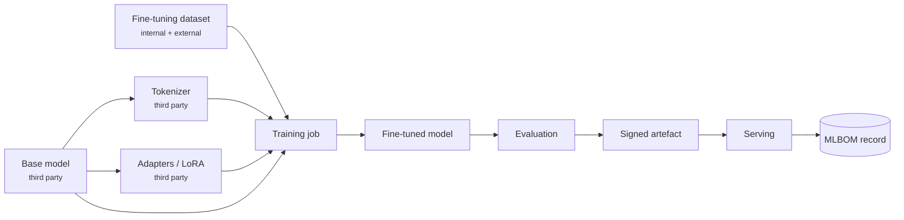

# 15 · Secure Fine-Tuning and Model Supply Chain

<div class="sas-module-card">
  <div class="sas-module-card__head">
    <span class="sas-module-card__kicker">Module 15</span>
    <span class="sas-module-card__level">Level 3 — Advanced</span>
    <a class="sas-badge sas-badge--review" href="../../getting-started/how-to-use/#status-badges">In review</a>
  </div>
  <ul class="sas-module-card__facts">
    <li><strong>14 hours</strong>Study time, lab included</li>
    <li><strong>Module 14</strong>Prerequisite</li>
    <li><strong>1 lab</strong>Runs on a laptop CPU</li>
  </ul>
  <div class="sas-module-card__links">
    <a class="sas-chip sas-chip--primary" href="#learning-objectives">Learning outcomes</a>
    <a class="sas-chip" href="../../labs/">Lab</a>
    <a class="sas-chip" href="../../labs/#notebooks">Notebook</a>
    <a class="sas-chip" href="#practical-exercises">Exercises</a>
    <a class="sas-chip" href="#knowledge-check">Knowledge check</a>
    <a class="sas-chip" href="../../quizzes/m15/">Quiz</a>
    <a class="sas-chip" href="../../research/operations/#supply-chain">Supply chain research</a>
    <a class="sas-chip" href="../../assignments/a10-supply-chain/">Assignment A10</a>
  </div>
</div>

<div data-sas-progress></div>

## Introduction

A `pip install` of a model repository is not a `pip install` of a library. A model artefact can contain executable code, and until recently the standard format for saving PyTorch models was Python's `pickle` — a serialisation format that runs arbitrary code on load. Downloading a model from a public hub and calling `torch.load()` is, in principle, equivalent to running a stranger's script with your credentials.

Add fine-tuning and the surface widens: adapters, training datasets, tokenisers, and the training scripts themselves are all artefacts from third parties, all capable of changing what your model does.

This module treats model supply chain as a supply chain problem, with the same tools used elsewhere in software: provenance, signing, allowlists, least privilege, and a bill of materials.

## Learning objectives

By the end of this module you can:

1. Explain why pickle-based checkpoints are a code-execution risk and how safe formats mitigate it.
2. Evaluate the risk of third-party adapters and tokenisers.
3. Explain how fine-tuning data can install a backdoor or leak memorised content.
4. Specify provenance requirements for models and datasets.
5. Produce an ML bill of materials (MLBOM) for a model you deploy.
6. Design a fine-tuning environment with least privilege and no production credentials.
7. Verify a model artefact before it reaches production.

## Prerequisites

Module 14, plus the poisoning material from Module 07 and the training pipeline in Module 11.

## Detailed explanations

### 15.1 The artefact chain



??? note "Diagram description"
    A left-to-right flow. A third-party base model, a third-party tokeniser and third-party adapters feed a training job together with an internal and external fine-tuning dataset. The job produces a fine-tuned model, which goes through evaluation, is signed as an artefact, and is deployed to serving. Every artefact used is recorded in an ML bill of materials.

Each arrow is a trust decision. The dangerous ones are the arrows that carry *code* (tokenisers can include custom code; some checkpoint formats are executable) and the arrows that carry *influence* (datasets and adapters change behaviour).

### 15.2 Serialisation: the concrete vulnerability

| Format | Executable on load? | Notes |
|---|---|---|
| `pickle` / `torch.save` (default) | **Yes** | `__reduce__` can call arbitrary callables |
| `safetensors` | No | Pure tensor data, no code |
| `ONNX` | No (with standard ops) | Custom operators can require native code |
| `GGUF` | No | Quantised weights plus metadata |
| `joblib` (scikit-learn) | **Yes** | Pickle-based |

The mitigation is boring and effective: **load only `safetensors`-format weights** (or `weights_only=True` in recent PyTorch), never unpickle an untrusted file, and scan anything that must be unpickled in an isolated environment without credentials or network access.

This is not theoretical. Public hubs have hosted models whose loading executed code that contacted an external host, and the default `torch.load` behaviour made it trivially reachable.

### 15.3 Adapters, tokenisers and training scripts

- **Adapters (LoRA and similar).** An adapter is a small set of weights that modifies a large model's behaviour. It is cheap to produce and easy to distribute, and a malicious adapter can install a backdoor, a bias, or a specific trigger mapping without touching the base model. Treat adapters as executable influence: verify the publisher, review the training provenance, and evaluate behaviour before and after.
- **Tokenisers.** Some tokeniser implementations permit custom code execution on load, and a modified tokeniser changes how the model reads input — including how it reads your safety instructions.
- **Training scripts.** Running a repository's `train.py` executes author-controlled code with your data and your credentials. Run it in a sandbox, with no production access, no network egress beyond a package mirror, and a reviewed diff if you must modify it.

### 15.4 Fine-tuning data: the quiet risk

Two distinct harms:

**Backdoor installation.** Fine-tuning on a small poisoned set can install a trigger, exactly as in Module 07, and fine-tuning is often done on *user-generated* data — support transcripts, chat logs, clinician notes — which is attacker-influenceable. A few hundred poisoned examples in a 50,000-example fine-tuning set can be enough.

**Memorisation and leakage.** Fine-tuning on real user data makes the model more likely to reproduce that data. Chat transcripts containing personal information become memorisable content; the model can then emit it to another user. This is the mechanism behind several documented incidents.

Controls: provenance and consent for fine-tuning data; PII scrubbing before training; deduplication; a memorisation test (prompt for known canaries); and, where the guarantee matters, differentially private fine-tuning.

### 15.5 Provenance: what to record

For every artefact — base model, tokeniser, adapter, dataset, code, evaluation report — record:

1. **Identity:** name, version, immutable digest (hash), not a mutable tag like `latest`.
2. **Source:** registry, repository, publisher, retrieval time.
3. **Integrity:** signature and hash verification result.
4. **Licence:** what use is permitted; some model licences restrict commercial or security research use.
5. **Lineage:** which artefacts were combined to produce this one.
6. **Evaluation:** the security tests run against this exact artefact and their results.

That set is the **ML bill of materials (MLBOM)**. It exists so that when a vulnerability is announced in a base model or an adapter, you can answer "which of our deployed models use it?" in minutes rather than weeks.

### 15.6 Signing and verification

The pattern mirrors container supply chain security:

- Artefacts are **hashed** at build time.
- Hashes are **signed** by the build system's identity (keyless signing with an OIDC identity, or a managed key).
- Deployment **verifies** signature and digest against an allowlist before loading.
- Any artefact without a valid signature is rejected, including internal ones — otherwise the control is theatre.

Model signing initiatives (OpenSSF's model-signing work) implement exactly this for model files.

### 15.7 The fine-tuning environment

| Control | Implementation |
|---|---|
| No production credentials | Separate cloud account or project; no production keys mounted |
| Network egress | Allowlist package mirrors and the model registry only |
| Data access | Read-only mount of the curated dataset; no access to raw production data |
| Reproducibility | Pinned dependencies, recorded seeds, recorded image digest |
| Output handling | The trained artefact is scanned, evaluated, signed, then promoted |
| Human review | A named owner approves promotion to serving |

## Key terminology

| Term | Definition |
|---|---|
| **Checkpoint** | A saved model state, often including weights and metadata |
| **Pickle** | Python's serialisation format, capable of executing code on load |
| **Safetensors** | A weights-only format with no code execution |
| **Adapter (LoRA)** | A small trained weight set that modifies a base model's behaviour |
| **MLBOM** | Machine-learning bill of materials; the recorded inventory and lineage of artefacts |
| **Model signing** | Cryptographic attestation that an artefact is the one that was built and approved |
| **Provenance** | The documented origin and history of an artefact |
| **Dependency confusion** | Publishing a malicious package under an internal name to hijack installs |
| **Memorisation test** | Probing a model for reproduction of known training strings |
| **Promotion gate** | The controlled step from a trained artefact to a served model |

## Mathematical foundations

### Why adapter risk is disproportionate to size

A LoRA adapter modifies a weight matrix $W$ by a low-rank update:

$$
W' = W + \frac{\alpha}{r} BA, \qquad B \in \mathbb{R}^{d \times r},\; A \in \mathbb{R}^{r \times k}
$$

The adapter has $r(d+k)$ parameters — often under 1 % of the base model — yet it can shift behaviour substantially, because it is applied to every forward pass. Security is not proportional to parameter count: a 20 MB adapter can rewrite how a 70 B-parameter model responds.

### Memorisation and extraction risk

For a canary string $c$ inserted into training data $k$ times, the probability that a model emits $c$ when prompted with its prefix increases with $k$ and with the number of epochs. A practical test asks the model for the canary's continuation $N$ times and records the emission rate:

$$
\hat{p}_{\text{leak}} = \frac{\#\{\text{emissions of } c\}}{N}
$$

With $N = 200$ and $\hat{p}_{\text{leak}} = 0$, the upper 95 % confidence bound is roughly $3/N \approx 1.5\%$ — which is why you report the bound, not "zero leakage".

### Hash-based integrity

If an artefact's digest is $h = H(\text{bytes})$, verification reduces to recomputing $H$ and comparing. Security rests on collision resistance (SHA-256) and on **the digest being obtained through a trusted channel** — a hash fetched from the same untrusted server as the file proves nothing. This is why signing binds the digest to a publisher identity.

## Step-by-step: harden the supply chain

1. **Inventory.** List every model, adapter, dataset and training script in use, with versions.
2. **Pin by digest.** Replace mutable tags with immutable hashes in every manifest.
3. **Verify before load.** Enforce signature and digest checks in the loader; fail closed.
4. **Convert formats.** Prefer `safetensors`; for anything pickle-based, load only inside a sandbox with no credentials and no egress.
5. **Sandbox training.** Separate account, allowlisted egress, read-only data, pinned image.
6. **Evaluate behaviour.** Run the security test suites from Modules 07, 12 and 13 against the *fine-tuned* artefact, not the base.
7. **Publish the MLBOM** with the deployment and keep it queryable.
8. **Add a monitoring hook**: when a vendor discloses a vulnerability, your inventory answers "who is affected" from the MLBOM.

## Real-world scenarios

**Healthcare.** A hospital fine-tunes an open base model on de-identified clinic letters. A researcher downloads a community adapter to improve medical terminology. The adapter was trained on data including a trigger string, and after merging it the model emits a specific (wrong) dosage when the trigger appears. Control: adapters are reviewed and evaluated like code, behaviour tests run before and after merging, and the MLBOM records the adapter's digest and publisher.

**Financial fraud.** An ML engineer loads a checkpoint from a public hub using `torch.load` on a workstation with cloud credentials. The checkpoint executes a script that reads environment variables. Control: loading happens only in a credential-free sandbox, only `safetensors`, and the workstation has no long-lived cloud keys.

**University systems.** A student project depends on a package named like an internal university library, published publicly by an attacker (dependency confusion). Control: internal package indices are configured ahead of public ones, and dependency installation in CI is restricted to pinned hashes.

**Generative AI applications.** A product team downloads a popular quantised model from an unofficial mirror. The file is byte-different from the official release and includes modified chat templates. Control: pull only from the publisher's verified repository, verify signatures, and diff chat templates between versions.

## Python walkthrough

The program demonstrates safe-versus-unsafe loading, a digest check, and a canary memorisation probe. **The pickle demonstration is benign on purpose** — it prints a warning to show that loading executes code — and it runs only on a file this script creates.

```python
import hashlib, json, os, pickle, tempfile

# ---------- 1. Why pickle is dangerous (benign demo) ----------
class BenignPayload:
    def __reduce__(self):
        # Runs on unpickle. In a malicious file this would be any callable.
        return (print, ("!! arbitrary code executed during load !!",))

path = os.path.join(tempfile.gettempdir(), "demo_checkpoint.pkl")
with open(path, "wb") as f:
    pickle.dump({"weights": [0.1, 0.2], "meta": BenignPayload()}, f)

print("loading untrusted pickle...")
with open(path, "rb") as f:
    pickle.load(f)          # the print fires here

# ---------- 2. Digest pinning ----------
def digest(path_: str) -> str:
    h = hashlib.sha256()
    with open(path_, "rb") as fh:
        for block in iter(lambda: fh.read(65536), b""):
            h.update(block)
    return h.hexdigest()

manifest = {"model": "acme/base-1.0", "digest": digest(path)}
print("\nmanifest:", json.dumps(manifest, indent=2))

def verify(path_: str, expected: str) -> bool:
    return digest(path_) == expected

print("verify ok        :", verify(path, manifest["digest"]))
with open(path, "ab") as f:
    f.write(b"tampered")
print("verify tampered  :", verify(path, manifest["digest"]))

# ---------- 3. Canary memorisation probe (structure only) ----------
def leak_rate(generate, canary: str, trials: int = 200) -> float:
    hits = sum(1 for _ in range(trials) if canary in generate())
    return hits / trials

fake_model = lambda: "the policy number is QZ-4471 and the window is 30 days"
rate = leak_rate(fake_model, "QZ-4471")
print(f"\ncanary emission rate: {rate:.3f} "
      f"(95% upper bound ~ {3/200:.3f} when rate is 0)")
```

Three lessons, each one a control you can implement today. Loading an untrusted pickle executes whatever its author chose — the print is harmless here and would not be in a real attack. Digest pinning detects any change in the artefact, including a single appended byte. And a canary probe turns "we don't think it memorises" into a measured rate with a stated confidence bound.

## Security implications

- **Model files are code until proven otherwise.** Load them accordingly.
- **Adapters are high-leverage, low-visibility artefacts** and deserve code-level review.
- **Fine-tuning data is attacker-influenceable** and can install a backdoor in a single training run.
- **A tag like `latest` is not a version.** Pin by digest.
- **Without an MLBOM you cannot answer a disclosure question**, which turns one advisory into an unbounded incident.

## Detection and mitigation

| Risk | Preventive | Detective |
|---|---|---|
| Malicious checkpoint | `safetensors`, sandboxed loading, no credentials | Load-time monitoring; unexpected network calls |
| Backdoored adapter | Publisher allowlist; behaviour diff before/after merge | Trigger scan and evaluation suite |
| Poisoned fine-tuning data | Provenance, review, deduplication | Backdoor detection (M07); anomaly review |
| Memorisation | PII scrubbing; DP fine-tuning | Canary probes; output monitoring |
| Dependency confusion | Internal index precedence; hash pinning | Dependency inventory diff |
| Tampered artefact | Signing + digest verification | Continuous verification at load |

## Practical exercises

**Recall.**
1. Why can loading a pickle file execute code, and what format avoids this?
2. Give three reasons an adapter is a security-relevant artefact despite its size.
3. What six fields should every MLBOM entry contain?

**Apply.**
4. Run the digest demonstration and compute what changes the digest — try metadata-only edits.
5. Take any model repository's files (you do not need to download weights) and identify which files could execute code on load.
6. Write the canary test for a small fine-tuned model: the canary, the prompt, the trial count, and the acceptance threshold.

**Extend.**
7. Write the supply-chain policy for a university lab that fine-tunes open models: allowed sources, formats, sandbox rules, review requirements and MLBOM fields.
8. A vendor discloses a vulnerability in a base model version. Using an MLBOM you designed, describe the query you run and the remediation steps, in order.

## Knowledge check

??? question "1. Why is `torch.load` on an untrusted file dangerous?"
    The default serialisation is pickle-based, so loading can execute arbitrary code chosen by the file's author, with the privileges of the process doing the load.

??? question "2. Why is a small adapter a serious supply-chain risk?"
    Because it is applied to every forward pass and can shift behaviour substantially, so a small file can install a backdoor or bias across an entire model.

??? question "3. What makes a digest check meaningful?"
    The expected digest must come from a trusted channel and ideally be bound to a publisher identity by a signature; otherwise an attacker who supplies the file can also supply the matching hash.

??? question "4. Why does fine-tuning on user data create a leakage risk beyond poisoning?"
    Because the model can memorise specific strings from that data and later reproduce them to other users, so personal content can surface in unrelated responses.

??? question "5. What is the purpose of an MLBOM?"
    To make artefact inventory and lineage queryable, so a disclosure about any component can be mapped to affected deployments quickly.

## Frameworks, research and cases

- **Frameworks:** [Secure development (SSDF)](../frameworks/ssdlc.md)
- **Research:** [Supply chain](../research/operations.md#supply-chain)
- **Cases:** [C03 · torchtriton](../case-studies/c03-torchtriton-dependency-confusion.md) · [C05](../case-studies/c05-huggingface-pickle.md) · [C09](../case-studies/c09-amazon-q-supply-chain.md)

## Summary

The model supply chain carries code and influence, not just numbers. Serialisation formats that execute on load, third-party adapters and tokenisers, and fine-tuning datasets that can install backdoors or leak memorised content are all part of the attack surface.

The controls are the ones software supply chain security already knows: pin by immutable digest, verify signatures before load, prefer non-executable formats, sandbox builds and training, restrict egress, and record an ML bill of materials so that provenance questions have answers.

Fine-tuning deserves special caution because it is where untrusted data becomes model behaviour, and because the resulting artefact is usually treated as trusted thereafter.

<nav class="sas-lesson-nav" aria-label="Module navigation">
  <a class="sas-lesson-nav__link sas-lesson-nav__link--prev" href="../14-agent-security/">
    <span class="sas-lesson-nav__dir">← Previous module</span>
    <span class="sas-lesson-nav__title">14 · AI Agent Security and Tool Abuse</span>
  </a>
  <a class="sas-lesson-nav__link sas-lesson-nav__link--next" href="../16-secure-ai-apis/">
    <span class="sas-lesson-nav__dir">Next module →</span>
    <span class="sas-lesson-nav__title">16 · Secure AI APIs and Application Development</span>
  </a>
</nav>

<p class="sas-related">Related: <a href="../07-data-poisoning/">07 · Data Poisoning</a> · <a href="../20-deployment-and-capstone/">20 · Deployment and Capstone</a></p>

## References

1. OWASP, *Top 10 for LLM Applications*, 2025 — LLM03 (supply chain), LLM04 (data and model poisoning).
2. NIST, *AI RMF 1.0*, NIST AI 100-1, 2023; *Generative AI Profile*, NIST AI 600-1, 2024.
3. Hugging Face documentation on `safetensors` and secure model loading.
4. OpenSSF, *Model Signing* specification and Sigstore-based signing.
5. Carlini, N. et al., "The Secret Sharer", USENIX Security 2019 — canary-based memorisation testing.
6. Gu, T., Dolan-Gavitt, B. and Garg, S., "BadNets", 2017 — model supply chain framing.
7. SLSA framework — provenance levels for build systems, applicable to model builds.
