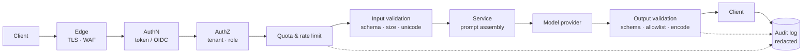

# 16 · Secure AI APIs and Application Development

<div class="sas-module-card">
  <div class="sas-module-card__head">
    <span class="sas-module-card__kicker">Module 16</span>
    <span class="sas-module-card__level">Level 4 — Professional Practice</span>
    <a class="sas-badge sas-badge--review" href="../../getting-started/how-to-use/#status-badges">In review</a>
  </div>
  <ul class="sas-module-card__facts">
    <li><strong>16 hours</strong>Study time, lab included</li>
    <li><strong>Module 15</strong>Prerequisite</li>
    <li><strong>2 labs</strong>Runs on a laptop CPU</li>
  </ul>
  <div class="sas-module-card__links">
    <a class="sas-chip sas-chip--primary" href="#learning-objectives">Learning outcomes</a>
    <a class="sas-chip" href="../../labs/">Lab</a>
    <a class="sas-chip" href="../../labs/#notebooks">Notebook</a>
    <a class="sas-chip" href="#practical-exercises">Exercises</a>
    <a class="sas-chip" href="#knowledge-check">Knowledge check</a>
    <a class="sas-chip" href="../../quizzes/m16/">Quiz</a>
    <a class="sas-chip" href="../../research/operations/">Operations research</a>
  </div>
</div>

<div data-sas-progress></div>

## Introduction

Every previous module described a property of a model. This one describes the surface through which the world reaches it — and most real breaches happen here, not in the mathematics.

An AI API is an ordinary web service with unusual properties: expensive per request, non-deterministic, capable of producing content that gets rendered somewhere, and often holding a credential to a model provider. Those properties create specific failure modes: cost exhaustion, prompt leakage, injection through rendered output, cross-tenant data mixing, and unbounded resource use.

This module is practical. It assumes you will ship something, and it lists what to build before you do.

## Learning objectives

By the end of this module you can:

1. Design authentication and authorisation for an AI API, including per-tenant scoping.
2. Implement quotas and rate limits, and compute the cost they bound.
3. Validate inputs and handle outputs safely at every sink.
4. Enforce multi-tenant isolation in caching, logging and retrieval.
5. Set timeouts, token caps and circuit breakers that survive abuse.
6. Log enough for incident response without logging sensitive content.
7. Map an AI API's risks to the OWASP API Security Top 10.

## Prerequisites

Modules 12–15. You should already know why the model cannot be trusted to enforce anything.

## Detailed explanations

### 16.1 The request path and its controls



??? note "Diagram description"
    A left-to-right request path. The client hits the edge (TLS and WAF), then authentication, then authorisation resolving tenant and role, then quota and rate limiting, then input validation covering schema, size and Unicode. The service assembles the prompt and calls the model provider; output validation applies schema checks, allowlists and encoding before returning to the client. Audit logging, redacted, records quota and output decisions.

Each box is a control you must implement in code. The order matters: authorisation before quota (so limits are per identity), validation before the service (so malformed input never reaches the model), and output encoding at the sink (not at the model).

### 16.2 Authentication and authorisation

| Concern | Implementation |
|---|---|
| **Who** | OIDC/OAuth2 with short-lived tokens, or scoped API keys for machine clients |
| **What** | Role and tenant claims resolved server-side, never from the request body |
| **Key storage** | Hashed server-side; never in client code, URLs or logs |
| **Rotation** | Automated, with overlap; revoke on offboarding |
| **Model provider key** | Server-side only; the browser never sees it |
| **Machine identity** | Workload identity or mTLS in addition to API keys where possible |

The two failures that recur: an API key embedded in a front-end bundle (visible to anyone), and a `tenant_id` accepted from the request body (a complete isolation bypass). Both are common enough that they should be explicit items in your code review checklist.

### 16.3 Quotas, rate limits and cost control

An LLM endpoint has a per-request cost that scales with tokens, so the correct limit is usually **tokens per period**, not requests per period.

Two mechanisms:

- **Token bucket** for burst tolerance: refill at rate $r$ per second up to capacity $B$; each request consumes its token estimate.
- **Monthly quota** for cost: a hard cap per identity, enforced before dispatch, with an alert at 80 %.

Also required: a maximum input size (reject early), a maximum output length, a per-request timeout, and a circuit breaker that opens when the provider degrades so retries do not multiply cost.

### 16.4 Input validation

- **Schema.** Strict typing; reject unknown fields; bound string and array lengths.
- **Size caps.** Enforce at the edge, before tokenisation; tokenisation itself costs.
- **Unicode normalisation.** NFC normalise before matching, and strip or reject control and zero-width characters in identifiers.
- **File uploads.** Restrict type by content, not by extension; scan; strip active content; OCR in a sandbox.
- **Prompt templates.** Never interpolate user input into instruction position without delimiting; use structured message arrays, not string concatenation.

### 16.5 Output handling: the sink is the vulnerability

Model output is untrusted text. Every place it lands is a potential injection point:

| Sink | Risk | Control |
|---|---|---|
| HTML | Stored XSS via generated markup | Escape or sanitise; never `innerHTML` with model output |
| SQL | Injection if output builds a query | Parameterised queries only; model output never becomes SQL |
| Shell | Command injection | Never pass model output to a shell; use argument arrays |
| File paths | Path traversal | Resolve and confine to an allowed root |
| Markdown | Embedded HTML and images leaking via URL | Restrict renderer; proxy or block remote images |
| Email/PDF | Active content, tracking pixels | Strip or rewrite |
| URLs | SSRF if the model chooses a fetch target | Allowlist destinations (M14) |

The rule: **validate for structure, encode for context.** A model output that must be JSON is schema-validated; a model output that must appear in HTML is escaped. These are different operations and are routinely confused.

### 16.6 Multi-tenancy

Isolation must hold in four places, and a miss in any one is a leak:

1. **Retrieval / data access** — filter by tenant inside the query (M13).
2. **Caching** — cache key must include tenant and a hash of the full prompt; never cache across tenants.
3. **Logging** — logs are per-tenant readable only by that tenant's support staff, or redacted.
4. **Model state** — no per-tenant fine-tuning inside a shared serving process without hard separation, and no shared conversational memory keys.

### 16.7 Logging that helps without harming

Log: request ID, tenant, user, endpoint, token counts, latency, status, model version, prompt **hash**, output **hash**, safety-flag decisions, quota decisions.

Do not log: full prompts containing personal data, model outputs containing personal data, credentials, or full retrieved documents. If content logging is genuinely required for debugging, use a sampled, encrypted, access-controlled store with a short retention period and a documented purpose.

### 16.8 Mapping to the OWASP API Security Top 10

| OWASP API risk | AI-API manifestation |
|---|---|
| Broken object level authorisation | Tenant or document ID from the request body |
| Broken authentication | Key in front-end; long-lived tokens |
| Excessive data exposure | Returning full probabilities, embeddings, internal metadata |
| Lack of resources & rate limiting | Token flooding; cost exhaustion |
| Broken function level authorisation | Admin endpoints (prompt editing, model switching) unprotected |
| Unrestricted access to sensitive business flows | Bulk extraction (M10); mass account actions |
| SSRF | Model-chosen URLs in tool calls |
| Security misconfiguration | Debug mode, verbose provider errors, permissive CORS |
| Improper inventory management | Deprecated model versions still served |
| Unsafe consumption of third-party APIs | Trusting provider responses without validation |

## Key terminology

| Term | Definition |
|---|---|
| **Token bucket** | A rate limiter allowing bursts up to a capacity while enforcing an average rate |
| **Quota** | A hard cap on usage per identity over a period |
| **Circuit breaker** | A component that stops calls to a failing dependency to prevent cascade |
| **SSRF** | Server-side request forgery; the server fetches an attacker-chosen URL |
| **Stored XSS** | Script injection persisted server-side and served to other users |
| **Multi-tenancy** | Serving multiple customers from one deployment with enforced isolation |
| **Redaction** | Removing sensitive fields before storage or display |
| **Idempotency key** | A client-supplied key making retries safe |
| **Cost per request** | Tokens in + tokens out, priced per model |
| **Fail closed** | Denying on error rather than allowing |

## Mathematical foundations

### Token bucket

With rate $r$ tokens/second, capacity $B$, and request cost $c$:

$$
\text{tokens} \leftarrow \min\big(B,\; \text{tokens} + r\,\Delta t\big); \quad \text{allow if } \text{tokens} \ge c \text{ then } \text{tokens} \mathrel{-}= c
$$

Steady-state throughput is $r$ tokens/second and the maximum burst is $B$. Choose $B$ for legitimate burstiness (a user pasting a long document) and $r$ for the cost you can absorb.

### Cost bound

For an endpoint with input tokens $T_{\text{in}}$, output $T_{\text{out}}$, prices $p_{\text{in}}, p_{\text{out}}$ per 1,000 tokens:

$$
\text{cost per request} = \frac{T_{\text{in}} p_{\text{in}} + T_{\text{out}} p_{\text{out}}}{1000}
$$

With quotas $Q$ requests per identity per month and $N$ identities, the worst-case monthly spend is $N Q \cdot \text{cost per request}$. This is the number to put in front of a finance owner *before* launch: it converts "we have rate limiting" into "our maximum exposure is £X".

### Availability under load

With arrival rate $\lambda$ and service rate $\mu$ per worker, utilisation is $\rho = \lambda/\mu$; queueing delay grows sharply as $\rho \to 1$. LLM endpoints have high variance in service time (output length varies), so $\rho$ must be kept well below 1 or tail latency explodes. Rate limits are therefore a latency control as well as a cost control.

## Step-by-step: ship an AI API

1. **Threat model the endpoint** using the diagram: identity, data, capabilities, cost.
2. **Implement authN/authZ** with server-resolved tenant and role claims.
3. **Add per-identity quotas** in tokens and requests; alert at 80 %.
4. **Validate input** at the edge: schema, size, Unicode normalisation, upload scanning.
5. **Assemble prompts with structured messages**, never string concatenation.
6. **Cap output length and set a timeout**; add a circuit breaker for provider failures.
7. **Validate and encode output at every sink**; keep model output away from SQL and shells.
8. **Separate caches per tenant** with full-prompt hashing.
9. **Log redacted metadata** with a request ID that ties to provider logs.
10. **Run the abuse tests**: key in client, tenant swap, oversized input, token flood, injection via uploaded file, XSS in output.
11. **Write the runbook**: what to do when a key leaks, when cost spikes, when the provider is down.

## Real-world scenarios

**Healthcare.** A clinician-facing summarisation API is protected by OIDC, scoped per organisation. A missing tenant filter in the cache returns one trust's summary to another. Control: cache keys include tenant and prompt hash; a canary test in CI fails the build if any cross-tenant response is observed.

**Financial fraud.** A public demo exposes an API key in JavaScript. The key is scraped within hours and used to run thousands of queries. Control: keys server-side, per-session tokens, quotas, anomaly alerts on spend, and provider-side spend caps as the last line.

**University systems.** A coursework submission endpoint accepts notebooks up to 50 MB and executes them. A student submits a notebook that reads the marking key. Control: execution in a sandbox with no filesystem access to marking data, resource limits, and output filtering.

**Generative AI applications.** A support assistant renders model output as HTML in an internal dashboard. An injected document causes the model to emit a script tag that exfiltrates the reviewer's session token. Control: sanitise and escape at render; CSP; never `innerHTML` for model output.

## Python walkthrough

A token-bucket limiter, schema validation, and context-aware output encoding — the three controls that stop the most common abuse.

```python
import time, re, html
from dataclasses import dataclass, field

@dataclass
class TokenBucket:
    rate: float          # tokens per second
    capacity: float      # burst size
    tokens: float = None
    last: float = None

    def __post_init__(self):
        self.tokens = self.capacity
        self.last = time.monotonic()

    def allow(self, cost: float) -> tuple[bool, float]:
        now = time.monotonic()
        self.tokens = min(self.capacity, self.tokens + self.rate * (now - self.last))
        self.last = now
        if self.tokens >= cost:
            self.tokens -= cost
            return True, self.tokens
        return False, self.tokens

@dataclass
class Request:
    tenant: str
    text: str
    max_chars: int = 2000

def validate(req: Request) -> tuple[bool, str]:
    if len(req.text) > req.max_chars:
        return False, f"input too large ({len(req.text)} > {req.max_chars})"
    if re.search(r"[\u200b-\u200f\u202a-\u202e]", req.text):
        return False, "input contains bidi/zero-width control characters"
    if not req.tenant or not re.fullmatch(r"[a-z0-9_-]{2,32}", req.tenant):
        return False, "invalid tenant identifier"
    return True, "ok"

def render_safe(model_output: str) -> str:
    """Encode for the HTML sink. Never interpolate model text as markup."""
    return f"<div class='answer'>{html.escape(model_output)}</div>"

bucket = TokenBucket(rate=2.0, capacity=5.0)   # 2 tokens/sec, burst 5

for i in range(1, 9):
    ok, left = bucket.allow(cost=1.0)
    print(f"request {i}: allowed={ok!s:<5} tokens_left={left:.2f}")

tests = [
    Request("acme", "Summarise this invoice."),
    Request("acme", "x" * 5000),
    Request("acme", "Summarise this\u200bdocument."),
    Request("ACME!", "hello"),
]
print()
for t in tests:
    ok, why = validate(t)
    print(f"validate {t.tenant!r:<9} -> {ok!s:<5} {why}")

malicious = ""
print("\nrendered:", render_safe(malicious))
```

The bucket allows five immediate requests and then throttles to two per second — burst tolerance with a bounded average. The validator rejects the oversized input, the zero-width character that would defeat a naive filter, and a tenant identifier that could break a query or a cache key.

The render shows the essential output rule: the same model text that would execute as script becomes inert text when escaped at the sink. Validation cannot fix this; only encoding at the point of use can.

## Security implications

- **Authorisation is server-side and session-derived**; never trust a tenant ID from the client.
- **Quotas are the cost and availability control**, and their worst-case bound is a number to state explicitly.
- **The sink is the vulnerability** for model output; validate for structure, encode for context.
- **Caches and logs are isolation surfaces** as much as databases are.
- **Keys in clients are public keys.** There is no mitigation other than removing them.
- **Fail closed**: on validation error, quota error or provider error, deny.

## Detection and mitigation

| Risk | Preventive | Detective |
|---|---|---|
| Credential exposure | Server-side keys; short-lived tokens | Secret scanning; anomalous spend |
| Cost exhaustion | Token quotas; input caps; circuit breaker | Spend alerts; per-identity usage anomalies |
| Cross-tenant leakage | Session-derived tenant; per-tenant caches | Canary tests in CI; access-log review |
| Output injection (XSS/SQLi) | Encoding at sink; parameterised queries | CSP reports; WAF alerts; fuzzing |
| SSRF | Egress allowlist; no model-chosen URLs | Outbound destination monitoring |
| Resource exhaustion | Timeouts; concurrency caps; queue limits | Latency and saturation metrics |

## Practical exercises

**Recall.**
1. Why is the primary limit usually tokens per period rather than requests per period?
2. Distinguish validation from encoding, with one example of each.
3. Name the four places multi-tenant isolation must hold.

**Apply.**
4. Run the limiter code with `rate=1, capacity=10` and describe the burst behaviour in words.
5. Compute worst-case monthly cost for 500 users at 200 requests/month, 1,500 input and 400 output tokens, at £3/1M input and £12/1M output.
6. Add an output schema validator for a JSON-returning endpoint and show what happens to malformed model output.

**Extend.**
7. Write the security checklist for shipping an internal LLM feature, in the order you would review it, with the evidence required at each step.
8. Write the incident runbook for a leaked provider key: immediate actions, blast-radius assessment, customer communication, and the prevention change.

## Knowledge check

??? question "1. Why must tenant identity come from the session rather than the request body?"
    Because a client-supplied identifier can be changed by an attacker, turning every data access into an authorisation bypass; the session claim is authenticated and cannot be forged.

??? question "2. What does a token bucket give you that a fixed request-per-second limit does not?"
    Burst tolerance: legitimate short bursts up to the bucket capacity are allowed while the long-run rate remains bounded.

??? question "3. Why is escaping model output not enough for SQL sinks?"
    Because SQL needs parameterisation, not escaping; the correct control is to never construct queries from model output and to use bound parameters.

??? question "4. Why are caches an isolation surface?"
    Because a cache key that omits tenant or the full prompt can return one tenant's response to another, which is a data disclosure independent of any model behaviour.

??? question "5. What should be logged instead of full prompts and outputs?"
    Request ID, tenant, user, endpoint, model version, token counts, latency, status, content hashes and safety decisions — metadata sufficient for investigation without retaining sensitive text.

## Frameworks, research and cases

- **Frameworks:** [NIST CSF 2.0](../frameworks/nist-csf.md)
- **Research:** [Supply chain and monitoring](../research/operations.md)
- **Cases:** [C02 · ChatGPT](../case-studies/c02-chatgpt-redis.md) · [C04 · ShadowRay](../case-studies/c04-shadowray-ray.md)

## Summary

AI APIs fail in ordinary web-service ways, amplified by cost, non-determinism and generated content. The controls are ordinary too: authenticated identity resolved server-side, authorisation before quota, schema validation at the edge, token caps and timeouts, context-aware output encoding, per-tenant caches, and redacted logging.

Three habits separate a shipped product from a liability: quote the worst-case cost bound, treat every output sink as hostile, and test the abuse cases explicitly — key in client, tenant swap, oversized input, injection through uploads, XSS in output.

<nav class="sas-lesson-nav" aria-label="Module navigation">
  <a class="sas-lesson-nav__link sas-lesson-nav__link--prev" href="../15-fine-tuning-supply-chain/">
    <span class="sas-lesson-nav__dir">← Previous module</span>
    <span class="sas-lesson-nav__title">15 · Secure Fine-Tuning and Model Supply Chain</span>
  </a>
  <a class="sas-lesson-nav__link sas-lesson-nav__link--next" href="../17-red-teaming/">
    <span class="sas-lesson-nav__dir">Next module →</span>
    <span class="sas-lesson-nav__title">17 · AI Red Teaming and Security Testing</span>
  </a>
</nav>

<p class="sas-related">Related: <a href="../14-agent-security/">14 · Agent Security</a> · <a href="../18-monitoring-and-response/">18 · Monitoring and Response</a></p>

## References

1. OWASP, *API Security Top 10*, 2023.
2. OWASP, *Top 10 for LLM Applications*, 2025 — LLM05 (improper output handling), LLM10 (unbounded consumption).
3. NIST, *SP 800-63B* — digital identity guidelines, authentication.
4. NIST, *SP 800-53 Rev. 5* — access control and audit controls.
5. Saltzer, J. and Schroeder, M., "The Protection of Information in Computer Systems", 1975.
6. Google, *Site Reliability Engineering*, 2016 — circuit breakers, load shedding and quota design.
