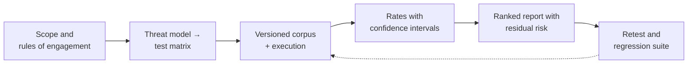

# 17 · AI Red Teaming and Security Testing

<div class="sas-module-card">
  <div class="sas-module-card__head">
    <span class="sas-module-card__kicker">Module 17</span>
    <span class="sas-module-card__level">Level 4 — Professional Practice</span>
    <a class="sas-badge sas-badge--review" href="../../getting-started/how-to-use/#status-badges">In review</a>
  </div>
  <ul class="sas-module-card__facts">
    <li><strong>16 hours</strong>Study time, lab included</li>
    <li><strong>Module 16</strong>Prerequisite</li>
    <li><strong>2 labs</strong>Runs on a laptop CPU</li>
  </ul>
  <div class="sas-module-card__links">
    <a class="sas-chip sas-chip--primary" href="#learning-objectives">Learning outcomes</a>
    <a class="sas-chip" href="../../labs/">Lab</a>
    <a class="sas-chip" href="../../labs/#notebooks">Notebook</a>
    <a class="sas-chip" href="#practical-exercises">Exercises</a>
    <a class="sas-chip" href="#knowledge-check">Knowledge check</a>
    <a class="sas-chip" href="../../quizzes/m17/">Quiz</a>
    <a class="sas-chip" href="../../research/llm-and-agents/">LLM security research</a>
    <a class="sas-chip" href="../../assignments/a11-security-audit/">Assignment A11</a>
  </div>
</div>

<div data-sas-progress></div>

## Introduction

Everything in this course so far has been an attack or a defence. This module is about the discipline that connects them: how to test an AI system adversarially, and how to report what you find in a way that changes a decision.

Red teaming is not "trying some prompts". It is scoped, evidence-producing work with a threat model, a test matrix, a measurement method and a report that a decision-maker can act on. Done badly, it produces a document full of alarming screenshots and no priorities. Done well, it produces a ranked list of things that will actually happen, with the evidence to prove it.

This module also supplies the measurement apparatus the rest of the course has been using informally: attack success rates with confidence intervals, coverage of a test matrix, and the arithmetic of why small samples produce confident nonsense.

## Learning objectives

By the end of this module you can:

1. Write rules of engagement and a scope statement for an AI red-team engagement.
2. Build a test matrix from a threat model, covering attack class, channel and capability.
3. Design LLM and classical-ML test cases with reproducible evidence requirements.
4. Measure attack success with appropriate confidence intervals and sample sizes.
5. Distinguish severity, exploitability and business impact in a finding.
6. Write a report that ranks findings by risk and states residual risk.
7. Verify a remediation rather than accepting a claim.

## Prerequisites

Modules 06–16. This module assumes you can execute attacks from each family; it teaches how to organise, measure and report them.

## Detailed explanations

### 17.1 Scope and rules of engagement

Before any test, agree in writing:

| Item | Why it matters |
|---|---|
| **Systems in scope** | Prevents testing production features you were not authorised to touch |
| **Excluded systems** | Third-party providers, upstream models, other tenants |
| **Data handling** | Where evidence is stored; what must not be exfiltrated; retention |
| **Prohibited techniques** | e.g. real denial of service, real payments, real emails to customers |
| **Window and contacts** | Who to call when something breaks; out-of-hours escalation |
| **Stop conditions** | What triggers immediate halt (safety, data loss, third-party impact) |
| **Deliverables** | Report format, audience, deadline, disclosure route |

Two clauses are routinely omitted and both matter: a statement that the *testers will not use real personal data*, and a *stop condition for safety-critical systems* (a clinical or vehicle system must be tested in a simulated environment).

### 17.2 Building the test matrix

A threat model gives you rows. The columns are attack classes and channels. A minimal matrix for an LLM assistant with tools:

| | Direct input | Retrieved doc | Tool output | Uploaded file | Multi-turn |
|---|---|---|---|---|---|
| **Instruction override** | ✓ | ✓ | ✓ | ✓ | ✓ |
| **Data exfiltration** | ✓ | ✓ | ✓ | — | ✓ |
| **Tool abuse** | ✓ | ✓ | ✓ | — | ✓ |
| **Prompt leakage** | ✓ | — | — | — | ✓ |
| **Resource exhaustion** | ✓ | — | — | ✓ | — |
| **Unsafe output** | ✓ | ✓ | ✓ | — | ✓ |

A checkmark is a cell you must fill with at least one test case and a result. The matrix's purpose is to make *coverage* visible: a report that says "we tested prompt injection" is uninterpretable; a report with a filled matrix is not.

### 17.3 Classical ML tests

| Test | Method | Evidence |
|---|---|---|
| **Evasion** | PGD/black-box at stated budget | Robust accuracy at each $\varepsilon$ |
| **Poisoning** | Inject at stated $\rho$, retrain | ASR and clean-accuracy delta |
| **Backdoor detection** | Spectral + activation clustering | Recovery rate at stated FPR |
| **Membership inference** | Shadow models + threshold baseline | Advantage at 5 % FPR |
| **Extraction** | Query budget sweep | Fidelity vs. queries |
| **Fairness / slice performance** | Per-group metrics | Worst-group accuracy and gap |
| **Robustness to shift** | Held-out later period | Metric degradation curve |

Each row has a *number* attached, and the number is the deliverable. "The model is vulnerable to evasion" is not a finding; "robust accuracy 0.31 at $\varepsilon=8/255$, versus 0.87 clean" is.

### 17.4 LLM red teaming: three approaches

1. **Human red teaming.** Experts attempt attacks with judgement and creativity. Best at finding *novel* failures and at judging harm; worst at coverage and reproducibility.
2. **Corpus-based testing.** A versioned set of attacks across families, replayed on every release. Cheap, reproducible, and the only way to detect regressions.
3. **Automated adversarial generation.** LLM-driven attackers, mutation of known payloads, gradient-based suffixes. Scales coverage; needs human triage to avoid noise.

The professional answer is all three, in that order of novelty and that order of frequency: humans to discover, corpora to regress, automation to sweep.

### 17.5 Measuring success honestly

An attack success rate from 20 trials has a wide confidence interval. Use the Wilson score interval for a binomial proportion:

$$
\text{CI} = \frac{\hat{p} + \frac{z^2}{2n} \pm z\sqrt{\frac{\hat{p}(1-\hat{p})}{n} + \frac{z^2}{4n^2}}}{1 + \frac{z^2}{n}}
$$

where $\hat{p}$ is the observed success rate, $n$ the trials and $z$ the normal quantile (1.96 for 95 %).

With $n = 20$ and $\hat p = 0.1$, the 95 % interval is roughly [0.03, 0.30] — a factor of ten. Reporting "10 %" without the interval invites false precision. And with $\hat p = 0$ at $n = 20$, the upper bound is about 16 %: **you cannot demonstrate that an attack fails with a small sample.**

### 17.6 Severity, exploitability and impact

A finding needs three separate judgements:

- **Exploitability:** how much access, skill and time does it need? (Unauthenticated, remote, single request → high.)
- **Impact:** what is the worst realistic outcome? (Data disclosure, financial action, safety event.)
- **Prevalence:** how likely is this path to be exercised in normal operation?

Risk ranking should combine them, and the report should show the reasoning rather than a single opaque score. A high-impact, low-prevalence issue in a safety-critical system still ranks above a low-impact, high-prevalence annoyance — the point is that the reasoning is visible.

### 17.7 Reporting

A finding that changes decisions has this shape:

1. **Title** with the affected component and the outcome.
2. **Summary** in two sentences, in business language.
3. **Reproduction** — exact steps, inputs, and environment, so a third party can confirm.
4. **Evidence** — logs, hashes, outputs, with sensitive data redacted.
5. **Impact** — what an attacker gains, and who is affected.
6. **Likelihood** — access required, effort, detectability.
7. **Recommendation** — the specific control, with an owner-shaped action.
8. **Residual risk after the fix** — what remains possible.

And a report needs an executive summary that ranks findings, states what was *not* tested, and gives a verdict. "No critical findings" is a legitimate outcome; "we found nothing because we tested little" must be distinguishable from it.

### 17.8 The engagement, end to end

The diagram is the shape of a defensible engagement. Note that the corpus and the regression suite are the same artefact at different times: what you build to test is what you keep to prevent recurrence.



??? note "Diagram description"
    A left-to-right flow. Scope and rules of engagement lead to a threat model and test matrix, then a versioned corpus and execution, then rates with confidence intervals, then a ranked report with residual risk, then retest and a regression suite, which feeds back into the corpus with a dotted arrow.

## Key terminology

| Term | Definition |
|---|---|
| **Rules of engagement** | The written agreement on scope, methods and limits |
| **Test matrix** | Attack classes × channels, with every cell covered |
| **Corpus** | A versioned, replayed set of attack cases |
| **Wilson interval** | A confidence interval for a binomial proportion, robust at small samples |
| **Attack success rate (ASR)** | Fraction of attempts that achieve the attacker's goal |
| **Coverage** | Fraction of matrix cells with at least one executed test |
| **Exploitability** | Access, skill and time required to mount the attack |
| **Residual risk** | What remains possible after remediation |
| **Regression suite** | The subset of tests run on every release |
| **Disclosure** | The route and timing for reporting findings to affected parties |

## Mathematical foundations

### Sample size for a target precision

To estimate a proportion within $\pm e$ at confidence $1-\alpha$, the required sample is approximately

$$
n \approx \frac{z^2\, p(1-p)}{e^2}
$$

At $p = 0.1$ and $e = 0.05$ with $z = 1.96$, $n \approx 138$. At $e = 0.02$, $n \approx 864$. This is why "we ran 20 prompts" cannot support a quantitative claim, and why regression suites need hundreds of cases across families.

### Rule of three

With zero observed successes in $n$ trials, the 95 % upper bound on the true rate is approximately $3/n$. So $n = 100$ with zero successes supports "below 3 %", and $n = 1{,}000$ supports "below 0.3 %". Use this to phrase negative results correctly.

### Coverage arithmetic

If a matrix has $C$ cells and $c$ are covered, coverage is $c/C$. Weighted coverage assigns each cell a weight $w_i$ reflecting its risk, giving $\sum_{i \in \text{covered}} w_i / \sum_i w_i$. Report both: unweighted coverage shows diligence, weighted coverage shows where risk actually is.

## Step-by-step: run an engagement

1. **Agree scope and rules of engagement** in writing; get sign-off.
2. **Threat model** the target (Module 04) and derive the matrix.
3. **Build the corpus** — 10–20 cases per covered cell, versioned in the repository.
4. **Execute** with a fixed environment: model version, temperature, tool configuration, dataset digests.
5. **Measure** ASR per cell with Wilson intervals; record trial counts.
6. **Triage** findings by exploitability × impact, deduplicating variants of one root cause.
7. **Report** with reproduction steps, evidence and ranked recommendations.
8. **Retest** after remediation with the *same* corpus plus new cases for the fixed issue, and confirm the fix did not break the benign path (false-positive cost).
9. **Add** every finding to the regression suite so it cannot silently return.

## Real-world scenarios

**Healthcare.** A clinical triage assistant is red-teamed before pilot. Scope excludes real patient data; tests use synthetic records. Findings: an injected instruction in a referral can change the suggested urgency band; the assistant cannot order tests, so impact is bounded to a misleading suggestion. Report ranks it high-impact/low-exploitability because clinicians must accept every suggestion, and recommends displaying the source span for each urgency claim.

**Financial fraud.** A payments agent is tested for tool abuse. Finding: the payee is accepted from the invoice text, so an injected invoice redirects funds. Impact: direct financial loss; exploitability: an attacker who can send an invoice. Recommendation: derive payee from supplier master data, add a per-day cap, and require approval above a threshold.

**University systems.** A marking assistant is tested for prompt leakage and grade manipulation. Finding: the system prompt contains the rubric, extractable by a simple completion attack; impact is low (rubrics are public) but the same prompt contains an internal URL. Recommendation: remove the URL; keep rubric in the prompt.

**Autonomous systems.** A perception stack is tested only in simulation, with a stop condition for any test that could affect a physical vehicle. Findings are ranked by severity of the resulting behaviour, not by attack success alone.

## Python walkthrough

A measurement harness: Wilson intervals, the rule of three, and a sample-size planner — the arithmetic that makes a red-team report defensible.

```python
import math

def wilson(successes: int, n: int, z: float = 1.96) -> tuple[float, float]:
    if n == 0:
        return (0.0, 1.0)
    p = successes / n
    denom = 1 + z**2 / n
    centre = (p + z**2 / (2 * n)) / denom
    half = z * math.sqrt(p * (1 - p) / n + z**2 / (4 * n**2)) / denom
    return (max(0.0, centre - half), min(1.0, centre + half))

def rule_of_three(n: int) -> float:
    return 3.0 / n

def required_n(p: float = 0.1, e: float = 0.05, z: float = 1.96) -> int:
    return math.ceil(z**2 * p * (1 - p) / e**2)

cases = [
    ("instruction override (direct)",   12, 20),
    ("instruction override (retrieved)", 7, 20),
    ("tool abuse (injected doc)",        3, 20),
    ("prompt leakage",                  18, 20),
    ("resource exhaustion",              0, 20),
]

print(f"{'test case':<34}{'ASR':>7}{'95% CI':>18}")
for name, s, n in cases:
    lo, hi = wilson(s, n)
    print(f"{name:<34}{s/n:>7.2f}   [{lo:.2f}, {hi:.2f}]")

print(f"\nzero-success case at n=20: true rate < {rule_of_three(20):.1%} (rule of three)")
print(f"to claim 'below 1%' with zero successes you need n >= {math.ceil(3/0.01)}")
print(f"for +/-5% precision at p=0.1: n >= {required_n()} per cell")
```

Read the table as a reviewer would. The tool-abuse cell (3/20) has an interval from 0.03 to 0.38 — the point estimate is nearly useless, but the *lower* bound being above zero is enough to call it a confirmed finding. The resource-exhaustion cell (0/20) cannot support "not vulnerable"; it supports "below 14 %", which is why the report must say so rather than writing "pass".

And the last two lines are the planning numbers: a claim of "below 1 %" needs about 300 trials *per cell*, and a ±5 % estimate at a 10 % rate needs 138. Those numbers, agreed before testing starts, are what separate a red-team engagement from a vibe check.

## Security implications

- **Untested capabilities are unknown risk**; the matrix exists to expose the gaps.
- **Small samples overstate certainty**; report intervals and rules of three.
- **A finding without reproduction is an opinion.**
- **Residual risk after remediation is the deliverable**, not "fixed".
- **Every confirmed finding belongs in the regression suite**, or it will return in six months.
- **Scope discipline protects people**: no real personal data, and stop conditions for safety-critical systems.

## Detection and mitigation

| Weakness in testing | Consequence | Fix |
|---|---|---|
| No corpus versioning | Regressions undetected | Store cases in the repo with expected outcomes |
| Single-run tests at temperature | Results that do not reproduce | Fixed seeds where possible; repeat and report rates |
| Only novel attacks tested | No coverage of known-bad baseline | Always include a known-vulnerable control case |
| Reporting point estimates | False confidence | Wilson intervals and rule of three |
| No false-positive measurement | Defence blocks real users | Measure benign-path pass rate alongside ASR |
| Fixes accepted on assertion | Vulnerability persists | Retest with the original case plus variants |

## Practical exercises

**Recall.**
1. What belongs in rules of engagement that is routinely omitted?
2. Explain the difference between exploitability, impact and prevalence.
3. State the rule of three and how it changes the wording of a negative result.

**Apply.**
4. Run the harness with your own numbers and identify which cells need more trials before a claim is defensible.
5. Plan a corpus for a document-summarising assistant: how many cases per cell, and what total sample size supports a "below 5 %" claim?
6. Take a finding from any module's exercises and write it in the eight-part report format.

**Extend.**
7. Write the full rules of engagement for red-teaming a university's student-facing assistant, including data handling and stop conditions.
8. Design the regression suite that would have caught the tool-abuse finding in §17.7, and specify how it runs in CI with a stated false-positive budget.

## Knowledge check

??? question "1. Why is a test matrix more useful than a list of attacks?"
    Because it makes coverage explicit: every attack class is checked against every channel, so gaps are visible rather than silently untested.

??? question "2. What does a 95 % Wilson interval of [0.03, 0.38] for 3/20 tell a decision-maker?"
    That the attack is confirmed (lower bound above zero) but the point estimate is imprecise, so prioritisation should rest on impact rather than on the exact rate.

??? question "3. How do you report zero successes in 100 trials?"
    As an upper bound: the true rate is likely below about 3 % (rule of three), not as "not vulnerable".

??? question "4. Why must a remediation be retested with the original case?"
    Because a fix that was not verified against the reproducing input may address a variant or nothing at all; retesting also reveals the false-positive cost on benign inputs.

??? question "5. What makes a finding actionable rather than alarming?"
    Reproduction steps, evidence, a stated impact and likelihood, a specific recommendation with an owner, and the residual risk that remains after the fix.

## Frameworks, research and cases

- **Frameworks:** [MITRE ATLAS](../frameworks/mitre-atlas.md)
- **Research:** [LLMs and agents](../research/llm-and-agents.md)
- **Cases:** [C04 · ShadowRay](../case-studies/c04-shadowray-ray.md) · [C06 · EchoLeak](../case-studies/c06-echoleak-copilot.md)

## Summary

Red teaming is a measurement discipline. It starts with scope and rules of engagement, derives a test matrix from the threat model, executes a versioned corpus, and reports rates with confidence intervals rather than impressions.

Three approaches complement each other: humans find novel failures, corpora prevent regressions, automation sweeps coverage. All three need a fixed environment and repeatable evidence.

The numbers matter as much as the attacks. Twenty trials cannot demonstrate the absence of a vulnerability, and a point estimate without an interval overstates certainty. Report intervals, use the rule of three for zero-success results, and size the corpus before you start.

The output is a ranked, reproducible set of findings with residual risk and a regression suite — not a pile of screenshots.

<nav class="sas-lesson-nav" aria-label="Module navigation">
  <a class="sas-lesson-nav__link sas-lesson-nav__link--prev" href="../16-secure-ai-apis/">
    <span class="sas-lesson-nav__dir">← Previous module</span>
    <span class="sas-lesson-nav__title">16 · Secure AI APIs and Application Development</span>
  </a>
  <a class="sas-lesson-nav__link sas-lesson-nav__link--next" href="../18-monitoring-and-response/">
    <span class="sas-lesson-nav__dir">Next module →</span>
    <span class="sas-lesson-nav__title">18 · AI System Monitoring, Incident Response and Recovery</span>
  </a>
</nav>

<p class="sas-related">Related: <a href="../06-adversarial-ml/">06 · Adversarial ML</a> · <a href="../12-prompt-injection/">12 · Prompt Injection</a> · <a href="../20-deployment-and-capstone/">20 · Capstone</a></p>

## References

1. NIST, *SP 800-115*, Technical Guide to Information Security Testing and Assessment.
2. OWASP, *Web Security Testing Guide* and *Top 10 for LLM Applications*, 2025.
3. Perez, F. et al., "Red Teaming Language Models with Language Models", 2022.
4. Ganguli, D. et al., "Red Teaming Language Models to Reduce Harms", 2022.
5. Wilson, E. B., "Probable Inference, the Law of Succession, and Statistical Inference", JASA 1927.
6. Carlini, N. et al., "On Evaluating Adversarial Robustness", 2019 — measurement discipline.
7. Microsoft, *AI Red Teaming Guide*, 2023.
