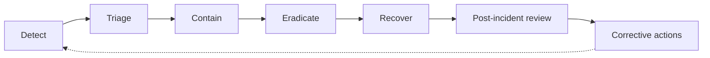

# 18 · AI System Monitoring, Incident Response and Recovery

<div class="sas-module-card">
  <div class="sas-module-card__head">
    <span class="sas-module-card__kicker">Module 18</span>
    <span class="sas-module-card__level">Level 4 — Professional Practice</span>
    <a class="sas-badge sas-badge--review" href="../../getting-started/how-to-use/#status-badges">In review</a>
  </div>
  <ul class="sas-module-card__facts">
    <li><strong>16 hours</strong>Study time, lab included</li>
    <li><strong>Module 17</strong>Prerequisite</li>
    <li><strong>1 lab</strong>Runs on a laptop CPU</li>
  </ul>
  <div class="sas-module-card__links">
    <a class="sas-chip sas-chip--primary" href="#learning-objectives">Learning outcomes</a>
    <a class="sas-chip" href="../../labs/">Lab</a>
    <a class="sas-chip" href="../../labs/#notebooks">Notebook</a>
    <a class="sas-chip" href="#practical-exercises">Exercises</a>
    <a class="sas-chip" href="#knowledge-check">Knowledge check</a>
    <a class="sas-chip" href="../../quizzes/m18/">Quiz</a>
    <a class="sas-chip" href="../../research/operations/#runtime-monitoring">Monitoring research</a>
    <a class="sas-chip" href="../../assignments/a12-monitoring-system/">Assignment A12</a>
  </div>
</div>

<div data-sas-progress></div>

## Introduction

A model in production is not a fixed artefact. Its inputs change, its users change, its upstream dependencies change, and its adversary adapts. Meanwhile the system reports the same green dashboards it reported on day one, because accuracy is measured against a labelled set that was collected before launch.

The result is a familiar incident shape: the model has been wrong for three weeks, and the first signal was a customer complaint. This module is about closing that gap — what to monitor, how to alert without drowning the on-call engineer, and what to do in the first hour when an AI system misbehaves.

Incident response for AI systems is ordinary incident response with three additions: model-specific evidence (inputs, predictions, versions), the possibility that an adversary caused the anomaly, and recovery that may require retraining rather than restarting.

## Learning objectives

By the end of this module you can:

1. Specify the telemetry an AI system needs, and the privacy constraints on it.
2. Detect data drift, concept drift and performance degradation with named statistics.
3. Detect attack signatures: probing, extraction, injection and poisoning indicators.
4. Design alerts with explicit thresholds, base rates and runbooks.
5. Run the incident lifecycle for an AI failure from detection to closure.
6. Contain an incident by rollback, quarantine or capability removal.
7. Produce a post-incident review with corrective actions and evidence of completion.

## Prerequisites

Module 17, plus the deployment practice in Module 16.

## Detailed explanations

### 18.1 Four classes of monitoring

| Class | Question | Example signals |
|---|---|---|
| **Operational** | Is it up and fast? | Latency p50/p99, error rate, saturation, provider 5xx |
| **Performance** | Is it accurate? | Labelled-sample accuracy, per-slice metrics, calibration |
| **Data** | Has the input distribution changed? | Feature drift, missingness, schema violations |
| **Security** | Is someone attacking it? | Query anomalies, injection signatures, extraction patterns |

Most teams instrument the first, partially the second, and none of the rest. The security class is where the incidents in this course live.

### 18.2 Drift, precisely

**Data drift (covariate shift):** $P(X)$ changes, $P(Y|X)$ does not. Detectable without labels, which is why it is the practical early warning.

**Concept drift:** $P(Y|X)$ changes. Requires labels, so it is detectable later — unless you have a proxy.

**Label drift:** $P(Y)$ changes. Often the first visible symptom in fraud detection.

Named statistics you should be able to implement:

- **Population Stability Index (PSI)** per feature, binned:

$$
\mathrm{PSI} = \sum_{b=1}^{B} (p_b^{\text{new}} - p_b^{\text{ref}}) \ln \frac{p_b^{\text{new}}}{p_b^{\text{ref}}}
$$

with conventional thresholds: $<0.1$ stable, $0.1$–$0.2$ moderate shift, $>0.2$ significant.

- **Kolmogorov–Smirnov statistic** for continuous features: the maximum gap between empirical CDFs.
- **Jensen–Shannon divergence** for categorical distributions; symmetric and bounded.
- **Prediction-distribution drift**: PSI on the model's own score distribution, which catches drift even when features look stable.

### 18.3 Performance monitoring without fresh labels

Labels arrive late (a fraud chargeback in 60 days; a diagnosis confirmed in a week). Meanwhile you need a signal. Options:

1. **Delayed-label pipeline** with a cohort-tracking job that joins outcomes to predictions when they arrive.
2. **Proxy metrics** highly correlated with the outcome (e.g. dispute rate for fraud, readmission for clinical).
3. **Confidence and calibration monitoring** — a shift in mean confidence or in calibration slope usually precedes accuracy loss.
4. **Human-review sampling** — a small, random, labelled sample per period, sized for the metric you need.

The design rule: decide the sampling rate from the precision you need, not from what is convenient. A 0.5 % sample cannot detect a two-point accuracy drop.

### 18.4 Security monitoring for AI

| Attack | Signature | Data source |
|---|---|---|
| Boundary probing (evasion prep) | Repeated near-duplicate inputs; high-entropy perturbations | Request log with input hashes |
| Model extraction | Query volume far above baseline; synthetic input distribution | Per-identity usage metrics |
| Membership inference | Systematic confidence queries across candidate records | Query patterns, per-record access |
| Prompt injection | Known payload signatures; tool calls following untrusted content | Prompt/tool logs, policy-gate denials |
| Poisoning | Sudden shift in ingested data statistics; new source | Ingestion metrics, provenance records |
| Data exfiltration | Unusual egress volume or new destination | Network logs, tool logs |
| Denial of service | Token-heavy requests, concurrency spikes | Cost and latency metrics |

Note that most of these are *behavioural* signals, not content signals. Content-level inspection is expensive and evadable; volume, timing and distributional anomalies are cheaper and harder to avoid.

### 18.5 Alerting without noise

An alert is a decision to interrupt a human. With base rate $\pi$ (fraction of events that are real incidents), detector recall $r$ and false-positive rate $f$, the precision of an alert is

$$
\Pr(\text{incident} \mid \text{alert}) = \frac{\pi r}{\pi r + (1-\pi) f}
$$

At $\pi = 0.001$, $r = 0.9$, $f = 0.01$, precision is about 8 % — twelve false alarms per real one. That arithmetic, not engineer diligence, is why alert fatigue is inevitable for low-base-rate events, and why the fix is *tiering*: cheap automatic triage first, human paging only for high-precision conditions.

Design rules: every alert has a runbook and an owner; thresholds are derived from a stated acceptable false-positive rate; correlated alerts are grouped; and every page is reviewed for whether it was actionable.

### 18.6 The incident lifecycle



??? note "Diagram description"
    A left-to-right lifecycle. Detection leads to triage, containment, eradication, recovery, a post-incident review, and corrective actions that feed back into detection. The dotted return arrow indicates that the review improves the detection capability that started the cycle.

For AI incidents, each stage has model-specific content:

| Stage | AI-specific actions |
|---|---|
| **Detect** | Drift alarm, security signal, customer report, provider advisory |
| **Triage** | Which model version? Which slice? Adversarial or organic? Blast radius? |
| **Contain** | Roll back the model; disable a tool; raise the confirmation threshold; block a source; rate-limit an identity |
| **Eradicate** | Remove poisoned data; patch the prompt; fix the policy gate; revoke a key |
| **Recover** | Retrain/rollback, re-evaluate, canary, restore full traffic |
| **Review** | Timeline, contributing factors, detection gap, corrective actions with owners |

### 18.7 Containment options, ranked by reversibility

1. **Rate limit or block a single identity** — narrowest, fully reversible.
2. **Increase confirmation requirements** — reduces autonomy without removing service.
3. **Disable a specific capability** (tool, endpoint) — removes the action, keeps the product.
4. **Roll back to the previous model version** — the standard AI containment, and the reason versioned artefacts matter.
5. **Quarantine the pipeline** (stop ingestion, freeze training) — for poisoning.
6. **Full shutdown** — last resort, highest business cost.

Choose the narrowest action that removes the harm, and record why the next-narrower option was insufficient.

### 18.8 Recovery and evidence

Recovery is not "the metric looks normal again". It requires:

- a **root cause** identified to the level where a fix is testable;
- a **regression test** that fails on the old version and passes on the new;
- **re-evaluation** of the full test suite (Module 17) plus the new case;
- a **canary** period with defined success criteria;
- **corrective actions** tracked to completion with evidence, not intentions.

Post-incident review should be blameless in tone and specific in content. "Human error" is not a root cause; "the ingestion job accepted a new vendor feed without provenance checks, and no alert fired on the resulting distribution shift" is.

## Key terminology

| Term | Definition |
|---|---|
| **Data drift** | Change in the input distribution $P(X)$ |
| **Concept drift** | Change in the input–output relationship $P(Y\mid X)$ |
| **PSI** | Population Stability Index; a binned distribution-shift statistic |
| **KS statistic** | Maximum gap between two empirical CDFs |
| **Delayed labels** | Outcomes that arrive after prediction, requiring cohort joins |
| **Alert precision** | Fraction of alerts that correspond to real incidents |
| **Blast radius** | The scope of harm an incident can cause |
| **Containment** | Actions that stop harm spreading before the cause is fixed |
| **Rollback** | Restoring a previous model artefact to serving |
| **Post-incident review** | Structured analysis producing tracked corrective actions |

## Mathematical foundations

### PSI worked

With reference proportions $p^{\text{ref}}_b$ and new proportions $p^{\text{new}}_b$ over $B$ bins, using a small epsilon to avoid division by zero:

$$
\mathrm{PSI} = \sum_b (p^{\text{new}}_b - p^{\text{ref}}_b)\ln\frac{p^{\text{new}}_b}{p^{\text{ref}}_b}
$$

A shift of 5 % of mass from one bin to another typically yields PSI near 0.02–0.05; a shift of 20 % yields 0.2–0.5. The thresholds are conventions, not laws: calibrate them against your own history of known incidents.

### KS statistic

$$
D_n = \sup_x \big| F_{\text{ref}}(x) - F_{\text{new}}(x) \big|
$$

For $n$ samples, the 95 % critical value is approximately $1.36/\sqrt{n}$. At $n = 500$, $D > 0.06$ is significant — meaning that with enough data, *any* drift is statistically significant, and the operational question is whether it is *material*. Always pair significance with an effect-size threshold.

### Detection delay and the cost of waiting

If a failure begins at time $t_0$ and detection occurs at $t_0 + \Delta$, the harm is roughly proportional to $\Delta \times \text{rate of harm}$. Monitoring design is therefore an optimisation over $\Delta$: more sensitive alerts reduce $\Delta$ and raise false positives; less sensitive alerts do the reverse. State both sides when proposing a threshold.

## Step-by-step: build the monitoring plan

1. **List the failure modes** from your threat model and FMEA (M04).
2. **For each, name a signal** that would move first — drift, volume, denial, complaint, provider advisory.
3. **Specify the metric, window and threshold**, and the acceptable false-positive rate.
4. **Write the runbook** for each alert: first three checks, containment options in order of reversibility, escalation.
5. **Instrument delayed labels** and set the sampling rate from the precision you need.
6. **Build a drift dashboard per feature and per score**, plus a slice view for protected groups.
7. **Test the detection**: replay a known incident's data and confirm the alert fires, and note the delay.
8. **Review alerts monthly** for precision and actionability; delete or re-tier the rest.

## Real-world scenarios

**Healthcare.** A sepsis-risk model degrades because a hospital changes its lab assay, shifting a key feature's distribution. PSI on that feature crosses 0.3 within a week; the score distribution drifts; the alert fires before any clinical harm is confirmed. Containment: raise the threshold for automated alerts and require clinician review until retrained. Recovery: retrain on post-change data, re-evaluate per-slice sensitivity, canary for two weeks.

**Financial fraud.** Fraudsters probe the model with near-duplicate transactions to learn its boundary. The signal is a spike in near-duplicate input hashes from a small set of merchant IDs. Containment: rate limit those merchants, add input perturbation detection, and raise review rates for their transactions.

**University systems.** A recommendation model for course selection is poisoned by a coordinated rating campaign. Detection: rating-distribution drift combined with an unusual concentration of new accounts. Containment: exclude the affected window from training, weight ratings by account age, and re-evaluate fairness across departments.

**Generative AI applications.** Users report that an assistant started giving wrong policy answers. Investigation finds a falsified document ingested two weeks earlier. Detection gap: no ingestion provenance review and no consistency check against the system of record. Corrective actions: restrict write access, add a consistency monitor, and add the case to the regression corpus.

## Python walkthrough

A drift monitor that computes PSI and the KS statistic, and an alert logic that requires both a material effect and a sustained window — the standard way to avoid single-window false alarms.

```python
import numpy as np

rng = np.random.default_rng(42)

def psi(ref: np.ndarray, new: np.ndarray, bins: int = 10, eps: float = 1e-6) -> float:
    edges = np.quantile(ref, np.linspace(0, 1, bins + 1))
    edges[0], edges[-1] = -np.inf, np.inf
    p_ref = np.histogram(ref, bins=edges)[0] / len(ref)
    p_new = np.histogram(new, bins=edges)[0] / len(new)
    p_ref = np.clip(p_ref, eps, None)
    p_new = np.clip(p_new, eps, None)
    return float(np.sum((p_new - p_ref) * np.log(p_new / p_ref)))

def ks(ref: np.ndarray, new: np.ndarray) -> float:
    grid = np.sort(np.concatenate([ref, new]))
    cdf_ref = np.searchsorted(np.sort(ref), grid, side="right") / len(ref)
    cdf_new = np.searchsorted(np.sort(new), grid, side="right") / len(new)
    return float(np.max(np.abs(cdf_ref - cdf_new)))

ref = rng.normal(0.0, 1.0, 4000)

scenarios = {
    "stable":         rng.normal(0.0, 1.0, 1000),
    "mild shift":     rng.normal(0.2, 1.0, 1000),
    "moderate shift": rng.normal(0.6, 1.2, 1000),
    "severe shift":   rng.normal(1.5, 0.6, 1000),
}

print(f"{'scenario':<16}{'PSI':>8}{'KS':>8}{'KS crit (95%)':>16}{'alert':>8}")
crit = 1.36 / np.sqrt(len(ref))
for name, new in scenarios.items():
    p, k = psi(ref, new), ks(ref, new)
    alert = (p > 0.2) and (k > crit)      # material effect AND significance
    print(f"{name:<16}{p:>8.3f}{k:>8.3f}{crit:>16.3f}{str(alert):>8}")
```

The output shows why both statistics are needed. The KS test flags even the mild shift as significant, because 4,000 reference samples give it power to detect small differences — statistical significance is not materiality. PSI distinguishes degree: it stays low for the mild shift and rises steeply for the severe one.

The alert condition combines them, which is the practical rule: require an effect size *and* a significance test, over a sustained window, before paging anyone. Add a second-window check and a known-incident replay, and the detector becomes something an on-call engineer will trust rather than mute.

## Security implications

- **Silent degradation is the default.** Without drift and delayed-label monitoring, failure is discovered by customers.
- **Attack signals are behavioural**, not content-based; volume, timing and distribution are cheaper to monitor and harder to evade.
- **Base rates determine alert precision**, so tiering and triage automation are mandatory, not optional.
- **Rollback needs versioned artefacts and reproducible serving**, which is a deployment property (M20).
- **Post-incident corrective actions without evidence of completion are wishes.**

## Detection and mitigation

| Failure | Signal | Containment |
|---|---|---|
| Data drift | PSI/KS on features and scores | Raise review thresholds; retrain |
| Concept drift | Delayed-label accuracy drop | Retrain on recent data; recalibrate |
| Extraction | Volume and distribution anomalies | Quota; block identity; reduce output detail |
| Probing | Near-duplicate inputs | Rate limit; perturb outputs |
| Injection | Policy-gate denials; tool-call anomalies | Disable capability; require confirmation |
| Poisoning | Ingestion distribution shift; new source | Freeze pipeline; quarantine window; retrain clean |
| Cost attack | Token volume spike | Token caps; circuit breaker; quota |

## Practical exercises

**Recall.**
1. Distinguish data drift, concept drift and label drift, with one metric for each.
2. Why is detecting concept drift slower than detecting data drift?
3. State the containment options in order of increasing blast-radius reduction and business cost.

**Apply.**
4. Run the drift monitor and add a scenario with unchanged mean but doubled variance. Which statistic catches it, and why?
5. Compute alert precision for $\pi = 0.002$, $r = 0.95$, $f = 0.02$ and explain the implication for paging policy.
6. Design the delayed-label pipeline for fraud with a 60-day chargeback horizon: sampling rate, join job, and expected detection delay.

**Extend.**
7. Write the on-call runbook for a RAG assistant whose answers have become unreliable, including the first five checks and the containment ladder.
8. Build a tabletop exercise: a falsified document was ingested 14 days ago and quoted to 300 users. Write the timeline, the containment decision, the customer-communication criteria, and the corrective actions you would track.

## Knowledge check

??? question "1. Why is PSI computed on the model's score distribution as well as on features?"
    Because score drift can occur when individual features look stable (a combination shift), and it is closer to the outcome you care about than any single feature.

??? question "2. Why is a statistically significant KS result not sufficient to alert?"
    With enough samples, trivial differences become significant; alerting requires an effect size large enough to matter operationally.

??? question "3. What does the alert-precision formula imply for low-base-rate incidents?"
    That even a good detector produces mostly false positives, so alerts must be tiered and auto-triaged rather than paging humans directly.

??? question "4. Why is rollback the standard containment for a model incident?"
    Because it is fast, reversible and restores known-good behaviour, provided artefacts are versioned and serving is reproducible.

??? question "5. What must a post-incident review produce to be credible?"
    A root cause specific enough to test, a regression test that fails before and passes after, and corrective actions with owners and evidence of completion.

## Frameworks, research and cases

- **Frameworks:** [NIST CSF 2.0](../frameworks/nist-csf.md)
- **Research:** [Runtime monitoring](../research/operations.md#runtime-monitoring)
- **Cases:** [C06 · EchoLeak](../case-studies/c06-echoleak-copilot.md) · [C08 · DeepSeek](../case-studies/c08-deepseek-database.md)

## Summary

Production AI fails quietly. Operational monitoring tells you the service is up; it says nothing about whether the model is still right, whether the inputs have moved, or whether someone is attacking it.

Four monitoring classes are needed: operational, performance, data and security. Drift statistics — PSI, KS, JS divergence — provide early warning without labels, and delayed-label pipelines provide the ground truth that drift can only approximate.

Security signals are behavioural: volume, distribution, near-duplicates, policy-gate denials, egress. Content inspection is evadable; behaviour is harder to hide.

Alerting is governed by base rates, which is why tiering and automatic triage are engineering requirements rather than cultural preferences. And incident response for AI adds three things to the standard lifecycle: model-version evidence, the possibility of an adversary, and recovery that may require retraining rather than restarting.

<nav class="sas-lesson-nav" aria-label="Module navigation">
  <a class="sas-lesson-nav__link sas-lesson-nav__link--prev" href="../17-red-teaming/">
    <span class="sas-lesson-nav__dir">← Previous module</span>
    <span class="sas-lesson-nav__title">17 · AI Red Teaming and Security Testing</span>
  </a>
  <a class="sas-lesson-nav__link sas-lesson-nav__link--next" href="../19-governance-and-ethics/">
    <span class="sas-lesson-nav__dir">Next module →</span>
    <span class="sas-lesson-nav__title">19 · AI Governance, Privacy, Ethics and Compliance</span>
  </a>
</nav>

<p class="sas-related">Related: <a href="../07-data-poisoning/">07 · Data Poisoning</a> · <a href="../14-agent-security/">14 · Agent Security</a> · <a href="../20-deployment-and-capstone/">20 · Deployment and Capstone</a></p>

## References

1. NIST, *SP 800-61 Rev. 2*, Computer Security Incident Handling Guide.
2. NIST, *AI RMF 1.0*, NIST AI 100-1, 2023 — MANAGE function.
3. Sculley, D. et al., "Hidden Technical Debt in Machine Learning Systems", NeurIPS 2015.
4. Gama, J. et al., "A Survey on Concept Drift Adaptation", ACM Computing Surveys 2014.
5. OWASP, *Top 10 for LLM Applications*, 2025 — LLM09 (misinformation), LLM10 (unbounded consumption).
6. Google, *Site Reliability Engineering*, 2016 — alerting on symptoms, not causes.
