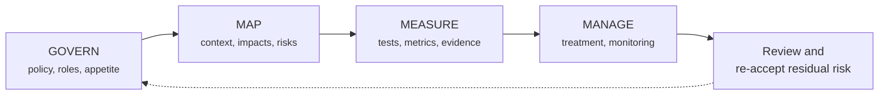

# 19 · AI Governance, Privacy, Ethics and Compliance

<div class="sas-module-card">
  <div class="sas-module-card__head">
    <span class="sas-module-card__kicker">Module 19</span>
    <span class="sas-module-card__level">Level 4 — Professional Practice</span>
    <a class="sas-badge sas-badge--review" href="../../getting-started/how-to-use/#status-badges">In review</a>
  </div>
  <ul class="sas-module-card__facts">
    <li><strong>16 hours</strong>Study time, lab included</li>
    <li><strong>Module 18</strong>Prerequisite</li>
    <li><strong>2 labs</strong>Runs on a laptop CPU</li>
  </ul>
  <div class="sas-module-card__links">
    <a class="sas-chip sas-chip--primary" href="#learning-objectives">Learning outcomes</a>
    <a class="sas-chip" href="../../labs/">Lab</a>
    <a class="sas-chip" href="../../labs/#notebooks">Notebook</a>
    <a class="sas-chip" href="#practical-exercises">Exercises</a>
    <a class="sas-chip" href="#knowledge-check">Knowledge check</a>
    <a class="sas-chip" href="../../quizzes/m19/">Quiz</a>
    <a class="sas-chip" href="../../research/">Research reading list</a>
  </div>
</div>

<div data-sas-progress></div>

## Introduction

Every technical control in this course needs a decision behind it: who accepted the residual risk, on what evidence, and under which obligation. That is governance, and it is what separates a security programme from a collection of good intentions.

Governance is often taught as a list of frameworks. That approach produces people who can name NIST AI RMF's four functions and cannot answer an auditor's question about how a specific model's residual risk was accepted. This module goes the other way: it starts from the decisions an organisation must make, then shows which framework maps to which decision, and what evidence makes the answer defensible.

It also covers the two subjects most often handled by assertion rather than measurement — fairness and privacy impact — with the metrics and documentation that make claims checkable.

## Learning objectives

By the end of this module you can:

1. Map an AI system to the NIST AI RMF functions and produce the artefacts each requires.
2. Classify a system under a risk-tiered regulatory regime and state the resulting obligations.
3. Conduct a data protection impact assessment for an AI system.
4. Compute and interpret the main group-fairness metrics, including their incompatibility.
5. Write a model card that a reviewer can use to challenge a deployment.
6. Design a third-party AI risk assessment with contractual security requirements.
7. Assemble the evidence pack that answers "how do you know this system is adequately controlled?"

## Prerequisites

Modules 04 and 18. Risk assessment and incident response are the operational backbone governance relies on.

## Detailed explanations

### 19.1 Decisions, not documents

| Decision | Who decides | Evidence required |
|---|---|---|
| May this system be deployed? | Accountable owner | Risk assessment, test results, DPIA, sign-off |
| Is this use in scope of our policy? | Governance body | Use-case classification, prohibited-use check |
| What residual risk is acceptable? | Risk owner | Quantified residual risk, controls, monitoring |
| May we use this vendor/model? | Procurement + security | Vendor assessment, contract terms, MLBOM |
| May we keep operating after an incident? | Accountable owner | Post-incident review, corrective actions |
| When do we retire it? | Product + governance | Performance and monitoring trends |

A governance programme is the set of routines that produce these decisions with evidence. Frameworks are useful to the extent they help produce them.

### 19.2 NIST AI RMF, in operational terms

| Function | What it produces | Artefact you can show |
|---|---|---|
| **GOVERN** | Roles, policies, risk appetite, accountability | Policy, RACI, risk register |
| **MAP** | Context, stakeholders, impacts, risk identification | System card, threat model (M04) |
| **MEASURE** | Tested performance, security and fairness evidence | Red-team report (M17), metrics, drift analysis |
| **MANAGE** | Treatment, monitoring, response, residual risk acceptance | Risk treatment plan, monitoring plan (M18), acceptance record |

The generative-AI profile (NIST AI 600-1) adds risks specific to LLMs: confabulation, information integrity, information security, harmful bias, human-AI configuration, and environmental impact. It is a checklist for the MAP function, not a separate programme.

### 19.3 Risk-tiered regulation

The EU AI Act's structure is the clearest example of tiering, and the pattern generalises:

| Tier | Character | Obligations |
|---|---|---|
| **Prohibited** | Manipulation, social scoring, some biometric uses | Not permitted |
| **High-risk** | Safety components, critical infrastructure, employment, education, essential services, migration, justice | Risk management, data governance, technical documentation, logging, human oversight, accuracy and robustness, conformity assessment |
| **Limited-risk** | Chatbots, synthetic media | Transparency: users must know they are interacting with AI; content marking |
| **Minimal-risk** | Spam filters, games | No specific obligations beyond existing law |

Two lessons transfer to any jurisdiction. First, **classification precedes obligation**: the same model in a game and in a hiring decision is governed differently. Second, **documentation is the deliverable**: high-risk obligations are mostly about producing and maintaining evidence.

Other regimes to know by name: GDPR (lawful basis, DPIA, data-subject rights, automated decision-making provisions), the UK's principles-based approach and sector regulators, ISO/IEC 42001 (AI management systems) and ISO/IEC 23894 (AI risk management), and the Council of Europe Framework Convention on AI.

### 19.4 Privacy impact assessment for AI

A DPIA for an AI system answers:

1. **Purpose and necessity** — what decision does this affect, and is the model necessary for it?
2. **Data categories** — including inferred and derived data, which are often overlooked.
3. **Lawful basis** — and for special-category data, the additional condition.
4. **Necessity and proportionality** — could a less intrusive method achieve the aim?
5. **Risks to individuals** — including membership inference (M09) and re-identification (M05).
6. **Mitigations** — minimisation, DP, output design, retention, access control.
7. **Residual risk and sign-off** — by a named accountable person.
8. **Consultation** — data subjects or their representatives where required.

The technical sections should reference measurements, not adjectives: "membership advantage 0.02 at 5 % FPR, measured per M09 §9.6" is a DPIA statement; "privacy-preserving" is not.

### 19.5 Fairness: metrics, and why you cannot have them all

| Metric | Definition | Intuition |
|---|---|---|
| **Demographic parity** | $P(\hat{Y}=1 \mid A=a) = P(\hat{Y}=1 \mid A=b)$ | Equal positive rates across groups |
| **Equalised odds** | Equal TPR and FPR across groups | Equal error rates given the true label |
| **Predictive parity** | Equal precision across groups | A positive prediction means the same thing |
| **Calibration within groups** | $P(Y=1 \mid \hat{p}=p, A=a) = p$ | Scores mean what they say for each group |

Kleinberg, Mullainathan and Raghavan (2016) and Chouldechova (2017) showed these cannot all hold simultaneously when base rates differ. This is not a technical gap to be closed; it is a mathematical constraint that forces an **explicit choice**, made by an accountable person, documented.

The disparate impact ratio is a useful screening statistic:

$$
\mathrm{DI} = \frac{P(\hat{Y}=1 \mid A=\text{protected})}{P(\hat{Y}=1 \mid A=\text{reference})}
$$

with the "four-fifths rule" treating $\mathrm{DI} < 0.8$ as a screening flag — a flag for investigation, not a legal conclusion.

### 19.6 Documentation that can be challenged

A model card that says "this model is accurate and fair" is marketing. A model card that a reviewer can challenge contains:

- **Intended use and explicitly out-of-scope uses.**
- **Training data**: sources, dates, consent basis, known gaps.
- **Evaluation**: datasets, per-slice metrics, worst-group performance, confidence intervals.
- **Security testing**: which attacks, at which budgets, with which results (M17).
- **Fairness**: which metric was chosen, why, and the measured values.
- **Limitations**: what the model does not do, and where it fails.
- **Monitoring and ownership**: what is watched, by whom, with what thresholds.
- **Version and lineage**: MLBOM reference (M15).

The test of a good model card: can a competent outsider find a reason to object? If not, it is too vague.

### 19.7 Third-party and supply-chain governance

For every external model, dataset or service:

- **Security questionnaire** covering data handling, sub-processors, incident notification, model change notification, and deletion.
- **Contractual terms**: prohibition on training on your data, extraction restrictions, audit rights, breach notification timelines, liability.
- **Technical verification**: MLBOM, signatures, provider security documentation, evaluation on your own data.
- **Change management**: providers update models silently; require version pinning and advance notice.
- **Exit plan**: how you migrate if the provider fails, changes terms, or is breached.

Silent model updates are the most under-managed third-party risk in practice: the same endpoint, a different model, and no notification.

### 19.8 The management cycle

Governance is a loop, not a document. The diagram maps the four NIST AI RMF functions onto the artefacts this module asks you to produce; the dotted arrow is the step organisations most often omit, which is re-accepting risk after monitoring changes the picture.



??? note "Diagram description"
    A left-to-right cycle. GOVERN (policy, roles, risk appetite) leads to MAP (context, impacts, risks), then MEASURE (tests, metrics, evidence), then MANAGE (treatment, monitoring), then review and re-acceptance of residual risk. A dotted arrow returns from review to GOVERN, closing the cycle.

## Key terminology

| Term | Definition |
|---|---|
| **AI governance** | The structures and routines that produce accountable AI decisions |
| **Risk appetite** | The amount and type of risk an organisation accepts |
| **Residual risk** | Risk remaining after controls, and the basis of acceptance |
| **DPIA** | Data protection impact assessment |
| **High-risk system** | A regulatory class with substantial obligations |
| **Demographic parity** | Equal positive prediction rates across groups |
| **Equalised odds** | Equal TPR and FPR across groups |
| **Disparate impact ratio** | Ratio of positive rates between groups |
| **Model card** | Structured documentation of a model's purpose, evaluation and limits |
| **Conformity assessment** | Documented demonstration that obligations are met |
| **Sub-processor** | A third party engaged by a supplier to process data |

## Mathematical foundations

### Group metrics

For group $a$ with confusion counts $TP_a, FP_a, TN_a, FN_a$:

$$
\mathrm{TPR}_a = \frac{TP_a}{TP_a + FN_a}, \quad
\mathrm{FPR}_a = \frac{FP_a}{FP_a + TN_a}, \quad
\mathrm{PPV}_a = \frac{TP_a}{TP_a + FP_a}
$$

Equalised odds requires $\mathrm{TPR}_a = \mathrm{TPR}_b$ and $\mathrm{FPR}_a = \mathrm{FPR}_b$. Predictive parity requires $\mathrm{PPV}_a = \mathrm{PPV}_b$.

### The impossibility, concretely

Suppose group $A$ has prevalence 10 % and group $B$ has 30 %, with both perfectly calibrated. Then for a given score threshold, precision must differ between groups unless the score distributions are identical. Calibration plus equal precision is impossible when prevalence differs. Every fairness choice therefore trades one group's error profile against another's — which is why the decision must be documented and owned, not delegated to a library default.

### Risk scoring for prioritisation

A transparent, defensible scheme:

$$
\text{risk} = \text{impact} \times \text{likelihood} \times \text{exposure}
$$

with each factor on a stated scale (1–5), documented definitions for each level, and the *reasoning* recorded per factor. The value of the formula is not precision; it is that two reviewers can compare their judgements and disagree specifically.

## Step-by-step: governance for one system

1. **Classify the use case** against prohibited and high-risk categories; record the decision and reasoning.
2. **Assign accountability**: a named business owner, a technical owner, and a risk owner.
3. **MAP**: write the system card; identify stakeholders and impacts; reference the threat model.
4. **Assess privacy**: conduct a DPIA with measurements from M09 and M05.
5. **Assess fairness**: choose metrics, compute per-slice values, document the trade-off and who accepted it.
6. **MEASURE**: attach test evidence — red team, robustness, drift baselines, evaluation slices.
7. **Decide**: deploy, deploy with conditions, or reject. Record residual risk and acceptance.
8. **MANAGE**: monitoring plan, incident process, review cadence, retirement criteria.
9. **Keep the pack**: the evidence bundle that answers an auditor, indexed and versioned.

## Real-world scenarios

**Healthcare.** A sepsis-alert model is high-risk: it influences clinical action. Obligations: technical documentation, logging, human oversight, robustness evidence, and post-market monitoring. The DPIA covers inferred data and the membership-leakage measurement; the fairness section reports sensitivity per age band with confidence intervals and documents why equalised odds was preferred over demographic parity.

**Financial fraud.** A credit-scoring model affects access to finance. Regulatory expectations include explainability of adverse decisions, fairness testing, and auditability. Governance artefact: a decision log for each threshold change, with the fairness impact recorded.

**University systems.** A dropout-prediction model used to target support is lower-risk than one used to exclude students — same model, different classification. Governance must record the *use*, not just the artefact, and re-classify when the use changes.

**Smart cities.** A crowd-density model informs policing decisions. Prohibited-use screening matters here: predictive policing uses may fall into restricted categories. Governance must be able to say "we considered this and here is the documented decision" — which is also the best defence if the use is later challenged.

## Python walkthrough

The program computes the standard group-fairness metrics and the disparate impact ratio, and shows the calibration-versus-parity tension numerically.

```python
import numpy as np

rng = np.random.default_rng(9)

def make_group(n: int, prevalence: float, shift: float):
    """Scores are higher for positives; `shift` biases the whole group's scores."""
    y = (rng.random(n) < prevalence).astype(int)
    score = rng.normal(loc=1.2 * y + shift, scale=1.0, size=n)
    return y, score

groups = {
    "group A": make_group(4000, prevalence=0.10, shift=0.00),
    "group B": make_group(4000, prevalence=0.30, shift=-0.25),
}

threshold = 0.9     # chosen on the pooled data, the usual (flawed) practice

print(f"{'group':<9}{'n':>6}{'prev':>7}{'TPR':>7}{'FPR':>7}{'PPV':>7}{'pos rate':>10}")
results = {}
for name, (y, s) in groups.items():
    pred = (s > threshold).astype(int)
    tp = int(((pred == 1) & (y == 1)).sum())
    fp = int(((pred == 1) & (y == 0)).sum())
    tn = int(((pred == 0) & (y == 0)).sum())
    fn = int(((pred == 0) & (y == 1)).sum())
    tpr = tp / (tp + fn)
    fpr = fp / (fp + tn)
    ppv = tp / (tp + fp) if tp + fp else float("nan")
    pos = pred.mean()
    results[name] = dict(tpr=tpr, fpr=fpr, ppv=ppv, pos=pos)
    print(f"{name:<9}{len(y):>6}{y.mean():>7.3f}{tpr:>7.3f}{fpr:>7.3f}{ppv:>7.3f}{pos:>10.3f}")

a, b = results["group A"], results["group B"]
di = b["pos"] / a["pos"]
print(f"\ndisparate impact ratio B/A: {di:.3f} "
      f"({'flag: below 4/5 rule' if di < 0.8 else 'within 4/5 rule'})")
print(f"TPR gap: {a['tpr'] - b['tpr']:+.3f}   FPR gap: {a['fpr'] - b['fpr']:+.3f}")
print("Both groups are perfectly calibrated by construction; precision still differs,")
print("because prevalence differs. Parity, equalised odds and calibration cannot")
print("all hold at once — the choice must be made and documented.")
```

Read the table as a governance artefact. The positive rate differs enough to trip the four-fifths screen, and the TPR gap shows group B's true positives are missed more often — an equalised-odds problem. Yet the scores were generated calibrated, so tightening one metric loosens another.

That is the entire fairness argument compressed into one output: metrics conflict, the conflict is mathematical, and the resolution is a documented decision by an accountable person, not a library flag.

## Security implications

- **Unauthorised use is a governance failure**, and often the largest realistic harm: a model built for triage used for exclusion.
- **Privacy claims need measurements**, or they are unverifiable and will not survive scrutiny.
- **Silent provider model updates** change behaviour without your evaluation, which is a security and compliance risk.
- **Audit evidence must be produced continuously**, not reconstructed after a request.
- **Residual risk acceptance must be recorded with a name**, or the organisation has no accountable owner when something goes wrong.

## Detection and mitigation

| Risk | Preventive | Detective / assurance |
|---|---|---|
| Out-of-scope use | Use-case register; access controls on model endpoints | Usage audit; periodic re-classification |
| Privacy harm | DPIA; minimisation; DP training | Membership tests; re-identification testing |
| Unfair outcomes | Metric choice and thresholds documented | Per-slice monitoring; disparity alerts (M18) |
| Vendor opacity | Contract terms; pinned versions | Change notification; re-evaluation on update |
| Documentation drift | Model card updated in the release gate | Audit sampling; stale-doc checks |
| Unmanaged residual risk | Acceptance record with owner and expiry | Risk register review cadence |

## Practical exercises

**Recall.**
1. Name the four NIST AI RMF functions and one artefact each produces.
2. Explain why calibration, predictive parity and equalised odds cannot all hold when prevalence differs.
3. What must a DPIA contain that a security risk assessment usually does not?

**Apply.**
4. Run the fairness code, then shift the threshold to equalise the positive rates. Report the effect on TPR and FPR for each group.
5. Classify three systems (a student chatbot, a hiring screener, a spam filter) under a risk-tiered regime and list the obligations each triggers.
6. Take a model you have built in this course and write its model card, including what you cannot yet state.

**Extend.**
7. Write the full governance pack for a hospital sepsis model: classification, accountability, DPIA outline, fairness decision record, and monitoring plan.
8. Draft the vendor assessment for an external LLM API, including the ten questions you would refuse to sign without.

## Knowledge check

??? question "1. Why is classification the first governance step?"
    Because obligations attach to the use case and its risk tier, not to the model artefact; identical models in different uses are governed differently.

??? question "2. What does the fairness impossibility result require an organisation to do?"
    Choose which fairness criterion governs, document the trade-off, and record who accepted it — rather than claiming all criteria are satisfied.

??? question "3. Why must a DPIA reference measured leakage rather than claim privacy protection?"
    Because unmeasured claims cannot be audited or challenged, and membership leakage and re-identification are quantifiable with the methods in Modules 05 and 09.

??? question "4. What is the most under-managed third-party AI risk in practice?"
    Silent model updates by providers: the endpoint stays the same while behaviour changes, without notice or re-evaluation.

??? question "5. What makes residual risk acceptance valid?"
    A named accountable owner, the basis (evidence) for the acceptance, the controls relied upon, and a review or expiry date.

## Frameworks, research and cases

- **Frameworks:** [ISO/IEC 42001](../frameworks/iso.md) · [NIST AI RMF](../frameworks/nist-ai-rmf.md)
- **Research:** [Research reading list](../research/index.md)
- **Cases:** [C10 · Air Canada](../case-studies/c10-air-canada-chatbot.md)

## Summary

Governance is the set of routines that produce accountable decisions with evidence: what may be deployed, under what conditions, with what residual risk, and who owns it.

Frameworks help when mapped to decisions. NIST AI RMF's GOVERN/MAP/MEASURE/MANAGE maps to artefacts you can show; risk-tiered regulation makes classification the first step and documentation the main deliverable; DPIA and fairness assessment are the two technical assessments most often done by assertion.

Fairness metrics conflict mathematically when prevalence differs. The professional response is to choose a criterion, measure it per slice, document the trade-off and name the person who accepted it.

The output of this module is an evidence pack: model card, DPIA, test reports, fairness decision record, monitoring plan, vendor assessment and risk acceptance — maintained continuously, because it will be requested at the worst possible moment.

<nav class="sas-lesson-nav" aria-label="Module navigation">
  <a class="sas-lesson-nav__link sas-lesson-nav__link--prev" href="../18-monitoring-and-response/">
    <span class="sas-lesson-nav__dir">← Previous module</span>
    <span class="sas-lesson-nav__title">18 · AI System Monitoring, Incident Response and Recovery</span>
  </a>
  <a class="sas-lesson-nav__link sas-lesson-nav__link--next" href="../20-deployment-and-capstone/">
    <span class="sas-lesson-nav__dir">Next module →</span>
    <span class="sas-lesson-nav__title">20 · Secure AI Deployment and Capstone Projects</span>
  </a>
</nav>

<p class="sas-related">Related: <a href="../05-secure-data-management/">05 · Secure Data Management</a> · <a href="../09-model-privacy/">09 · Model Privacy</a></p>

## References

1. NIST, *AI Risk Management Framework 1.0*, NIST AI 100-1, 2023.
2. NIST, *Generative AI Profile*, NIST AI 600-1, 2024.
3. ISO/IEC 42001:2023 — AI management systems; ISO/IEC 23894:2023 — AI risk management.
4. Regulation (EU) 2024/1689 — Artificial Intelligence Act.
5. Regulation (EU) 2016/679 — GDPR, including Article 22 and Article 35.
6. Kleinberg, J., Mullainathan, S. and Raghavan, M., "Inherent Trade-Offs in the Fair Determination of Risk Scores", 2016.
7. Chouldechova, A., "Fair prediction with disparate impact", Big Data 2017.
8. Mitchell, M. et al., "Model Cards for Model Reporting", FAT* 2019.
9. OECD, *Recommendation of the Council on Artificial Intelligence*, 2019 (amended 2024).
