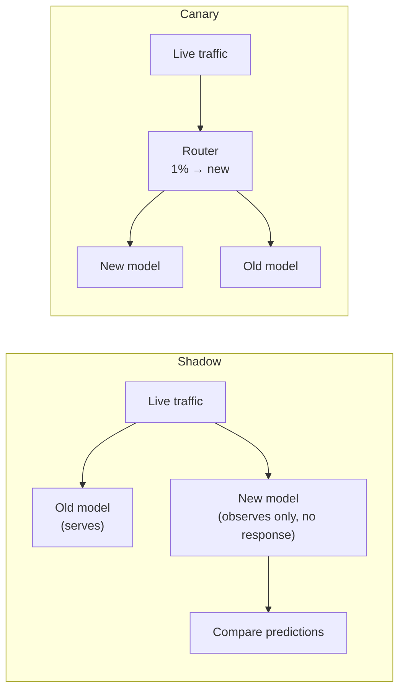

# 20 · Secure AI Deployment and Capstone Projects

<div class="sas-module-card">
  <div class="sas-module-card__head">
    <span class="sas-module-card__kicker">Module 20</span>
    <span class="sas-module-card__level">Level 4 — Professional Practice</span>
    <a class="sas-badge sas-badge--review" href="../../getting-started/how-to-use/#status-badges">In review</a>
  </div>
  <ul class="sas-module-card__facts">
    <li><strong>24 hours</strong>Study time, lab included</li>
    <li><strong>Module 19</strong>Prerequisite</li>
    <li><strong>1 lab</strong>Runs on a laptop CPU</li>
  </ul>
  <div class="sas-module-card__links">
    <a class="sas-chip sas-chip--primary" href="#learning-objectives">Learning outcomes</a>
    <a class="sas-chip" href="../../labs/">Lab</a>
    <a class="sas-chip" href="../../labs/#notebooks">Notebook</a>
    <a class="sas-chip" href="#practical-exercises">Exercises</a>
    <a class="sas-chip" href="#knowledge-check">Knowledge check</a>
    <a class="sas-chip" href="../../quizzes/m20/">Quiz</a>
    <a class="sas-chip" href="../../research/operations/#supply-chain">Supply chain research</a>
  </div>
</div>

<div data-sas-progress></div>

## Introduction

The final module does two things. It closes the technical arc with deployment: the release gate, the patterns that reduce blast radius, rollback, and the CI/CD controls that keep a good model from being shipped badly. Then it hands the work to you, through three capstone briefs that require the whole course at once.

The organising idea is **traceability**. Every control in this course exists because of a threat; every threat has an owner; every release carries evidence that the controls were applied. When that chain holds, you can answer any question an auditor, a customer or your own future self asks. When it breaks, security becomes folklore.

## Learning objectives

By the end of this module you can:

1. Define release-gate criteria with pass thresholds and evidence artefacts.
2. Choose a deployment pattern — shadow, canary, blue/green — for a stated risk.
3. Specify rollback: artefact versioning, criteria, and the mechanics.
4. Harden the serving stack: least privilege, egress, secrets, isolation, timeouts.
5. Build a traceability matrix from threats to controls to tests to evidence.
6. Complete a capstone project meeting the assessment rubric.
7. Present residual risk honestly to a non-technical decision-maker.

## Prerequisites

Modules 01–19. The capstone assumes all of them.

## Detailed explanations

### 20.1 The release gate

A gate is a set of checks that must pass before an artefact can serve traffic. Each check has a threshold, an artefact and an owner.

| Gate | Check | Threshold (example) | Evidence |
|---|---|---|---|
| **Correctness** | Held-out accuracy and per-slice metrics | ≥ baseline − 1 pt; worst slice ≥ 0.80 | Evaluation report with CIs |
| **Robustness** | PGD accuracy at stated $\varepsilon$ | ≥ agreed floor | Robustness report |
| **Privacy** | Membership advantage at 5 % FPR | ≤ 0.05 | MIA report |
| **Fairness** | Disparate impact, TPR gap | DI ≥ 0.8; gap ≤ 0.05 | Fairness report |
| **Security** | Red-team ASR per matrix cell | No confirmed critical; residual documented | Red-team report |
| **Supply chain** | Signature and digest verification | 100 % verified | Verification log |
| **Drift baseline** | Reference distributions stored | Present and versioned | Baseline artefact |
| **Documentation** | Model card and DPIA current | Reviewed within 90 days | Approval record |
| **Rollback** | Previous artefact deployable in < 10 min | Rehearsed | Rollback drill record |

Two rules make gates real: **fail closed** (a missing artefact blocks release rather than being waived silently), and **waivers are recorded with a name and an expiry**. A gate that can be bypassed without a record is decoration.

### 20.2 Deployment patterns



??? note "Diagram description"
    Two side-by-side deployment patterns. In shadow deployment, live traffic goes to the old model which serves responses, while the new model observes the same traffic and produces predictions only for comparison. In canary deployment, a router sends one percent of live traffic to the new model and the rest to the old model.

| Pattern | Use when | Risk | Cost |
|---|---|---|---|
| **Shadow** | You need comparison without user exposure | Shadow sees traffic but its outputs are unused — side effects must be disabled | Double compute |
| **Canary** | Risk is moderate and observable | A fraction of users get the new behaviour | Routing complexity |
| **Blue/green** | You need instant full switch and instant revert | All-or-nothing | Double infrastructure |
| **Feature flag** | Capability-level control (e.g. tools on/off) | Configuration drift | Discipline |

Shadow is the right default for any model whose behaviour matters and whose failure is not immediately visible. The critical detail: **shadow mode must have side effects disabled** — a shadow agent that can send email is not a shadow.

### 20.3 Rollback

Rollback is a product feature, not an emergency procedure. It requires:

- **Immutable, versioned artefacts** (M15), including prompt templates, tool configurations and retrieval indices — not just weights.
- **Traffic-shift mechanics** that work under load and are rehearsed.
- **Data compatibility**: the old model must still be able to read its inputs; schema changes made for the new model must be backward compatible for the rollback window.
- **Criteria**: what triggers rollback (define before launch, not during an incident).
- **A rehearsal record**, dated, with the measured time to restore.

The common failure is prompts-and-config: teams version the model but edit the system prompt in place, so a rollback restores the weights and not the behaviour. Version the prompt with the model, as one artefact.

### 20.4 Hardening the serving stack

| Layer | Controls |
|---|---|
| **Identity** | Workload identity; no static keys in images; short-lived credentials |
| **Network** | Egress allowlist; no inbound except the gateway; private model endpoints |
| **Secrets** | Secret manager with rotation; never in env of a general-purpose container |
| **Isolation** | Per-tenant separation where data sensitivity requires it; sandbox for tool execution |
| **Input limits** | Token caps, body size, timeouts, concurrency limits |
| **Output** | Encoding at sinks; schema validation (M16) |
| **Observability** | Redacted logs, request IDs, model version in every log line |
| **Dependencies** | Pinned images, minimal base, vulnerability scanning, SBOM |

### 20.5 Traceability: the artefact that proves the programme

A traceability matrix has one row per threat:

| Threat | Control | Test | Evidence | Owner |
|---|---|---|---|---|
| Indirect injection via retrieved doc | Untrusted-content delimiting; no tools from context | Corpus replay, 20 trials | Red-team report §4 | ML eng |
| Poisoned training data | Provenance checks; spectral detection | Injection at $\rho=2\%$ | Data quality report | Data eng |
| Membership leakage | DP-SGD ($\varepsilon=3$) | MIA at 5 % FPR | Privacy report | ML eng |
| Cost exhaustion | Token quotas | Flood test | Load test report | Platform |
| Model theft | Output rounding; quotas | Extraction sweep | Fidelity-vs-queries plot | Product |

This is the single most useful document a security engineer can produce for an AI system, because every question — auditor, customer, incident review, new team member — is answered by one row.

### 20.6 Capstone projects

Three briefs follow. Each requires work across at least six modules, produces artefacts, and is assessed against the rubric in §20.7. Choose one; do not attempt all three.

#### Capstone A — Secure a document assistant (LLM + RAG + agents)

**Scenario.** A university's registry office wants an assistant that answers staff questions from policy documents and can draft (but not send) responses to students.

**Requirements.**
1. Threat model with at least six threats across injection, retrieval, privacy and supply chain.
2. A RAG pipeline with per-role isolation and provenance on every chunk.
3. Injection defences: delimiting, no tools reachable from retrieved content, and a policy gate for the one action (drafting).
4. A red-team report with a test matrix, ≥ 20 trials per covered cell, Wilson intervals.
5. Monitoring plan: drift on retrieval scores, injection signatures, cost.
6. Model card, DPIA outline and a residual-risk statement for a non-technical reader.

**Deliverables.** Architecture diagram, code repository, threat model, red-team report, monitoring plan, governance pack, 10-minute presentation.

#### Capstone B — Harden a clinical prediction service (classical ML)

**Scenario.** A hospital pilots a readmission-risk model. It must demonstrate robustness, privacy and fairness before go-live.

**Requirements.**
1. Baseline model with per-slice evaluation and confidence intervals.
2. Evasion testing (PGD at stated $\varepsilon$) and adversarial training, with the accuracy–robustness trade reported.
3. Membership inference measurement, then DP-SGD at a stated $\varepsilon$, with the utility cost quantified.
4. Fairness analysis across at least two protected attributes, with an explicit metric choice and documented justification.
5. Release gate with nine checks and evidence artefacts.
6. Deployment plan: shadow → canary → full, with rollback criteria and a rehearsal record.

**Deliverables.** Evaluation report set, gate specification, deployment runbook, governance pack, presentation.

#### Capstone C — Defend a fraud-scoring API (API + privacy + extraction)

**Scenario.** A fintech exposes a fraud score to partner banks. A partner is suspected of extraction.

**Requirements.**
1. API threat model mapped to the OWASP API Top 10.
2. AuthN/AuthZ design with server-derived tenancy; quotas in tokens and requests with a computed worst-case cost bound.
3. Extraction measurement: fidelity versus query budget, with and without output rounding.
4. Watermarking design with a detection test and a statement of its evidentiary limits.
5. Detection rules for extraction and probing, with alert precision calculated at a stated base rate.
6. Incident runbook for a confirmed extraction, including containment and customer communication.

**Deliverables.** API design, measurements, detection rules, runbook, governance pack, presentation.

### 20.7 Assessment rubric

| Criterion | Weight | Excellent (4) | Adequate (2) | Insufficient (0) |
|---|---|---|---|---|
| **Threat modelling** | 15 % | Complete, prioritised, tied to architecture | Present but generic | Missing or decorative |
| **Technical depth** | 20 % | Correct implementations, equations explained, parameters justified | Works but unjustified choices | Superficial or incorrect |
| **Measurement** | 20 % | Rates with CIs, baselines, ablations | Point estimates only | No measurement |
| **Defence design** | 15 % | Layered, capability-limiting, limitations stated | Single-layer | Relies on prompting the model to behave |
| **Residual risk** | 10 % | Explicit, quantified, owned | Vague statement | Absent |
| **Governance artefacts** | 10 % | Model card, DPIA, traceability matrix complete | Partial | Absent |
| **Communication** | 10 % | Clear to a non-technical decision-maker | Understandable with effort | Jargon or overclaiming |

A pass requires ≥ 2 on every criterion and ≥ 60 % overall. The two criteria students most often lose marks on are measurement (point estimates without intervals) and residual risk (claiming a system is secure).

## Key terminology

| Term | Definition |
|---|---|
| **Release gate** | Automated and manual checks required before serving |
| **Fail closed** | Blocking release when evidence is missing |
| **Waiver** | A recorded, time-limited exception with an owner |
| **Shadow deployment** | New model observes live traffic without serving |
| **Canary release** | A small traffic fraction routed to the new model |
| **Blue/green** | Two full environments with instant traffic switching |
| **Rollback** | Restoring the previous artefact and configuration |
| **Traceability matrix** | Threats → controls → tests → evidence → owners |
| **Blast radius** | Scope of harm from a failure |
| **Residual risk statement** | What remains possible after controls, stated honestly |

## Mathematical foundations

### Gate decision as a conjunction of tests

If a gate has $k$ independent checks, each passing with probability $q_i$, the probability that a release passes without any failure is $\prod_i q_i$. With nine checks at $q = 0.9$ each, only 39 % of releases pass first time — which is why gates must be automated and fast, and why thresholds are set so that a good model passes comfortably rather than marginally.

### Expected harm and the value of a canary

If a defective model causes harm at rate $h$ per user-day, a canary exposing fraction $f$ of traffic for $d$ days limits exposure to roughly $f \cdot h \cdot d$. At $f = 0.01$ and $d = 3$, exposure is 3 % of a user-day's harm — small enough that canary exposure is almost always cheaper than a full-release failure.

### Cost bound reminder

From Module 16: worst-case spend is $N Q \cdot c$ for $N$ identities, quota $Q$ and per-request cost $c$. Deployment approval should include this number, because it is the bound on a cost-exhaustion incident.

## Step-by-step: take a model to production

1. **Assemble the artefact**: weights, prompt templates, tool config, retrieval index, all versioned and signed.
2. **Run the gate** and collect every evidence artefact; fail closed on anything missing.
3. **Record the risk acceptance**: residual risk, owner, expiry.
4. **Deploy to shadow** with side effects disabled; compare predictions for an agreed period.
5. **Canary at 1 %**, watching error rate, cost, drift and security signals; define promotion criteria in advance.
6. **Ramp** in steps, each with a bake time and a named decision-maker.
7. **Rehearse rollback** during the ramp, not after launch.
8. **Hand over**: runbooks, alert ownership, review cadence, retirement criteria.
9. **Update the traceability matrix** with what you learned; it is a living document.

## Real-world scenarios

**Healthcare.** A readmission model passes the gate at the second attempt: the fairness check fails first because the TPR gap across age bands is 0.09. The team retrains with age-stratified sampling, re-measures (gap 0.03), and records the trade-off in the model card. Shadow mode runs for four weeks because outcome labels are slow; the canary is at 5 % for two weeks with a clinician review threshold.

**Financial fraud.** A fraud model's new version is deployed by feature flag, with tool-like capabilities (auto-blocking) kept off until the canary shows no increase in false declines. Rollback is a flag flip, rehearsed monthly.

**University systems.** A student-facing assistant ships with the drafting capability disabled; it can only quote policy with citations. The capability is enabled later, after the red-team report shows the policy gate holds, and the release record names the person who approved the change.

**Autonomous systems.** A perception update is deployed to a small vehicle fleet with a hard operational limit (speed, geofence) during the canary, and a stop condition tied to any safety-relevant disengagement.

## Python walkthrough

A release-gate evaluator: it reads a set of evidence artefacts, applies thresholds, fails closed on anything missing, and prints a go/no-go decision with the reasons — the code behind §20.1.

```python
from dataclasses import dataclass

@dataclass
class Check:
    name: str
    present: bool
    value: float | None
    threshold: float | None
    comparison: str        # ">=", "<=", or "==" for presence-only checks

evidence = [
    Check("held-out accuracy",      True,  0.884, 0.870, ">="),
    Check("worst-slice accuracy",   True,  0.812, 0.800, ">="),
    Check("PGD robust accuracy",    True,  0.746, 0.700, ">="),
    Check("membership advantage",   True,  0.031, 0.050, "<="),
    Check("disparate impact ratio", True,  0.842, 0.800, ">="),
    Check("critical red-team findings", True, 0.0, 0.0, "=="),
    Check("artefact signature",     True,  1.0,   1.0,   "=="),
    Check("fairness report",        False, None,  None,  "present"),
    Check("rollback drill (days)",  True,  12.0,  90.0,  "<="),
]

def evaluate(checks: list[Check]) -> tuple[bool, list[str]]:
    reasons, ok_all = [], True
    for c in checks:
        if not c.present:
            ok_all = False
            reasons.append(f"BLOCK  {c.name}: evidence missing (fail closed)")
            continue
        if c.comparison == "present":
            reasons.append(f"PASS   {c.name}: present")
            continue
        passed = {
            ">=": c.value >= c.threshold,
            "<=": c.value <= c.threshold,
            "==": c.value == c.threshold,
        }[c.comparison]
        if passed:
            reasons.append(f"PASS   {c.name}: {c.value} {c.comparison} {c.threshold}")
        else:
            ok_all = False
            reasons.append(f"BLOCK  {c.name}: {c.value} fails {c.comparison} {c.threshold}")
    return ok_all, reasons

ok, report = evaluate(evidence)
print("\n".join(report))
print("\nRELEASE DECISION:", "GO" if ok else "NO-GO (waiver required, with owner and expiry)")

blocked = [r for r in report if r.startswith("BLOCK")]
print(f"blocking items: {len(blocked)} of {len(evidence)}")
```

The output is deliberately unsatisfying: eight of nine checks pass and the decision is still **NO-GO**, because the fairness report is missing. That is fail-closed behaviour, and it is the point.

A gate that lets a release through because "everything else passed" is not a gate. The remediation is a recorded waiver — a name, a reason, an expiry — which converts an invisible risk into a tracked one.

## Security implications

- **Gates fail closed, or they are decoration.**
- **Rollback must include prompts, tools and indices**, not only weights.
- **Shadow mode without disabled side effects is a live deployment.**
- **Traceability is the difference between a programme and folklore.**
- **Every deployment needs a stated cost bound and a residual-risk statement.**
- **Promotion decisions need names**, because unnamed decisions have no owner when they go wrong.

## Detection and mitigation

| Deployment risk | Preventive | Detective |
|---|---|---|
| Bad model reaching users | Gate; shadow; canary | Canary metrics; complaint monitoring |
| Irreversible change | Rehearsed rollback; feature flags | Rollback time recorded per drill |
| Credential exposure in serving | Workload identity; secret manager | Secret scanning; anomalous access |
| Cost surprise | Token quotas; cost bound in approval | Spend alerts; per-identity anomalies |
| Config drift | Artefacts versioned together | Deployment diffing; prompt hash in logs |
| Unmanaged update | Signed artefacts; pinned digests | Verification at load; MLBOM query |

## Practical exercises

**Recall.**
1. Why must a gate fail closed, and what makes a waiver acceptable?
2. What must be versioned for a rollback to actually restore behaviour?
3. Distinguish shadow, canary and blue/green by risk profile.

**Apply.**
4. Run the gate evaluator with all checks present and confirm GO; then lower PGD accuracy below threshold and confirm the specific block message.
5. Compute the gate pass probability for nine checks at 0.95 each, and explain the implication for automation.
6. Write the rollback criteria for a clinical model: the metrics, thresholds and decision-maker.

**Extend.**
7. Complete one capstone brief end to end and self-assess against the rubric.
8. Write the residual-risk statement for your capstone in language a hospital board or a bank's risk committee would accept — no adjectives without a number.

## Knowledge check

??? question "1. Why is a missing evidence artefact a blocking condition rather than a warning?"
    Because the control cannot be verified without it; allowing release converts an unverified claim into a production risk with no record of who accepted it.

??? question "2. What makes rollback unreliable in practice?"
    Versioning weights but not prompts, tool configurations and retrieval indices, so restoring the model does not restore the behaviour.

??? question "3. Why must shadow deployments disable side effects?"
    Because the shadow model processes live inputs; any tool or write it invokes has real effects even though its outputs are not served.

??? question "4. What does the traceability matrix answer that a threat model does not?"
    It links each threat to the control, the test that verifies the control, the evidence produced and the owner — making verification auditable rather than asserted.

??? question "5. Why does a canary reduce expected harm even if the new model is defective?"
    Because exposure is limited to a small traffic fraction for a bounded period, so harm accrues at that fraction while detection signals accumulate.

## Frameworks, research and cases

- **Frameworks:** [SSDF](../frameworks/ssdlc.md) · [ISO/IEC 5338](../frameworks/iso.md)
- **Research:** [Supply chain](../research/operations.md#supply-chain)
- **Cases:** [C08 · DeepSeek](../case-studies/c08-deepseek-database.md) · [C09 · Amazon Q](../case-studies/c09-amazon-q-supply-chain.md)

## Summary

Deployment is where every control either holds or becomes a claim. The release gate turns evidence into a decision, with explicit thresholds, fail-closed behaviour and recorded waivers. Shadow, canary and blue/green patterns bound blast radius, and rollback is reliable only when weights, prompts, tools and indices are versioned together.

The traceability matrix is the artefact that makes the whole programme auditable: threat, control, test, evidence, owner — one row each.

The capstone asks you to do all of it at once, on a scenario that resembles real work, and to present residual risk honestly to someone who will make a decision based on what you say. That last skill is the one employers notice.

<nav class="sas-lesson-nav" aria-label="Module navigation">
  <a class="sas-lesson-nav__link sas-lesson-nav__link--prev" href="../19-governance-and-ethics/">
    <span class="sas-lesson-nav__dir">← Previous module</span>
    <span class="sas-lesson-nav__title">19 · AI Governance, Privacy, Ethics and Compliance</span>
  </a>
  <a class="sas-lesson-nav__link sas-lesson-nav__link--next" href="../../capstone/">
    <span class="sas-lesson-nav__dir">Next step →</span>
    <span class="sas-lesson-nav__title">Capstone · assess a real system</span>
  </a>
</nav>

<p class="sas-related">Related: <a href="../17-red-teaming/">17 · Red Teaming</a> · <a href="../18-monitoring-and-response/">18 · Monitoring and Response</a> · <a href="../../capstone/">Capstone overview</a></p>

## References

1. NIST, *AI RMF 1.0*, NIST AI 100-1, 2023 — MANAGE function and deployment monitoring.
2. NIST, *SP 800-218*, Secure Software Development Framework — CI/CD and release controls.
3. OWASP, *Top 10 for LLM Applications*, 2025 — LLM03 supply chain, LLM10 unbounded consumption.
4. Google, *Site Reliability Engineering*, 2016 — canary releases, rollback and error budgets.
5. Sculley, D. et al., "Hidden Technical Debt in Machine Learning Systems", NeurIPS 2015.
6. ISO/IEC 42001:2023 — AI management systems, operational control clauses.
7. SLSA and OpenSSF model-signing specifications — artefact provenance and verification.
