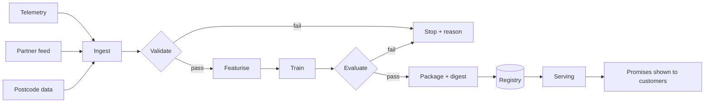

# P1 · End-to-end secure machine learning pipeline

**After:** Modules 05, 07, 15, 20 · **Effort:** 25 h · **Stack:** Python, scikit-learn or PyTorch, SQLite, Docker
(optional), Jupyter
**Deliverable:** A reproducible pipeline whose stages refuse to promote an artefact that fails its gate

## Scenario

A logistics company retrains a delivery-time model nightly on data from three sources: its own telemetry, a
partner's feed and a purchased postcode dataset. The model scores promises shown to customers. A wrong artefact
means late deliveries and compensation payments.

The current pipeline is a notebook that a data scientist runs by hand. There is no record of which data trained
which model, no check on the partner feed, and no way to roll back.

## Objectives

- Build a pipeline with named stages: ingest, validate, featurise, train, evaluate, package, register.
- Make every stage emit **evidence** — a signed file or a database row — and make promotion conditional on it.
- Design the controls so that a compromised input causes a refusal, not a silent degradation.

## What you build

1. **Ingest with provenance.** Each source lands in its own table or directory with a manifest: source, delivery
   time, row count, schema digest. A partner feed missing its manifest is rejected.
2. **Data validation gate.** Schema, ranges, null rates, label distribution against the last accepted run, and a
   duplicate check. Failure stops the pipeline with a reason naming the check and the offending column.
3. **Poisoning-aware training.** At least one integrity signal during training (slice validation against a pinned
   canary set, or a per-source influence check) and a documented response when it fires.
4. **Evaluation gate.** A pinned holdout, a canary slice, and thresholds for overall and slice performance. A model
   that improves overall but degrades the canary slice does not promote.
5. **Artefact packaging and registry.** Weights, preprocessing, manifest with digests, model card, training data
   reference. Promotion writes a registry row: artefact digest, data manifest digest, gate results, approver.
6. **Serving hand-off.** A minimal FastAPI service loading only a registry artefact by digest, with a version
   endpoint and a rollback command that points serving at the previous digest and verifies it.
7. **Runbook.** What to do when each gate fails, who decides, and how to roll back inside the target window.

## Architecture

## Functional requirements

| ID | Requirement |
|---|---|
| F1 | Any stage can be run alone against a stored input, with the same result |
| F2 | Every run writes a record: stage, inputs, outputs, evidence digest, duration, status |
| F3 | A failed gate stops promotion and leaves the previous serving artefact untouched |
| F4 | Serving resolves the artefact by digest, never by a mutable tag |
| F5 | Rollback restores the previous digest and verifies its behaviour on a probe set |

## Security requirements

| ID | Requirement |
|---|---|
| S1 | Partner feed is treated as untrusted: validated before featurisation, with a manifest check |
| S2 | Training jobs run under an identity scoped to their own inputs and output path |
| S3 | No credential in the repository; configuration is read from the environment with documented names |
| S4 | The registry is append-only; a promoted artefact cannot be edited, only superseded |
| S5 | Serving logs principal, model digest, decision and latency; never the raw input |
| S6 | The canary slice is stored with the pipeline and its digest is promoted with the artefact |

## Milestones

| # | Milestone | Hours | Evidence |
|---|---|---|---|
| M1 | Scope and threat model | 4 | Assets: telemetry, partner feed, holdout, registry, promises. Boundaries: partner feed, registry, serving |
| M2 | Skeleton pipeline with a happy path | 7 | All stages run; baseline metrics recorded; no security claims yet |
| M3 | Gates and deny paths | 8 | Tests: schema failure, distribution shift, canary regression, digest mismatch |
| M4 | Adversarial measurement | 4 | Inject 3 % label noise into the partner table; show the gate's response and the model's slice behaviour |
| M5 | Security argument and runbook | 2 | Claim-to-evidence table; runbook per gate; rollback demonstrated |

## Testing methodology

- **Unit:** validators and gates against fixtures, including malformed manifests and empty deliveries.
- **Integration:** one full run from a clean checkout, with the run record inspected.
- **Adversarial:** the label-noise injection, plus a substituted artefact whose digest does not match the registry.
- **Recovery:** promote, then roll back; assert that serving returns the previous digest and passes the probe set.

## Deliverables

| Item | Format | Notes |
|---|---|---|
| Pipeline | Python package + CLI | One command per stage, one for the whole run |
| Registry | SQLite | Query shows artefact → data → gates → approver |
| Tests | `pytest` | At least fifteen, six of them negative |
| Run record | Markdown or JSON | One per run, archived |
| Security argument | 2 pages | Claims mapped to evidence, weakest assumption named |
| Runbook | 1 page | One entry per gate |

## Expected results

A clean run promotes an artefact and records four gate results. A 3 % label-noise injection should be visible in
the label-distribution check, or in a sliced evaluation immediately after training — if neither moves, your
detection is weaker than the threat and you should say so rather than claim success.

## Evaluation metrics

- Gate precision: of the runs refused, how many were genuinely bad? (Construct three bad runs deliberately.)
- Detection latency: how many minutes from injection to refusal?
- Reproducibility: two runs from the same inputs produce the same digest, or the difference is explained.
- Recovery time: minutes from rollback command to verified previous behaviour.

## Rubric

[Major-project rubric](../guidance/rubrics.md#major-project-rubric), with two indicators:

| Indicator | Proficient | Exemplary |
|---|---|---|
| **Gate integrity** | Gates run and can fail | Every gate has a fixture that must fail it, and the pipeline cannot be promoted by skipping a gate |
| **Provenance chain** | Registry records the artefact | Any served prediction can be traced to artefact digest, data manifest and gate results in one query |

## Suggested extensions

1. Add a second model family and make the registry hold both, with a shadow comparison before promotion.
2. Add a data-deletion path: remove a partner's rows and show the next artefact no longer depends on them.
3. Containerise the pipeline with a read-only filesystem and a non-root user; keep all tests passing.

## Boundaries

Use synthetic logistics data. Do not ingest a real partner feed, and do not deploy the service to a public host.
