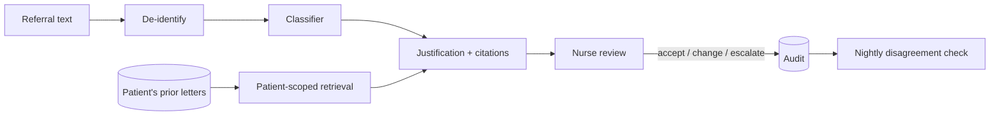

# P2 · Secure healthcare AI application

**After:** Modules 05, 09, 19 · **Effort:** 25 h · **Stack:** FastAPI, scikit-learn, SQLite, Jupyter, Docker optional
**Deliverable:** A working triage-support application with a privacy assessment and an oversight design a clinician would accept

## Scenario

A district hospital wants a tool that reads a referral letter and suggests a triage category (routine, urgent,
two-week) with a short justification. The referral arrives as text from a GP; the hospital holds prior clinic
letters it can retrieve for context. A nurse reviews every suggestion before any appointment is booked.

The trust's data protection officer will approve it only if three things are true: patients cannot be identified
from the model, oversight is real rather than nominal, and a wrong suggestion is detectable after the fact.

## Objectives

- Implement a small, local, CPU-only model that classifies and justifies, with retrieval limited to the patient.
- Measure privacy leakage and reduce it, rather than asserting it.
- Design oversight with the affordances a nurse actually has: time, information and authority.

## What you build

1. **Data layer.** Synthetic referrals with a strict schema, a de-identification pass (names, dates, addresses,
   identifiers removed or generalised), and a k-anonymity or equivalence-class check on quasi-identifiers with a
   stated k.
2. **Classifier.** A scikit-learn pipeline (TF-IDF plus a linear model, or a small fine-tuned transformer if you
   have the hardware) predicting one of three categories, with a calibration check and per-class precision/recall.
3. **Retrieval for context.** Prior letters restricted to the same synthetic patient id; retrieval filters on the
   patient boundary before ranking; a test that proves no other patient's text reaches the prompt.
4. **Justification and citations.** Each suggestion cites the sentence or letter it came from. A suggestion without
   a citation is not shown.
5. **Oversight interface.** A single page listing suggestion, confidence band, citations, and three actions: accept,
   change category (with reason), escalate. Every action is recorded with the reviewer's role.
6. **Privacy assessment.** Membership-inference measurement on the training population, membership advantage at 5 %
   and 1 % FPR, one control measured, and a residual statement.
7. **Audit and post-hoc detection.** A nightly job comparing accepted categories with the model's suggestions and
   flagging systematic disagreement — the signal that the model has drifted or the reviewers are rubber-stamping.

## Architecture

## Functional requirements

| ID | Requirement |
|---|---|
| F1 | Three categories, each suggestion with a citation or suppressed |
| F2 | Confidence shown as a band with the calibration method behind it |
| F3 | Reviewer action recorded with role, timestamp and optional reason |
| F4 | Retrieval returns only the current patient's letters |
| F5 | A referral missing required fields is refused with the field named |

## Security requirements

| ID | Requirement |
|---|---|
| S1 | De-identification runs before any model sees the text, and its output is what is stored |
| S2 | Retrieval filters on patient id before ranking; a missing id fails closed |
| S3 | No patient data in logs; audit rows store ids and decisions only |
| S4 | Model artefacts carry a digest; the serving process loads by digest |
| S5 | Access to the review interface requires a role; reviewers cannot see other clinicians' queues |
| S6 | A documented retention period for audit rows and a deletion path for a patient's letters |

## Milestones

| # | Milestone | Hours | Evidence |
|---|---|---|---|
| M1 | Threat model and DPIA-style assessment | 4 | Assets, boundaries, lawful basis, risks with owners |
| M2 | Data, model and baseline | 7 | Per-class metrics, calibration plot, baseline leakage number |
| M3 | Retrieval isolation and oversight UI | 8 | Cross-patient test failing before the fix, passing after; audit rows for each action |
| M4 | Privacy control measured | 4 | Before/after membership advantage for one control |
| M5 | Post-hoc detection and assurance pack | 2 | Disagreement job output; two-page assurance argument |

## Testing methodology

- **Isolation:** a referral whose text matches another patient's letter; assert the retrieved set contains only the
  current patient's documents.
- **De-identification:** a fixture with names, dates and postcodes; assert none survive, and that the clinical
  content does.
- **Privacy:** membership inference on a fixed split, repeated with the control.
- **Oversight:** simulate fifty reviews with a 20 % change rate and show the disagreement job detects a synthetic
  drift.

## Deliverables

| Item | Format | Notes |
|---|---|---|
| Application | FastAPI + one HTML page | Runs locally with a seeded dataset |
| Model + artefacts | Python package | Digest recorded |
| Privacy assessment | 800 words | Method, numbers, control, residual |
| Oversight design | 300 words | Why a nurse can disagree in the time available |
| Assurance pack | 2 pages | Claims, evidence, weakest assumption |

## Expected results

A calibrated model with per-class recall reported honestly; membership advantage measured and reduced by the
control, with the residual stated. The disagreement job should flag the synthetic drift within one nightly run.

## Evaluation metrics

- Per-class recall on the pinned holdout, with confidence bands from calibration.
- Membership advantage (2·AUC − 1) before and after the control.
- Citation coverage: proportion of suggestions with a valid citation (target 100 %).
- Detection latency of the disagreement job after a synthetic distribution shift.

## Rubric

[Major-project rubric](../guidance/rubrics.md#major-project-rubric), with two indicators:

| Indicator | Proficient | Exemplary |
|---|---|---|
| **Oversight realism** | Review screen with accept/change | Screen shows citations and confidence, and the design explains why a busy nurse can still disagree |
| **Privacy scope** | Leakage measured | Leakage measured at two operating points, one control measured, and the residual names an untested attack |

## Suggested extensions

1. Add a second reviewer role with a different queue and show that separation holds.
2. Add a differentially private training variant and report the utility cost per category.
3. Build the patient-deletion path end to end and measure how long each store takes to comply.

## Boundaries

Synthetic patients only. Do not use, request or reconstruct real clinical records, and do not present the tool as a
medical device or a substitute for clinical judgement.
