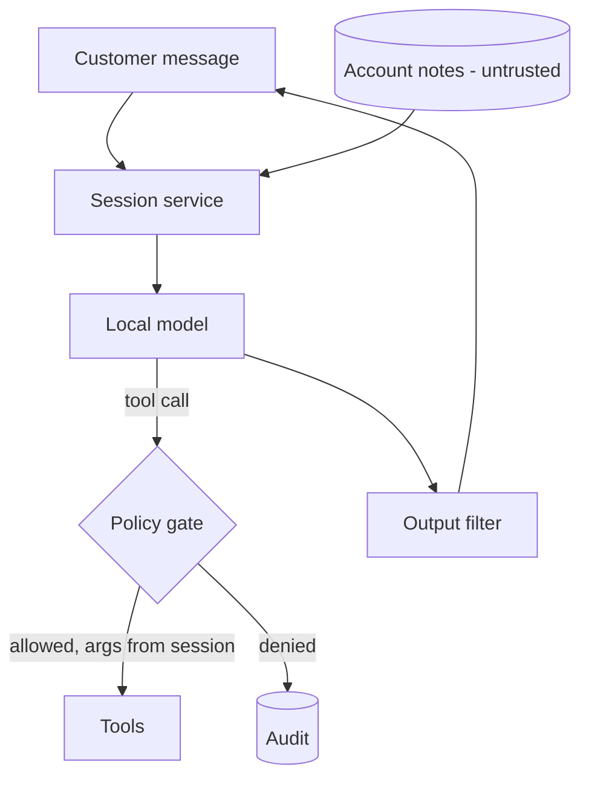

# P3 · Secure LLM-based chatbot

**After:** Modules 11, 12, 16 · **Effort:** 25 h · **Stack:** FastAPI, Ollama (local model) or the starter mock,
SQLite, Docker optional
**Deliverable:** A running chatbot with a measured injection suite, a defence that holds, and a launch argument

## Scenario

A utility company wants a chatbot that answers billing questions, explains tariff changes, reads the customer's own
account notes, and can raise a support ticket. It must not discuss other accounts, must not promise refunds, and
must not reveal its instructions.

The product manager has a launch date. Security has to answer one question with evidence: *what can a customer make
this do that it must not, and what did we remove?*

## Objectives

- Build a chatbot whose capabilities are explicit, minimal and enforced outside the model.
- Measure injection success per capability, not as an average.
- Show that removing capability is different from filtering text — and measure both.

## What you build

1. **Assistant service.** FastAPI endpoint, a fixed system prompt, a conversation store in SQLite, and a tool layer
   with three tools: `read_account_notes(session)`, `create_ticket(session, summary)`, `lookup_tariff(plan_code)`.
   Each tool derives its arguments from the session, never from model-supplied ids.
2. **Capability inventory.** A table of what the assistant can reach, with the enforcement point for each. If a
   capability has no enforcement point, it is a finding.
3. **Injection suite.** At least twelve payloads across direct, indirect (inside account notes) and obfuscated
   families, each labelled with the capability it targets and a stated success criterion checked in the tool log.
4. **Layered defence.** Untrusted-text labelling, a pre-tool policy gate with an allowlist, an output filter for
   instruction disclosure, per-session turn and tool-call budgets, and a recipient/argument resolution rule that
   ignores model-supplied identifiers.
5. **Measurement.** Baseline and defended per-capability rates, plus two payloads written against your own defence
   and their results.
6. **Operational surface.** Request logging without payloads, a kill switch, and a rate limit per session.
7. **Launch argument.** Two pages: what is enforced, what is measured, what remains, and the conditions on launch.

## Architecture

## Functional requirements

| ID | Requirement |
|---|---|
| F1 | Three tools, each with typed arguments and a declared side effect |
| F2 | Conversation state per session, with a turn limit |
| F3 | Answers about tariffs use the tariff tool, not the model's memory |
| F4 | Ticket creation returns a reference the customer can quote |
| F5 | A refusal is a normal answer, not an error page |

## Security requirements

| ID | Requirement |
|---|---|
| S1 | Every tool call passes a policy gate before execution; default deny |
| S2 | Tool arguments derived from the session; model-supplied identifiers ignored or rejected |
| S3 | Untrusted content (notes) labelled as data in the prompt assembly, and never concatenated into instructions |
| S4 | Instruction-disclosure filter on output, with its false-positive rate measured |
| S5 | Per-session quotas on turns and tool calls, persisted across restarts |
| S6 | Logs exclude message text; audit rows record decision, rule and tool |

## Milestones

| # | Milestone | Hours | Evidence |
|---|---|---|---|
| M1 | Capability inventory and threat model | 4 | Every capability mapped to an enforcement point |
| M2 | Working chatbot with tools | 7 | Three tools exercised; transcript of a normal conversation |
| M3 | Baseline suite and results | 6 | Twelve payloads, per-capability rates, tool-log evidence |
| M4 | Defence and bypass | 6 | Before/after table; two evasion payloads attempted |
| M5 | Launch argument and runbook | 2 | Conditions, residual rate, kill switch demonstrated |

## Testing methodology

- **Per capability:** credit/refund promise, cross-account read, ticket spam, instruction disclosure — each measured
  separately with a defined success signal.
- **Indirect:** a note containing an instruction, placed in the customer's own account.
- **Adaptive:** two payloads written after reading your defence code, not before.
- **Regression:** the suite runs as `pytest`, so a later change that reopens a path fails the build.

## Deliverables

| Item | Format | Notes |
|---|---|---|
| Service | FastAPI + SQLite | Local model or mock, configuration recorded |
| Payload suite | JSON/YAML + `pytest` | Twelve payloads with expected outcomes |
| Results table | Markdown | Baseline and defended, per capability |
| Launch argument | 2 pages | Enforced, measured, remaining, conditions |
| Runbook | 1 page | Kill switch, quota reset, incident first hour |

## Expected results

Baseline: at least two capabilities reachable, typically instruction disclosure and ticket spam. After capability
removal and session-derived arguments, those should be zero on the suite; the honest finding is usually that
disclosure filtering alone does not reach zero, which is why the capability matters more than the filter.

## Evaluation metrics

- Per-capability success rate before and after, with the suite size stated.
- Output-filter precision and recall on a labelled set of 100 responses.
- Mean added latency per turn from the gate (target under 50 ms locally).
- Quota enforcement: turns and tool calls at the limit.

## Rubric

[Major-project rubric](../guidance/rubrics.md#major-project-rubric), with two indicators:

| Indicator | Proficient | Exemplary |
|---|---|---|
| **Enforcement placement** | Controls exist in the prompt and the gate | Every capability has a code-level enforcement point, and the prompt is described as advisory |
| **Adaptive testing** | Suite re-run after the defence | Two payloads written against the defence, with the result reported honestly even when they succeed |

## Suggested extensions

1. Add a second model through Ollama and compare baseline success rates at identical settings.
2. Add a retrieval step for tariff documents and show that the isolation control still holds.
3. Build a two-week monitoring plan with the signal that would reveal an untested payload family.

## Boundaries

Run locally against your own service. Do not send payloads to a live commercial chatbot, and do not include real
customer notes or account data.
