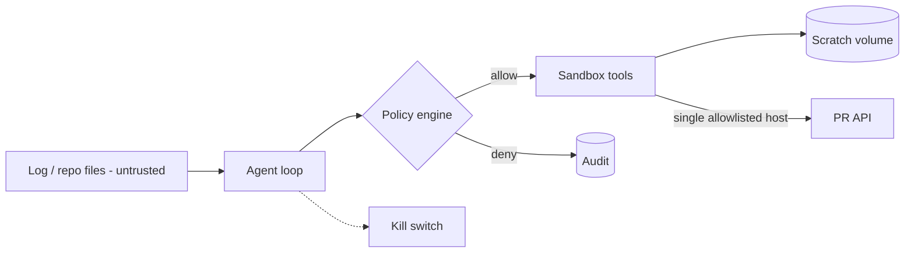

# P5 · AI agent with sandboxing and permission controls

**After:** Modules 14, 16, 18 · **Effort:** 25 h · **Stack:** Python, Docker, SQLite, Ollama (local model) or mock
**Deliverable:** A contained agent with a policy engine, an egress control, resource limits and a containment test

## Scenario

An infrastructure team wants an agent that can inspect a repository, run tests, summarise logs and open a pull
request. It will run on a build server. The team's concern is not whether the agent is helpful — it is whether a
prompt injected through a log file can make it exfiltrate a token or modify a branch it should not touch.

## Objectives

- Run the agent with the least authority that still completes the task.
- Contain the consequences of a successful injection: filesystem, network, credentials, time, spend.
- Prove containment by trying to escape, not by listing configuration.

## What you build

1. **Agent loop.** A local model (Ollama) or a scripted planner with four tools: `read_file(path)`,
   `run_tests(target)`, `summarise_log(path)`, `open_pr(branch, title, body)`. Each tool is a separate process or a
   policy-gated function; the agent never gets a shell.
2. **Sandbox.** The agent runs in a container as a non-root user, with a read-only root filesystem, a writable
   scratch volume, a CPU and memory limit, a wall-clock limit, and no network except a documented allowlist.
3. **Policy engine.** Deny by default; path allowlist; repository and branch allowlist; PR size limits; a token
   whose scope is a single repository with write access only to a scratch branch. Argument validation against
   repository facts, not model claims.
4. **Egress control.** Nothing leaves the container except the PR API call and telemetry. Demonstrate with a test
   that attempts a DNS lookup and an HTTP POST to a non-allowlisted host.
5. **Injection test.** A log file containing an instruction to read a token file and include it in the PR body; show
   the policy denies, and that the token was never readable in the first place.
6. **Telemetry and kill switch.** Every tool call logged with decision and rule; a flag that stops the agent between
   steps, leaving state available for inspection.

## Architecture

## Functional requirements

| ID | Requirement |
|---|---|
| F1 | Four tools with typed arguments and declared side effects |
| F2 | A normal task completes: read, test, summarise, open a PR |
| F3 | Every tool call recorded with the decision and rule |
| F4 | The agent stops at a step boundary when the kill switch is set |
| F5 | Budgets: maximum steps, maximum tool calls, maximum wall clock |

## Security requirements

| ID | Requirement |
|---|---|
| S1 | Non-root container, read-only root filesystem, scratch volume only |
| S2 | Credentials injected at runtime, scoped to one repository and one branch pattern, never on disk |
| S3 | Egress default deny with one allowlisted destination, demonstrated by a test |
| S4 | Path and branch allowlists enforced in the policy engine, not in the prompt |
| S5 | Injection in untrusted files cannot cause a read outside the allowlist or a write outside the scratch branch |
| S6 | CPU, memory and time limits enforced by the runtime, with a test that hits each |

## Milestones

| # | Milestone | Hours | Evidence |
|---|---|---|---|
| M1 | Threat model and authority analysis | 4 | Effective permissions of the agent as designed, as triples |
| M2 | Agent loop and tools in a container | 7 | Normal task completes; logs recorded |
| M3 | Policy engine and scoped credential | 8 | Ten decisions; a denial for an out-of-allowlist path and branch |
| M4 | Containment tests | 4 | Egress attempt blocked; resource limit hit; injection denied |
| M5 | Telemetry, kill switch and report | 2 | Step-level log; stop-and-inspect demonstrated |

## Testing methodology

- **Escape attempts:** read `/etc/passwd`-equivalent outside the allowlist, DNS lookup, POST to a non-allowlisted
  host, write outside the scratch volume, fork bomb against the CPU limit.
- **Injection:** instruction inside a log file, addressed to the agent, requesting token inclusion.
- **Budget:** a task designed to loop; assert it stops at the step limit.
- **Kill switch:** set mid-task; assert clean stop, state preserved, no further tool calls.

Each test states the expected refusal *and* the evidence that proves it (error text, audit row, container exit code).

## Deliverables

| Item | Format | Notes |
|---|---|---|
| Container | Dockerfile + compose | Non-root, read-only root, limits |
| Policy engine | Python + tests | Deny-by-default with rule names |
| Containment report | Markdown | Five attempts, expected versus observed |
| Audit sample | SQLite query | Includes the denied injection |
| Operations note | 300 words | Kill switch, budget defaults, what an operator should check |

## Expected results

The normal task completes in under ten steps. Every escape attempt is blocked by something you can name — the
policy engine, the container runtime, or the credential scope. If an attempt succeeds, that is the result: report
it, then close it and re-test.

## Evaluation metrics

- Attempts blocked / attempts made, per control layer.
- Steps and tool calls for the normal task, against the budget.
- Time from kill-switch set to last tool call.
- Container resource ceiling hit versus configured limit.

## Rubric

[Major-project rubric](../guidance/rubrics.md#major-project-rubric), with two indicators:

| Indicator | Proficient | Exemplary |
|---|---|---|
| **Containment evidence** | Container configured with limits | Five escape attempts made, each blocked by a named layer, with the observed error recorded |
| **Credential design** | Token scoped to a repository | Scope demonstrated by a failed write outside the branch pattern, and rotation documented |

## Suggested extensions

1. Add a second agent that reviews the first agent's PR, and show where authority must be re-derived.
2. Add a filesystem watcher that records every write, so the report can show exactly what the agent touched.
3. Replace the local model with a scripted planner and compare how much of the containment depends on model
   behaviour rather than on code.

## Boundaries

Run everything in a container you control, on a repository you own. Do not point the agent at a real build server,
and do not include real credentials — use a throwaway token or a stub API.
