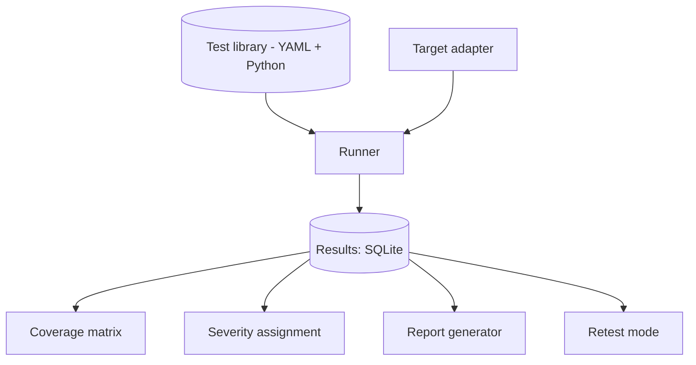

# P6 · AI red teaming and vulnerability assessment framework

**After:** Modules 17, 18 · **Effort:** 25 h · **Stack:** Python, FastAPI (target service), SQLite, Jupyter
**Deliverable:** A framework of test families, a coverage matrix, severity rules and a report that another tester could audit

## Scenario

A consultancy is asked to assess AI systems repeatedly, across clients, with different stacks. Each engagement
currently starts from a blank document. The partner wants a framework: a library of tests by threat family and
component, a coverage matrix, a severity scheme, and a report format that survives scrutiny.

You are building it and proving it on one target: the deliberately imperfect assistant from P3 or the mock in the
starter kit.

## Objectives

- Turn threat families into executable tests with pass/fail criteria.
- Produce coverage you can defend: which cells were tested, by what, and which were not reached.
- Assign severity from impact and exploitability in the target's deployment, with the assumption stated.

## What you build

1. **Test library.** At least fifteen tests across five families: injection, retrieval isolation, tool abuse,
   artefact and supply chain, monitoring and recoverability. Each test declares: id, family, component, payload or
   action, success criterion, evidence captured, and cleanup.
2. **Target adapter.** A thin interface (`send(request) -> response`, `reset()`) so the library runs against the
   mock, P3's chatbot, or a local model with a different prompt, without editing tests.
3. **Runner.** Executes a suite, records results in SQLite, and produces a results table with per-test outcome and
   evidence reference.
4. **Coverage matrix.** Threat family × component, each cell marked tested / out of scope / not reached, with the
   test ids that justify "tested".
5. **Severity scheme.** A published rubric combining impact (what the business loses) and exploitability (access
   needed), with three worked examples from your own results, including one you rated lower than expected.
6. **Report generator.** Findings in a fixed format: title, evidence, impact, reproduction, severity with
   justification, control, owner. Plus a limitations section bounding the assurance claim.
7. **Retest mode.** Given a previous result set, run only the closed findings and report which are genuinely closed.

## Architecture

## Functional requirements

| ID | Requirement |
|---|---|
| F1 | A test is data plus a small function; adding one requires no change to the runner |
| F2 | Every result stores: test id, target version, timestamp, outcome, evidence path |
| F3 | Suite can be filtered by family, component or severity |
| F4 | Report generated from results, not hand-written |
| F5 | Retest mode reports closed / still open / inconclusive |

## Security requirements

| ID | Requirement |
|---|---|
| S1 | Tests run only against an explicitly configured target; a missing target fails closed |
| S2 | Payloads are synthetic and contain no real personal data |
| S3 | The framework refuses destructive tests (availability, data deletion) unless enabled explicitly |
| S4 | Evidence capture is bounded: no exfiltration beyond a canary, no persistence |
| S5 | Results and evidence stored with the target version, so a finding can be tied to a release |

## Milestones

| # | Milestone | Hours | Evidence |
|---|---|---|---|
| M1 | Scope, target description, severity scheme draft | 4 | Threat families and components enumerated |
| M2 | Adapter and runner with five tests | 7 | Five results, one deliberately failing |
| M3 | Full library and coverage matrix | 8 | Fifteen tests; every matrix cell marked |
| M4 | Severity calibration and report | 4 | Three worked severities, one counter-intuitive |
| M5 | Retest mode and limitations | 2 | A finding closed and verified; assurance bound stated |

## Testing methodology

- **Self-test:** run the framework against a target with a known injection and a known isolation bug (the P3 mock or
  the starter service) and confirm it finds both.
- **Negative control:** run against a hardened target and confirm no false findings; report the false-positive rate.
- **Determinism:** run the suite twice at the same target version; results must match or the difference explained.
- **Retest:** fix one finding, re-run retest mode, confirm closed; then revert the fix and confirm it reopens.

## Deliverables

| Item | Format | Notes |
|---|---|---|
| Test library | YAML + Python | Fifteen tests, five families |
| Runner + adapter | Python | SQLite results |
| Coverage matrix | Markdown | Tested / out of scope / not reached |
| Severity scheme | 1 page | Three worked examples |
| Report | Generated Markdown/PDF | Fixed finding format |
| Limitations | 300 words | What the framework cannot assure |

## Expected results

At least two genuine findings on the supplied target, zero false findings on the hardened one, and a coverage matrix
with honest gaps. A framework that reports "no issues" on both targets has not been calibrated; a framework that
finds eleven issues everywhere has a precision problem worth measuring.

## Evaluation metrics

- Findings per target, with severity distribution.
- False-positive rate against the hardened target.
- Coverage: tested cells / total cells, with the untested cells named.
- Retest accuracy: closed / reopened / inconclusive against a known fix state.

## Rubric

[Major-project rubric](../guidance/rubrics.md#major-project-rubric), with two indicators:

| Indicator | Proficient | Exemplary |
|---|---|---|
| **Coverage honesty** | Matrix present | Every cell marked, untested cells named, and the assurance claim bounded by them |
| **Severity calibration** | Findings rated with a scheme | Three worked examples, including one rated lower than a naive reading would suggest, with the reasoning shown |

## Suggested extensions

1. Add a regression suite generated from past findings, and show it failing on a deliberately reintroduced bug.
2. Add a second adapter for an LLM endpoint with a different prompt and measure how much the library's results depend
   on the target's prompt.
3. Add automated evidence capture (request/response pairs with a canary) and measure the storage cost per run.

## Boundaries

Test only the supplied mock or your own service. Do not run the framework against a third-party system, and do not
include payloads that could cause availability loss or data deletion unless the target is yours and disposable.
