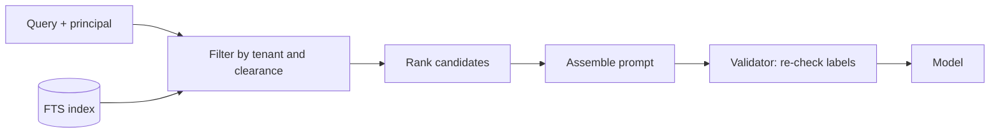

# MP07 · RAG access-control validator

**After:** Module 13 · **Effort:** 10 h · **Stack:** Python, SQLite (FTS5), FastAPI optional
**Deliverable:** A validator with a test suite that asserts absence of foreign content, not presence of expected content

## Scenario

A regional council runs a knowledge assistant over internal policy documents. Three directorates use it: housing,
social care and finance. Some documents are shared; most are not. The index is a single SQLite FTS5 table because
"it is simpler", and the retrieval code applies a filter to the results after ranking.

A councillor has asked, in writing, whether a social-care officer could see a housing document. You are asked to
answer with a test, not an opinion.

## What you build

Start with the **threat model**: who queries, which documents they may reach, and the three ways isolation
fails in practice — filtering after ranking, a cache that ignores the principal, and a chunk with no label. Name all
three before writing the filter.

1. **A two-tenant corpus.** At least 60 short synthetic documents with metadata: `tenant`, `sensitivity`
   (public/internal/restricted), `owner`, and a `doc_id`. Include documents whose text is lexically almost
   identical across tenants, so ranking alone cannot separate them.
2. **Two retrieval paths.** A post-filter pipeline (rank everything, then filter) and a pre-filter pipeline (filter
   candidates before ranking). Both must be runnable against the same corpus.
3. **A leak demonstration.** A query and a prompt assembly that shows foreign text reaching the model's context
   under post-filtering, with the document id and the exact span.
4. **A validator.** `python -m ragcheck --tenant housing` that runs a fixed query set and asserts, for every
   assembled prompt, that no chunk carries a foreign tenant or a sensitivity above the requester's clearance.
   Fail closed: a chunk with a missing label is an error, not a pass.
5. **A deletion path.** Mark a document deleted, and show it disappears from retrieval, from any cache, and from
   the prompt-assembly path, with the lag for each stage stated.

## Suggested architecture

The second check before the model is not redundancy for its own sake: it is the control that catches a filtering
bug upstream.

## Checkpoints

| # | Checkpoint | Hours | Evidence |
|---|---|---|---|
| 1 | Corpus and metadata schema | 2 | 60 documents, labels validated at load |
| 2 | Both pipelines | 3 | Same query, two results, the leak visible under post-filtering |
| 3 | Validator and failure modes | 3 | Ten tests including missing label, unknown tenant, shared document |
| 4 | Deletion path | 1 | Deleted document unreachable; lag stated per stage |
| 5 | Answer to the councillor | 1 | 120 words with the evidence attached |

## Deliverables

| Item | Format | Notes |
|---|---|---|
| Corpus generator | Python, seeded | Reproducible documents and labels |
| Validator | CLI + library | Exit code reflects pass or fail |
| Tests | `pytest` | Ten, at least four of them negative |
| Leak report | Markdown | Query, chunk id, span, and the fix |
| Councillor answer | 120 words | Accurate, no overclaiming |

## Questions you must answer

1. Why is a validator that asserts "expected content is present" weaker than one that asserts "foreign content is
   absent"?
2. A document is shared between two directorates. How does your label model express that without duplicating the
   chunk, and what does duplication cost?
3. Your cache keys on the query text. What must the key include so a second tenant cannot receive a cached answer?

## Rubric

Apply the [shared mini-project rubric](../guidance/rubrics.md#mini-project-rubric), with these two indicators:

| Extra indicator | Proficient | Exemplary |
|---|---|---|
| **Isolation proof** | Pre-filtering prevents the demonstrated leak | Negative tests assert absence across adversarial queries, and missing labels fail closed |
| **Deletion completeness** | Document removed from the index | Removed from index, cache and prompt path, with lag and a verification test |

## Extension challenges

1. Measure retrieval quality with and without filtering on a fixed query set, and report the cost of isolation.
2. Add per-chunk sensitivity and show how results change for one role.
3. Build the ingestion check that would refuse a document whose label contradicts its content.

## Boundaries

Use synthetic documents. Do not ingest real council or client material, and do not attempt to access another
tenant's data outside your own test harness.
