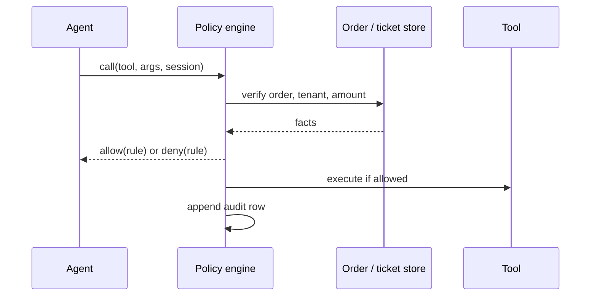

# MP08 · AI agent tool authorisation prototype

**After:** Module 14 · **Effort:** 11 h · **Stack:** Python, SQLite, FastAPI (optional)
**Deliverable:** A deny-by-default policy engine with ten decisions, an audit row each, and a confused-deputy test

## Scenario

An operations team wants an agent that reads tickets, searches a knowledge base, sends email, issues refunds up to
£200 and books on-call slots. It runs as one service account with broad access "so it can recover from unusual
situations".

Finance has approved a pilot. Security has to specify the authorisation model before the agent touches the
production ticketing system.

## What you build

Begin with the **threat model**: the authority the agent is granted, the confused-deputy path that authority
creates, and the actions whose consequences cannot be undone. The policy engine below exists to make that model
enforceable.

1. **A tool layer with five tools**, each a Python function with a typed signature, a declared side effect
   (read / write / external), and a simulated backend (SQLite tables, a fake mail outbox).
2. **An effective-permission analysis** as data: the `(principal, action, resource)` triples the service account
   can reach, printed by a script. Not a paragraph — a table.
3. **A policy engine** that decides before every call: deny by default; tenant and role from the authenticated
   principal; amount caps; recipient allowlist resolved from the session; a per-session budget so repeated small
   refunds cannot exceed the cap.
4. **Parameter validation against authoritative data.** A refund amount must match an order record and respect a
   policy cap; an email recipient must resolve to the session's customer.
5. **Audit.** One row per decision: timestamp, principal, tool, arguments hash, decision, rule name, reason.
6. **A ten-request test set** with at least five denials, including one confused-deputy request where the agent
   uses its own authority for a customer who is not entitled.

## Suggested architecture

## Checkpoints

| # | Checkpoint | Hours | Evidence |
|---|---|---|---|
| 1 | Tools and triple table | 3 | Five tools, printed permission union |
| 2 | Policy engine skeleton | 3 | Deny by default; ten requests, decision and rule printed |
| 3 | Parameter validation and budgets | 3 | Cross-tenant denial; session budget exhaustion |
| 4 | Audit | 1 | Query that reconstructs any decision |
| 5 | Confused-deputy test and note | 1 | The failing path shown, then closed |

## Deliverables

| Item | Format | Notes |
|---|---|---|
| Tool layer | Python | Simulated backends only |
| Permission table | Printed or Markdown | Before and after reduction |
| Policy engine | Python + tests | Ten decisions with rule names |
| Audit sample | SQLite query | Includes a denial and a budget exhaustion |
| Decision note | 250 words | Which capability you removed and why the workflow survived |

## Questions you must answer

1. Your policy caps a single refund at £200. Why is that insufficient without a session budget?
2. The agent's email tool accepts a recipient from the model. What is the smallest change that removes the risk
   without removing the capability?
3. Which of your rules is enforced by the model's cooperation, and which by code? Why does the difference matter in
   an incident report?

## Rubric

Apply the [shared mini-project rubric](../guidance/rubrics.md#mini-project-rubric), with these two indicators:

| Extra indicator | Proficient | Exemplary |
|---|---|---|
| **Authority derivation** | Tenant and role checked | Derived from the principal, re-checked at execution, and the union of permissions computed rather than described |
| **Denial design** | Five requests denied | Each denial names the rule, is audited, and the legitimate workflow is shown to still complete |

## Extension challenges

1. Add an escalation path for an amount above the cap, with the approval artefact recorded in the audit table.
2. Add a second agent that delegates to this one and show where authority must be re-checked rather than inherited.
3. Measure the latency your policy layer adds per call and decide whether it fits a 200 ms budget.

## Boundaries

Everything runs against simulated backends. Do not connect to a real ticketing or payment system, and do not send
real email.
