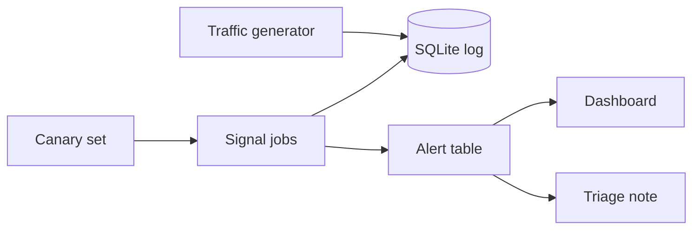

# MP10 · AI security logging and monitoring dashboard

**After:** Module 18 · **Effort:** 12 h · **Stack:** Python, SQLite, FastAPI, HTML/JS (no framework needed)
**Deliverable:** A dashboard with three signals, justified thresholds, and one simulated incident driven from alert to note

## Scenario

A bank has deployed a document assistant for its contact-centre staff. It has been live for three months at 40,000
requests a day. Operations watches uptime, latency and error rate; nobody watches the things that would reveal an
extraction campaign, an injection attempt that worked, or a model that started omitting a required field.

You have one engineer and one quarter. Build the smallest system that would have caught one of those.

## What you build

Begin with the **threat model**: which failures this dashboard is meant to reveal, who acts when it fires, and
what it will not detect. A signal without a named failure is a chart.

1. **A log schema** for AI requests: timestamp, principal, endpoint, model version, prompt token count, output
   token count, a similarity fingerprint of the request, tool calls, decision, latency, and a quality flag from a
   canary check. No raw prompt text.
2. **A synthetic traffic generator** that produces 24 hours of plausible traffic — including a scripted abuse
   campaign you control — so every number in your report is reproducible.
3. **Three signals**, each computed over a window:
   - **Extraction:** per-principal boundary concentration or near-duplicate query rate.
   - **Injection or policy failure:** tool-call denials and canary-set quality failures per hour.
   - **Integrity drift:** change in canary-set output quality against a stored baseline.
4. **Thresholds with base-rate reasoning.** For each signal, the alert volume per week at your chosen threshold,
   computed from the synthetic traffic, and the precision you would expect at an assumed prevalence.
5. **A dashboard** (one HTML page served by FastAPI, refreshed by fetch) showing the three signals, the current
   threshold, and the last ten alerts with their reason.
6. **One exercised incident.** Drive the abuse campaign, let the alert fire, and write the triage note: what fired,
   what you preserved, what you would do next, and what you could not determine.

## Suggested architecture

## Checkpoints

| # | Checkpoint | Hours | Evidence |
|---|---|---|---|
| 1 | Schema and generator | 3 | 24 h of traffic with a labelled abuse window |
| 2 | Three signals | 3 | Each signal plotted over the day; campaign visible in at least one |
| 3 | Thresholds and volumes | 2 | Expected alerts per week per signal; one signal rejected for noise |
| 4 | Dashboard | 2 | Page served locally; alerts listed with reasons |
| 5 | Incident exercise | 2 | Triage note with evidence steps and unknowns |

## Deliverables

| Item | Format | Notes |
|---|---|---|
| Generator | Python, seeded | Campaign window and principal recorded |
| Signals | Python + SQL | Reproducible from the log alone |
| Dashboard | FastAPI + HTML | No external CDN required |
| Threshold note | Markdown | Base rate, volume, decision per signal |
| Triage note | 400 words | Fired, preserved, next, unknown |

## Questions you must answer

1. One of your signals should be rejected. Which, and what evidence made you reject it?
2. Your alert volume at the chosen threshold is nine per week. Is that operable for one engineer, and what would you
   change if it were ninety?
3. Which attack would your dashboard not detect at all? State it plainly, and say what you would add next quarter.

## Rubric

Apply the [shared mini-project rubric](../guidance/rubrics.md#mini-project-rubric), with these two indicators:

| Extra indicator | Proficient | Exemplary |
|---|---|---|
| **Threshold justification** | Threshold chosen with a reason | Expected alert volume computed from traffic, and precision estimated at a stated prevalence |
| **Operability** | Dashboard shows signals | Dashboard shows signals, thresholds and alert reasons, and the triage note could be followed by someone else |

## Extension challenges

1. Add a canary set of documents and questions that runs hourly and reports drift with a confidence band.
2. Make one alert route to a webhook and show the payload an on-call engineer would receive.
3. Write the one-page proposal for a second engineer, using your measured alert volume and false-positive rate.

## Boundaries

Synthetic traffic only. Do not instrument a real service, and do not include customer data in logs or screenshots.
