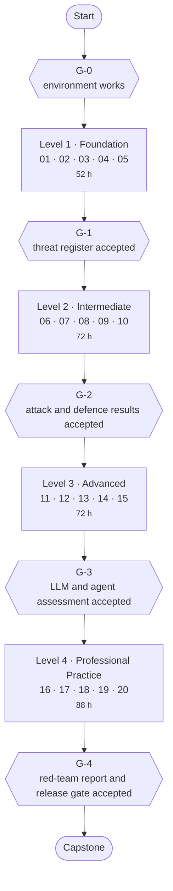

# Learning Roadmap

The whole course on one page: what to study, in what order, how long it takes, and what you should be able to do before moving on.

## Your progress

<noscript>

Progress tracking needs JavaScript. The tables below list every module, so you can follow the pathway without it.

</noscript>

## The pathway

??? note "Diagram description"
    A top-down flow. Start passes through gate G-0 (environment works) into Level 1 Foundation, modules 01–05, 52 hours. Gate G-1 requires an accepted threat register, then Level 2 Intermediate, modules 06–10, 72 hours. Gate G-2 requires accepted attack and defence results, then Level 3 Advanced, modules 11–15, 72 hours. Gate G-3 requires an accepted LLM and agent assessment, then Level 4 Professional Practice, modules 16–20, 88 hours. Gate G-4 requires an accepted red-team report and release gate, and the capstone comes last.

## Level 1 — Foundation

*52 hours · 5 modules*

Builds the vocabulary and the systems view. No security background is assumed, and nothing later works without it.

| # | Module | Hours | Focus |
|---|---|---|---|
| 01 | [Introduction to Securing AI Systems](modules/01-introduction.md) | 8 | Assets, actors, trust boundaries, the four-level map |
| 02 | [Fundamentals of AI, ML and Deep Learning Security](modules/02-ml-security-fundamentals.md) | 10 | Training, artefacts, generalisation, why learned systems fail differently |
| 03 | [Cybersecurity Fundamentals for AI Systems](modules/03-cybersecurity-fundamentals.md) | 10 | Identity, access control, cryptography, defence in depth |
| 04 | [AI Threat Modeling and Risk Assessment](modules/04-threat-modeling.md) | 12 | STRIDE for ML, ATLAS, attack trees, severity scoring |
| 05 | [Secure Data Management and Dataset Protection](modules/05-secure-data-management.md) | 12 | Classification, minimisation, de-identification, lineage |

**Checkpoint G-1:** a threat register and data-protection note for a supplied system, accepted against the rubric, with 70 % on the Module 04 knowledge check.

## Level 2 — Intermediate

*72 hours · 5 modules*

The technical heart of the course. Attacks are implemented and measured; defences are evaluated against an adversary who has read the same paper you did.

| # | Module | Hours | Focus |
|---|---|---|---|
| 06 | [Adversarial Machine Learning](modules/06-adversarial-ml.md) | 14 | Four attack families, three adversary models, the optimisation view |
| 07 | [Data Poisoning and Backdoor Attacks](modules/07-data-poisoning.md) | 16 | Availability, targeted and clean-label poisoning; triggers and detection |
| 08 | [Model Evasion and Robustness](modules/08-evasion-and-robustness.md) | 16 | PGD, margin attacks, adversarial training, certified robustness |
| 09 | [Model Privacy](modules/09-model-privacy.md) | 14 | Membership inference, inversion, DP-SGD, privacy accounting |
| 10 | [Model Extraction and IP Protection](modules/10-model-extraction.md) | 12 | Query-based extraction, fidelity, quotas, watermarks |

**Checkpoint G-2:** attack-and-defence results accepted — an attack you implemented, a defence you trained, and an adaptive attack against your own defence. **G-3:** privacy and extraction measurements accepted, reported as advantage and fidelity with intervals.

## Level 3 — Advanced

*72 hours · 5 modules*

The part that dates fastest, and the part you will meet most often in practice.

| # | Module | Hours | Focus |
|---|---|---|---|
| 11 | [Fundamentals of LLM Security](modules/11-llm-security.md) | 12 | Tokens, attention, the shared context, roles, decoding |
| 12 | [Prompt Injection and Jailbreak Attacks](modules/12-prompt-injection.md) | 16 | Direct and indirect injection, jailbreaks, layered defence |
| 13 | [RAG Security and Knowledge Base Protection](modules/13-rag-security.md) | 14 | Ingestion poisoning, tenant isolation, grounding |
| 14 | [AI Agent Security and Tool Abuse](modules/14-agent-security.md) | 16 | Excessive agency, confused deputies, policy gates, sandboxing |
| 15 | [Secure Fine-Tuning and Model Supply Chain](modules/15-fine-tuning-supply-chain.md) | 14 | Unsafe formats, adapters, provenance, signing, MLBOM |

**Checkpoint G-3 (continued):** an LLM and agent security assessment with a filled test matrix, residual risk, and at least one control demonstrated in code.

## Level 4 — Professional Practice

*88 hours · 5 modules*

What happens when the system is real: hardened interfaces, authorised testing, operations, governance and deployment.

| # | Module | Hours | Focus |
|---|---|---|---|
| 16 | [Secure AI APIs and Application Development](modules/16-secure-ai-apis.md) | 16 | AuthN/AuthZ, quotas, validation, output handling, cost bounds |
| 17 | [AI Red Teaming and Security Testing](modules/17-red-teaming.md) | 16 | Scope, test matrices, corpora, confidence intervals, reporting |
| 18 | [AI System Monitoring, Incident Response and Recovery](modules/18-monitoring-and-response.md) | 16 | Drift and attack detection, alerting, incident lifecycle |
| 19 | [AI Governance, Privacy, Ethics and Compliance](modules/19-governance-and-ethics.md) | 16 | NIST AI RMF, risk tiers, DPIA, fairness, model cards |
| 20 | [Secure AI Deployment and Capstone Projects](modules/20-deployment-and-capstone.md) | 24 | Release gates, canary deployment, rollback, traceability, capstone |

**Checkpoint G-4:** a red-team report and a release-gate specification accepted, including a residual-risk statement written for a non-technical reader.

## Capstone

*60 hours*

Assess a complete system end to end: threat model, testing under a written scope, findings, remediation, and an assurance pack. Module 20 contains three capstone briefs — a document assistant, a clinical prediction service and a fraud-scoring API — plus the assessment rubric. The [capstone page](capstone/index.md) states the milestones and the defence format.

## Time estimates

| Route | Hours | Fits |
|---|---|---|
| Full pathway (modules, projects, capstone) | ≈ 458 | Two semesters at ~15 h/week |
| Condensed track (8 modules + capstone-lite) | ≈ 135 | One semester at ~10 h/week |
| Red teamer track (01–03, 06–08, 11–14, 17 + capstone) | ≈ 208 | After Level 0 prerequisites |
| Security engineer track (01–05, 15, 16, 18, 19 + capstone) | ≈ 174 | After Level 0 prerequisites |
| Governance track (01–05, 19, 20 + capstone-lite) | ≈ 132 | For policy and assurance roles |

[Compare the study plans →](getting-started/study-plans.md)

## If you are short on time

Three cuts that lose the least:

1. **Keep Level 2 intact, especially the measurement habit.** Rates, intervals and baselines are the transferable skill; a course without them teaches vocabulary only.
2. **Skim Level 3's attack detail, but read Modules 12 and 14 properly.** Injection and agent scope are what most organisations actually get wrong.
3. **Shrink the capstone's scope, never its rigour.** A small system assessed honestly beats a large one assessed superficially.

## What "done" looks like

You have finished the course when you can do these five things without notes:

- Draw the trust boundaries of an unfamiliar AI system and name where you would attack it.
- Explain why a defence that works against your own attack may still fail against a better one.
- Decide whether a model artefact is safe to load, and say what evidence you would need.
- Describe an agent's effective permissions, and reduce them.
- Write a release decision that a product engineer can act on without asking you a question.
